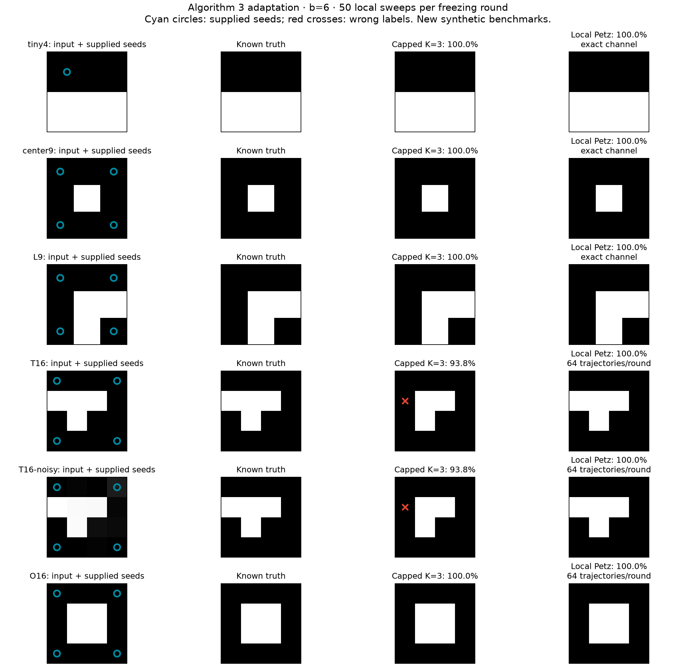
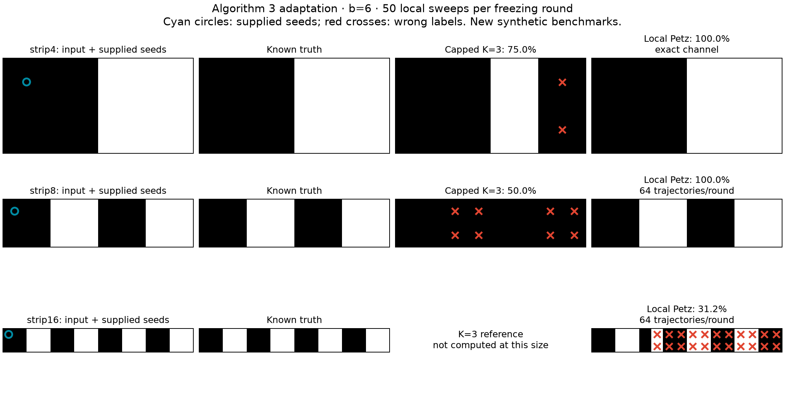
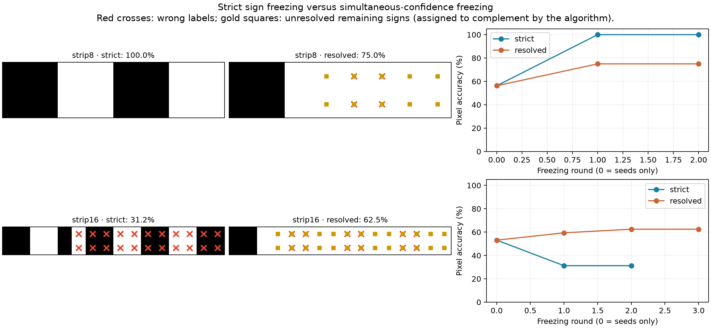

# Algorithm 3 with local nearest-neighbor Petz recovery

This is an explicitly modified implementation of the magnetization/freezing
Algorithm 3 (`a:modified2`) in `Quantum_paper/MainV2.tex`, lines 421–460.
It retains the iterative external-field update and replaces the globally
capped Gibbs state by the existing nearest-neighbor Petz channel. The user
approved retaining K=3 as a small-system reference, rather than enforcing
a global particle cap in the local circuit.

The initial experiments succeed on small images and several 4x4 shapes,
but do **not** establish reliable segmentation at the longest tested
separation. The strict sign rule can freeze uncertain magnetizations into
irreversible wrong labels. All results are ideal classical simulations;
no quantum hardware was used.

The follow-up [beta/kappa sweep](algorithm3-parameter-sweep.md) varies both
parameters and repeats candidate settings and the baseline with independent
random seeds. The accuracy values below describe the original single runs;
they should not be interpreted as parameter-level success probabilities.

## Resolving the manuscript specification

The manuscript describes down-spin corner seeds, subsequently writes their
magnetization as +1/2, and freezes negative magnetizations. The displayed
pseudocode also unions the new frozen pixels with the active set, assigns
magnetizations on an empty set difference, and assigns the remaining active
set to the corner segment. These statements cannot all hold together.
The original generating code is not available here, so these tests are not
a reproduction of its implementation or its figures.

We use the following sign-consistent interpretation of the surrounding
freezing procedure:

1. Supplied seeds belong to one known segment and have frozen magnetization
   -1/2, consistent with the paper's down-spin language and Z convention.
2. The active set is the complement of the accumulated frozen set.
3. Prepare a fresh all-+x state of the active spins and apply a specified
   number of local Petz sweeps (50 in the main experiment).
4. Compute or measure m_i = <Z_i>/2. Simultaneously freeze the selected
   negative-magnetization pixels and retain their measured magnetizations.
5. Add these pixels to the **previous frozen set**, rebuild the fields,
   and repeat until no further pixels freeze.
6. The frozen set, including the supplied seeds, is the seed's segment;
   its complement is the other segment.

All seed labels are supplied before inference. Ground truth is used only
to score the results. On the alternating strips, the left and right corners
have opposite colors, so we use one top-left seed rather than assigning
all four corners to the same class. The square shape examples use four
same-class corner seeds. The global spin sign is fixed, not selected after
examining accuracy. A numerical tolerance of 1e-10 excludes roundoff-sized
negative values from the strict m<0 decision.

## Active Hamiltonian and local circuit

Original row-major pixel order, unique nearest-neighbor edges, sample
contrast standard deviation, kappa=2, and Sz=Z/2 are preserved. Neither
sigma nor the temperature normalization is recomputed when pixels freeze.
Throughout a run, b=beta_paper/N_original=6.

For active pixels A and frozen magnetizations m_tilde_j:

\[
H_A=-\frac14\sum_{\{i,j\}\subset A}
(X_iX_j+Y_iY_j+\Delta_{ij}Z_iZ_j)
-\frac12\sum_{i\in A}h_i Z_i,
\qquad h_i=\sum_{j\notin A:\,j\sim i}\Delta_{ij}\widetilde m_j.
\]

We omit the frozen–frozen scalar energy, which does not change the normalized
state. Recorded magnetizations are not rounded to +/-1/2. A frozen pixel
is a classical contribution to h, not a quantum spin that continues to
interact through XX or YY.

For each active center i, the recovery patch contains i and its active
nearest neighbors. Its Hamiltonian contains every active edge inside the
patch and the fields h_j on its sites, including fields from frozen
neighbors outside the patch. The patch has at most five spins. The original
five-color schedule is retained using physical image coordinates.

The patch Gibbs state defines the same four-Kraus Petz erasure/recovery
channel used in `local-petz.md`. Full-image Gibbs preservation is not
assumed. There is no global K restriction in this channel.

`preparation_circuit` constructs an executable Qiskit circuit for each
classically selected round. It prepares +x, performs the sweeps with locally
routed elementary gates and reset ancillas, and measures Z. The classical
controller computes magnetizations, freezes pixels, and chooses the next
round's circuit. `segment(..., backend="counts", count_provider=...)` is
the interface for feeding circuit measurement counts into that controller.
The supplied runner's counts backend simulates ideal shots from exact
density matrices; it does not submit jobs to a device.

After compaction, active tensor index i corresponds to original pixel
`model.active[i]` and Qiskit qubit `N_active-1-i`. Its reset ancilla is
`2*N_active-1-i`. All routed two-qubit gates still use original image
nearest-neighbor edges or the attached ancilla edge. Removing spins does
not introduce long physical connections between compact register indices.

QPY exports contain the full round, including preparation and measurement.
They reuse a composite sweep instruction whose definition contains all
elementary gates. A composite instruction is not counted as one physical
gate. Compressed QASM files contain one elementary sweep body, without
initial preparation or final measurement. Manifests record the repetition
count, original pixel mapping, elementary operations, and verification.
Saved rounds follow the recorded simulated freezing history. When running
new measurements, the controller must rebuild subsequent rounds from those
new results rather than blindly replaying the saved history.

## Executed segmentation results

These are new synthetic examples, not the paper's unavailable test dataset.
All runs below use b=6, kappa=2, and 50 local sweeps per freezing round.
The larger tests use 64 independent MPS Kraus trajectories per round with
bond dimension 32. New random streams are used after each freezing round.
Each MPS sample supplies exact expectations within that trajectory, without
additional finite-shot Z noise.

| Example | Pixels / supplied seeds | Local Petz, strict rule | K=3 reference |
| --- | ---: | ---: | ---: |
| Two horizontal colors, 2x2 | 4 / 1 | 100% (exact channel) | 100% |
| Alternating strip, 2x4 | 8 / 1 | 100% (exact channel) | 75% |
| Single white center, 3x3 | 9 / 4 | 100% (exact channel) | 100% |
| L shape, 3x3 | 9 / 4 | 100% (exact channel) | 100% |
| T shape, 4x4 | 16 / 4 | 100% (sampled) | 93.75% |
| T shape with Gaussian intensity noise, 4x4 | 16 / 4 | 100% (sampled) | 93.75% |
| O shape, 4x4 | 16 / 4 | 100% (sampled) | 100% |
| Alternating strip, 2x8 | 16 / 1 | 100% (sampled) | 50% |
| Alternating strip, 2x16 | 32 / 1 | **31.25% (sampled)** | Not computed |

The noisy example adds Gaussian noise with standard deviation 20 in the
0–255 intensity scale, clips to that range, and uses dataset seed 2026.
The four exact small examples also give 100% accuracy at 5 and 20 sweeps
per round. All four give 100% with 8,192 ideal independent Z shots per
round and the simultaneous-confidence freezing rule below.





The K=3 reference includes every sector from zero through K up-spins and
weights them thermally. It uses the same fields and freezing convention.
Increasing K to 4 fixes the 2x4 strip and both T examples. This illustrates
sensitivity to the original cap; it is not evidence that the capped and
local-Petz states coincide. For the 2x8 strip, K=3 freezes all pixels and
misses the entire opposite-color segment.

All strict local runs terminate after two rounds. In these experiments the
second round preserves the first-round sign segmentation; it does not repair
the 32-spin error. On that strip, 12 opposite-class pixels are incorrectly
frozen and ten seed-class pixels remain in the complement. Excluding the
one supplied seed, accuracy is 9/31 = 29.03%.

## Sampling uncertainty and conservative freezing

For R independent bounded magnetization samples in [-1/2,1/2], use

\[
r_R=\sqrt{\frac{\log(2NT/\alpha)}{2R}},\qquad
T=N-|\mathrm{seeds}|+1,\quad\alpha=0.05.
\]

The resolved rule freezes only when m_hat_i+r_R < -1e-10. Fresh samples
conditional on previous rounds permit a union bound over at most N*T
adaptive decisions. This bound controls sampling of the simulated channel,
not tensor truncation, preparation bias, hardware noise, or correctness of
the segmentation model. Direct Z-shot samples have the same range and can
use the same bound with their actual shot count.

The resolved rule gives the same correct labels on the T, noisy T, and O
examples. On the 2x8 strip it freezes no wrong pixels, but stops with four
seed-class pixels still active. The paper's complement-label convention
then gives 75% accuracy; ten remaining signs are unresolved by the bound.
Thus its strict-rule 100% result at this sample size is not a confidence
guarantee. Unresolved pixels should be treated as abstentions in an
application rather than advertised as securely classified.

On the 2x16 strip, the resolved rule freezes two pixels in round 1, one
more in round 2, and none in round 3. Together with the original seed,
these form the correct first black block. It freezes **no wrong pixels**,
but leaves twelve seed-class pixels in the active complement. The resulting
hard-label accuracy is 62.5%, or 61.29% excluding the supplied seed.
Twenty-six remaining pixel signs are unresolved by the simultaneous bound.
Conservative freezing prevents the observed false freezes but does not
recover the full segmentation at this sampling budget.



These experiments distinguish three questions: whether the exact channel
has the right magnetization signs, whether finite samples resolve those
signs, and whether irreversible freezing propagates errors. Small-system
results address the first question directly. The longer-strip experiments
expose the latter two limitations and do not determine the infinite-sample
segmentation accuracy.

## Validation and limits

All 121 repository tests pass, including 14 Algorithm 3 tests. The existing
quimb/NumPy deprecation warnings do not affect these results.

Tests check the external-field Hamiltonian against an independent partial
expectation of the full Hamiltonian, the up-spin cap and its full-space
limit, synchronous monotone freezing, original normalization, one-spin
remainders, active-register bit order, compact MPS updates with holes,
measurement-count feedback, and routed circuit execution.

An expanded all-input synthesis check detected incorrect elementary
circuits for two field-dependent five-spin isometries in the installed
Qiskit synthesis path. `verified_field_recovery` now checks every initialized
input column and, if necessary, completes the isometry to a full unitary
using QR before synthesis. It rejects any circuit still failing the check.
This fallback increases the fixed patch cost. Regression tests check the
two affected routed channels on arbitrary complex input states. Exports
are regenerated using the verified path.

All 30 recoveries in the eight exported small-system rounds were checked
on every initialized isometry input column. Two use the unitary-completion
fallback; the maximum verified column error is 5.7e-13. QPY and elementary
QASM exports were reloaded and their definitions/gates checked. Example
routed costs for the first round are:

| Image | Active spins + ancillas | CNOTs per sweep | CNOTs for one 50-sweep preparation |
| --- | ---: | ---: | ---: |
| 2x2 | 3 + 3 | 314 | 15,700 |
| 2x4 strip | 7 + 7 | 4,899 | 244,950 |
| 3x3 center or L shape | 5 + 5 | 11,480 | 574,000 |

These costs exclude the repetitions needed to obtain measurement shots
and subsequent freezing rounds. The circuit construction is local, but
generic synthesis still has a large constant cost.

Across the first eight paired trajectories of every strict MPS round,
doubling the bond dimension from 32 to 64 changes the mean magnetizations
by at most 9.3e-8 (largest individual change 5.3e-7). This is a subset
convergence check along the recorded frozen-field history, not a new
adaptive run or a rigorous bound. It is much smaller than the sampling
uncertainty. Statistical uncertainty remains substantial on long strips;
these results do not establish what an infinite-sample implementation
would label there.

For fixed patch size, one sweep costs O(N_active) gates and five parallel
layers with a local ancilla per active spin. Algorithm 3 adds repeated
preparations for measurement and sequential classical feedback. At most
N-|seeds| productive freezing rounds are possible, so a pessimistic total
cost is O(M*s*N^2) elementary gates for M shots and s sweeps per round,
with a substantial constant from local synthesis. If the magnetization
margin is delta, resolving signs requires sample counts on the order of
log(NT/alpha)/delta^2. Local gates alone do not guarantee efficient reliable
segmentation when distant magnetizations become small.

The MPS simulator uses compact column order and bounded contiguous gate
windows; it explicitly rejects windows larger than 12 spins. This is a
classical simulation limitation, separate from the bounded physical patch
size in the quantum circuit. No hardware noise or runtime advantage is
claimed.

## Reproduce

From the repository root:

```sh
.venv/bin/python -m pytest -q -c algorithm1/pytest.ini
.venv/bin/python algorithm1/python/run_algorithm3.py \
  --backend dense --cases tiny4 strip4 center9 L9 --sweeps 50 --export-circuits
.venv/bin/python algorithm1/python/run_algorithm3.py \
  --backend capped --cases tiny4 strip4 center9 L9 T16 T16-noisy O16 strip8 --k 3
.venv/bin/python algorithm1/python/run_algorithm3.py \
  --backend mps --cases T16 T16-noisy O16 strip8 strip16 --sweeps 50 --replicas 64
.venv/bin/python algorithm1/python/run_algorithm3.py \
  --backend mps --cases T16 T16-noisy O16 strip8 strip16 --sweeps 50 \
  --replicas 64 --decision resolved --reuse-strict
.venv/bin/python algorithm1/python/run_algorithm3.py \
  --backend counts --cases tiny4 strip4 center9 L9 --sweeps 50 \
  --shots 8192 --decision resolved
.venv/bin/python algorithm1/python/validate_algorithm3.py
.venv/bin/python algorithm1/python/plot_algorithm3.py
```

`--reuse-strict` reuses samples only when the image, temperature, couplings,
normalization, active sites, frozen fields, and random streams match the
strict run exactly. Divergent branches are simulated afresh. It avoids
repeating identical first-round ensembles and does not select favorable
trajectories. All trajectories are retained.

Each run directory contains the full image, truth labels, predicted labels,
nonseed accuracy, IoU, frozen values, active sets, and per-round estimates
in `report.json`. Sampled runs retain raw magnetization samples. Circuit
exports and verified gate-count manifests are in `circuits/` for the small
benchmarks. Results are under `algorithm1/results/algorithm3/` and remain
Git-ignored, consistent with the other experiments.
