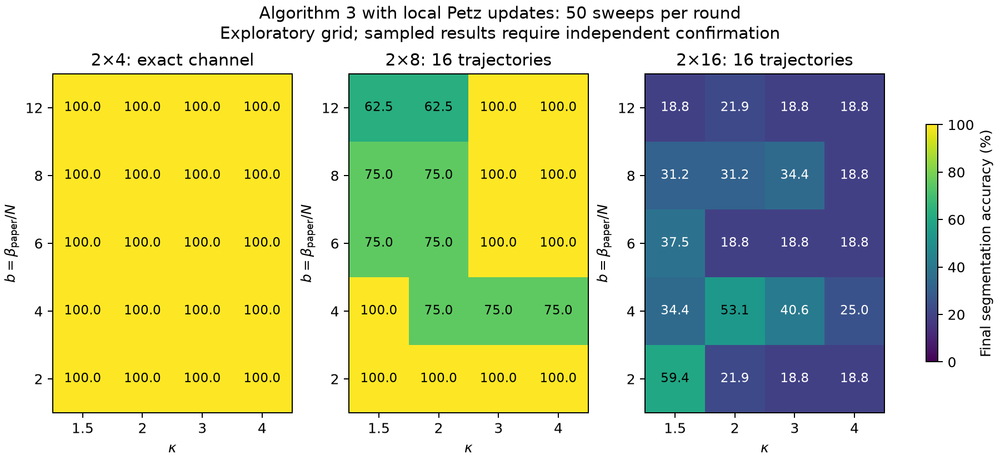
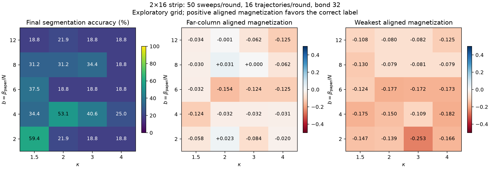
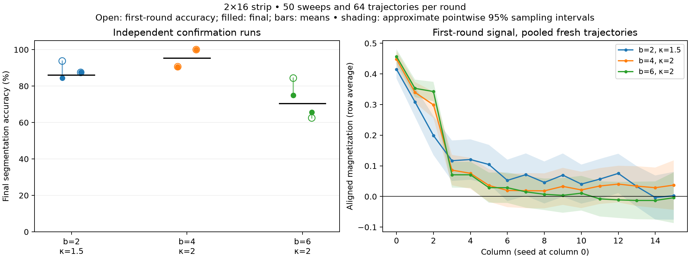

# Algorithm 3: beta and kappa sweep

This experiment tests parameter sensitivity of the existing local-Petz
adaptation described in [algorithm3-local-petz.md](algorithm3-local-petz.md).
It uses ideal channel simulations, not quantum hardware, and new synthetic
alternating-block images rather than the manuscript's unavailable dataset.

**Main result:** lowering b from 6 to 4 while keeping kappa=2 improved
32-pixel accuracy in both fresh confirmation runs, from 75%/65.625% to
90.625%/100%. This is a promising finite-budget setting, not an established
universal parameter choice. It was less reliable on the 16-pixel strip,
and the far-end magnetization remains statistically unresolved.

## Screening results

All 20 settings give 100% accuracy on the exact 2x4 control. The sampled
2x8 grid ranges from 62.5% to 100%. The sampled 2x16 grid is much worse:

| b = beta/N | kappa=1.5 | kappa=2 | kappa=3 | kappa=4 |
| ---: | ---: | ---: | ---: | ---: |
| 2 | 59.375% | 21.875% | 18.750% | 18.750% |
| 4 | 34.375% | 53.125% | 40.625% | 25.000% |
| 6 | 37.500% | 18.750% | 18.750% | 18.750% |
| 8 | 31.250% | 31.250% | 34.375% | 18.750% |
| 12 | 18.750% | 21.875% | 18.750% | 18.750% |

These are single 16-trajectory screening runs, not estimates of the exact
channel's segmentation accuracy. Shared random streams can correlate the
errors across settings and create apparently smooth regions in a heatmap.
The top two settings, (b,kappa)=(2,1.5) and (4,2), were selected by final
accuracy, with minimum aligned first-round magnetization as a tie-breaker.
The original (6,2) setting provides the independent comparison baseline.





The K=3 reference remains at 50% on all 20 settings for 2x8. For 2x4, it
gives 50% at (2,1.5), 100% at (12,1.5) and (12,2), and 75% elsewhere. Thus changing
these parameters does not fix the larger capped reference in this grid.

## Independent confirmations

Each entry is a complete adaptive segmentation with 64 independent MPS
trajectories per freezing round, 50 sweeps, and bond 32. Run 1 uses base
seed 20000000; run 2 uses 40000000. Both streams differ from screening.

| Image | (b, kappa) | Paper beta | Run 1 | Run 2 | Mean |
| --- | --- | ---: | ---: | ---: | ---: |
| 2x16 | (6, 2), original | 192 | 75.000% | 65.625% | 70.313% |
| 2x16 | (2, 1.5) | 64 | 84.375% | 87.500% | 85.938% |
| 2x16 | **(4, 2)** | **128** | **90.625%** | **100.000%** | **95.313%** |
| 2x8 | (6, 2), original | 96 | 100.000% | 100.000% | 100.000% |
| 2x8 | (2, 1.5) | 32 | 75.000% | 75.000% | 75.000% |
| 2x8 | (4, 2) | 64 | 75.000% | 100.000% | 87.500% |

The 32-pixel mean improvement for (4,2) is **25 percentage points** over
the concurrently rerun original setting. The two individual improvements
are 15.625 and 34.375 percentage points. For (2,1.5), the mean improvement
is 15.625 percentage points. Two independent repetitions are too few to
estimate a stable run-success probability or a confidence interval for the
adaptive algorithm's mean accuracy. The reported mean is descriptive.

The old 31.25% result at (6,2), RNG seed 1200, is not a fixed property of
those parameters. Its fresh 75% and 65.625% results expose substantial
sampling dependence. Comparisons above use the same trajectory budgets,
not the 16-trajectory screening baseline or that single historical run.



Freezing sometimes erodes a good initial sign pattern. On 32 pixels,
(2,1.5), run 1 starts at 93.75% after the first round and ends at 84.375%
after four rounds. Original (6,2), run 1 goes from 84.375% to 75% over six
rounds. Both (4,2) runs terminate after two rounds and retain their initial
90.625%/100% accuracy. On 16 pixels, (2,1.5), run 2 even starts at 100%
and ends at 75%. This isolates an adaptive-freezing problem beyond the
question of whether the initial magnetization signs are favorable.

Pooling the 128 independent **first-round** trajectories per setting gives
these far-column aligned row-average magnetizations:

| (b, kappa) | Mean | Approximate pointwise 95% sampling interval |
| --- | ---: | --- |
| (2, 1.5) | 0.00245 | [-0.07550, 0.08040] |
| (4, 2) | 0.03718 | [-0.04346, 0.11782] |
| (6, 2) | -0.00408 | [-0.08692, 0.07877] |

All three intervals include zero. A perfect final label map in one run is
therefore not evidence of a confidently resolved far-end signal. For the
two 32-pixel (4,2) runs, 15 and 12 freezing decisions fail the conservative
simultaneous sign bound, and nine final active signs remain unresolved in
each. Unresolved active pixels are still assigned the complement label
by the paper-style strict rule; they are not securely classified.

The finite-budget results favor testing (4,2) further on long strips, but
do not identify a parameter region that reliably solves all sizes. Useful
next controls are more independent ensembles, more sweeps at fixed sample
count, and delaying near-zero freezing decisions. These experiments alone
do not settle the broader conjecture about correlations in non-Gibbs states.

## Numerical validation

- All 60 local-channel grid runs, 40 capped references, and 12 independent
  confirmations completed without failed parameter settings.
- Trace preservation was checked on all 1,739 patches in all adaptive
  rounds of the three local-channel grids. Maximum Frobenius error was
  6.89e-15. The Kraus form supplies complete positivity.
- Bond 32 was doubled to 64 for four matched first-round trajectories of
  each 32-pixel screening setting selected for confirmation, plus the
  original baseline. Largest individual magnetization changes were
  3.12e-4 at (2,1.5), 7.59e-7 at (4,2), and 3.96e-7 at (6,2).
  The largest change in the four-trajectory mean was 7.83e-5. This is an
  empirical subset check with fixed fields, not a global error bound or
  a rerun of the full adaptive algorithm at bond 64.
- Maximum accumulated discarded weight in the confirmations was 1.29e-4.
  Accumulated discarded weight is a diagnostic, not a certified observable
  error. Sampling uncertainty is much larger than the paired changes above.
- The 14 existing Algorithm 3 tests and the new exact sample-preservation
  test pass. Chunking trajectory batches preserves the original samples,
  standard errors, and numerical diagnostics exactly.

Full records and raw samples are in `results/algorithm3-sweep/`. The compact
[numerical summary](algorithm3-parameter-sweep-summary.json) is outside the
ignored results directory for future version control. It includes the
screening grid, all confirmations, first-round signal estimates, validation
results, and software versions.

## Protocol

- Images: 2x4, 2x8, and 2x16 strips of alternating black/white 2x2 blocks.
- One supplied black seed at the upper-left pixel, frozen at -1/2.
- Fresh all-+x preparation in each adaptive freezing round.
- Nearest-neighbor star Petz updates, existing five-color order, 50 sweeps
  per round. Strict negative-magnetization freezing; retained measured
  magnetizations generate the next round's external fields.
- Effective inverse temperature b = beta_paper/N_original in
  {2, 4, 6, 8, 12}; kappa in {1.5, 2, 3, 4}. Original sample contrast
  standard deviation and original pixel count stay fixed after freezing.
- For 32 pixels, the paper beta values are {64, 128, 192, 256, 384}.
  Keeping b fixed between sizes means scaling beta_paper with N.
- Exact density evolution on 8 pixels. Screening on 16 and 32 pixels uses
  16 independent Kraus trajectories per round, MPS bond 32, cutoff 1e-12,
  base RNG seed 10000000. Settings share the base seed; they are not
  independent statistical replicates of each other.
- Independent confirmation uses 64 trajectories per round with base seeds
  20000000 and 40000000. The original b=6, kappa=2 setting is rerun at the
  same budget. Adaptive rounds use separate RNG streams, offset by 100000.
- K=3 capped-Gibbs references are computed on the 8- and 16-pixel grids.
  This cap is absent from the local-Petz channel.

Ground truth is consulted only for scoring and selecting parameters for
confirmation; the segmentation algorithm does not receive it. Parameter
selection on these synthetic images is not an independent image test set.
No trajectories are discarded or postselected. The simulator computes
magnetization expectations within each stochastic trajectory, without
additional quantum measurement-shot noise.

## Interpreting the diagnostics

The aligned magnetization is -m_i on black pixels and +m_i on white pixels.
A positive value has the desired sign. The far-column diagnostic averages
the two last-column spins; it measures signal propagation away from the
seed. The minimum aligned magnetization exposes the weakest or wrong sign.
These are first-round diagnostics, before adaptive freezing changes fields.

Accuracy counts the supplied seed. The machine-readable reports also give
nonseed accuracy, false freezes, missed seed-class pixels, class IoUs,
every adaptive round, standard errors, and raw trajectory samples.

A high screening score alone is insufficient: the 16-trajectory grid has
large sampling uncertainty. Its simultaneous Hoeffding radius exceeds
1/2, so it cannot certify even a fully polarized spin. Independent larger
ensembles are needed to check the apparent optima. Approximate pointwise
95% intervals in the confirmation plots are sampling intervals, not
simultaneous guarantees of a correct segmentation. Bond-refinement checks
address MPS truncation separately; neither addresses physical gate noise.

## Reproduction

From the repository root, using its existing virtual environment:

```bash
.venv/bin/python algorithm1/python/sweep_algorithm3.py --cases strip4 --backend dense --workers 1 --output algorithm1/results/algorithm3-sweep/exact8
.venv/bin/python algorithm1/python/sweep_algorithm3.py --cases strip8 --workers 2 --output algorithm1/results/algorithm3-sweep/screen16
.venv/bin/python algorithm1/python/sweep_algorithm3.py --cases strip16 --workers 4 --output algorithm1/results/algorithm3-sweep/screen32
.venv/bin/python algorithm1/python/sweep_algorithm3.py --cases strip4 strip8 --backend capped --workers 1 --output algorithm1/results/algorithm3-sweep/capped
.venv/bin/python algorithm1/python/sweep_algorithm3.py --bs 6 --kappas 2 --replicas 64 --seeds 20000000 40000000 --workers 2 --output algorithm1/results/algorithm3-sweep/confirm-baseline
.venv/bin/python algorithm1/python/sweep_algorithm3.py --bs 2 --kappas 1.5 --replicas 64 --seeds 20000000 40000000 --workers 2 --output algorithm1/results/algorithm3-sweep/confirm-warm
.venv/bin/python algorithm1/python/sweep_algorithm3.py --bs 4 --kappas 2 --replicas 64 --seeds 20000000 40000000 --workers 2 --output algorithm1/results/algorithm3-sweep/confirm-runner-up
.venv/bin/python algorithm1/python/sweep_algorithm3.py --cases strip8 --pairs 6:2 2:1.5 4:2 --replicas 64 --seeds 20000000 40000000 --workers 2 --output algorithm1/results/algorithm3-sweep/confirm-transfer16
.venv/bin/python algorithm1/python/plot_algorithm3_sweep.py --summary algorithm1/algorithm3-parameter-sweep-summary.json
```

Reports are checkpointed after every completed setting and samples after
each freezing round. Status files update every eight trajectories. Completed
settings with matching configurations are reused when the command is rerun;
an interrupted setting starts again. Failed settings remain explicit in
their report rather than being silently omitted or regularized. To retry
a failed setting, preserve its report elsewhere before removing that run
directory. Generated raw data are under the repository's ignored results
directory, following the existing convention.
