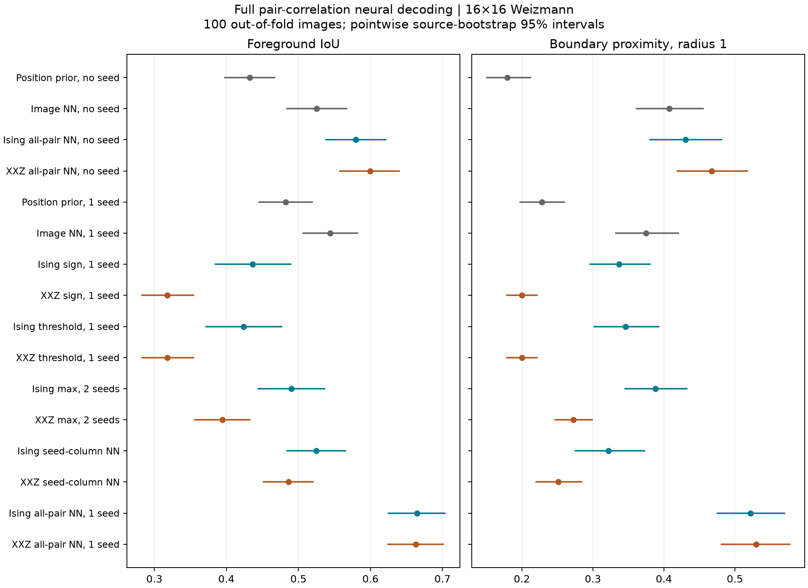
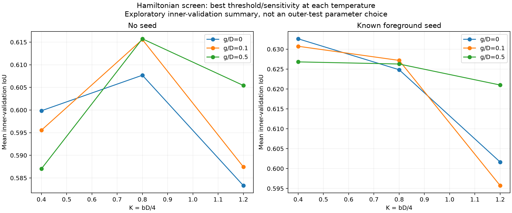
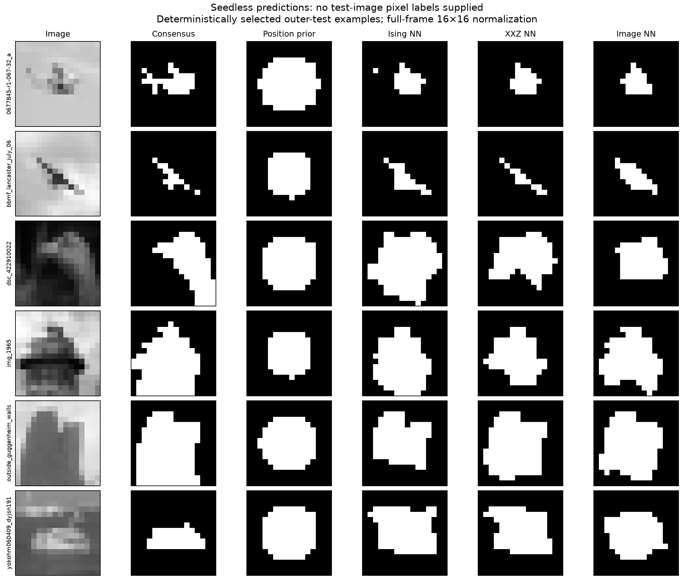
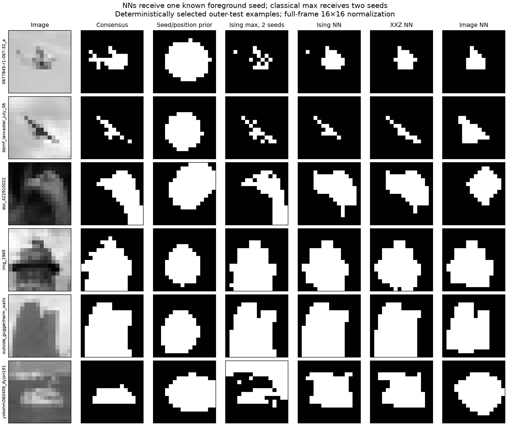

# Neural decoding of all-pair Ising and XXZ correlations

This experiment tests whether a learned segmentation rule can extract information missed by Algorithm 1. A positive gain over seed/position-only controls is evidence of usable correlation information. A negative result cannot establish an information-theoretic limit.

## Main findings

On 100 source-level out-of-fold predictions, the primary all-pair networks achieve mean IoU 0.5799 (Ising) and 0.5994 (XXZ) without any test-image seed. With one known foreground seed, the scores are 0.6648 and 0.6632. These are the choices selected with the sampling-quality requirement.
The seedless position-only prior scores 0.4325, and the separately trained raw-image network scores 0.5251. Their seeded counterparts score 0.4824 and 0.5441. The raw-image control is a small network trained from scratch, not a pretrained segmentation benchmark.
On the common 75-image historical subset, the foreground-seeded all-pair networks score 0.6660 and 0.6702, compared with 0.4988 and 0.4973 for the earlier two-seed Ising and XXZ rules. The neural methods have additional supervised training; matched controls and paired intervals below qualify the comparison.
Holding the earlier foreground-start Ising Hamiltonian fixed still gives NN IoU 0.6388 on those same 75 sources, versus 0.4135 for the earlier adaptive pairwise readout. Thus improvement does not require changing that Hamiltonian: learned decoding of the full pair matrix already finds useful information.
At the newly selected Hamiltonians, using only the foreground-seed correlation column gives NN IoU 0.5249 and 0.4863. Mismatching matrices with other images lowers seedless IoU to 0.3325 and 0.3366. These controls support the contribution of image-specific correlations beyond average object shape or seed position.
The XXZ-minus-Ising IoU difference is 0.0195 [0.0010, 0.0381] without seeds and -0.0016 [-0.0125, 0.0101] with a foreground seed. These compare complete selected pipelines and do not isolate exchange as the cause.
All conclusions concern this internal 16×16 benchmark. The final section reports independent larger-bank checks of the unrestricted XXZ selections separately.

## What the network receives

For each image, estimate C[i,j] = mean_s z_i^(s) z_j^(s) from Z-basis spin snapshots. The network maps the complete C matrix and fixed lattice coordinates to one foreground probability per pixel. In the seeded arm it also receives one known foreground pixel, which is forced to remain foreground. An inner-validation-selected probability threshold converts the output into a binary segmentation. Every measured pair is available to the decoder; the full-C model never receives image intensities or the Hamiltonian parameter values.
C uses Pauli eigenvalues ±1 and equals four times the spin-1/2 Gamma values used in the paper code. Pixel indices use NumPy row-major order. The diagonal is exactly one and is not an additional measured feature. All pairs commute in the Z basis, so one snapshot supplies every pair product. No X/X or Y/Y correlation is included, even for XXZ.
The volume decoder has 29,785 parameters at width 24 or 75,241 at width 40; the graph decoder has 21,289 at width 24. The latter normalizes positive and negative correlation-weighted messages separately. Both also receive local correlations and row summaries derived from the same matrix.

## Design

- All 100 Weizmann single-object source images, grayscale and 16×16 full-frame normalization; majority vote of three annotations. These images were used in earlier development, so this is internal cross-validation, not external validation.
- Five fixed outer folds: 64 training, 16 inner-validation and 20 outer-test sources. No pixel-level split. Hamiltonian, architecture, checkpoint epoch, and output threshold are chosen on the inner validation set. Refit on the 80 outer-training sources with three fixed random seeds and average probabilities. Each source is evaluated once.
- Input is the full 256×256 Pauli ZZ correlation matrix, with known pixel coordinates and optional one known foreground seed. The full-correlation models cannot access grayscale intensities. The foreground seed is the same mask-derived interior pixel as earlier studies; its geometry contains privileged information, measured by the seed/position-only control.
- 36 Hamiltonians: threshold edge-Otsu/q90; sensitivity alpha=0.01 or inverse q90−q10 edge spread; K=0.4/0.8/1.2; g/D=0/0.1/0.5. D=median absolute Delta, b=4K/D, Delta=atan(alpha(tau−d)). The Ising branch has g=0. No fields or spin clamping.
- A correlation-volume residual CNN and a graph message-passing network both receive every pair correlation. Widths 24/40, learning rates 0.001/0.003 and weight decay 0.001/0.01 are explored in the documented screening/refinement scheme. Dihedral augmentations transform both correlation axes and labels together.
- Networks are trained from scratch with AdamW, batch size 16, equal-weight binary cross-entropy and soft-IoU loss, gradient norm clipping at 5, and cosine learning-rate decay. Screening runs 100 epochs; refinement runs 140. Checkpoints and mask thresholds (0.25 to 0.75 in steps of 0.05) are selected every five epochs using validation images. Refits preserve the selected learning-rate schedule and stop at the selected epoch.
- Primary Hamiltonian choices require >=95% of the 80 outer-training images to pass full-pair/scalar convergence checks; no test labels or test convergence flags enter selection. Unrestricted XXZ choices are retained separately. No test image is dropped.
- Four chains × 2,048 retained configurations per image/setting. Ising uses exact independent frontier samples; XXZ uses the existing complete-loop SSE/worldline-cluster sampler. Prefix tests use 512 and 1,024 samples per chain without retraining. Existing matching banks are reused; all correlations of an image share the same samples.
- The raw-image CNN, spatial/seed prior, and single-seed-column CNN are separately trained controls. Classical sign and scalar-threshold rules select their own Hamiltonians on the same validation fold. The two-seed control receives an extra known background pixel.
- The seed-column neural control uses the Hamiltonian chosen for the corresponding full-matrix foreground-seeded model, then tunes its own architecture and training settings. This isolates additional pairs at that Hamiltonian; it is not a separate Hamiltonian search for the best possible column-only decoder.
- Prior/image/column controls retain the constant identity-matrix position encoding and are offered the same convolutional/graph architecture choices. This prevents attributing gains from extra position-coding capacity to measured off-diagonal correlations.
- Additional classical controls suffixed -80 fit their Hamiltonian and scalar decision rule using all 80 outer-training labels. This gives the simpler baselines access to the full training-label budget; the original inner-validation-only controls are also retained. Neither version reads outer-test labels.
- IoU is mean foreground IoU per source, not pooled pixels. Boundary proximity uses the existing Zhang skeleton convention at radius 1: the documented operational interpretation inherited from the crack-paper comparison, not a conventional contour-boundary IoU. Neural probability-band abstention is an uncalibrated diagnostic; it is not comparable to a Gibbs confidence interval. Hard neural masks assign every pixel.
- Completed 693 inner fits and 240 refits; 7.34 summed worker-hours. Pointwise source-bootstrap intervals condition on the fitted models and do not include all variation from repeating nested cross-validation.

## Outer-test results

| Method / seed information | Mean IoU [95% CI] | Boundary proximity [95% CI] | Configurations per image |
|---|---:|---:|---:|
| Ising/none | 0.5799 [0.5382, 0.6212] | 0.4306 [0.3805, 0.4814] | 8192 |
| Ising-historical/none | 0.5603 [0.5172, 0.6040] | 0.4300 [0.3795, 0.4819] | 8192 |
| XXZ/none | 0.5994 [0.5574, 0.6396] | 0.4675 [0.4190, 0.5173] | 8192 |
| XXZ-unrestricted/none | 0.5979 [0.5549, 0.6407] | 0.4596 [0.4082, 0.5103] | 8192 |
| XXZ-historical/none | 0.5665 [0.5228, 0.6096] | 0.4524 [0.4025, 0.5042] | 8192 |
| prior/none | 0.4325 [0.3981, 0.4669] | 0.1794 [0.1507, 0.2119] | 0 |
| image/none | 0.5251 [0.4839, 0.5665] | 0.4075 [0.3613, 0.4554] | 0 |
| Ising/foreground | 0.6648 [0.6252, 0.7034] | 0.5222 [0.4754, 0.5697] | 8192 |
| Ising-historical/foreground | 0.6339 [0.5928, 0.6734] | 0.5186 [0.4732, 0.5671] | 8192 |
| XXZ/foreground | 0.6632 [0.6242, 0.7008] | 0.5297 [0.4809, 0.5773] | 8192 |
| XXZ-unrestricted/foreground | 0.6628 [0.6233, 0.7014] | 0.5324 [0.4826, 0.5823] | 8192 |
| XXZ-historical/foreground | 0.6353 [0.5956, 0.6741] | 0.5301 [0.4853, 0.5775] | 8192 |
| prior/foreground | 0.4824 [0.4453, 0.5189] | 0.2283 [0.1977, 0.2599] | 0 |
| image/foreground | 0.5441 [0.5067, 0.5821] | 0.3747 [0.3323, 0.4202] | 0 |
| Ising-column/foreground | 0.5249 [0.4847, 0.5650] | 0.3220 [0.2754, 0.3727] | 8192 |
| XXZ-column/foreground | 0.4863 [0.4518, 0.5200] | 0.2511 [0.2203, 0.2842] | 8192 |
| Ising/one-sign | 0.4333 [0.3812, 0.4867] | 0.3357 [0.2946, 0.3798] | 8192 |
| Ising/one-threshold | 0.4307 [0.3785, 0.4841] | 0.3357 [0.2939, 0.3806] | 8192 |
| Ising/two-max | 0.4835 [0.4391, 0.5289] | 0.3863 [0.3447, 0.4295] | 8192 |
| Ising/same-H-sign | 0.3254 [0.2794, 0.3724] | 0.2463 [0.2115, 0.2828] | 8192 |
| Ising/one-sign-80 | 0.4362 [0.3846, 0.4892] | 0.3370 [0.2961, 0.3807] | 8192 |
| Ising/one-threshold-80 | 0.4241 [0.3717, 0.4767] | 0.3459 [0.3019, 0.3926] | 8192 |
| Ising/two-max-80 | 0.4902 [0.4445, 0.5362] | 0.3880 [0.3456, 0.4324] | 8192 |
| XXZ/one-sign | 0.3232 [0.2874, 0.3602] | 0.2053 [0.1826, 0.2286] | 8192 |
| XXZ/one-threshold | 0.3007 [0.2695, 0.3332] | 0.2303 [0.1977, 0.2665] | 8192 |
| XXZ/two-max | 0.3928 [0.3556, 0.4300] | 0.2703 [0.2448, 0.2963] | 8192 |
| XXZ/same-H-sign | 0.2872 [0.2547, 0.3207] | 0.1942 [0.1756, 0.2133] | 8192 |
| XXZ/one-sign-80 | 0.3181 [0.2830, 0.3545] | 0.2001 [0.1786, 0.2214] | 8192 |
| XXZ/one-threshold-80 | 0.3181 [0.2830, 0.3545] | 0.2001 [0.1786, 0.2214] | 8192 |
| XXZ/two-max-80 | 0.3943 [0.3561, 0.4325] | 0.2726 [0.2467, 0.2991] | 8192 |



## Paired differences

| Decoder | Control | ΔIoU [95% CI] | Δ boundary [95% CI] |
|---|---|---:|---:|
| Ising/none | prior/none | 0.1474 [0.1106, 0.1854] | 0.2512 [0.2011, 0.3015] |
| Ising/none | image/none | 0.0549 [0.0141, 0.0954] | 0.0231 [-0.0324, 0.0783] |
| Ising-historical/none | prior/none | 0.1278 [0.0887, 0.1682] | 0.2505 [0.1991, 0.3032] |
| Ising-historical/none | image/none | 0.0352 [-0.0063, 0.0782] | 0.0225 [-0.0330, 0.0806] |
| Ising/foreground | prior/foreground | 0.1824 [0.1431, 0.2220] | 0.2939 [0.2426, 0.3447] |
| Ising/foreground | image/foreground | 0.1207 [0.0877, 0.1540] | 0.1475 [0.0955, 0.1969] |
| Ising/foreground | Ising/one-sign | 0.2315 [0.1804, 0.2833] | 0.1864 [0.1288, 0.2444] |
| Ising/foreground | Ising/one-threshold | 0.2342 [0.1829, 0.2859] | 0.1865 [0.1274, 0.2455] |
| Ising/foreground | Ising/one-threshold-80 | 0.2407 [0.1911, 0.2912] | 0.1762 [0.1195, 0.2332] |
| Ising/foreground | Ising/two-max-80 | 0.1746 [0.1310, 0.2169] | 0.1342 [0.0835, 0.1852] |
| Ising/foreground | Ising/same-H-sign | 0.3394 [0.2933, 0.3847] | 0.2758 [0.2239, 0.3278] |
| Ising/foreground | Ising-column/foreground | 0.1399 [0.1090, 0.1725] | 0.2002 [0.1443, 0.2563] |
| Ising-historical/foreground | prior/foreground | 0.1515 [0.1135, 0.1900] | 0.2903 [0.2365, 0.3446] |
| Ising-historical/foreground | image/foreground | 0.0898 [0.0582, 0.1224] | 0.1439 [0.0911, 0.1980] |
| XXZ/none | prior/none | 0.1669 [0.1323, 0.2023] | 0.2880 [0.2397, 0.3369] |
| XXZ/none | image/none | 0.0743 [0.0371, 0.1116] | 0.0600 [0.0035, 0.1158] |
| XXZ-historical/none | prior/none | 0.1340 [0.0922, 0.1762] | 0.2730 [0.2227, 0.3257] |
| XXZ-historical/none | image/none | 0.0415 [-0.0002, 0.0836] | 0.0449 [-0.0137, 0.1051] |
| XXZ/foreground | prior/foreground | 0.1808 [0.1434, 0.2180] | 0.3015 [0.2494, 0.3532] |
| XXZ/foreground | image/foreground | 0.1191 [0.0873, 0.1514] | 0.1551 [0.1012, 0.2084] |
| XXZ/foreground | XXZ/one-sign | 0.3400 [0.3026, 0.3781] | 0.3244 [0.2723, 0.3777] |
| XXZ/foreground | XXZ/one-threshold | 0.3625 [0.3209, 0.4044] | 0.2994 [0.2446, 0.3549] |
| XXZ/foreground | XXZ/one-threshold-80 | 0.3450 [0.3069, 0.3843] | 0.3297 [0.2769, 0.3830] |
| XXZ/foreground | XXZ/two-max-80 | 0.2689 [0.2307, 0.3075] | 0.2572 [0.2034, 0.3119] |
| XXZ/foreground | XXZ/same-H-sign | 0.3760 [0.3394, 0.4132] | 0.3356 [0.2836, 0.3872] |
| XXZ/foreground | XXZ-column/foreground | 0.1769 [0.1456, 0.2094] | 0.2786 [0.2249, 0.3318] |
| XXZ-historical/foreground | prior/foreground | 0.1529 [0.1165, 0.1910] | 0.3018 [0.2506, 0.3539] |
| XXZ-historical/foreground | image/foreground | 0.0912 [0.0599, 0.1235] | 0.1554 [0.1052, 0.2061] |

| Seed information | XXZ minus Ising IoU [95% CI] | XXZ minus Ising boundary score [95% CI] |
|---|---:|---:|
| none | 0.0195 [0.0010, 0.0381] | 0.0369 [0.0027, 0.0698] |
| foreground | -0.0016 [-0.0125, 0.0101] | 0.0076 [-0.0257, 0.0409] |

Each model selects its own Hamiltonian and decoder; these are comparisons of the complete pipelines, not isolated causal effects of exchange.

### Does the decoder use image-specific correlation information?

For the seedless models, replace each image’s matrix with that of another held-out image in the same fold, keeping the trained network and threshold fixed. Since these models read neither intensities nor seeds, this exactly permutes their existing output masks. The table averages over all 19 alternative donors for each source; it preserves the decoder and its marginal output distribution while breaking the image–correlation pairing. This is an input ablation, not retraining or a formal information bound.

| Seedless model | Correct pairing IoU | Mismatched pairing IoU | Paired difference [95% CI] |
|---|---:|---:|---:|
| Ising/none | 0.5799 | 0.3325 | 0.2474 [0.2131, 0.2816] |
| XXZ/none | 0.5994 | 0.3366 | 0.2628 [0.2303, 0.2952] |

## Comparison on the previous 75-image evaluation subset

These compare the same source images. The neural models were trained out of fold on up to 80 other sources; previous methods were tuned on the old 25-image split. Supervised training is additional information and computation. Historical NN rows retain the old foreground-start Hamiltonian, separating decoder changes from Hamiltonian tuning. The old adaptive baselines consume multiple rounds; the new networks consume one 8,192-configuration bank.

| Decoder | NN IoU | Earlier adaptive pairwise IoU | Paired difference [95% CI] |
|---|---:|---:|---:|
| Ising/foreground | 0.6660 | 0.4135 | 0.2525 [0.1908, 0.3155] |
| Ising-historical/foreground | 0.6388 | 0.4135 | 0.2253 [0.1722, 0.2810] |
| Ising/none | 0.5807 | 0.4135 | 0.1672 [0.1036, 0.2336] |
| XXZ/foreground | 0.6702 | 0.4249 | 0.2452 [0.1875, 0.3045] |
| XXZ-historical/foreground | 0.6397 | 0.4249 | 0.2147 [0.1646, 0.2671] |
| XXZ/none | 0.5938 | 0.4249 | 0.1689 [0.1051, 0.2345] |

Earlier two-seed tests are stronger benchmarks than the recent adaptive one-seed methods: primary Ising reached 0.4988 and primary XXZ 0.4973, with a secondary XXZ rule at 0.5010. The paired comparison below uses those primary methods on the same 75 sources. They receive both foreground and background seed labels; the neural rows receive one or neither. See [the earlier two-seed report](xxz-two-seed-bpm.md).

| Decoder | NN IoU | Earlier two-seed IoU | Paired difference [95% CI] |
|---|---:|---:|---:|
| Ising/foreground | 0.6660 | 0.4988 | 0.1671 [0.1192, 0.2150] |
| Ising/none | 0.5807 | 0.4988 | 0.0819 [0.0302, 0.1334] |
| XXZ/foreground | 0.6702 | 0.4973 | 0.1729 [0.1261, 0.2194] |
| XXZ/none | 0.5938 | 0.4973 | 0.0966 [0.0451, 0.1472] |

## Selected settings and sampling diagnostics

| Decoder | Architectures over five folds | Selected Hamiltonian IDs | Mean inner training IoU | Mean inner validation IoU | Converged test images |
|---|---|---|---:|---:|---:|
| Ising/none | {'graph': 4, 'volume': 1} | {'3d8166c7d273': 2, '1789b9c16415': 1, 'c8c7bd6bf454': 1, '5a6bd2a389bd': 1} | 0.6354 | 0.6272 | 100/100 |
| Ising-historical/none | {'volume': 3, 'graph': 2} | {'79173a8f83ea': 5} | 0.6696 | 0.5641 | 100/100 |
| XXZ/none | {'graph': 4, 'volume': 1} | {'38521b80bce4': 3, '4a7f28c05242': 2} | 0.6373 | 0.6169 | 100/100 |
| XXZ-unrestricted/none | {'volume': 3, 'graph': 2} | {'e779bd0daba9': 1, 'b371ab4fcf2a': 1, '384eeef54c19': 2, '38521b80bce4': 1} | 0.6517 | 0.6352 | 66/100 |
| XXZ-historical/none | {'graph': 2, 'volume': 3} | {'09d32848863a': 5} | 0.6208 | 0.5634 | 83/100 |
| prior/none | {'volume': 4, 'graph': 1} | {'null': 5} | 0.4356 | 0.4489 | n/a |
| image/none | {'volume': 4, 'graph': 1} | {'null': 5} | 0.6175 | 0.5400 | n/a |
| Ising/foreground | {'graph': 5} | {'c8c7bd6bf454': 3, '3d8166c7d273': 1, '99b251d9b106': 1} | 0.6878 | 0.6890 | 100/100 |
| Ising-historical/foreground | {'graph': 5} | {'79173a8f83ea': 5} | 0.6899 | 0.6371 | 100/100 |
| XXZ/foreground | {'graph': 5} | {'38521b80bce4': 4, '4a7f28c05242': 1} | 0.6857 | 0.6789 | 100/100 |
| XXZ-unrestricted/foreground | {'graph': 5} | {'38521b80bce4': 3, 'b371ab4fcf2a': 2} | 0.6896 | 0.6874 | 90/100 |
| XXZ-historical/foreground | {'graph': 5} | {'09d32848863a': 5} | 0.6898 | 0.6371 | 83/100 |
| prior/foreground | {'volume': 3, 'graph': 2} | {'null': 5} | 0.4951 | 0.5132 | n/a |
| image/foreground | {'graph': 2, 'volume': 3} | {'null': 5} | 0.5944 | 0.5675 | n/a |
| Ising-column/foreground | {'volume': 3, 'graph': 2} | {'c8c7bd6bf454': 3, '3d8166c7d273': 1, '99b251d9b106': 1} | 0.5594 | 0.5678 | 100/100 |
| XXZ-column/foreground | {'volume': 3, 'graph': 2} | {'38521b80bce4': 4, '4a7f28c05242': 1} | 0.5113 | 0.5254 | 100/100 |

The complete rules, per-fold selections, thresholds, epochs, checkpoints, and predictions are saved in JSON/NPZ files. No Hamiltonian is selected separately using a test image’s annotation.

| Primary decoder | Threshold rule | Sensitivity rule | K | g/D | Folds selecting this rule |
|---|---|---|---:|---:|---:|
| Ising/none | edge_otsu | fixed01 | 0.8 | 0.0 | 2 |
| Ising/none | edge_otsu | fixed01 | 1.2 | 0.0 | 1 |
| Ising/none | edge_otsu | fixed01 | 0.4 | 0.0 | 1 |
| Ising/none | edge_otsu | inverse_spread | 0.4 | 0.0 | 1 |
| XXZ/none | edge_otsu | inverse_spread | 0.4 | 0.1 | 3 |
| XXZ/none | edge_otsu | fixed01 | 0.4 | 0.1 | 2 |
| Ising/foreground | edge_otsu | fixed01 | 0.4 | 0.0 | 3 |
| Ising/foreground | edge_otsu | fixed01 | 0.8 | 0.0 | 1 |
| Ising/foreground | edge_otsu | inverse_spread | 0.8 | 0.0 | 1 |
| XXZ/foreground | edge_otsu | inverse_spread | 0.4 | 0.1 | 4 |
| XXZ/foreground | edge_otsu | fixed01 | 0.4 | 0.1 | 1 |

These selections are image-adaptive rules: q90 and edge-Otsu are computed from the current image’s nearest-neighbor intensity distances; inverse-spread sensitivity is 1/max(q90(d)−q10(d),1). K sets b=4K/D using that image’s D. Thus the same selected K does not imply the same numerical beta for every image. The selections optimize inner-validation performance within this grid, not a universal optimum.



The exploratory sweep figure uses the initial width-24 volume CNN, tested across the complete grid. Final choices may use the subsequent graph-network refinement. The figure includes unrestricted settings, including colder XXZ banks that fail convergence; those curves are not evidence of physical Gibbs-state behavior in those regimes. Primary outer-test selections apply the quality eligibility criterion.

### Correlation saturation diagnostic

The following label-independent diagnostic holds the Ising q90/inverse-spread rule fixed and varies temperature. Participation rank is (tr C)^2/tr(C²). It measures matrix concentration, not segmentation information: the infinite-temperature identity matrix has maximal rank but carries no image-dependent signal.

| K | Mean absolute off-diagonal correlation | Fraction with absolute correlation >0.95 | Mean participation rank |
|---:|---:|---:|---:|
| 0.4 | 0.0407 | 0.00% | 83.15 |
| 0.8 | 0.6249 | 16.19% | 2.44 |
| 1.2 | 0.8178 | 55.81% | 1.45 |

## Sampling sensitivity

| Decoder | 2,048 total configurations | 4,096 | 8,192 |
|---|---:|---:|---:|
| Ising/none | 0.5764 | 0.5786 | 0.5799 |
| Ising-historical/none | 0.5605 | 0.5601 | 0.5603 |
| XXZ/none | 0.5913 | 0.5934 | 0.5994 |
| XXZ-unrestricted/none | 0.5913 | 0.5936 | 0.5979 |
| XXZ-historical/none | 0.5667 | 0.5673 | 0.5665 |
| Ising/foreground | 0.6556 | 0.6614 | 0.6648 |
| Ising-historical/foreground | 0.6335 | 0.6346 | 0.6339 |
| XXZ/foreground | 0.6539 | 0.6633 | 0.6632 |
| XXZ-unrestricted/foreground | 0.6531 | 0.6610 | 0.6628 |
| XXZ-historical/foreground | 0.6362 | 0.6350 | 0.6353 |
| Ising-column/foreground | 0.5238 | 0.5246 | 0.5249 |
| XXZ-column/foreground | 0.4873 | 0.4858 | 0.4863 |

The models and thresholds stay fixed during prefix evaluation; these are input-noise sensitivity tests, not separately optimized low-budget models. Configuration counts are not independent sample counts for XXZ.

## Example segmentations





## What this can establish

An out-of-fold gain over Algorithm 1 on the same Hamiltonian demonstrates a decoder limitation. A gain over the spatial/seed prior is evidence that the measured correlations contribute information beyond seed geometry and average mask shape. Comparing all pairs with the single-seed column tests the incremental value of the rest of the matrix at the selected Hamiltonian. A gap to the raw-image network suggests information loss or difficult decoding, but does not by itself prove loss: input representation and training optimization differ.
Conversely, outperforming this raw-image network would demonstrate a useful representation or inductive bias under this training budget, not additional information created by the Hamiltonian. The Hamiltonian and its sampled correlations are generated from the image. This study does not compare with a pretrained segmentation model or establish a new classical benchmark.
For a finite zero-field classical Ising model with known graph and finite couplings, the edge-product statistics form a minimal exponential family. Strict convexity of the log partition function makes exact edge-correlation means identify the dimensionless edge couplings. Thus exact two-point information is not automatically a fundamental bottleneck for identifying that Gibbs distribution. This is an application of the exponential-family mean-parameter correspondence; it does not identify the original image or its semantic mask. Near saturation, inversion may be poorly conditioned, and finite sampling changes the practical question. See [Wainwright (2006), exponential-family background](https://jmlr.org/papers/volume7/wainwright06a/wainwright06a.pdf).
A restricted XXZ extension follows from the relative-entropy argument in [Anshu et al., Proposition 17](https://arxiv.org/pdf/2004.07266). Our application: hold the dimensionless exchange operator A0 fixed, set A(θ)=A0+sum_e θ_e Z_i Z_j, and let ρθ=exp(−A(θ))/Zθ. Writing mθ for the edge ZZ means gives D(ρθ||ρη)+D(ρη||ρθ)=(η−θ)·(mθ−mη). Identical means make both relative entropies zero, hence the states equal. Taking matrix logarithms and using independence of the traceless edge Pauli operators then gives θ=η. In this study bg/4=K(g/D) is fixed within each Hamiltonian rule, satisfying that condition. This is an identifiability argument for exact finite-temperature means, not a practical reconstruction guarantee, and not a claim for arbitrary unknown exchange couplings. It does not undo information lost when converting image intensities to Hamiltonian couplings, determine semantic masks, or justify a zero-temperature limit.
All-pair storage and classical processing scale quadratically in pixel count: 32,640 distinct off-diagonal pairs for 256 pixels. The volume CNN is resolution-specific. These coarse-image tests establish neither full-resolution performance nor quantum computational advantage. An unsuccessful learned decoder on only 100 images would not establish an upper bound.

## Reproduction

Use the existing virtual environment plus requirements-neural.txt. The underlying dataset archive and cached-bank hashes are inherited and verified by the existing preparation scripts.

```sh
.venv/bin/python -m pytest algorithm1/tests/test_correlation_nn.py -q
.venv/bin/python algorithm1/python/correlation_nn_data.py sample --workers 4
.venv/bin/python algorithm1/python/run_correlation_nn.py screen-ready --workers 4
.venv/bin/python algorithm1/python/finish_correlation_nn.py
```

The completion driver runs the measurement audit, refinement, selection, column controls, final refits, higher-budget XXZ checks, training audit, analysis, and frozen-model confirmation inference. Completed fit files are reused on restart. The saved protocol and amendments specify the fixed choices.

## Higher-budget XXZ confirmation

This check changes measurement inputs only. Networks, thresholds, folds, and Hamiltonian choices remain frozen. Cases are selected using failed sampling diagnostics, not segmentation errors. No case is dropped.

| Seed information | Resampled images | Still failing | IoU [95% CI] | Boundary proximity | Change in IoU | Mean configurations in final input |
|---|---:|---:|---:|---:|---:|---:|
| XXZ/none | 0 | 0 | 0.5994 [0.5574, 0.6396] | 0.4675 | +0.0000 | 8192 |
| XXZ/foreground | 0 | 0 | 0.6632 [0.6242, 0.7008] | 0.5297 | +0.0000 | 8192 |
| XXZ-unrestricted/none | 34 | 0 | 0.5986 [0.5559, 0.6413] | 0.4559 | +0.0007 | 16548 |
| XXZ-unrestricted/foreground | 10 | 0 | 0.6626 [0.6230, 0.7014] | 0.5348 | -0.0002 | 10650 |

All selected primary XXZ test cases passed the initial diagnostics and retain their original banks. No independent extra bank was generated for these primary cases.

Resampled cases use four chains × 8,192 retained configurations, replacing the original four × 2,048 bank. The original bank was still generated: the JSON report separately records total configurations spent, including discarded inputs. Remaining failures continue to limit a Gibbs-state interpretation.

The unrestricted rows are secondary diagnostics. Their networks were trained on the original, sometimes unconverged banks; replacing only flagged test inputs can change the input distribution. These rows do not replace the primary reliably sampled comparison or constitute retraining on converged Gibbs measurements.
