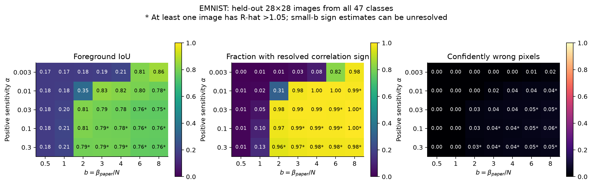
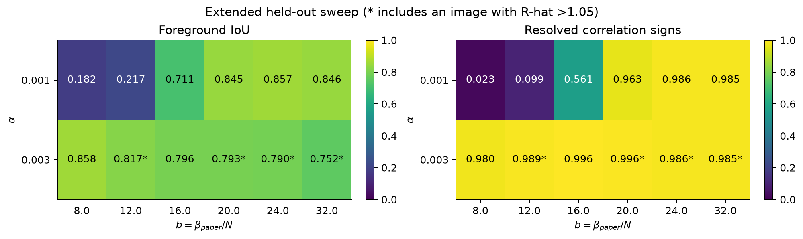
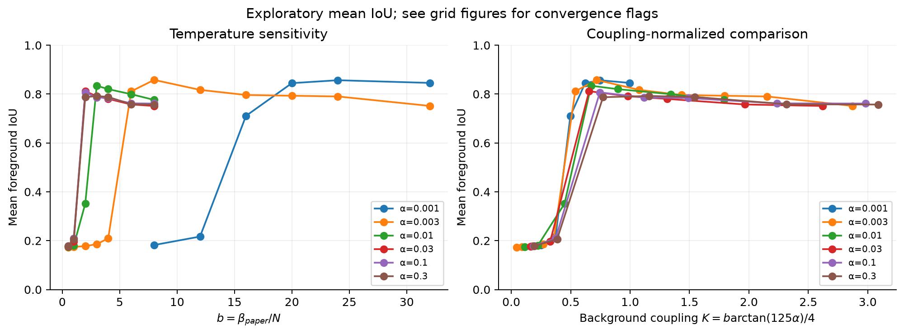
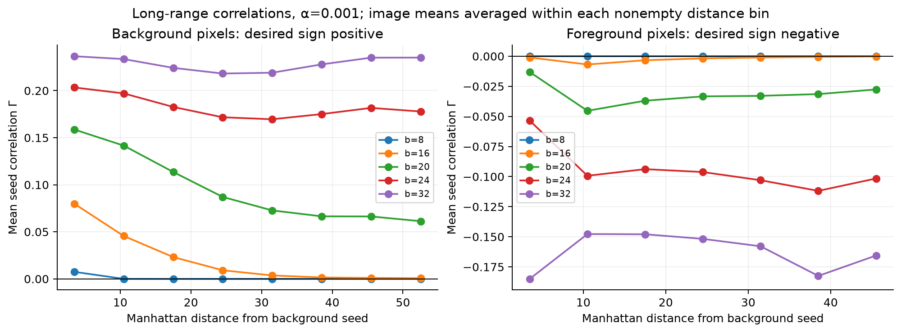
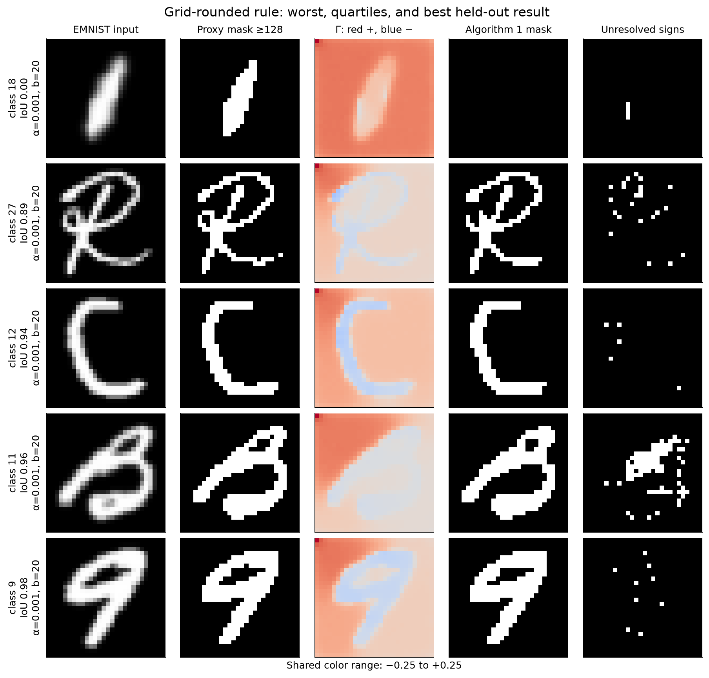
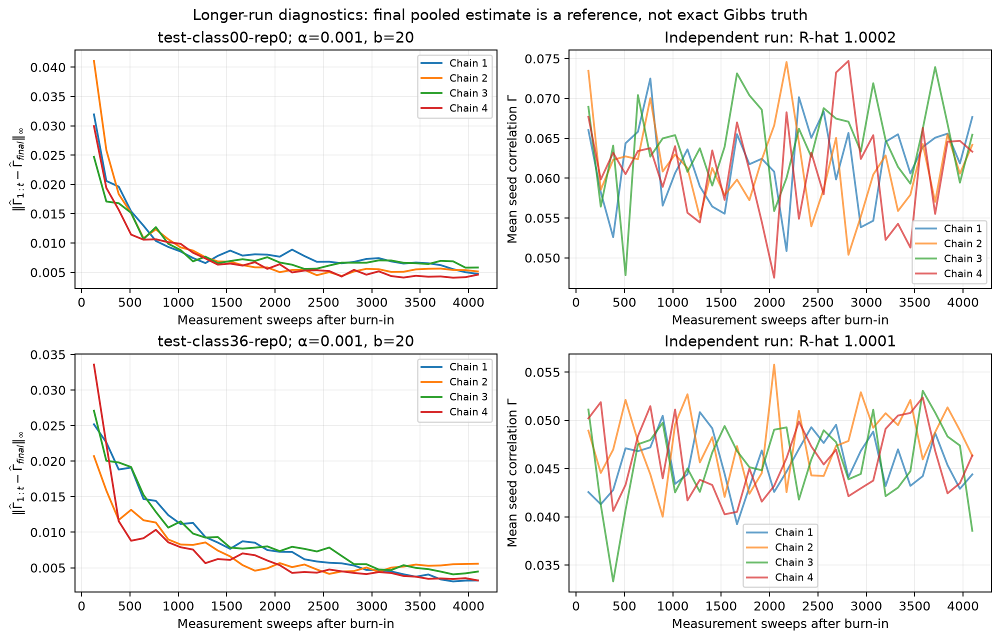

# EMNIST Gibbs-state study for Algorithm 1

This study uses the **positive-sensitivity, sign-compatible** coupling

\[
\Delta_{pq}=\arctan[\alpha(125-|c_p-c_q|)],\qquad
H=-\frac14\sum_{\{p,q\}}\Delta_{pq}Z_pZ_q,\qquad\alpha>0.
\]

There are no XX or YY terms, fields, fixed spins, color rescaling, or sigma
normalization. Edges are unique horizontal/vertical nearest neighbors on an
open rectangular grid. Pixels use row-major ordering. With the paper's
normalization, the Gibbs weight is `exp(-b H)` with **b = beta_paper/N**.
The measured observable is `Gamma(seed,p)=<Z_seed Z_p>/4`. Algorithm 1 assigns
the seed's class iff Gamma is strictly positive, including zero in the other
class. The seed is a measurement reference, never a pinned spin.

The earlier `ising_algorithm1.py` retains the literal old formula
`atan(alpha*(d-125))` for reproducibility. Its negative alpha reference agrees
with the new `ising_monte_carlo.signed_image(image, positive_alpha)`.

## Results

**Weak sensitivity with moderate effective cooling works well on most of this
subset, but several images still fail decisively.** The 94 native EMNIST images
were evaluated at 46 distinct parameter pairs, giving **4,324 image/parameter
conditions**, plus independent longer checks and controls.

The selected parameters were frozen before held-out simulations. The final
comparison below gives fixed parameters and the continuous image rule the
same sampling budget: four independent ensembles, 1,024 discarded and 2,048
measurement sweeps per ensemble, with blocks of 128.

| Method on the 47 held-out images | Mean foreground IoU | Balanced accuracy | Resolved signs |
|---|---:|---:|---:|
| Fixed alpha=0.001, b=20 | 0.8524 | 0.9362 | 98.28% |
| Continuous image-statistic rule below | 0.8546 | 0.9375 | 98.14% |
| Otsu thresholding, proxy baseline | 0.8847 | — | — |

The continuous rule's mean-IoU gain over the equal-budget fixed setting is
0.00213, with a paired bootstrap 95% interval **[-0.00063, 0.00554]**.
There is no clear improvement from adapting the parameters image by image
within this narrow image family. The rule is useful as a normalized starting
point. It does not establish superiority over Otsu, which scores higher in
mean IoU against this threshold-defined proxy.

For the continuous rule, median IoU is 0.9406; **37/47 images reach IoU >=0.90**,
while **5/47 fall below 0.50**. The worst IoU is 0.0132. Class-18, class-31 and
class-45 examples have IoUs 0.0132, 0.0778 and 0.1720 respectively, even with
mostly resolved signs. These are substantive failures. At the alternative
proxy thresholds 96 and 160, mean IoU is 0.7868 and 0.8172. The conclusions
depend on the operational definition of a foreground pixel.

The continuous rule uses alpha in [0.000867, 0.001197] and b in [16.74,23.05]
on the held-out set. Its maximum monitored split R-hat is 1.00295 and the
minimum estimated ESS of the spatially averaged seed correlation is 4,300
out of 8,192 measurement sweeps. For the matched fixed reference these are
1.00190 and 4,579. ESS concerns this observable, not every pixel simultaneously.

Selected **exploratory-grid** results are below. These use fewer samples than
the final equal-budget comparison and should not be interpreted as precise
rankings between neighboring settings. None of these selected cells has an
observable R-hat above 1.05.

| alpha | b | beta_paper for 784 spins | Held-out mean IoU |
|---:|---:|---:|---:|
| 0.001 | 20 | 15,680 | 0.8448 |
| 0.001 | 24 | 18,816 | 0.8568 |
| 0.001 | 32 | 25,088 | 0.8458 |
| 0.003 | 8 | 6,272 | 0.8580 |
| 0.01 | 3 | 2,352 | 0.8342 |
| 0.03 | 2 | 1,568 | 0.8119 |
| 0.1 | 2 | 1,568 | 0.8070 |

Parameter pairs with insufficiently mixed runs are marked with an asterisk
in the grid figures. Across the full exploratory sweep, 91/4,324 conditions
have an observable split R-hat above 1.05 (maximum 3.04). Most short ensembles
do not complete a full hot–cold–hot replica journey. Consequently the entire
grid is not a certified equilibrium benchmark. The recommended region is
supported separately by the longer checks below; suspect cold/strong-alpha
cells must not support fine quantitative claims.







The distance plot shows genuinely measurable seed correlations over the
image's full range at b=20 and higher, unlike the weak signals at b=8 for
alpha=0.001. Higher b strengthens the mean correlations, but stronger average
correlations alone do not ensure correct signs for each pixel or image.
Distance bins average image-level means over images with nonempty bins;
foreground and background curves have different contributing pixels.





### Independent checks and explanation of failures

The longer confirmation fixes class IDs `{0,4,8,...,44}` before inspection:
12 held-out images at alpha=0.001 and b=20,32. Each uses four independent
ensembles, 2,048 burn-in and 4,096 measurement sweeps. Its maximum monitored
R-hat is 1.00082. At b=20 the minimum mean-correlation ESS is 12,105 out of
16,384 sweeps, with 614 completed temperature round trips across the twelve
ensembles of four chains.

Compared with the exploratory runs, the b=20 correlation-map changes have
median l-infinity norm 0.00755 and maximum 0.00853; median RMS change is
0.00242. On this preselected subset, mean IoU **decreases from 0.8746 at b=20
to 0.8214 at b=32**. Thus, colder Gibbs states are not automatically better
for segmentation. The convergence plot compares running estimates to the
final pooled Monte Carlo estimate; that reference is not exact Gibbs truth.



Four controls use the same EMNIST glyphs (classes 0,12,24,36) converted to
exact black/white inputs before constructing H. All four have IoU=1 and all
signs resolved at alpha=0.001,b=20. The gray class-24 glyph remains poorly
segmented, while its binary counterpart succeeds. This supports a limitation
in how the fixed 125 threshold encodes antialiased boundaries, rather than
a failure caused simply by having 784 spins.

For example, only 17.3% of the threshold-mask boundary edges in the worst
class-18 image have d>125. The remaining boundary edges mostly favor aligning
spins across the desired boundary. Alpha changes their magnitudes, never
their signs. Even an oracle choosing the best tested pair for that image
reaches only IoU=0.382. This oracle uses the evaluation mask and is not an
implementable unsupervised parameter rule.

Exact enumeration on four contrast-rich 3×3 patches from training images,
covering 36 parameter settings, gives maximum Monte Carlo Gamma error
0.005071; all estimates meet the specified `6*SE+0.002` check. The relevant
Python test suites pass 14 tests. Native-image correlations, their errors,
couplings, seeds and temperature conventions are exported in
`results/emnist-confirmation/emnist-gibbs-reference.mat`; its Python MAT-file
round trip is verified. MATLAB execution was not tested.

## Data and evaluation target

The data is [EMNIST Balanced, from NIST](https://www.nist.gov/itl/products-and-services/emnist-dataset),
introduced by [Cohen et al.](https://arxiv.org/abs/1702.05373).
Its 112,800 training and 18,800 test images are 28×28 grayscale arrays, across
47 character classes. The downloader retrieves just the needed members of
the official NIST ZIP (approximately 33 MB), verifies ZIP CRCs and IDX
headers/counts, and records SHA256 hashes. Images are transposed into upright
orientation, as also documented by [TensorFlow Datasets](https://www.tensorflow.org/datasets/catalog/emnist).

One image is sampled uniformly within each class in each official split:
47 calibration images and 47 held-out images, each with **784 spins** and
1,512 edges. Selection uses NumPy seeds 20261007/20261008. Dataset indices,
image hashes, class IDs, character mapping, and reference pixels are in the
manifest. No resizing or thresholding is applied to the main simulation input.

EMNIST supplies **character classification labels, not pixel segmentation
annotations**. Our evaluation proxy calls intensity >=128 foreground and
checks thresholds 96 and 160 as a sensitivity analysis. This is a consistency
test against a defined mask, not independent evidence of human-quality
segmentation or character recognition. The main score is foreground
intersection-over-union (IoU), averaged equally across images; balanced
accuracy, foreground recall and precision are also retained. Ordinary pixel
accuracy can conceal a failure to recover the foreground.

The primary reference is the first darkest perimeter pixel (background).
A secondary reference is the first brightest pixel (ink). Both choices depend
only on the image. Otsu thresholding is included as a classical proxy baseline.
Direct thresholding at 128 would score 100% by construction and is not an
independent competing algorithm. The per-image grid oracle uses the proxy
mask to choose parameters and is only an optimistic comparison.

## Sampling and numerical checks

Since H is diagonal in the computational basis, classical Ising Monte Carlo
samples the full Gibbs state's diagonal distribution exactly in the stationary
limit. There is no tensor truncation, spectral diagonalization, quantum device,
or approximate quantum bath in this experiment.

Each sweep combines:

1. A systematic local heat-bath sweep, with
   `P(z_i=+1|neighbors)=[1+tanh(b*sum_j Delta_ij*z_j/4)]/2`.
2. A signed Swendsen–Wang cluster move. An edge is eligible only if
   `Delta_ij*z_i*z_j>0`; activate it with probability
   `1-exp(-b*abs(Delta_ij)/2)`. Independently flip each resulting component.
3. Adjacent-temperature replica exchanges in alternating even/odd pairs, with
   acceptance `min(1,exp[(b_i-b_j)*(E_i-E_j)])`.

The temperature ladder includes b=0 and every requested target, with closer
spacing in the ordering region. Parallel tempering combined with cluster
updates has precedent in [Bittner and Janke](https://arxiv.org/abs/1107.5640).
We implement a signed-bond version rather than claiming their homogeneous
model or reported speedup applies unchanged to EMNIST.

Correlations use an improved conditional estimator: if seed and pixel lie
in the same occupied cluster, contribute their relative sign divided by four;
otherwise contribute zero. Given the bonds, independent component flips make
this the exact conditional expectation. Frustrated occupied cycles cannot
occur because all occupied edges were satisfied. This estimator reduces
variance; it does not remove finite-sample bias in thresholding its sign.

The exploratory grid uses two independent replica ensembles (random and
all-up initializations), 512 discarded sweeps and 1,024 measurement sweeps per
ensemble, grouped into blocks of 64. Every spin remains free, and cluster
flips preserve global spin-flip symmetry. Temperature exchanges, completed
replica round trips, split R-hat, autocorrelation estimates, batch errors,
and inter-chain correlation differences are saved. A pointwise sign is called
resolved only when `abs(Gamma)>max(3*SE,1e-12)`. SE is the larger of the batch
estimate and the between-chain estimate. These are approximate Monte Carlo
diagnostics, not simultaneous confidence guarantees over 784 pixels.

The tests independently enumerate the frustrated four-spin spin/bond joint
distribution, check the signed cluster estimator identity, compare full
Monte Carlo correlations against exact nine-spin Gibbs sums, and verify the
Hamiltonian convention against the previous exact implementation. Constant
observables have zero reported ESS because they provide no empirical mixing
information. Unranked split R-hat and energy ESS cannot by themselves certify
that every metastable mode was visited; longer independent confirmations are
reported with the results.

## Scaling and limitations

For a fixed number R of temperatures, a sweep costs O(R N) on the grid, apart
from essentially linear union-find overhead. It stores spin configurations
and correlation batches, not a 2^N state vector. The required number of sweeps
and temperatures may grow with size, temperature and frustration; no polynomial
mixing guarantee or quantum speedup follows from the per-sweep cost.

The central temperature variable is b=beta_paper/N. A parameter rule that
holds local thermal behavior fixed must scale beta_paper proportionally to N.
The dimensionless typical interaction is

\[
K_{\rm typ}=\frac{b}{4}\operatorname{median}_{e}|\Delta_e|.
\]

Small alpha gives `Delta≈alpha*(125-d)`, so the distribution depends mainly
on the product `b*alpha`. Large alpha saturates magnitudes toward pi/2,
discarding much of the distinction between weak and strong boundaries.

There cannot be a universally successful alpha/beta rule with this fixed
threshold: if all neighbor differences are below 125, every coupling is
ferromagnetic for every positive alpha. On a connected grid, all two-point
correlations are positive at finite b>0, so Algorithm 1 puts every pixel in
the seed's segment. Smooth or low-contrast images can therefore require a
change to the Hamiltonian, rather than a different temperature.

## Calibration and parameter rule

The main grid uses alpha `{0.003,0.01,0.03,0.1,0.3}` and b
`{0.5,1,2,3,4,6,8}`. Because the optimum occurred at its weak-alpha/cold-b
boundary, an extension uses alpha `{0.001,0.003}` and b
`{8,12,16,20,24,32}`. There are **46 distinct parameter pairs**, including
one pair deliberately repeated by the extension. For the repeated `(0.003,8)`
pair, aggregate analyses consistently use the original main-grid run.

The choice is frozen using only the 47 training images, before simulating
the held-out set. The training mean-IoU optimum is alpha=0.001, b=20, with
IoU 0.79014; alpha=0.001, b=24 gives 0.78966 and alpha=0.003, b=8 gives
0.78845. These differences are too small to establish a sharp optimum.
There were no observable R-hat flags above 1.05 at these three settings.

Define the image statistic

\[
q(I)=\operatorname{median}_{e:d_e>0}|125-d_e|.
\]

Use q=125 for a constant image and clip q below at one intensity unit.
The training median is 91. Starting from the winning fixed setting, the
calibrated **continuous heuristic** is

\[
\boxed{\alpha(I)=\frac{0.091}{q(I)},\quad
b(I)=\frac{4(0.6217749727)}{
\operatorname{median}_{e}|\arctan[\alpha(I)(125-d_e)]|},\quad
\beta_{\rm paper}(I)=N\,b(I).}
\]

This preserves both a typical arctangent argument and a typical thermal
coupling. The coefficients come only from the training optimum and median
training statistics; this is not a separately optimized regression model.
The grid-rounded version uses nearest values on a logarithmic scale.
On this dataset it selects the same fixed grid pair for every image, so the
rounded result provides no evidence of an advantage from image adaptation.
The continuous version is evaluated separately with four independent chains,
1,024 burn-in and 2,048 measurement sweeps per chain, on all 47 held-out images.

In the weak-sensitivity regime, this is approximately `b*alpha=0.02` when
zero-distance background edges dominate the median. It explains why increasing
alpha requires a smaller b and why a single beta without an image-size
convention is misleading. For an EMNIST-like image, alpha=0.001 and b around
20–24 is the simple fixed starting band. This is an empirical recommendation
for the tested image family. A zero median coupling raises an error; silently
choosing an enormous beta would not repair a disconnected or unsuitable model.

The reusable `image_parameter_rule(image, coefficient=0.091,
reduced_coupling=0.6217749727)` function returns alpha, b, beta_paper and
an all-ferromagnetic applicability warning. Inspect correlation uncertainty
and the match between image boundaries and coupling signs before relying on
the segmentation. An Otsu-derived mask can help diagnose the latter on an
unannotated image, but then agreement is only with that provisional mask.

## Files

- `python/fetch_emnist.py`: official data acquisition and verification.
- `python/ising_monte_carlo.py`: positive-alpha model and Gibbs sampler.
- `python/run_emnist_ising.py`: class-stratified subsets and parameter grids.
- `python/analyze_emnist_ising.py`: calibration, held-out scores and figures.
- `python/confirm_emnist_ising.py`: independent longer runs, continuous rule,
  binary controls and MATLAB export.
- `tests/test_ising_monte_carlo.py`: physical/numerical validation.

Raw samples and figures are under `results/` and ignored by Git. Compact
summary JSON files, protocol, data provenance and selected indices are retained
outside that directory for reproducibility. No dataset is committed.

## Reproduction

From the LBL2023 repository, using the existing environment:

```sh
.venv/bin/python -m pip install -r algorithm1/requirements-monte-carlo.txt
.venv/bin/python algorithm1/python/fetch_emnist.py
.venv/bin/python -m pytest algorithm1/tests/test_ising_monte_carlo.py algorithm1/tests/test_ising_algorithm1.py -q
.venv/bin/python algorithm1/python/run_emnist_ising.py --splits train --workers 4
.venv/bin/python algorithm1/python/run_emnist_ising.py --splits train --alphas .001 .003 --bs 8 12 16 20 24 32 --output algorithm1/results/emnist-extension --workers 2
.venv/bin/python algorithm1/python/analyze_emnist_ising.py --fit --extension algorithm1/results/emnist-extension
.venv/bin/python algorithm1/python/run_emnist_ising.py --splits test --workers 4
.venv/bin/python algorithm1/python/run_emnist_ising.py --splits test --alphas .001 .003 --bs 8 12 16 20 24 32 --output algorithm1/results/emnist-extension --workers 2
.venv/bin/python algorithm1/python/analyze_emnist_ising.py --extension algorithm1/results/emnist-extension
.venv/bin/python algorithm1/python/validate_emnist_ising.py
.venv/bin/python algorithm1/python/confirm_emnist_ising.py --workers 4
.venv/bin/python algorithm1/python/confirm_emnist_ising.py --continuous --all-classes --burn 1024 --samples 2048 --workers 2 --output algorithm1/results/emnist-continuous
.venv/bin/python algorithm1/python/confirm_emnist_ising.py --fixed-reference --all-classes --burn 1024 --samples 2048 --workers 4 --output algorithm1/results/emnist-fixed-reference
.venv/bin/python algorithm1/python/analyze_emnist_ising.py --extension algorithm1/results/emnist-extension
```

The scripts set numerical libraries to one thread each and can resume completed
jobs after verifying their exact cached protocol. Use a new output directory
for a changed protocol. The frozen-rule file refuses an inconsistent refit.
