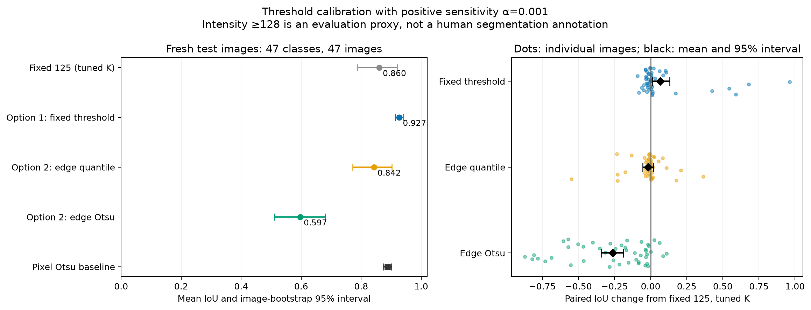
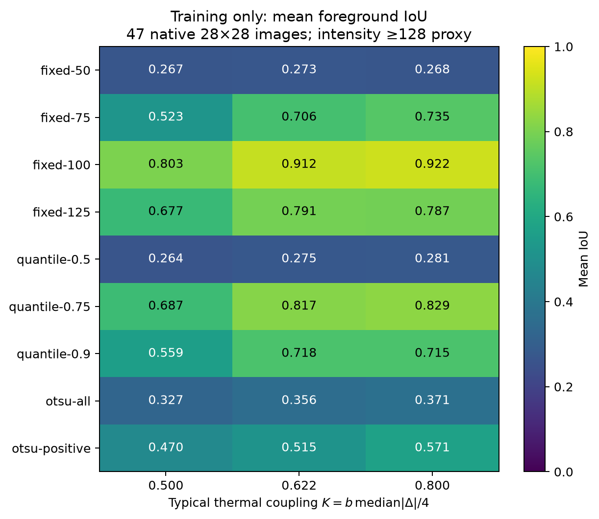
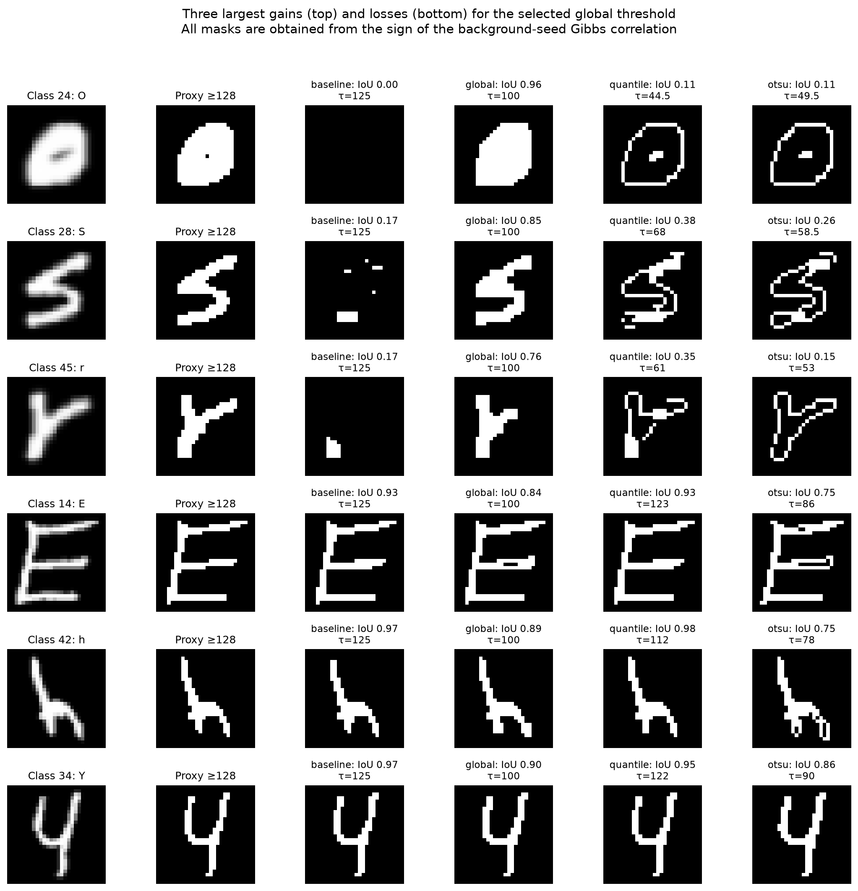

# Replacing the fixed edge threshold: EMNIST experiment

This study tests options 1 and 2: a calibrated global threshold, and a global
threshold computed separately from each image's neighboring intensity
differences. It retains positive sensitivity and the Ising sign convention from
the [previous EMNIST study](emnist-ising.md).

**The best tested choice is a constant threshold of 100, with alpha = 0.001
and K = 0.8.** On the 47 fresh test images, it improves mean foreground IoU
from 0.860 to 0.927 and removes the five severe failures with IoU below 0.5.
The image-dependent quantile rule does not show an improvement over 125;
edge Otsu performs substantially worse.

| Training-selected rule | K | Training IoU | Fresh test IoU (95% image-bootstrap interval) | Test images below IoU 0.5 |
|---|---:|---:|---:|---:|
| Fixed 125 control | 0.621775 | 0.791 | 0.860 [0.788, 0.920] | 5/47 |
| **Option 1: fixed 100** | **0.8** | **0.922** | **0.927 [0.914, 0.939]** | **0/47** |
| Option 2: 75th percentile of positive differences | 0.8 | 0.829 | 0.842 [0.772, 0.902] | 5/47 |
| Option 2: Otsu on positive differences | 0.8 | 0.571 | 0.597 [0.510, 0.681] | 19/47 |

Training entries are the original screening estimates. Longer checks of the
flagged calibration runs leave every choice unchanged; the audited Otsu
training mean is 0.570. The fixed-125 control selects the original thermal
scale, so the separately retained original-scale baseline is identical.

The paired test IoU change for fixed 100 versus fixed 125 is **+0.06691**,
with approximate 95% interval **[+0.01309, +0.13203]**. The improvement is
concentrated in recovery from severe failures: there are 23 improvements,
23 declines, and one tie. This is not a uniform improvement for every image.
The worst fixed-100 test IoU is 0.764; 39/47 images have IoU at least 0.9,
compared with 36/47 for the control.

The adaptive quantile's paired change is -0.01777 [-0.05529, +0.01698],
which does not establish an improvement or a clear decline at this sample
size. Edge Otsu's change is -0.26359 [-0.34207, -0.18744]. These are
approximate intervals from a small balanced pilot with one image per class;
they cannot characterize within-class variability.



## What the threshold change is doing

At fixed K = 0.621775, changing 125 to 100 already improves training IoU
from 0.791 to **0.912**. Choosing K = 0.8 then adds a smaller improvement to
0.922. Thus the training improvement is not explained solely by a change
in temperature. The fresh evaluation compares the jointly calibrated choices.

| Fixed threshold | Training IoU at K=0.5 | At K=0.621775 | At K=0.8 |
|---|---:|---:|---:|
| 50 | 0.267 | 0.273 | 0.268 |
| 75 | 0.523 | 0.706 | 0.735 |
| 100 | 0.803 | 0.912 | 0.922 |
| 125 | 0.677 | 0.791 | 0.787 |



On fresh test images, the fraction of proxy-boundary edges with
antiferromagnetic couplings rises from **61.9% at 125 to 79.0% at 100**.
At the same time, the fraction of within-stroke edges incorrectly made
antiferromagnetic rises from 0.08% to 4.03%. Threshold 100 achieves a useful
balance on this sample.

The adaptive quantile ranges from 44.5 to 140, with median 88.75. Positive-edge
Otsu ranges from 49.5 to 101, with median 71.5. Otsu makes 92.1% of boundary
edges antiferromagnetic, but also 11.6% of within-stroke edges. These local
statistics and the example masks support the interpretation that thresholds
that are too low can split the ink into multiple spin domains, sometimes
leaving an outline instead of a filled character. Otsu optimizes separation
of edge-difference values; that objective does not impose consistency of
the resulting spin domains across the image.

The examples below are selected reproducibly: the three largest gains and
three largest losses of fixed 100 relative to fixed 125. They show both
recovery from a missing character and modest deterioration on thin strokes.



For fixed 100, **99.72%** of background-seed correlation signs satisfy the
pointwise resolution criterion. Background and ink seeds give foreground
IoUs 0.9270 and 0.9274, and their pixel predictions agree **99.976%** of the
time. For Otsu, these IoUs are 0.5965 and 0.5064, with only 55.31% seed
agreement. High mean resolution alone therefore does not ensure a consistent
two-region segmentation.

Changing the evaluation mask also changes the absolute scores:

| Rule | Mask >=96 | Mask >=128 | Mask >=160 |
|---|---:|---:|---:|
| Fixed 125 | 0.787 | 0.860 | 0.819 |
| Fixed 100 | **0.900** | **0.927** | **0.868** |
| 75th-percentile rule | 0.833 | 0.842 | 0.782 |
| Positive-edge Otsu | 0.662 | 0.597 | 0.534 |
| Pixel-intensity Otsu baseline | 0.984 | 0.888 | 0.800 |

The ordering among the four Ising choices survives these two proxy changes.
The pixel baseline's behavior emphasizes that the definition of foreground
matters substantially.

## Recommendation and numerical checks

For the next experiments on **0–255 EMNIST-like images**, use

\[
\tau=100,\qquad \alpha=0.001,\qquad
\beta_{\rm paper}=\frac{3.2N}{\operatorname{median}_{e}|\Delta_e|}.
\]

This means b = beta_paper/N = 32.106–32.429 on the fresh test set, roughly
beta_paper = 25,200 for N = 784. It is the best setting in the tested grid,
not an established optimum or a universal rule for arbitrary images. A
reasonable next calibration would refine tau around 85–115 and evaluate
controlled contrast changes, using additional held-out images. Neither a
quantile nor edge Otsu should replace the constant based on these results.

All 188 fresh test conditions have maximum observable split R-hat below
1.019. All test jobs record at least one hot–cold–hot replica round trip,
with 4,436 in total. For fixed 100, the minimum effective sample-size
estimate for the mean correlation is 5,710 of 8,192 retained measurements.
Some per-pixel batch R-hat values are larger: the maximum across the entire
test study is 1.161. The smallest adjacent swap acceptance is 3.27%. We do
not interpret the scalar diagnostics as proof that every correlation is
fully equilibrated.

The longer independent checks cover four preselected test images and all
four selected rules, for 16 comparisons. They use four chains, 2,048 warmup
and 4,096 retained sweeps per chain. Maximum observable R-hat is 1.0045;
no short-versus-long correlation discrepancy exceeds six combined standard
errors plus 0.002. Maximum IoU change is 0.007963, and the mean absolute
change is 0.002266. **All four fixed-100 segmentation masks are unchanged**;
their maximum correlation l-infinity difference is 0.006866. Across all
rules the maximum is 0.019974, for edge Otsu.

Machine-readable results are in [emnist-thresholds-summary.json](emnist-thresholds-summary.json),
with separate [exact checks](emnist-thresholds-validation.json),
[calibration audit](emnist-thresholds-training-audit.json), and
[longer confirmations](emnist-thresholds-confirmation.json).

## Hamiltonian and temperature

For raw 0–255 grayscale intensities and unique horizontal/vertical edges,

\[
d_{pq}=|I_p-I_q|,\qquad
\Delta_{pq}=\arctan[\alpha(\tau-d_{pq})],\qquad
H=-\frac14\sum_{\{p,q\}}\Delta_{pq}Z_pZ_q.
\]

Sensitivity is fixed at **alpha = 0.001** throughout this experiment. Similar
neighbors with difference below tau have ferromagnetic coupling; differences
above tau have antiferromagnetic coupling. There are no XX/YY terms, external
fields, periodic boundaries, or pinned spins. This is a diagonal quantum
Hamiltonian, whose Gibbs probabilities are sampled classically here.

We compare the dimensionless temperature scale

\[
K=\frac{b}{4}\operatorname{median}_{e}|\Delta_e|,
\qquad b=\frac{\beta_{\rm paper}}{N},
\qquad \beta_{\rm paper}=\frac{4NK}{\operatorname{median}_{e}|\Delta_e|}.
\]

The grid is K = 0.5, 0.6217749727338072, 0.8. The middle value reproduces
b = 20 at threshold 125 when the median coupling equals arctan(0.125)/4.
Normalizing K prevents a threshold change from simply weakening the typical
coupling. It does not fix the entire coupling distribution or a critical
temperature. Each method selects K on training data, so the final comparison
is between calibrated threshold-and-temperature choices. The training heatmap
also provides comparisons at identical K.

## Candidate threshold rules

1. Fixed tau in **50, 75, 100, 125**.
2. Quantiles **0.50, 0.75, 0.90** of strictly positive neighboring differences.
   Constant background edges are excluded from this quantile calculation.
3. Otsu splitting of **all neighboring differences**, including zeros.
4. Otsu splitting of **positive neighboring differences** only.

The last three families implement option 2. Edge Otsu splits the empirical
distribution to minimize the sum of within-group squared deviations. The
threshold is the midpoint of the adjacent observed values at the optimal
split. Ties choose the lowest split. This fixes the otherwise arbitrary
threshold within an empty histogram gap and avoids zero couplings at the
observed edge values. The usual pixel-intensity Otsu segmentation is evaluated
separately as a baseline; it is never substituted for edge Otsu.

For a quantile, the actual interpolated quantile is retained, including any
zero couplings caused by equal edge differences. Adaptive thresholds have a
floor of 1. An empty positive-difference distribution uses threshold 125;
Otsu also uses this fallback when there are fewer than two distinct values
to split. If the median absolute coupling vanishes, thermal normalization
raises an error rather than choosing an enormous beta. These fallbacks are
implementation conventions, not a general segmentation solution for all
degenerate images.

All thresholds are computed once from the image. They are independent of the
spin configuration, and the Hamiltonian remains fixed throughout sampling.

## Calibration, evaluation, and uncertainty

The data are native 28×28 EMNIST Balanced images: **784 spins per image**.
Calibration reuses the previous 47 training images, one per class. The new
evaluation uses 47 fresh official test images, also one per class, selected
with RNG seed 20261009. We exclude all 47 previously inspected test indices
and the content hashes of all 94 images in the earlier study. Both exclusions
and uniqueness of the new test images were checked.

The complete screening grid contains 47 × 9 × 3 = **1,269 training
conditions**. We freeze the best fixed threshold, best quantile, best Otsu
variant, and their temperatures using only mean training foreground IoU.
Threshold 125 receives the same temperature-selection opportunity. The
manifest, frozen selection, code hashes, run signatures, and sampling data
are saved under `results/emnist-thresholds/`.

EMNIST supplies character labels, not segmentation annotations. Our reference
mask is intensity >=128, with sensitivity checks at 96 and 160. These masks
are used for calibration and evaluation, never for the spin update rules.
Consequently, good scores demonstrate agreement with a foreground proxy;
they do not establish accuracy against human segmentation labels.
Directly thresholding intensity at 128 would score IoU = 1 by construction.
These scores therefore test how faithfully the Hamiltonian reproduces the
chosen target; they do not demonstrate an advantage over classical segmentation.

Algorithm 1 assigns a pixel to the seed's segment when
Gamma(seed,pixel) = <Z_seed Z_pixel>/4 is strictly positive. The primary seed
is the first darkest perimeter pixel; foreground is Gamma <=0. A secondary
seed is the first brightest pixel, for which foreground is Gamma >0. Neither
seed is pinned. IoU measures foreground overlap, avoiding misleading accuracy
scores dominated by black background pixels. We also report balanced
accuracy, seed agreement, and the fraction of correlation signs satisfying
|Gamma| > max(3 SE, 1e-12). This is an approximate pointwise resolution
criterion, not a simultaneous confidence guarantee.

The sampler combines systematic single-spin heat-bath updates, signed
Swendsen–Wang cluster updates, and adjacent parallel-tempering exchanges.
Every replica uses one such sweep per iteration. Training uses two chains
with 512 warmup and 1,024 retained sweeps each; fresh testing uses four chains
with 1,024 warmup and 2,048 retained sweeps each. Chains start from random
or all-up configurations. Batch size is 64. Reported standard errors take
the larger of batch and between-chain estimates.

Paired differences compare methods on exactly the same test images.
Percentile bootstrap intervals use 5,000 image resamples. They describe the
uncertainty of this small image sample, not every source of Monte Carlo or
dataset uncertainty. No held-out result is used to change the frozen rule.

## Verification and reproducibility

The focused Python suite contains 18 passing tests, including backward
compatibility of threshold 125, arbitrary-threshold energies, edge Otsu
against direct within-class variance minimization, quantile conventions,
thermal normalization, and Monte Carlo versus exact enumeration.

An additional 81 parameter comparisons use three high-variance 3×3 EMNIST
training patches. Exact Gibbs probabilities enumerate all 512 spin states.
Thresholds and temperatures come from their parent 28×28 images. The maximum
absolute correlation discrepancy is **0.005331**, with no discrepancy beyond
6 estimated standard errors plus 0.002. Details are in
`emnist-thresholds-validation.json`.

Every calibration job with observable split R-hat >1.05 receives a longer
independent audit. This includes four jobs and 12 parameter conditions; it
does not alter the frozen choices. A separate, preselected confirmation uses
fresh test classes 0, 12, 24, and 36, doubles both warmup and retained length,
and changes the random seed. All diagnostics remain empirical checks, not
a proof of equilibration.

From the repository root, with the existing optional Monte Carlo environment:

```sh
.venv/bin/python -m pytest algorithm1/tests/test_ising_thresholds.py algorithm1/tests/test_ising_monte_carlo.py algorithm1/tests/test_ising_algorithm1.py -q
.venv/bin/python algorithm1/python/run_emnist_thresholds.py train --workers 6
.venv/bin/python algorithm1/python/run_emnist_thresholds.py freeze
.venv/bin/python algorithm1/python/run_emnist_thresholds.py test --workers 6
.venv/bin/python algorithm1/python/validate_emnist_thresholds.py
.venv/bin/python algorithm1/python/audit_emnist_threshold_training.py
.venv/bin/python algorithm1/python/confirm_emnist_thresholds.py --workers 6
.venv/bin/python algorithm1/python/analyze_emnist_thresholds.py
```

The existing EMNIST download and earlier study's training manifest are
required. Cached protocols reject conflicting parameters or code hashes.
The model extension is backward compatible: `signed_image(image, alpha)`
still uses 125; `signed_image(image, alpha, threshold=tau)` sets the new value.
Exact Python reference comparisons use the older literal convention
`ising_model(image, -alpha, threshold=tau)`, which represents the same
Hamiltonian. Older simulation outputs are preserved.

The JSON summaries and source scripts are outside the ignored results
directory. Raw NPZ samples, manifests, and PNG/SVG figures are inside
`algorithm1/results/emnist-thresholds/`, which remains ignored by Git.
