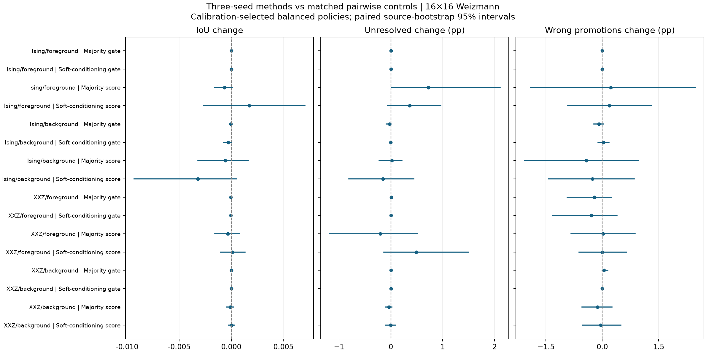
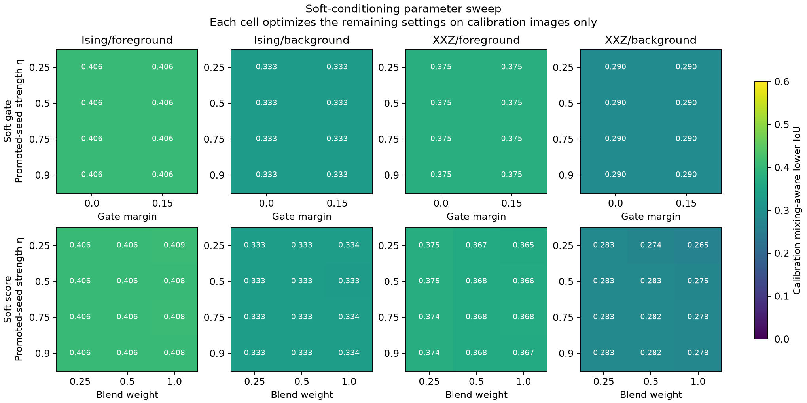
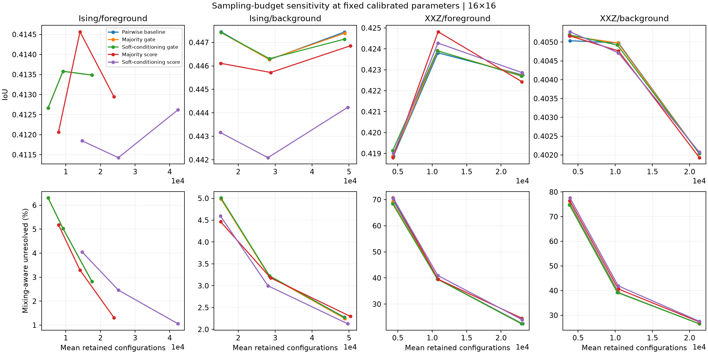

# Three-seed majority and soft conditioning: numerical Gibbs experiment

Completed readout and promotion study on the Weizmann Segmentation Evaluation Database. All selections use calibration images; comparison outcomes do not choose parameters. These are reused development images, not an external validation set.

## Findings

Neither three-seed majority nor soft conditioning gives a consistent segmentation or promotion-reliability improvement beyond matched pairwise controls in this parameter grid. At 16×16, none of the 16 balanced higher-order methods has a positive matched-control IoU confidence interval excluding zero. Promotion gates are usually redundant; score methods change coverage and cost more than IoU. This is evidence about the tested policies and Hamiltonians, not a general impossibility result for higher correlations.
The apparent Ising/foreground coverage gain against the separately tuned baseline is misleading without matching iteration settings. Majority scoring has 1.31% unresolved pixels versus 0.59% for pairwise scoring with the same settings; soft scoring has 1.06% versus 0.70%. Their matched IoU differences are −0.00065 [−0.00162, +0.00010] and +0.00170 [−0.00266, +0.00708], respectively. Neither improvement is established. The headline soft method also promotes more incorrect labels and consumes more samples than the separately tuned baseline.
Optimizing promotion reliability on calibration data lowers the comparison wrong-promotion rate to 28.02% for Ising/foreground soft scoring and 24.71% for Ising/background majority scoring, at unresolved fractions of 5.97% and 5.36%. The changes relative to controls with the same promotion cutoff and stopping rule remain inconclusive. Stricter promotion settings account for much of the tradeoff.
XXZ favors a small higher-order blend (0.25) in the balanced calibration selections. Increasing the blend often worsens the calibration lower-IoU objective. Ising selects stronger blends, but their comparison gains do not survive matched-control scrutiny. There is no parameter setting established here as uniformly best for IoU, coverage, boundaries, reliability, and cost.
Sampling limits matter: the fixed-budget XXZ estimates have substantial convergence failures. The larger-budget confirmation at the end of this report preserves all selected parameters and uses the same replacement bank for every method on an affected image. Do not interpret statistical abstention alone as total uncertainty.
One plausible explanation for the small higher-order effect is vote redundancy and correlated label mistakes. For example, Ising/foreground soft-score triplets have 84.78% average signed-spin unanimity, yet 25.16% of evaluated triplets contain at least two semantically wrong labels. Agreement among inferred seeds is not independent evidence that the segmentation is correct.

## Experimental scope

- Ising and XXZ, each with a known foreground or background starting pixel; fixed primary Hamiltonians inherited from the promotion study. Hamiltonians were selected separately previously, so differences across model/start rows do not isolate only the model or only the starting label.
- 25 calibration sources and 75 comparison sources at both 8×8 and 16×16. Two random promotion replicates per calibration case; five per comparison case.
- 306 readout/promotion configurations × 3 round caps × 2 stopping settings = 1,836 policies per model/start, 7,344 combinations and 734,400 calibration endpoints.
- Promotion cutoffs 0.25/0.5/0.75; abstention margins 0/0.05; anchored or uniform triplets; gate confidence margins 0/0.15; score blend weights 0.25/0.5/1; soft promoted-seed strengths 0.25/0.5/0.75/0.9, with trusted-anchor strength 1.
- Caps 3/6/10; ordinary stopping or two equal-count transitions. Stop immediately on all resolved, no candidates, or failed score convergence. No forced extra labels to make a triplet.
- Main budget: four chains × 2,048 configurations per fresh round. Budget sensitivity: 512 and 1,024 per chain, same frozen parameters and paired prefixes.
- Select separately by mixing-aware lower IoU (balanced), full-mask IoU, BPM, and promotion reliability subject to calibration quality/coverage constraints where feasible.
- 161,250 comparison trajectory records; 5.83 summed worker-hours of offline reanalysis. Existing Gibbs banks are reused; these times are not new state-preparation times.

## Definitions and controls

All scores are normalized to [-1,1]. The pairwise control divides the original foreground-minus-background mean by the number of nonempty roles. Every promoted pixel is evaluated with its own label removed; only the initial trusted label is retained. Thus the numerical baseline here differs from historical reports. The same convention applies to every variant.
Three-seed majority evaluates Zi × majority(ya Za,yb Zb,yc Zc) sample by sample. Its mean is (ya Cia+yb Cib+yc Cic−ya yb yc Ciabc)/2 for distinct sites. Raw odd Z correlations vanish by global spin-flip symmetry for both finite zero-field Gibbs states. Soft conditioning uses A=va+vb+vc+va vb vc, B=1+va vb+va vc+vb vc and E[Zi A]/E[B], where vs=eta_s ys Zs. This is exact spin-flip symmetrization of the soft conditional ratio; it does not double the independent sample count. Ratio uncertainty retains numerator/denominator covariance using paired influence observations.
One triple per target/round is selected using random priorities fixed before the round. Anchored groups contain the original seed when eligible. A promoted target is excluded from its own triple; if fewer than three other seeds exist its score falls back to leave-one-out pairwise inference. Before three total seeds, every method uses the same pairwise bootstrap.
Gate variants retain pairwise segmentation and require an extra confident higher-order sign before promotion. Score variants blend the higher-order readout with the pair score for both segmentation and promotion. At most one seed and one anti-seed are selected uniformly per round. Truth is used only for the original label, calibration selection, and evaluation.
Each selected variant is compared with a pair control having the same cutoff, margin, cap and stop; and an unweighted linear signed-triple vote using the same group-selection rule. This controls triplet selection. Soft conditioning also gives the trusted anchor a different strength from promoted seeds, so this unweighted linear control alone cannot attribute a soft-method gain specifically to the four-point term rather than seed weighting. Different methods can stop at different rounds, so actual retained configurations are reported rather than claiming identical consumed budgets.
IoU and BPM evaluate tentative masks, including unresolved pixels. Statistical unresolved excludes only the original trusted pixel; mixing-aware unresolved is 100% for failed final score convergence. BPM is the inherited Zhang skeleton-proximity IoU with Euclidean radius 1, not ordinary object-outline accuracy; radius 0 and 2 are also saved. One pixel represents a different image fraction at the two resolutions, so boundary comparisons should be made within a resolution. Wrong-promotion rate pools wrong promoted labels / all promoted labels; no-promotion runs do not count as perfect precision.
Errors use 16 blocks per chain and the larger of block and between-chain SE; nominal Bonferroni-t correction covers pixels × ten rounds within one trajectory. Direct score/influence split-Rhat and inherited scalar guard must be below 1.05. Soft weighting requires Kish effective weight count ≥100; this does not substitute for autocorrelation ESS. Prefix scalar guards are inherited from full banks; direct readout diagnostics are recomputed. MCMC/delta-method coverage and pointwise bootstrap intervals are exploratory, not simultaneous across the sweep.

## Balanced selections: primary comparison

### 16×16

| Model / start | Method | IoU | U | Mixing U | BPM r=1 | Wrong promotions | Promoted / image | Configurations | Activated |
|---|---|---:|---:|---:|---:|---:|---:|---:|---:|
| Ising/foreground | Pairwise baseline | 0.4135 | 2.82% | 2.82% | 0.3356 | 32.72% | 2.17 | 17564 | 0.0% |
| Ising/foreground | Majority gate | 0.4135 | 2.82% | 2.82% | 0.3356 | 32.72% | 2.17 | 17564 | 58.7% |
| Ising/foreground | Soft-conditioning gate | 0.4135 | 2.82% | 2.82% | 0.3356 | 32.72% | 2.17 | 17564 | 58.7% |
| Ising/foreground | Majority score | 0.4129 | 1.31% | 1.31% | 0.3346 | 31.69% | 3.68 | 23921 | 66.7% |
| Ising/foreground | Soft-conditioning score | 0.4126 | 1.06% | 1.06% | 0.3377 | 35.98% | 8.19 | 42402 | 68.0% |
| Ising/background | Pairwise baseline | 0.4474 | 2.28% | 2.28% | 0.3954 | 32.96% | 9.87 | 48781 | 0.0% |
| Ising/background | Majority gate | 0.4474 | 2.25% | 2.25% | 0.3954 | 32.87% | 9.88 | 48824 | 62.7% |
| Ising/background | Soft-conditioning gate | 0.4471 | 2.27% | 2.27% | 0.3952 | 32.99% | 9.87 | 48781 | 62.7% |
| Ising/background | Majority score | 0.4469 | 2.30% | 2.30% | 0.3944 | 32.54% | 10.25 | 50353 | 62.7% |
| Ising/background | Soft-conditioning score | 0.4442 | 2.13% | 2.13% | 0.3943 | 32.70% | 10.09 | 49633 | 62.7% |
| XXZ/foreground | Pairwise baseline | 0.4228 | 11.42% | 22.45% | 0.3420 | 32.28% | 3.54 | 23134 | 0.0% |
| XXZ/foreground | Majority gate | 0.4227 | 11.43% | 22.46% | 0.3418 | 32.07% | 3.51 | 23025 | 92.0% |
| XXZ/foreground | Soft-conditioning gate | 0.4227 | 11.42% | 22.46% | 0.3421 | 31.98% | 3.49 | 22959 | 92.0% |
| XXZ/foreground | Majority score | 0.4224 | 11.22% | 24.58% | 0.3418 | 32.29% | 3.51 | 23025 | 92.0% |
| XXZ/foreground | Soft-conditioning score | 0.4229 | 11.91% | 24.02% | 0.3421 | 32.27% | 3.52 | 23069 | 92.0% |
| XXZ/background | Pairwise baseline | 0.4020 | 8.93% | 26.53% | 0.3612 | 25.68% | 3.03 | 21299 | 0.0% |
| XXZ/background | Majority gate | 0.4020 | 8.93% | 26.53% | 0.3612 | 25.73% | 3.03 | 21277 | 82.7% |
| XXZ/background | Soft-conditioning gate | 0.4020 | 8.93% | 26.53% | 0.3612 | 25.68% | 3.03 | 21299 | 82.7% |
| XXZ/background | Majority score | 0.4019 | 8.89% | 27.28% | 0.3619 | 25.55% | 3.04 | 21321 | 82.7% |
| XXZ/background | Soft-conditioning score | 0.4021 | 8.93% | 27.57% | 0.3619 | 25.64% | 3.04 | 21299 | 82.7% |

### 8×8

| Model / start | Method | IoU | U | Mixing U | BPM r=1 | Wrong promotions | Promoted / image | Configurations | Activated |
|---|---|---:|---:|---:|---:|---:|---:|---:|---:|
| Ising/foreground | Pairwise baseline | 0.3884 | 1.99% | 1.99% | 0.4593 | 32.79% | 0.81 | 12408 | 0.0% |
| Ising/foreground | Majority gate | 0.3884 | 1.99% | 1.99% | 0.4593 | 32.79% | 0.81 | 12408 | 25.9% |
| Ising/foreground | Soft-conditioning gate | 0.3884 | 1.99% | 1.99% | 0.4593 | 32.79% | 0.81 | 12408 | 25.9% |
| Ising/foreground | Majority score | 0.3897 | 1.73% | 1.73% | 0.4622 | 31.74% | 1.23 | 14702 | 27.2% |
| Ising/foreground | Soft-conditioning score | 0.3853 | 1.54% | 1.54% | 0.4626 | 37.09% | 2.60 | 22173 | 28.3% |
| Ising/background | Pairwise baseline | 0.4005 | 0.52% | 0.52% | 0.4380 | 35.71% | 3.85 | 24379 | 0.0% |
| Ising/background | Majority gate | 0.4006 | 0.51% | 0.51% | 0.4380 | 35.77% | 3.82 | 24292 | 37.3% |
| Ising/background | Soft-conditioning gate | 0.4003 | 0.63% | 0.63% | 0.4380 | 35.47% | 3.83 | 24314 | 37.3% |
| Ising/background | Majority score | 0.4008 | 0.61% | 0.61% | 0.4354 | 34.13% | 4.02 | 25319 | 37.3% |
| Ising/background | Soft-conditioning score | 0.3992 | 0.30% | 0.30% | 0.4337 | 32.02% | 3.18 | 21387 | 37.3% |
| XXZ/foreground | Pairwise baseline | 0.4001 | 6.21% | 6.21% | 0.4569 | 28.82% | 2.32 | 19071 | 0.0% |
| XXZ/foreground | Majority gate | 0.4001 | 6.21% | 6.21% | 0.4569 | 28.82% | 2.32 | 19071 | 69.9% |
| XXZ/foreground | Soft-conditioning gate | 0.4001 | 6.21% | 6.21% | 0.4569 | 28.82% | 2.32 | 19071 | 69.9% |
| XXZ/foreground | Majority score | 0.4009 | 6.32% | 6.32% | 0.4586 | 28.93% | 2.36 | 19202 | 69.9% |
| XXZ/foreground | Soft-conditioning score | 0.4009 | 6.24% | 6.24% | 0.4575 | 29.02% | 2.35 | 19158 | 69.9% |
| XXZ/background | Pairwise baseline | 0.3290 | 6.02% | 6.02% | 0.4147 | 17.98% | 1.96 | 19115 | 0.0% |
| XXZ/background | Majority gate | 0.3290 | 6.02% | 6.02% | 0.4147 | 17.98% | 1.96 | 19115 | 67.2% |
| XXZ/background | Soft-conditioning gate | 0.3290 | 6.02% | 6.02% | 0.4147 | 17.98% | 1.96 | 19115 | 67.2% |
| XXZ/background | Majority score | 0.3287 | 6.04% | 6.04% | 0.4148 | 17.80% | 1.96 | 19137 | 67.2% |
| XXZ/background | Soft-conditioning score | 0.3291 | 5.97% | 5.97% | 0.4146 | 17.66% | 1.96 | 19137 | 67.2% |



### Paired mechanism effects, 16×16

| Model / start | Method | ΔIoU [95% CI] | ΔU, pp [95% CI] | Δwrong promotions, pp [95% CI] |
|---|---|---:|---:|---:|
| Ising/foreground | Majority gate | +0.000 [+0.000, +0.000] | +0.000 [+0.000, +0.000] | +0.000 [+0.000, +0.000] |
| Ising/foreground | Soft-conditioning gate | +0.000 [+0.000, +0.000] | +0.000 [+0.000, +0.000] | +0.000 [+0.000, +0.000] |
| Ising/foreground | Majority score | -0.001 [-0.002, +0.000] | +0.725 [+0.012, +2.108] | +0.229 [-1.914, +2.478] |
| Ising/foreground | Soft-conditioning score | +0.002 [-0.003, +0.007] | +0.361 [-0.066, +0.965] | +0.185 [-0.916, +1.311] |
| Ising/background | Majority gate | -0.000 [-0.000, +0.000] | -0.028 [-0.091, +0.004] | -0.090 [-0.227, +0.028] |
| Ising/background | Soft-conditioning gate | -0.000 [-0.001, +0.000] | -0.005 [-0.020, +0.006] | +0.027 [-0.115, +0.175] |
| Ising/background | Majority score | -0.001 [-0.003, +0.002] | +0.021 [-0.227, +0.212] | -0.429 [-2.073, +0.970] |
| Ising/background | Soft-conditioning score | -0.003 [-0.009, +0.001] | -0.150 [-0.813, +0.444] | -0.265 [-1.431, +0.850] |
| XXZ/foreground | Majority gate | -0.000 [-0.000, +0.000] | +0.005 [+0.000, +0.014] | -0.211 [-0.933, +0.249] |
| XXZ/foreground | Soft-conditioning gate | -0.000 [-0.000, +0.000] | +0.004 [+0.000, +0.012] | -0.293 [-1.325, +0.393] |
| XXZ/foreground | Majority score | -0.000 [-0.002, +0.001] | -0.204 [-1.187, +0.512] | +0.017 [-0.833, +0.876] |
| XXZ/foreground | Soft-conditioning score | +0.000 [-0.001, +0.001] | +0.490 [-0.135, +1.501] | -0.005 [-0.615, +0.642] |
| XXZ/background | Majority gate | +0.000 [+0.000, +0.000] | +0.001 [+0.000, +0.003] | +0.045 [+0.000, +0.148] |
| XXZ/background | Soft-conditioning gate | +0.000 [+0.000, +0.000] | +0.000 [+0.000, +0.000] | +0.000 [+0.000, +0.000] |
| XXZ/background | Majority score | -0.000 [-0.000, +0.000] | -0.038 [-0.108, +0.017] | -0.133 [-0.539, +0.259] |
| XXZ/background | Soft-conditioning score | +0.000 [-0.000, +0.000] | -0.006 [-0.099, +0.094] | -0.045 [-0.524, +0.491] |

Intervals bootstrap the 75 source images, after averaging promotion replicates within source. They are unadjusted pointwise intervals. Matched linear-control effects are included in the machine-readable summary.

### Equal-consumed-budget one-seed controls, 16×16

| Model / start | Method | Adaptive IoU | Pooled one-seed IoU | ΔIoU [95% CI] |
|---|---|---:|---:|---:|
| Ising/foreground | Majority gate | 0.4135 | 0.4101 | +0.003 [-0.000, +0.010] |
| Ising/foreground | Soft-conditioning gate | 0.4135 | 0.4101 | +0.003 [-0.000, +0.010] |
| Ising/foreground | Majority score | 0.4129 | 0.4099 | +0.003 [-0.002, +0.011] |
| Ising/foreground | Soft-conditioning score | 0.4126 | 0.4103 | +0.002 [-0.005, +0.011] |
| Ising/background | Majority gate | 0.4474 | 0.4452 | +0.002 [-0.002, +0.007] |
| Ising/background | Soft-conditioning gate | 0.4471 | 0.4452 | +0.002 [-0.002, +0.007] |
| Ising/background | Majority score | 0.4469 | 0.4453 | +0.002 [-0.002, +0.005] |
| Ising/background | Soft-conditioning score | 0.4442 | 0.4451 | -0.001 [-0.008, +0.005] |
| XXZ/foreground | Majority gate | 0.4227 | 0.4260 | -0.003 [-0.012, +0.005] |
| XXZ/foreground | Soft-conditioning gate | 0.4227 | 0.4259 | -0.003 [-0.012, +0.005] |
| XXZ/foreground | Majority score | 0.4224 | 0.4259 | -0.003 [-0.012, +0.004] |
| XXZ/foreground | Soft-conditioning score | 0.4229 | 0.4259 | -0.003 [-0.011, +0.004] |
| XXZ/background | Majority gate | 0.4020 | 0.4016 | +0.000 [-0.002, +0.002] |
| XXZ/background | Soft-conditioning gate | 0.4020 | 0.4016 | +0.000 [-0.002, +0.002] |
| XXZ/background | Majority score | 0.4019 | 0.4016 | +0.000 [-0.002, +0.002] |
| XXZ/background | Soft-conditioning score | 0.4021 | 0.4016 | +0.000 [-0.002, +0.002] |

The one-seed control pools precisely the independent rounds consumed by each adaptive trajectory; no extra trusted labels are supplied. Both methods have identical retained-configuration counts within each pairing.

## Alternative calibration objectives, 16×16

| Model / start | Objective | Selected new method | IoU | U | BPM | Wrong promotions | Configurations |
|---|---|---|---:|---:|---:|---:|---:|
| Ising/foreground | iou | Majority score | 0.4129 | 1.31% | 0.3346 | 31.69% | 23921 |
| Ising/foreground | boundary | Soft-conditioning score | 0.4134 | 2.83% | 0.3355 | 32.84% | 17564 |
| Ising/foreground | reliability | Soft-conditioning score | 0.4135 | 5.97% | 0.3354 | 28.02% | 31872 |
| Ising/background | iou | Soft-conditioning score | 0.4466 | 5.11% | 0.3947 | 30.75% | 61997 |
| Ising/background | boundary | Soft-conditioning score | 0.4451 | 4.83% | 0.3943 | 31.08% | 61145 |
| Ising/background | reliability | Majority score | 0.4456 | 5.36% | 0.3939 | 24.71% | 60381 |
| XXZ/foreground | iou | Soft-conditioning score | 0.4195 | 12.26% | 0.3434 | 27.11% | 34472 |
| XXZ/foreground | boundary | Soft-conditioning score | 0.4197 | 12.87% | 0.3383 | 29.22% | 21867 |
| XXZ/foreground | reliability | Soft-conditioning score | 0.4189 | 12.88% | 0.3381 | 29.10% | 21845 |
| XXZ/background | iou | Soft-conditioning score | 0.4017 | 9.16% | 0.3634 | 19.27% | 20382 |
| XXZ/background | boundary | Soft-conditioning score | 0.3999 | 11.37% | 0.3633 | 15.31% | 34821 |
| XXZ/background | reliability | Soft-conditioning gate | 0.4014 | 9.19% | 0.3630 | 18.09% | 20316 |

The method in each row is selected from calibration metrics, not chosen for its comparison score. Every family/objective result is retained in metrics.csv and higher-seeds-summary.json.



## Sampling cost



All observables use the same Z-basis configurations; no new measurement basis or Hamiltonian evolution is required. A round costs 4 × samples retained configurations. Ising draws are independent; XXZ configurations are correlated and score ESS is reported separately in the data. For the fixed-budget XXZ banks, a prospective round at budget S requires 4(2000+2S) SSE sweeps including burn-in; the summary also records this estimate. A sweep is not a fixed number of operations across Hamiltonians. Soft conditioning can reduce effective weight support; higher-order readout is not free in statistical precision. Reported configuration counts exclude unused precomputed bank tails and are per segmentation run; the numerical study reuses banks across methods and promotion replicates. The fixed-budget sweep reused existing banks, so it does not newly measure Gibbs-generation wall time. The confirmation adds two banks and uses burn-in 6000. Quantum state-preparation depth is not estimated.

## Selected balanced parameters

- Ising/foreground / Pairwise baseline: `{"blend": 0.0, "cap": 3, "cut": 0.75, "eta": 0.0, "family": "pair", "gate_margin": 0.0, "group": "anchor", "margin": 0.0, "stopping": "none"}`
- Ising/foreground / Majority gate: `{"blend": 0.0, "cap": 3, "cut": 0.75, "eta": 0.0, "family": "majority_gate", "gate_margin": 0.15, "group": "uniform", "margin": 0.0, "stopping": "same_count"}`
- Ising/foreground / Soft-conditioning gate: `{"blend": 0.0, "cap": 3, "cut": 0.75, "eta": 0.25, "family": "soft_gate", "gate_margin": 0.15, "group": "uniform", "margin": 0.0, "stopping": "none"}`
- Ising/foreground / Majority score: `{"blend": 1.0, "cap": 6, "cut": 0.5, "eta": 0.0, "family": "majority_score", "gate_margin": 0.0, "group": "uniform", "margin": 0.0, "stopping": "same_count"}`
- Ising/foreground / Soft-conditioning score: `{"blend": 1.0, "cap": 10, "cut": 0.25, "eta": 0.25, "family": "soft_score", "gate_margin": 0.0, "group": "uniform", "margin": 0.0, "stopping": "none"}`
- Ising/background / Pairwise baseline: `{"blend": 0.0, "cap": 10, "cut": 0.25, "eta": 0.0, "family": "pair", "gate_margin": 0.0, "group": "anchor", "margin": 0.0, "stopping": "none"}`
- Ising/background / Majority gate: `{"blend": 0.0, "cap": 10, "cut": 0.25, "eta": 0.0, "family": "majority_gate", "gate_margin": 0.0, "group": "uniform", "margin": 0.0, "stopping": "none"}`
- Ising/background / Soft-conditioning gate: `{"blend": 0.0, "cap": 10, "cut": 0.25, "eta": 0.9, "family": "soft_gate", "gate_margin": 0.15, "group": "anchor", "margin": 0.0, "stopping": "none"}`
- Ising/background / Majority score: `{"blend": 0.5, "cap": 10, "cut": 0.25, "eta": 0.0, "family": "majority_score", "gate_margin": 0.0, "group": "uniform", "margin": 0.0, "stopping": "none"}`
- Ising/background / Soft-conditioning score: `{"blend": 1.0, "cap": 10, "cut": 0.25, "eta": 0.9, "family": "soft_score", "gate_margin": 0.0, "group": "uniform", "margin": 0.0, "stopping": "none"}`
- XXZ/foreground / Pairwise baseline: `{"blend": 0.0, "cap": 3, "cut": 0.25, "eta": 0.0, "family": "pair", "gate_margin": 0.0, "group": "anchor", "margin": 0.0, "stopping": "none"}`
- XXZ/foreground / Majority gate: `{"blend": 0.0, "cap": 3, "cut": 0.25, "eta": 0.0, "family": "majority_gate", "gate_margin": 0.0, "group": "uniform", "margin": 0.0, "stopping": "same_count"}`
- XXZ/foreground / Soft-conditioning gate: `{"blend": 0.0, "cap": 3, "cut": 0.25, "eta": 0.75, "family": "soft_gate", "gate_margin": 0.15, "group": "uniform", "margin": 0.0, "stopping": "same_count"}`
- XXZ/foreground / Majority score: `{"blend": 0.25, "cap": 3, "cut": 0.25, "eta": 0.0, "family": "majority_score", "gate_margin": 0.0, "group": "anchor", "margin": 0.0, "stopping": "same_count"}`
- XXZ/foreground / Soft-conditioning score: `{"blend": 0.25, "cap": 3, "cut": 0.25, "eta": 0.5, "family": "soft_score", "gate_margin": 0.0, "group": "anchor", "margin": 0.0, "stopping": "none"}`
- XXZ/background / Pairwise baseline: `{"blend": 0.0, "cap": 3, "cut": 0.5, "eta": 0.0, "family": "pair", "gate_margin": 0.0, "group": "anchor", "margin": 0.0, "stopping": "none"}`
- XXZ/background / Majority gate: `{"blend": 0.0, "cap": 3, "cut": 0.5, "eta": 0.0, "family": "majority_gate", "gate_margin": 0.0, "group": "anchor", "margin": 0.0, "stopping": "same_count"}`
- XXZ/background / Soft-conditioning gate: `{"blend": 0.0, "cap": 3, "cut": 0.5, "eta": 0.5, "family": "soft_gate", "gate_margin": 0.15, "group": "anchor", "margin": 0.0, "stopping": "same_count"}`
- XXZ/background / Majority score: `{"blend": 0.25, "cap": 3, "cut": 0.5, "eta": 0.0, "family": "majority_score", "gate_margin": 0.0, "group": "uniform", "margin": 0.0, "stopping": "none"}`
- XXZ/background / Soft-conditioning score: `{"blend": 0.25, "cap": 3, "cut": 0.5, "eta": 0.75, "family": "soft_score", "gate_margin": 0.0, "group": "anchor", "margin": 0.0, "stopping": "none"}`

## Do the three seeds provide different votes?

| Model / start | Method | Images with triplets | Mean P(all three signed votes agree) | Triplets with at least two wrong labels |
|---|---|---:|---:|---:|
| Ising/foreground | Majority gate | 44 | 94.80% | 17.31% |
| Ising/foreground | Soft-conditioning gate | 44 | 94.80% | 17.31% |
| Ising/foreground | Majority score | 50 | 89.60% | 19.74% |
| Ising/foreground | Soft-conditioning score | 51 | 84.78% | 25.16% |
| Ising/background | Majority gate | 47 | 82.29% | 21.40% |
| Ising/background | Soft-conditioning gate | 47 | 83.34% | 12.82% |
| Ising/background | Majority score | 47 | 82.17% | 22.50% |
| Ising/background | Soft-conditioning score | 47 | 81.37% | 22.53% |
| XXZ/foreground | Majority gate | 69 | 74.27% | 16.69% |
| XXZ/foreground | Soft-conditioning gate | 69 | 74.33% | 16.52% |
| XXZ/foreground | Majority score | 69 | 74.18% | 13.95% |
| XXZ/foreground | Soft-conditioning score | 69 | 74.14% | 13.72% |
| XXZ/background | Majority gate | 62 | 85.75% | 6.77% |
| XXZ/background | Soft-conditioning gate | 62 | 85.75% | 6.77% |
| XXZ/background | Majority score | 62 | 85.26% | 8.71% |
| XXZ/background | Soft-conditioning score | 62 | 85.82% | 6.61% |

This diagnostic uses the shared triplet for unseeded targets, excluding per-seed leave-one-out alternatives. It averages groups within each image, then weights images with any triplet equally. It is descriptive and includes terminal-round evaluations. Semantic label errors are measured only afterward using annotations.
For three signed ±1 votes, majority equals their linear average whenever all three agree. Consequently the absolute difference between their candidate correlation scores is at most (2/3) P(the votes do not all agree). For perfectly aligned signed seeds, soft conditioning reduces to a positive rescaling of their common seed correlation, with unit scale when the trusted hard anchor is included. Strong internal agreement therefore need not add new segmentation information or establish semantic correctness.

## Reproduction

Requires the prepared Weizmann case files and the existing independent-round snapshot banks in algorithm1/results/promotion-reliability/banks. Input images and banks are SHA-verified. These are reused data dependencies, not regenerated by the readout runner. Run from the repository root with the existing .venv:
```sh
.venv/bin/python -m pytest algorithm1/tests/test_higher_seed*.py algorithm1/tests/test_iterative_seed_gibbs.py algorithm1/tests/test_promotion_reliability.py -q
.venv/bin/python algorithm1/python/run_higher_seed_study.py init
.venv/bin/python algorithm1/python/run_higher_seed_study.py calibrate --workers 4
.venv/bin/python algorithm1/python/run_higher_seed_study.py select
.venv/bin/python algorithm1/python/run_higher_seed_bounded.py test --workers 4
.venv/bin/python algorithm1/python/run_higher_seed_bounded.py budget --workers 4
.venv/bin/python algorithm1/python/audit_higher_seed_study.py controls --workers 3
.venv/bin/python algorithm1/python/audit_higher_seed_study.py audit
.venv/bin/python algorithm1/python/analyze_higher_seed_study.py
.venv/bin/python algorithm1/python/run_higher_seed_confirmation.py
.venv/bin/python algorithm1/python/analyze_higher_seed_confirmation.py
```

Validation: 46 unit/integration tests passed. The main audit checked 161,250 trajectory records and replayed 24 bank/setting combinations with zero discrepancy. The confirmation has its own audit below. Reproduction of the confirmation also requires the prior primary-XXZ confirmation banks listed in its protocol.

## Larger-budget XXZ confirmation

The standard-budget XXZ comparison has substantial sampling failures, so its unresolved rates should not be interpreted solely as an algorithmic limitation. This follow-up keeps the balanced policies fixed and uses four × 8,192 configurations per fresh round on all available prior primary-XXZ confirmation banks plus newly flagged cases. Two missing banks were generated; no parameter was retuned.
There are 43 confirmed image/resolution cases: 42 at 16×16 and 1 at 8×8. Each affected case uses the same new bank for both starting labels and every method/control. The other cases retain the original bank. The table therefore covers all 75 comparison sources at 16×16 with an explicitly mixed sampling budget; the fixed-budget results above remain unchanged.
The additional sampling reduces foreground-start pairwise mixing-aware unresolved from 22.45% to 9.70%, and background-start from 26.53% to 9.23%. Higher-order gates then give identical aggregate results to their pairwise controls. No higher-order variant has an established positive matched IoU effect. Background-start majority scoring has a small negative pointwise IoU interval; these exploratory intervals are not corrected across methods.
At the increased budget, one used round consumes 32,768 retained configurations and requires 4(6000 + 2×8192) = 89,536 prospective SSE sweeps including burn-in. The table averages actual used configuration counts over the mixed-budget comparison. The new banks preserve independent round seeds; the unused bank tails are excluded from these costs.

| Start | Method | IoU | U | Mixing U | BPM r=1 | Wrong promotions | Configurations |
|---|---|---:|---:|---:|---:|---:|---:|
| foreground | Pairwise baseline | 0.4249 | 7.16% | 9.70% | 0.3459 | 30.51% | 59725 |
| foreground | Majority gate | 0.4249 | 7.16% | 9.70% | 0.3459 | 30.51% | 59725 |
| foreground | Soft-conditioning gate | 0.4249 | 7.16% | 9.70% | 0.3459 | 30.51% | 59725 |
| foreground | Majority score | 0.4251 | 7.04% | 9.58% | 0.3452 | 30.66% | 59856 |
| foreground | Soft-conditioning score | 0.4250 | 7.66% | 10.19% | 0.3459 | 30.63% | 59703 |
| background | Pairwise baseline | 0.4085 | 6.67% | 9.23% | 0.3591 | 25.60% | 58851 |
| background | Majority gate | 0.4085 | 6.67% | 9.23% | 0.3591 | 25.60% | 58851 |
| background | Soft-conditioning gate | 0.4085 | 6.67% | 9.23% | 0.3591 | 25.60% | 58851 |
| background | Majority score | 0.4079 | 6.50% | 9.06% | 0.3590 | 25.80% | 58873 |
| background | Soft-conditioning score | 0.4086 | 6.48% | 9.04% | 0.3588 | 25.97% | 58764 |

| Start | Method | ΔIoU vs matched pair [95% CI] | Δ mixing U, pp [95% CI] |
|---|---|---:|---:|
| foreground | Majority gate | +0.0000 [+0.0000, +0.0000] | +0.00 [+0.00, +0.00] |
| foreground | Soft-conditioning gate | +0.0000 [+0.0000, +0.0000] | +0.00 [+0.00, +0.00] |
| foreground | Majority score | +0.0002 [-0.0011, +0.0014] | -0.12 [-1.10, +0.61] |
| foreground | Soft-conditioning score | +0.0001 [-0.0010, +0.0012] | +0.49 [-0.14, +1.50] |
| background | Majority gate | +0.0000 [+0.0000, +0.0000] | +0.00 [+0.00, +0.00] |
| background | Soft-conditioning gate | +0.0000 [+0.0000, +0.0000] | +0.00 [+0.00, +0.00] |
| background | Majority score | -0.0006 [-0.0014, -0.0001] | -0.17 [-0.52, +0.02] |
| background | Soft-conditioning score | +0.0001 [-0.0002, +0.0003] | -0.19 [-0.55, +0.01] |

Confirmation validation passed: 4,300 trajectories checked and four bank replays with zero discrepancy. Remaining convergence failures are retained and counted as unresolved in mixing-aware U. The extra budget is validation, not another tuning set.
