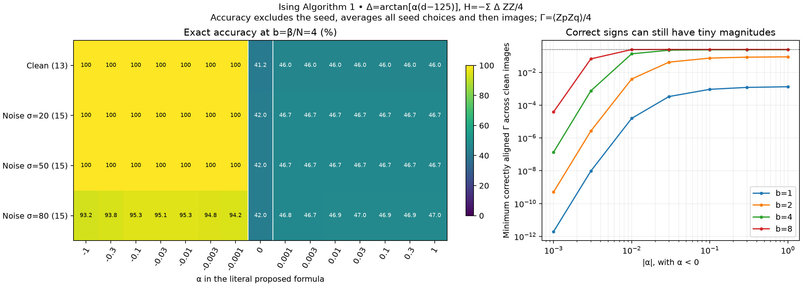
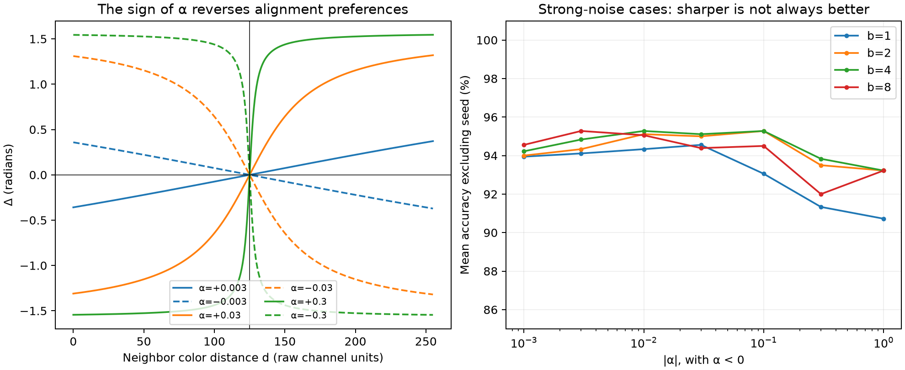
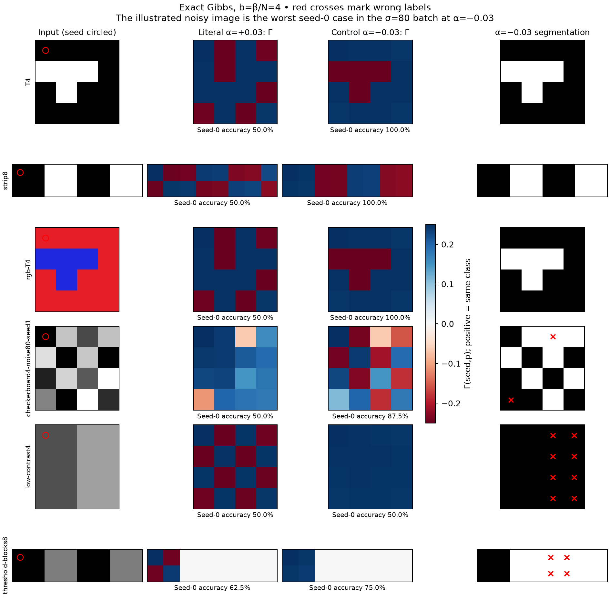

# Algorithm 1 with arctangent Ising couplings

**Result:** the proposed formula with positive alpha has the opposite sign
from the intended color alignment when retaining the paper's minus sign in
the Hamiltonian. Literal negative-alpha controls work well on the tested
high-contrast images. At b=beta/N=4, alpha=-0.01 through -0.1 gives strong
correct correlations on all 13 clean images and all 30 noisy images at
noise standard deviations 20 and 50. Heavy noise and the fixed threshold
of 125 reveal limitations. All results below are exact Gibbs enumeration,
up to floating-point arithmetic; there is no trajectory sampling or tensor
truncation in this experiment.

## Model and conventions

Starting from `Quantum_paper/MainV2.tex`, equations `e:ham-delta` and
`e:anisotropy`, remove the XX and YY terms and use the requested formula
literally:

\[
H=-\sum_{\{p,q\}\in E}\Delta_{pq}S_p^zS_q^z
  =-\frac14\sum_{\{p,q\}\in E}\Delta_{pq}Z_pZ_q,
\qquad \Delta_{pq}=\arctan[\alpha(d(c_p,c_q)-125)].
\]

Each undirected nearest-neighbor edge appears once. This is equivalent to
the manuscript's ordered-pair sum with its extra factor 1/2. Open rectangular
boundaries, row-major pixel order, and Sz=Z/2 are preserved. Grayscale uses
absolute differences; RGB uses Euclidean distance in raw 0..255 channels.
RGB distances can exceed 255. No sigma normalization or color rescaling
is applied. Arctangent values are in radians, bounded by +/-pi/2. Alpha has
inverse color-distance units.

All terms commute and are diagonal in the Z basis. The quantum Gibbs state
is therefore also a classical Ising probability distribution. For z in
{+1,-1}^N, enumerate

\[
E(z)=-\tfrac14\sum_{\{p,q\}}\Delta_{pq}z_pz_q,\quad
p(z)=\frac{\exp[-b(E(z)-E_{\min})]}{\sum_{z'}\exp[-b(E(z')-E_{\min})]},
\quad b=\beta_{\rm paper}/N,
\quad \Gamma(p,q)=\tfrac14\sum_z p(z)z_pz_q.
\]

The code stores 2^N energies and weights, not a 2^N-by-2^N density matrix.
There are no fields, frozen spins, spin-number caps, or conditioning on a
seed's spin. The seed selects a correlation row, as in Algorithm 1. Global
spin-flip symmetry makes all one-spin means zero; nonzero pair correlations
still allow segmentation. The Gibbs mixture retains both spin orientations.

Algorithm 1 is unchanged: positive Gamma means the seed's class; zero or
negative Gamma means the other class. All possible seeds are evaluated.
The main accuracy metric excludes the seed itself and then averages over
seeds and images, giving each image equal weight. Seed-0 accuracy including
the seed is also saved. A separate 1e-12 tolerance flags weak numerical
signs; it does not change the strict classification rule. Exact zeros
between uncoupled components are enforced using their independent spin-flip
symmetries instead of interpreting roundoff as a sign.

## The sign issue is structural

For alpha>0, similar colors with d<125 have Delta<0. With H=-Delta SzSz,
they favor opposite spins. Dissimilar colors with d>125 favor like spins.
For two sites the exact answer is

\[
\Gamma(0,1)=\tfrac14\tanh(b\Delta/4),
\]

which directly exposes the reversed sign. Increasing positive alpha cannot
repair this. We tested positive and negative values of the literal formula;
the implementation never silently substitutes a different formula.

If alpha is intended to remain positive, the sign-compatible alternative is

\[
\boxed{\Delta_{pq}=\arctan[\alpha(125-d(c_p,c_q))],\qquad\alpha>0.}
\]

This is exactly equivalent to the negative-alpha results below with the
original Hamiltonian sign. Another equivalent convention would change the
overall sign of the Ising Hamiltonian instead.

There is an exact diagnostic on these bipartite grids. Let
chi_p=(-1)^(row_p+column_p). Changing alpha to -alpha is equivalent to
replacing Z_p by chi_p Z_p, so

\[
\Gamma_{+|\alpha|}(p,q)=\chi_p\chi_q\Gamma_{-|\alpha|}(p,q).
\]

Thus the literal positive-alpha labels differ by a checkerboard parity
factor from the negative-alpha labels whenever the correlation is nonzero.
This identity held across all images, magnitudes, and temperatures to
2.66e-13. No parity correction is applied to the reported labels.

## Test set and parameter grid

There are 63 synthetic images, all at most 16 pixels:

- 13 clean examples: uniform, horizontal and vertical halves, diagonal
  boundary, checkerboard, isolated center, L, T, O, disconnected islands,
  2x4 and 2x8 alternating 2x2-block strips, and an RGB T shape.
- 45 noisy examples: five 4x4 shapes, Gaussian standard deviations
  20, 50, and 80, with three reproducible noise realizations at each level.
  Intensities are clipped to [0,255]. A given shape/replicate uses the same
  standardized noise field across the three noise levels.
- Five threshold tests: grayscale contrast 80, RGB contrast about 104.9,
  two halves separated by contrast exactly 125, alternating blocks at 125,
  and alternating blocks at 128.

Alpha is 0 or +/-{0.001, 0.003, 0.01, 0.03, 0.1, 0.3, 1}; b is
{1,2,4,8}. This gives **3,780 exact Gibbs calculations**. For 16 pixels the
paper beta values are {16,32,64,128}. Noisy-image RNG seeds and full image
arrays are saved. Ground truth is used only for scoring and analysis.
The current noise samples are exploratory benchmarks, not a held-out image
dataset for claiming a generally optimal alpha.

## Results at b=4

Positive alpha gives about 46.0% nonseed accuracy on the clean set, and
about 46.7% on the noise-20 and noise-50 sets, at every tested positive
magnitude. On the clean 4x4 examples this is 50% when the known seed is
included. These are the expected checkerboard-reversal errors.

The negative-alpha controls give:

| Literal alpha | Clean, 13 images | Noise 20, 15 images | Noise 50, 15 images | Noise 80, 15 images | Smallest aligned clean Gamma |
| ---: | ---: | ---: | ---: | ---: | ---: |
| -0.001 | 100% | 100% | 100% | 94.22% | 1.36e-7 |
| -0.003 | 100% | 100% | 100% | 94.83% | 7.50e-4 |
| -0.01 | 100% | 100% | 100% | 95.28% | 0.13542 |
| -0.03 | 100% | 100% | 100% | 95.11% | 0.22508 |
| -0.1 | 100% | 100% | 100% | 95.28% | 0.23786 |
| -0.3 | 100% | 100% | 100% | 93.83% | 0.24019 |
| -1 | 100% | 100% | 100% | 93.22% | 0.24089 |

Accuracy here is the mean over all seed/nonseed pairs, averaged by image.
The aligned Gamma equals Gamma for same-class pixels and -Gamma for
different-class pixels. Its minimum is over every nonself pair in every
clean image; positive means the desired sign. The maximum possible value
is 1/4. At alpha=-0.03 and -0.1, ten of fifteen noise-80 images have fully
correct correlations for every seed. Mean accuracy and perfect-image rate
need not select the same parameter.



In these particular noise-20 and noise-50 samples, **every edge** retained
the intended threshold sign. At noise 80, eight images contained one or more
wrong-sign edges (20 such edges total). Consequently, the perfect lower-noise
scores should not be interpreted as evidence of handling arbitrary corrupted
coupling signs. Stronger alpha eventually saturates both good and bad edges;
the heavy-noise accuracy need not improve monotonically.

For clean images whose edge signs agree with the labels, write labels as
t_p=+/-1 and Delta_pq=t_p t_q |Delta_pq|. The change of variables
tau_p=t_p z_p makes every coupling ferromagnetic. In the high-temperature
expansion, each factor is cosh(K)[1+tau_p tau_q tanh(K)], K=b|Delta|/4>0.
The pair-correlation numerator sums positive products over subgraphs with
odd endpoints p,q and includes a connecting path. Hence it is positive on
a connected graph. Correct correlation *signs* in this ideal case follow
from the model structure for any finite b>0; alpha and temperature determine
how large and measurable those correlations are.

## Correlation strength and temperature

At alpha=-0.03, the weakest aligned clean correlation is 0.0003359,
0.042054, 0.225076, and 0.249876 at b=1,2,4,8 respectively. Thus exact
sign accuracy alone hides a large measurement-cost difference.

If M independent ideal Gibbs Z measurements are used to estimate all
P=N(N-1)/2 pair correlations, Hoeffding plus a union bound gives radius
sqrt(log(2P/eta)/(8M)). If every desired correlation has aligned magnitude
at least g>0, choosing M>log(2P/eta)/(8g^2) suffices for correct estimated
signs with probability at least 1-eta. This is a conservative bound on
sign correctness, not on having empirical confidence intervals exclude zero.
It assumes independent, perfectly prepared Gibbs samples.

At b=4 and eta=0.05, the worst sufficient counts over the clean images are
approximately 5.70e13, 1.88e6, 58, 21, and 19 for alpha=-0.001, -0.003,
-0.01, -0.03, and -0.1, respectively. These are theoretical sampling
bounds, not executed quantum shots or circuit resource estimates.



## Fixed-threshold failure cases

At b=4, alpha=-0.03:

| Test | Seed-0 accuracy, including seed | What the correlations show |
| --- | ---: | --- |
| Grayscale contrast 80 | 50% | Both colors are treated as similar; the classes merge. |
| RGB distance about 104.9 | 50% | Same failure with the raw RGB metric. |
| Two halves, contrast 125 | 100% | Cross-half correlations are exactly zero. Correct labels come from the tie rule, not an anticorrelation signal. |
| Alternating blocks, contrast 125 | 75% | Independent blocks have zero cross-correlations; a distant same-class block is lost. |
| Alternating blocks, contrast 128 | 100% | Correct but weak distant signal: minimum Gamma magnitude 0.001212. |

For the contrast-128 strip at alpha=-0.03, the all-pair ideal-sign sampling
bound is 721,726 shots. Changing alpha does not move the threshold at 125;
below-threshold class boundaries cannot be repaired by merely sharpening
this function. A contrast-adaptive threshold is a separate model change.



**Suggested next setting:** keep the paper's minus sign and use the
sign-compatible formula with positive sensitivity 0.03 or 0.1, initially at
b=4. These correspond to literal alpha=-0.03 or -0.1 in this experiment.
Both give strong clean-image signals and similar heavy-noise performance.
The small difference in noisy accuracy is not enough to declare one optimal.
This study validates small-system Gibbs correlations, not preparation by
the local bath or long-range order as image size tends to infinity.

## Code, compatibility, and verification

- [Python model](python/ising_algorithm1.py): exact diagonal energies,
  Gibbs probabilities, all pair correlations, and the unchanged sign rule.
- [Experiment runner](python/run_ising_algorithm1.py) and
  [plot/export script](python/plot_ising_algorithm1.py).
- [MATLAB implementation](matlab/algorithm1_ising_gibbs.m) and
  [fixture checker](matlab/verify_ising_gibbs_fixture.m).
- [Compact numerical summary](ising-algorithm1-summary.json); full results
  and per-image correlation arrays are under `results/ising-algorithm1/`.

The nine Python tests pass, including the analytic two-spin formula,
independent Kronecker Hamiltonian and matrix exponential, parity identity,
threshold-disconnected components, alpha=0 and b=0, RGB units, and invalid
inputs. A four-spin Ising Gibbs state also matches the existing compiled
Qiskit Algorithm 1 purification circuit to 2e-12. Existing XXZ modules and
their interfaces are unchanged. This is compatibility verification, not a
new scalable state-preparation circuit.

Across the complete grid, maximum residuals in known spin-flip symmetries
were below 1.80e-13; the bipartite identity differed by at most 2.66e-13.
All 3,780 correlation matrices were also checked for positive semidefiniteness,
diagonal entries exactly 1/4, and absolute entries bounded by 1/4.
The 1e-12 numerical sign threshold is recorded separately. MATLAB files and
two MAT fixtures were produced, but MATLAB/Octave is unavailable here, so
MATLAB execution is unverified.

Reproduce from the repository root:

```bash
.venv/bin/python algorithm1/python/run_ising_algorithm1.py
.venv/bin/python algorithm1/python/plot_ising_algorithm1.py --summary algorithm1/ising-algorithm1-summary.json
.venv/bin/pytest -q algorithm1/tests/test_ising_algorithm1.py
```

MATLAB, with `algorithm1/matlab` on its path:

```matlab
result = algorithm1_ising_gibbs(image, -0.03, 4*numel(image)); % grayscale
verify_ising_gibbs_fixture('algorithm1/results/ising-algorithm1/fixture-alpha-0.03.mat');
verify_ising_gibbs_fixture('algorithm1/results/ising-algorithm1/fixture-alpha0.03.mat');
```

For RGB use N=size(image,1)*size(image,2), not numel(image). Array entries
Gamma(seed,p) use row-major pixel indices; MATLAB indexing itself is one-based.
The exact enumerators reject more than 20 pixels because their classical
cost remains exponential. The study used at most 16 pixels.
