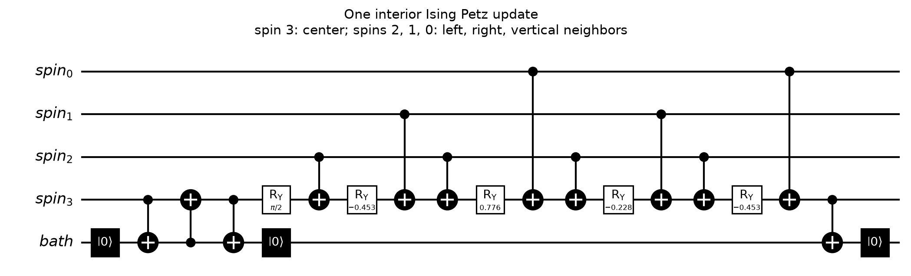
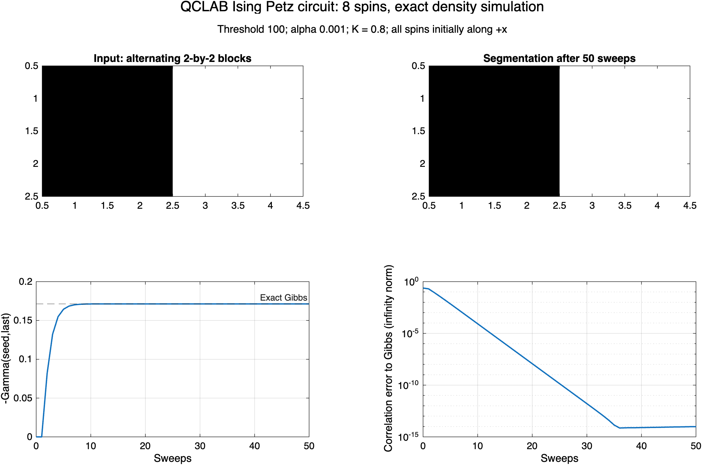
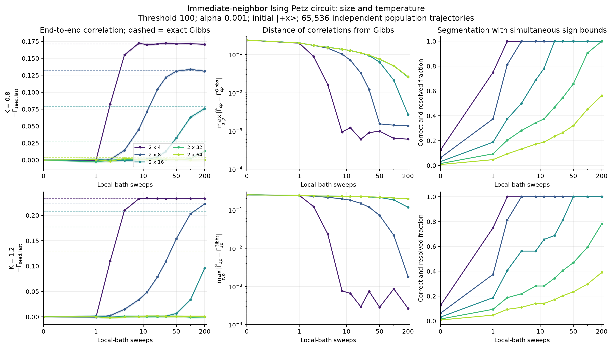
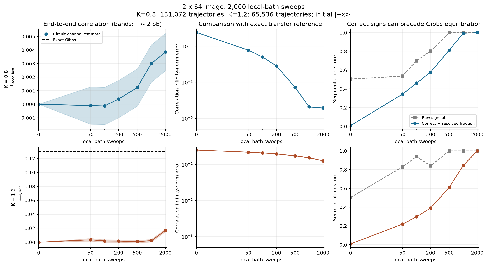
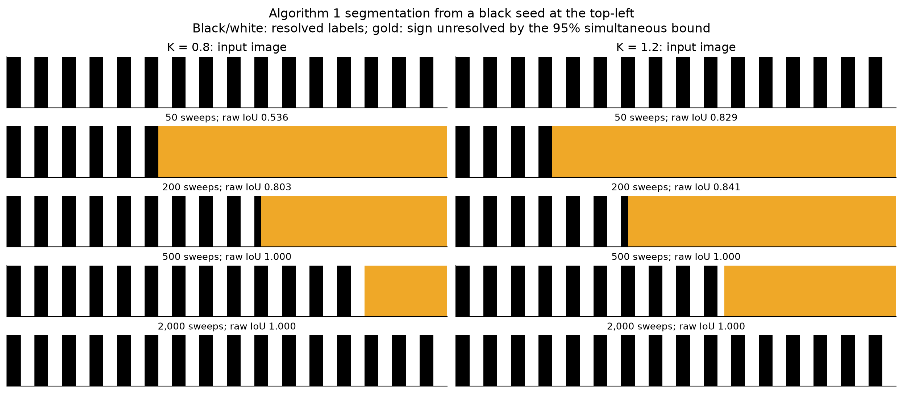

# Algorithm 1 with an immediate-neighbor Ising Petz circuit

Implemented and executed in MATLAB R2026b with the official QCLAB v1.2.0
toolbox. The input is a two-row image repeating black/white 2-by-2 blocks,
with open boundaries. We retain **option 1: threshold 100**, positive
**alpha = 0.001**, and default thermal scale **K = 0.8** from the
[threshold study](emnist-thresholds.md).

The main MATLAB entry point is
[algorithm1_ising_petz_qclab.m](matlab/algorithm1_ising_petz_qclab.m).
[run_ising_petz_demo.m](matlab/run_ising_petz_demo.m) runs and plots the
complete eight-spin demonstration. The Python implementation also exports
elementary OpenQASM circuits, including resets and final measurements.

The main mathematical improvement is that **for this diagonal Ising
Hamiltonian, the exact single-site Petz update already depends only on
immediate neighbors**. No approximation of the global Gibbs fixed point
is necessary. This statement also holds on coherent or entangled inputs;
we verify it against the global Petz formula on a six-spin example.

## Hamiltonian and temperature conventions

For each unique horizontal or vertical edge, use

\[
\Delta_{ij}=\arctan\!\left[\alpha(100-|I_i-I_j|)\right],\qquad
J_{ij}=\Delta_{ij}/4,\qquad H=-\sum_{\{i,j\}}J_{ij}Z_iZ_j.
\]

This retains the paper's spin convention \(S^z=Z/2\), so the observable
used for segmentation is \(\Gamma_{sp}=\langle Z_sZ_p\rangle/4\).
Positive couplings favor equal spins at similar pixels; negative couplings
favor opposite spins across black/white boundaries. Intensities remain in
the range 0 to 255. XX and YY interactions are absent.

We write the target as \(\sigma=e^{-bH}/\operatorname{Tr}e^{-bH}\), where

\[
b=\beta_{\rm paper}/N,\qquad
K=b\,\operatorname{median}_{\{i,j\}}|\Delta_{ij}|/4,\qquad N=2L.
\]

For these strips, K=0.8 gives b=32.1063837, and K=1.2 gives b=48.1595756.
The paper's beta is therefore N times these values. Holding K fixed as L
increases keeps the local temperature scale fixed. The MATLAB `B` option
sets b directly and overrides K.

## Why this Petz update is local

Erase spin i by taking its partial trace, then recover it using the Gibbs
reference. With \(\sigma_{\bar i}=\operatorname{Tr}_i\sigma\), the map is

\[
\Phi_i(\rho)=\sigma^{1/2}
\left[I_i\otimes\sigma_{\bar i}^{-1/2}
 (\operatorname{Tr}_i\rho)\sigma_{\bar i}^{-1/2}\right]\sigma^{1/2}.
\]

For a neighbor configuration \(z_j\in\{-1,+1\}\), define

\[
h_i(z_\partial)=\sum_{j\sim i}J_{ij}z_j,\qquad
p_i(s\mid z_\partial)=\frac{e^{bsh_i}}{2\cosh(bh_i)}.
\]

All interactions not incident on i cancel from the conditional Gibbs ratio.
Consequently the four Kraus operators are

\[
K_{s,t}=|s\rangle\langle t|_i\otimes
\sqrt{p_i(s\mid Z_{\partial i})},\qquad s,t\in\{+1,-1\}.
\]

These act only on the center and its immediate neighbors. They satisfy
\(\sum_{s,t}K_{s,t}^{\dagger}K_{s,t}=I\), and
\(\Phi_i(\sigma)=\sigma\). A sweep of such updates also preserves sigma.
On diagonal states this is precisely conditional single-spin heat-bath
resampling, a systematic-scan version of classical Glauber dynamics.
The expression above additionally specifies its action on coherences.
The use of local heat-bath maps for commuting Hamiltonians is consistent
with the construction in Section IV.2 of
[Kastoryano and Brandão](https://arxiv.org/html/1409.3435v3).
The conditional-ratio derivation here specializes it to our image model.

The nearest-neighbor cancellation is specific to this commuting model.
The earlier [XXZ patch bath](local-petz.md) generally has a biased fixed point.
No XXZ approximation is reused in this Ising implementation.

## The elementary circuit

An interior spin has three neighbors, so its update uses four system qubits
and one attached bath qubit. For a given center i:

1. Reset the bath to zero.
2. SWAP the old center into the bath, using three CNOTs.
3. Reset the bath, discarding the old spin and leaving the center in zero.
4. Apply a neighbor-controlled Ry rotation to the fresh center, with
   \(\theta(z_\partial)=2\arctan(e^{-bh_i(z_\partial)})\).
5. Apply CNOT from the center to the bath, then reset the bath.

Step 4 gives probability \(\cos^2(\theta/2)=p_i(+1\mid z_\partial)\).
Step 5 removes the new center's off-diagonal element, as required by the
Petz map. Omitting this final dephasing would implement a different channel.
All reset outcomes are retained; there is no postselection. The controls
are coherent: we do not measure and dephase the neighboring system spins.



In this diagram spin 3 is the center, spins 2/1/0 are its left/right/vertical
neighbors, and the bottom wire is its bath. Zero-angle rotations have been
removed. A cyclic Gray-code decomposition replaces the controlled rotation
by Ry and CNOT gates. Every two-qubit gate joins the center to a neighbor or
to its attached bath. The three black zero-state boxes are reset operations.
An SVG and text version are saved beside the PNG.

This is an **engineered digital heat bath**: temperature is encoded in the
conditional rotations, while the ancilla resets to a pure zero state. It is
not an autonomous, energy-conserving collision with a physically thermal
ancilla. Hardware must provide the gates and resets used by this channel.

## Algorithm 1 and measurement

The default initial state is all spins along +x. Apply T sweeps, measure
every system spin in Z, and repeat the preparation for M independent shots.
Each bitstring estimates all seed correlations simultaneously:

\[
\widehat\Gamma_{sp}=\frac1{4M}\sum_{m=1}^M z_s^{(m)}z_p^{(m)}.
\]

Positive correlation assigns a pixel to the seed's segment. Our black seed
is the top-left pixel; its opposite-sign segment is the white foreground.
The second seed is the third pixel of the top row, a white pixel. Raw masks
assign zero estimates to the opposite segment, but zero or uncertain signs
are marked unresolved in the confidence plots.

MATLAB uses **one-based, row-major pixel indices**, seeds `[1,3]`, and
QCLAB qubit 0 as the most significant bit. Python uses zero-based seeds
`[0,2]`; its exported measurement strings are also row-major from left to
right. `correlations_from_counts` processes Qiskit counts and returns
correlations, segment labels, standard errors and simultaneous sign bounds.

For one seed and N pixels, the two-sided Hoeffding radius used here is

\[
\epsilon=\sqrt{\log(2N/0.05)/(8M)}.
\]

A sign is resolved when the interval around its estimate excludes zero.
The 95% guarantee is simultaneous across pixels **at one checkpoint** for
the primary seed. It is not simultaneous across all sweep checkpoints or
both seeds. The infinity-norm plots compare both seeds with exact Gibbs
values and include both finite-sweep bias and Monte Carlo error. They are
not distances between full density matrices.

## Execution in MATLAB

The dependency is installed at `external/qclab` in this checkout, pinned to
the official v1.2.0 release, commit
`b9de8ca2d2e78186dc159a6ac6340646b7d603aa`. No additional MathWorks toolbox
is needed. `setup_ising_petz` adds paths only for the current session.
The package is maintained by the
[QCLAB project](https://github.com/QuantumComputingLab/qclab).

Paste this into MATLAB:

```matlab
cd('/Users/papi/Documents/ChatGPT/Quantum Segmentation/LBL2023');
addpath('algorithm1/matlab');
setup_ising_petz;
r = run_ising_petz_demo;

% Native QCLAB unitary segments for the second pixel:
r.model.kernels{2}.erase.draw();
r.model.kernels{2}.recover.draw();
% Full channel order: reset bath, erase, reset bath, recover, reset bath.

% 2-by-8: exact populations, no Monte Carlo error.
r8 = algorithm1_ising_petz_qclab(8, 'Simulation','population', 'Sweeps',50);

% 2-by-64: construct local circuits and the four-layer schedule.
large = algorithm1_ising_petz_qclab(64, 'Simulation','none');
disp(large.model.gate_counts_per_sweep);

% Finite-sweep sampling of the QCLAB-derived channel on a longer strip:
sample = algorithm1_ising_petz_qclab(16, 'Simulation','trajectories', ...
    'Sweeps',200, 'Shots',16384, 'K',0.8);
```

The returned `gamma` has dimensions `(sweeps+1, seed, pixel)`;
`gamma_gibbs` is the exact transfer-matrix reference. Additional options
are `Alpha`, `Threshold`, `B`, `Initial` (`plus_x`, `mixed`, `all_up`),
and `RngSeed`. The intended default threshold remains 100.

QCLAB provides the elementary **unitary segments**. The MATLAB driver
implements reset by contracting over both bath outcomes, producing the
four gate-derived Kraus matrices. It does not pretend that a QCLAB unitary
circuit alone implements a reset. Available simulation modes are:

| Mode | Computation | Intended size |
|---|---|---|
| `density` | Full system density matrix, including coherences; exact bath traces after QCLAB gates | Up to 8 system spins |
| `population` | Exact circuit population evolution, including finite-sweep transients | Up to 20 spins; verified at 16 |
| `trajectories` | Independent samples using probabilities extracted from QCLAB gates | Larger strips; memory O(NM) |
| `none` | Bounded local QCLAB circuits, update schedule and resources | Linear construction cost in N |



For students using a new checkout, download the dependency once from a
terminal in the repository root:

```sh
git clone --depth 1 --branch v1.2.0 https://github.com/QuantumComputingLab/qclab.git external/qclab
```

The external checkout and generated `results/` files are ignored by Git.
The source, validation summaries and this documentation are repository files.

## Tests actually executed

- All **159 upstream QCLAB tests** passed in installed MATLAB R2026b.
  [Installation record](ising-petz-qclab-installation.json) records the
  separately executed suite and its log hash.
- **31 focused Python tests** passed across the new circuit, existing Ising
  model, Monte Carlo model and threshold modules. These include arbitrary
  entangled inputs, Gibbs preservation, trace preservation, gate order,
  connectivity, population reduction, readout and QASM round trips.
- Every bath-initialized column of each eight-spin example's local unitary
  segments was executed using QCLAB `simulate`, agreeing with its matrix
  representation exactly to reported floating-point precision.
- Independent MATLAB and Python local Kraus operators differ by at most
  **5.8e-16** in Frobenius norm.
- For 8 spins and 50 sweeps, the native QCLAB-derived full density matrix
  differs from Python by **2.4e-14** in Frobenius norm. All correlation
  histories differ by at most **1.1e-14**.
- At 16 spins, the complete 50-sweep exact population histories agree to
  **4.3e-15**. Independent MATLAB/Python transfer references agree to
  **3.7e-16**. A MATLAB trajectory run also passes a finite-shot check.
- A native QCLAB local circuit program for **128 spins** was constructed
  and its resources checked. No 128-spin full quantum-state simulation was
  attempted.

The [native validation record](ising-petz-matlab-validation.json) contains
the measurements. Reproduce the cross-language test with
`verify_ising_petz_qclab` after generating the Python fixtures below.

## Size and sweep experiments

For this channel, output diagonal probabilities depend only on input
diagonal probabilities. After every spin has been updated once, the state
is diagonal. Thus +x and the maximally mixed state have identical Z
statistics at all sweep boundaries. This makes population evolution an
exact reduction of the circuit, with sampling error only when trajectories
are used. It is not an assumption that the bath has equilibrated.

The large runs used that reduction in Python, validated against native
QCLAB and exact small-system density evolution. The reference is an exact
4-by-4 rung transfer calculation, with O(L) work per seed. No sampled Gibbs
reference or exponential Hilbert-space enumeration is needed for it.

The initial study covered L=4,8,16,32,64 at K=0.8 and 1.2, with **65,536
independent trajectories per case**, through 200 sweeps. The following
values are at 200 sweeps. IoU compares the estimated white foreground with
the known binary image; resolved means correct and outside the primary
seed's simultaneous uncertainty interval.

| Image | K | Foreground IoU | Correct and resolved | Correlation infinity-norm error |
|---|---:|---:|---:|---:|
| 2 x 4 | 0.8 | 1.000 | 100% | 0.000612 |
| 2 x 8 | 0.8 | 1.000 | 100% | 0.00137 |
| 2 x 16 | 0.8 | 1.000 | 100% | 0.00269 |
| 2 x 32 | 0.8 | 1.000 | 100% | 0.0257 |
| 2 x 64 | 0.8 | 0.985 | 56.3% | 0.0266 |
| 2 x 4 | 1.2 | 1.000 | 100% | 0.000266 |
| 2 x 8 | 1.2 | 1.000 | 100% | 0.00181 |
| 2 x 16 | 1.2 | 1.000 | 100% | 0.118 |
| 2 x 32 | 1.2 | 0.824 | 78.1% | 0.196 |
| 2 x 64 | 1.2 | 0.857 | 39.1% | 0.195 |



Raw sign accuracy can be misleading when distant correlations are near
zero. In an independent L=64, K=0.8 run, the 200-sweep IoU was 0.803 rather
than 0.985, while the resolved fraction was similar (57.8% versus 56.3%).
Many distant labels were unresolved in both runs. The robust conclusion
from 200 sweeps is incomplete propagation of statistically detectable
correlations along the longest strip.

We extended independent L=64 runs to **2,000 sweeps**, using 131,072
trajectories for K=0.8 and 65,536 for K=1.2:

| K | Sweeps | IoU | Correct and resolved | Correlation infinity-norm error | End-to-end aligned correlation |
|---|---:|---:|---:|---:|---:|
| 0.8 | 500 | 1.000 | 81.3% | 0.00723 | 0.00124 |
| 0.8 | 1,000 | 1.000 | 99.2% | 0.00207 | 0.00300 |
| 0.8 | 2,000 | 1.000 | 100% | 0.00194 | 0.00385 +/- 0.00069 SE |
| 1.2 | 500 | 1.000 | 60.9% | 0.173 | 0.00101 |
| 1.2 | 1,000 | 1.000 | 84.4% | 0.152 | 0.00222 |
| 1.2 | 2,000 | 1.000 | 100% | 0.125 | 0.01676 +/- 0.00097 SE |

The exact end-to-end Gibbs values are **0.003482** at K=0.8 and **0.129610**
at K=1.2. At K=0.8 the final discrepancies are consistent with the sampling
scale. At K=1.2 the bath is plainly far from Gibbs correlations, despite
all primary-seed segmentation signs being correct and resolved. The sign
test uses the complete image, not only the end-to-end correlation.





The all-up initial-state control at K=0.8 reaches IoU=1 for L=4 by 200
sweeps, but only IoU=0.675 for L=64, with 57.8% correct and resolved signs.
Only these two all-up cases were tested; the extended runs start from +x.

These results support using **non-equilibrium correlation signs** for
segmentation in this family. They do not establish a universality class
or robustness over arbitrary images and initial states. The binary strips
are unfrustrated: flipping the spin convention on white pixels converts
every bond into a ferromagnetic one. Gibbs signs are therefore especially
favorable. This family also cannot distinguish the quality of different
thresholds strictly between 0 and 255 by coupling signs alone.

## Circuit scalability and its limits

Color centers by `(column + 2*row) mod 4`, using zero-based coordinates.
Each color contains disjoint center-plus-neighbor stars, so a sweep has
four parallel update layers. The logical architecture is the image ladder
with one attached resettable bath qubit per pixel.

For the tested parameters, the elementary resources per sweep are

\[
N_{\rm qubits}=2N,\quad N_{\rm CNOT}=12N-16,\quad
N_{R_y}=5N-8,\quad N_{\rm reset}=3N.
\]

The zero-field spin-flip symmetry removes some rotation angles. An interior
update has 12 CNOTs and 5 Ry gates; a degree-two boundary update has 8 CNOTs
and 3 Ry gates. The reset and conditional-rotation matrices have bounded
size; construction does not diagonalize the full Hamiltonian.

| Image | System spins | System + bath qubits | CNOT/sweep | Ry/sweep | Resets/sweep | Parallel depth/sweep |
|---|---:|---:|---:|---:|---:|---:|
| 2 x 4 | 8 | 16 | 80 | 32 | 24 | 76 |
| 2 x 8 | 16 | 32 | 176 | 72 | 48 | 76 |
| 2 x 16 | 32 | 64 | 368 | 152 | 96 | 76 |
| 2 x 32 | 64 | 128 | 752 | 312 | 192 | 76 |
| 2 x 64 | 128 | 256 | 1,520 | 632 | 384 | 76 |

Depth counts ideal elementary operations, with each reset counted as one
operation and all disjoint operations permitted to run in parallel. It
excludes initial Hadamards and final measurements. It is not a hardware
time estimate; reset latency and device connectivity matter. No extra
routing is required on the stated ladder-plus-attached-baths architecture.

The Python serial variant reuses one bath, reducing the count to N+1
qubits but increasing depth linearly with N. Its shared-ancilla transport
is not included in the logical resource count.

**Linear cost per sweep does not imply inexpensive complete preparation.**
At L=64, 2,000 sweeps require 3.04 million CNOTs per circuit execution.
At 65,536 independent shots this is about 199 billion ideal CNOTs in total.
These experiments therefore establish a scalable local construction, not
near-term hardware feasibility or a quantum computational advantage.
The diagonal model and these observables admit efficient classical sampling.

There are two distinct scaling costs. At fixed K=0.8, the exact end-to-end
correlation decreases from 0.1713 at L=4 to 0.003482 at L=64, increasing the
measurement burden. Cooling to K=1.2 strengthens the equilibrium long-range
correlation but substantially slows this local bath. The present data do
not establish an asymptotic mixing-time bound. A useful next comparison is
warm-to-cold schedules, with a stopping rule based on resolved signs rather
than requiring full Gibbs equilibration.

## Reproduce the Python study and exports

From the repository root:

```sh
.venv/bin/python -m pip install -r algorithm1/requirements-monte-carlo.txt
.venv/bin/python -m pytest -c algorithm1/pytest.ini \
  algorithm1/tests/test_ising_petz.py algorithm1/tests/test_ising_algorithm1.py \
  algorithm1/tests/test_ising_monte_carlo.py algorithm1/tests/test_ising_thresholds.py -q
.venv/bin/python algorithm1/python/run_ising_petz.py artifacts
.venv/bin/python algorithm1/python/run_ising_petz.py study
.venv/bin/python algorithm1/python/extend_ising_petz.py
.venv/bin/python algorithm1/python/analyze_ising_petz.py
```

The study uses independent pseudorandom trajectories and fixed recorded
seeds. The main runner checks source hashes before reusing cached results.
The extension's RNG seed is `9932100 + int(100*K)`. The analyzer also checks
the recorded numerical source hashes. Cross-language trajectories need
not match bit for bit; exact channel and population results are compared.

Files generated under `results/ising-petz/` include:

- `circuits/L*-one-sweep.qasm` and `.qpy`: elementary parallel bath sweeps.
- `circuits/L4-algorithm1-50-sweeps-{parallel,serial}.qasm`: complete
  preparation and measurement examples, initially all +x.
- `circuits/local-update.{png,svg,txt}`: one elementary local circuit.
- `qclab-fixture.mat`: independent quantum, population and correlation data.
- `matlab-demo.png` and `.mat`: native MATLAB demonstration.
- `study/` and `long/`: raw trajectory estimates, parameters and JSON metrics.
- `strip-study`, `long-strip`, `segmentation`: PNG and PDF scientific figures.

The compact [aggregate summary](ising-petz-summary.json) preserves resources,
validation records and numerical metrics outside the ignored results folder.
The scripts leave the earlier XXZ and EMNIST experiments unchanged.
