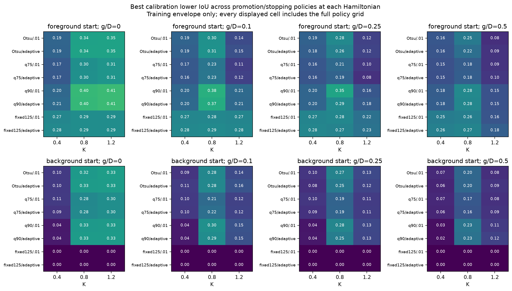
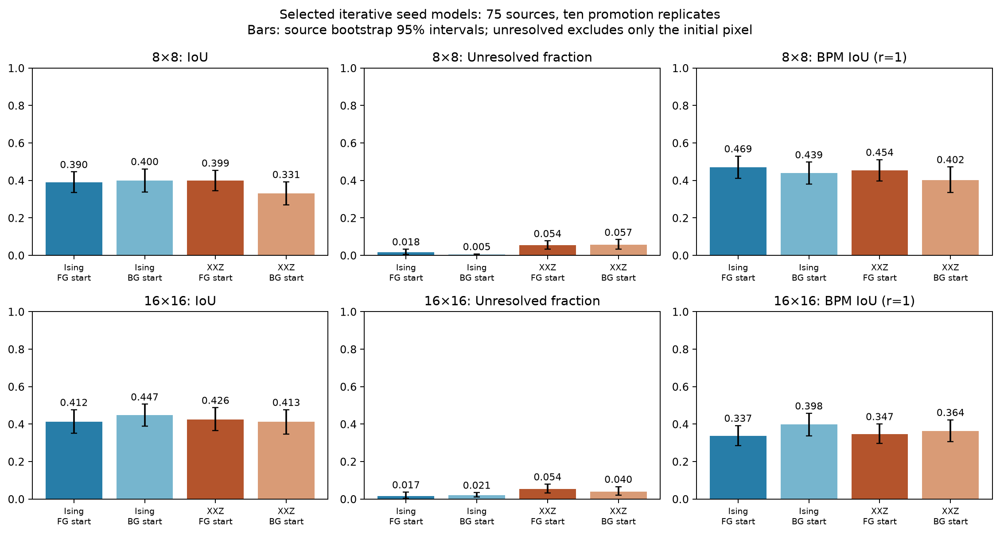
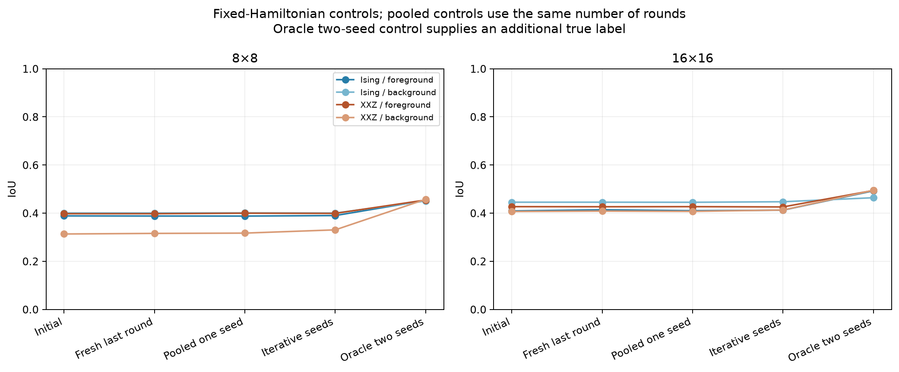
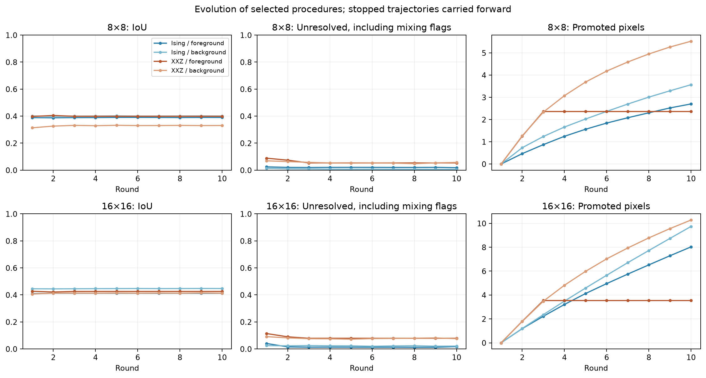
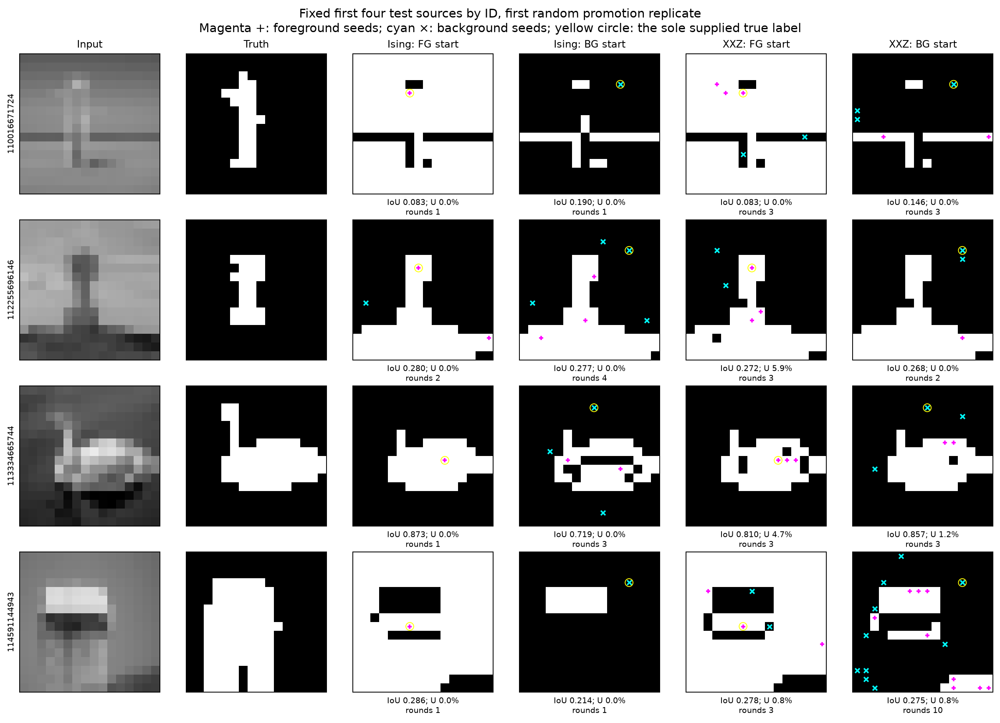
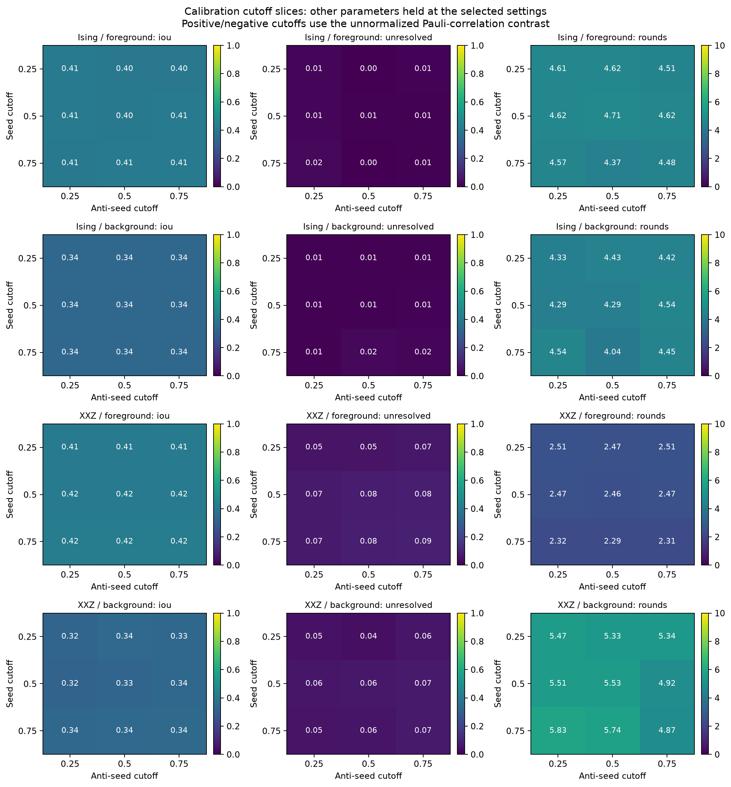
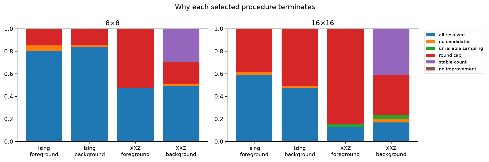

# Iterative seed and anti-seed Algorithm 1: Ising and XXZ

Experiment completed 2026-10-09. Status: full calibration, comparison, confirmation and implementation audit completed.

<!-- FINDINGS -->

## Main findings

The complete finite grid finished: **41,472 parameter combinations**, evaluated on 25 calibration sources at both resolutions with three random promotion replicates (**6,220,800 endpoints**). Selected rules were then compared on **75 different source images**, at 8×8 and 16×16, with ten random promotion replicates. Both known-foreground and known-background starts are included.

Against the **pooled one-seed control with the same sample budget**, 0 of the eight primary model/start/resolution comparisons have a positive paired-bootstrap IoU interval, 0 have a negative interval, and 8 overlap zero. These are exploratory, unadjusted intervals; they are not eight independent confirmatory tests.

The tables below distinguish area accuracy, unresolved pixels, incorrect promotions, and convergence. A lower unresolved fraction alone does not establish a better segmentation. The Ising/XXZ headline comparison uses separately selected Hamiltonian rules; it is not an isolated causal effect of adding XX/YY exchange.

**The main obstacle is label reliability, not just unresolved pixels.** At 16×16, 32.4%–32.7% of promoted labels are incorrect across the primary procedures. Their statistically resolved but semantically wrong fractions range from 23.1% to 39.8%. Correlation confidence therefore cannot be read as segmentation accuracy.

The background-start procedures also leave **more** unresolved pixels than their pooled one-seed controls at 16×16: +1.08 percentage points for Ising and +1.29 for XXZ; both paired intervals exclude zero. Compared with the first round alone, resolution can improve, but the equal-budget comparison does not support a general resolution benefit from promotion.

Starting-label effects depend on the Hamiltonian rule. At 16×16, the selected Otsu/Ising procedure benefits from a background start relative to its fixed-parameter foreground counterpart; the q90 foreground/background contrasts are not clearly separated. There is no evidence here for one universally preferable starting class or a consistent XXZ advantage.

The secondary selections contain a small exception: the g/D=0.5 background-start XXZ rule gains 0.0031 [0.0003, 0.0063] IoU over its pooled one-seed control, with 11.9% unresolved (14.4% including mixing failures). The secondary foreground-start XXZ rule instead changes IoU by -0.0092 [-0.0198, -0.0015]. These unadjusted exploratory contrasts do not establish a robust improvement from the modification.

The next modification worth testing is promotion reliability: spatially separated candidates, agreement checks before promotion, and removal or downweighting of inconsistent seeds. Those are hypotheses for a subsequent experiment, not results demonstrated by this sweep.

<!-- END FINDINGS -->

## Algorithm and conventions

The image Hamiltonian is unchanged during the procedure:

\[
H=-\frac14\sum_{\langle ij\rangle}[g(X_iX_j+Y_iY_j)+\Delta_{ij}Z_iZ_j],
\qquad \Delta_{ij}=\arctan[\alpha(\tau-d_{ij})].
\]

Ising has g=0; XXZ has positive uniform exchange g. The Gibbs state is exp(-bH)/Z. Define D as the median absolute Delta, with the established near-zero fallback, and b=4K/D. The paper's size-normalized convention is beta_paper=N b. Seeds affect the segmentation readout only: spins are not pinned, and no seed-dependent fields are added.

The experiment compares two starting conventions, as requested:

- One known foreground pixel: F contains that pixel and B is empty.
- One known background pixel: B contains that pixel and F is empty.

At each round, fresh Gibbs samples estimate

\[
S_i=\frac1{|F|}\sum_{s\in F}\langle Z_sZ_i\rangle-
\frac1{|B|}\sum_{a\in B}\langle Z_aZ_i\rangle,
\]

with either empty average set to zero. Foreground means S_i>1e-12; ties predict background. Pauli correlations lie in [-1,1], so S_i can lie in [-2,2] when both groups exist. The repository's previous Gamma convention is S/4; the new cutoff values are explicitly in Pauli units.

One uniformly random eligible foreground pixel and one uniformly random eligible background pixel can be added after a round. Either addition can be absent. Existing members of both sets are excluded from candidates, and the sets remain disjoint and grow monotonically. Later eligibility uses the current averaged contrast S_i. If no candidates exist, the procedure stops.

No ground-truth labels are read when selecting candidates or stopping. Truth is used only to provide the original seed and to evaluate results afterward. Promoted pixels are not automatically counted as resolved or correct. The primary unresolved fraction and unseeded-only IoU exclude **only the originally supplied pixel**. Full-mask IoU does not overwrite predicted labels at any seed.

Resolution here means that a correlation-score interval excludes zero, as in the preceding experiments. It does not mean semantic correctness. If a foreground seed has confidently positive correlations with every pixel, the rule stops immediately with an all-foreground mask; the analogous background start can give an all-background mask. The final analysis therefore also counts these collapsed masks and trajectories that never acquire both seed classes.

### What iteration can change

Because H and the Gibbs state stay fixed, resampling does not physically move the model toward a better segmentation. Iteration changes which correlations are averaged, the measurement noise, and the candidate sets. It can reach regions weakly correlated with the original seed through additional reference pixels. It can also propagate an incorrect label.

An idealized two-domain example makes this distinction explicit. Write the true class as sigma_i=+1 for foreground and -1 for background, and suppose off-diagonal correlations have the form C_ij=q sigma_i sigma_j with q>0. One correct initial seed gives score q sigma_i. With both seed classes present, let epsilon_F and epsilon_B be the fractions of incorrect labels in each seed set. Away from the seed self-correlations, the expected score becomes

\[
S_i=2q(1-\epsilon_F-\epsilon_B)\sigma_i.
\]

Correct promotion doubles the score in this idealization without changing its sign; errors attenuate it and can eventually reverse it. This is an explanatory example, not an assumed property of the image Hamiltonians. The measurements for different seeds are correlated, so doubling the score need not double statistical significance. The experiment uses their joint sample covariance rather than an independence approximation. The absolute promotion cutoffs also become easier to pass after both seed classes appear because the score's range expands from [-1,1] to [-2,2].

## Complete finite parameter grid

The existing verified Weizmann single-object images, grayscale preprocessing, majority human masks, and interior seed coordinates are reused: 25 calibration sources and 75 comparison sources, each resized to 8×8 and 16×16. The sizes correspond to 64 and 256 spins. Both sizes have equal weight within each source. These sources have appeared in previous development; the comparison is exploratory, not external validation at native image resolution.

| Hamiltonian parameter | Values |
|---|---|
| Threshold rule | Edge Otsu; q75 of positive neighbor differences; q90 of positive neighbor differences; fixed 125 |
| Sensitivity alpha | 0.01; 1/max(q90(d)-q10(d),1) |
| Normalized inverse temperature K | 0.4, 0.8, 1.2 |
| Exchange g/D | 0, 0.1, 0.25, 0.5 |

This gives **96 Hamiltonians**. Quantile thresholds exclude zero differences; sensitivity spread includes all edge differences. Floors and empty-set fallbacks match the established code. The threshold and sensitivity depend on the image; their rules and K/g settings are selected using calibration data.

| Promotion/stopping parameter | Values |
|---|---|
| Initial label | Foreground; background |
| Positive seed cutoff | 0.25, 0.5, 0.75 |
| Negative anti-seed cutoff magnitude | 0.25, 0.5, 0.75, crossed independently with the positive cutoff |
| Eligibility | Confidence-bound cutoff; point cutoff plus resolved sign |
| Stabilization | None; equal-count patience; no-improvement patience; 1% tolerance patience |
| Maximum rounds | 3, 6, 10 |

There are **432 policies per Hamiltonian**, including both starting conventions, for **41,472 full parameter combinations**. Every combination runs on all 50 calibration image/size cases with three random promotion replicates: **6,220,800 policy/replicate endpoints**. This is exhaustive over this stated Cartesian grid; it does not enumerate every continuous parameter value or every possible random sequence of promoted pixels.

For confidence-bound eligibility, S_i-radius_i must exceed the positive cutoff, or S_i+radius_i must be below the negative cutoff. For point-plus-resolved eligibility, the point score must exceed the cutoff and its interval must exclude zero. Cutoffs are applied to the stated unnormalized contrast; acquiring an anti-seed can change its possible magnitude from 1 to 2.

All policies stop if every non-initial pixel is resolved, no eligible candidate remains, or sampling fails the convergence guard. The stabilization rules are:

- None: only the other conditions and round cap apply.
- Equal count: two consecutive transitions with exactly the same unresolved count.
- No improvement: two rounds without a strict decrease in the best unresolved count seen so far.
- 1% tolerance: two rounds without a decrease exceeding max(1,ceil(0.01(N-1))) pixels relative to the best qualifying count.

These rules inspect counts, not ground-truth accuracy or the identities of unresolved pixels. Stop checks occur before further promotion. Terminal sampling/all-resolved/no-candidate conditions take precedence, then the round cap, then stabilization.

## Sampling and adaptive uncertainty

The additive sampler reuses the validated SSE diagonal, directed-loop and whole-worldline cluster updates. Its observable is a full Z-basis spin configuration at a fixed imaginary-time slice. Ising uses the existing exact conditional frontier sampler to obtain independent configurations. No physical bath or circuit execution is claimed.

All ZZ measurements commute. Each measured configuration z therefore supplies the score sample

\[
z_i\left(\frac1{|F|}\sum_{s\in F}z_s-\frac1{|B|}\sum_{a\in B}z_a\right).
\]

The second moment of this score equals the second moment of the parenthesized expression because z_i squared is 1. We use this identity and block correlation matrices to recover the full-series variance, paired batch error and split-Rhat for arbitrary seed sets. Individual seed correlations are not treated as independent.

Each round receives separately seeded and initialized Gibbs ensembles. Adaptive decisions use only that round's new samples; earlier adaptive samples are not pooled back into the new score. Competing policies share the same round-indexed measurements for a paired comparison. Stopping variants share random prefixes. A lazy generation guard stops drawing future ensembles only after **every** requested trajectory has stopped, without using truth. Unit tests compare this optimization against generating all ten rounds.

| Stage | Chains | Retained samples per chain per round | XXZ burn-in per round | Spacing | Promotion replicates |
|---|---:|---:|---:|---:|---:|
| Calibration | 4 | 2,048 | 1,500 sweeps | 2 | 3 |
| Comparison | 4 | 2,048 | 2,000 sweeps | 2 | 10 |
| Confirmation | 4 | 8,192 | 6,000 sweeps | 2 | 10 |

Each XXZ sweep has eight directed loops and one worldline cluster move. Ising samples are iid, without burn-in or thinning. The numerical pilot used only calibration images: 512 samples per chain caused premature reliability stops on its two 16×16 checks, motivating the fixed larger calibration budget before starting the grid.

A [documented numerical amendment](iterative-seeds-numerical-amendment.json) extends the directed-loop abort limit from ten million to one hundred million steps. One calibration bank (`chaom38`, 16×16, q75, alpha=0.01, K=1.2, g/D=0.1) reached the original guard. It was rerun with the **same random seed** and completed; the other 4,799 calibration banks remain unchanged. The extended guard is used for subsequent comparison and confirmation banks. No unfinished loop is accepted, and no transition probability, Hamiltonian, sample budget or parameter rule changes. Four additional tests verify the source change and bit-for-bit equality of ordinary sample paths. Each amended bank carries explicit provenance.

The nominal intervals use 16 blocks per chain and the larger of batch-mean and between-chain standard errors. A Bonferroni-t multiplier accounts for N pixels and ten possible rounds **within one trajectory**. It does not provide simultaneous coverage over the entire parameter grid. These are approximate MCMC intervals, not rigorous finite-time guarantees.

The convergence guard requires maximum full-series score/scalar split-Rhat below 1.05. Failed runs remain in the tables, with all non-initial pixels marked unresolved for mixing-aware metrics. Statistical unresolved fractions are reported separately. A confidently predicted pixel can still have the wrong semantic label, so correctly and wrongly resolved fractions and promotion errors are also retained.

## Selection, controls and confirmation

Primary policies maximize calibration mixing-aware lower IoU, separately for each model and starting convention. Failed-convergence cases score zero and unresolved labels are pessimistically assigned. Secondary selections maximize raw calibration IoU. Repeats and both resolutions are averaged within sources. Ties use raw IoU, fewer rounds and stable IDs. No comparison image is used to select parameters, and BPM is not used for selection.

For each selected policy, the comparison also evaluates its opposite-start counterpart with the same Hamiltonian, cutoffs and stopping rule. Thus both separately optimized starts and fixed-parameter starting-label comparisons are available.

Each final trajectory includes four controls on its selected Hamiltonian:

1. Initial one seed: the first round's original seed only.
2. Resample only: the last used round's fresh samples, still with the original seed only.
3. Pooled one seed: the original seed using all samples from exactly the rounds spent by the adaptive trajectory.
4. Oracle two seeds: one true foreground and one true background pixel, using the same pooled sample budget. This supplies an additional true label and is reported separately.

The pooled one-seed comparison is needed to distinguish a benefit from changing the readout from a benefit due to additional measurements. Pooling is allowed for these fixed-seed controls because their weights were not selected from the samples.

Any comparison model/image case with a failed final-round trajectory or minimum score ESS below 100 receives a separate longer bank. The first five comparison source IDs at 16×16 are also confirmed independently of outcomes. The whole bank and all its policies/controls are replaced without retuning. Confirmation uses new Gibbs and promotion random seeds; differences therefore include both sources of Monte Carlo variation. Remaining failures are retained.

<!-- SELECTION -->

## Selected primary rules

| Model / start | Threshold | Alpha rule | K | g/D | Seed cut | Anti cut | Gate | Stop | Cap |
| --- | --- | --- | --- | --- | --- | --- | --- | --- | --- |
| Ising / foreground | q90 | inverse_spread | 1.2 | 0.0 | 0.75 | 0.5 | confidence | none | 10 |
| Ising / background | edge_otsu | fixed01 | 1.2 | 0.0 | 0.75 | 0.25 | confidence | none | 10 |
| XXZ / foreground | q90 | fixed01 | 0.8 | 0.1 | 0.25 | 0.25 | point_resolved | no_improvement | 3 |
| XXZ / background | q90 | fixed01 | 0.8 | 0.1 | 0.25 | 0.5 | point_resolved | same_count | 10 |

Selection maximizes the calibration mixing-aware lower IoU. All secondary raw-IoU selections and their exact parameters are retained in the selection JSON.



Calibration envelope: best promotion/stopping policy at each Hamiltonian. These values are training performance, not comparison-set estimates.

<!-- END SELECTION -->

<!-- RESULTS -->

## Comparison results

| Size | Model / start | IoU [95% interval] | Unresolved | Mixing-aware U | BPM-IoU r=1 | Rounds |
| --- | --- | --- | --- | --- | --- | --- |
| 8×8 | Ising / foreground | 0.390 [0.336, 0.446] | 1.8% | 1.8% | 0.469 | 2.88 |
| 8×8 | Ising / background | 0.400 [0.339, 0.462] | 0.5% | 0.5% | 0.439 | 2.90 |
| 8×8 | XXZ / foreground | 0.399 [0.346, 0.454] | 5.4% | 5.4% | 0.454 | 2.30 |
| 8×8 | XXZ / background | 0.331 [0.270, 0.393] | 5.7% | 5.7% | 0.402 | 4.38 |
| 16×16 | Ising / foreground | 0.412 [0.352, 0.477] | 1.7% | 1.7% | 0.337 | 5.14 |
| 16×16 | Ising / background | 0.447 [0.389, 0.506] | 2.1% | 2.1% | 0.398 | 5.99 |
| 16×16 | XXZ / foreground | 0.426 [0.365, 0.488] | 5.4% | 7.9% | 0.347 | 2.80 |
| 16×16 | XXZ / background | 0.413 [0.348, 0.477] | 4.0% | 7.6% | 0.364 | 6.14 |

Intervals resample source images after averaging the ten promotion replicates. “Mixing-aware U” marks every non-initial pixel unresolved in a failed-convergence trajectory.



Primary selected rules: mean performance and source-bootstrap intervals.

### Selected XXZ versus selected Ising

| Size | Start | XXZ − Ising IoU [95%] | XXZ − Ising U [95%] | XXZ − Ising BPM [95%] |
| --- | --- | --- | --- | --- |
| 8×8 | foreground | 0.009 [-0.003, 0.022] | 0.036 [0.013, 0.059] | -0.016 [-0.048, 0.021] |
| 8×8 | background | -0.070 [-0.144, 0.001] | 0.052 [0.027, 0.080] | -0.037 [-0.103, 0.032] |
| 16×16 | foreground | 0.013 [-0.008, 0.041] | 0.037 [0.016, 0.059] | 0.010 [-0.011, 0.037] |
| 16×16 | background | -0.034 [-0.075, 0.005] | 0.019 [0.004, 0.038] | -0.033 [-0.069, 0.004] |

These are source-paired contrasts between separately optimized procedures. Their Hamiltonian rules and promotion/stopping policies can differ, so they compare the selected methods rather than exchange alone.

### Sample-budget controls

| Size | Model / start | Initial | Pooled original seed | Iterative | Iterative − pooled [95%] | Oracle two seeds |
| --- | --- | --- | --- | --- | --- | --- |
| 8×8 | Ising / foreground | 0.389 | 0.388 | 0.390 | 0.002 [-0.002, 0.007] | 0.453 |
| 8×8 | Ising / background | 0.401 | 0.401 | 0.400 | -0.001 [-0.004, 0.002] | 0.450 |
| 8×8 | XXZ / foreground | 0.398 | 0.400 | 0.399 | -0.001 [-0.011, 0.012] | 0.455 |
| 8×8 | XXZ / background | 0.313 | 0.317 | 0.331 | 0.014 [-0.000, 0.030] | 0.457 |
| 16×16 | Ising / foreground | 0.409 | 0.410 | 0.412 | 0.002 [-0.002, 0.009] | 0.493 |
| 16×16 | Ising / background | 0.446 | 0.445 | 0.447 | 0.002 [-0.000, 0.006] | 0.464 |
| 16×16 | XXZ / foreground | 0.427 | 0.427 | 0.426 | -0.001 [-0.012, 0.011] | 0.494 |
| 16×16 | XXZ / background | 0.407 | 0.407 | 0.413 | 0.006 [-0.003, 0.019] | 0.495 |

The oracle column has one additional ground-truth label. All columns use the same Hamiltonian within a row; pooled and oracle controls use the adaptive trajectory’s actual number of sampled rounds.



IoU for the unchanged original seed, adaptive seed sets, and an additional correctly labeled seed.

### Promotion errors and random selection

| Size | Model / start | Added pixels | Wrong / all added | Wrong FG additions | Wrong BG additions | Wrong resolved pixels | Mean within-image IoU SD |
| --- | --- | --- | --- | --- | --- | --- | --- |
| 8×8 | Ising / foreground | 2.70 | 36.3% | 50.5% | 15.2% | 42.8% | 0.001 |
| 8×8 | Ising / background | 3.57 | 31.2% | 47.8% | 16.6% | 29.8% | 0.003 |
| 8×8 | XXZ / foreground | 2.36 | 30.9% | 42.6% | 16.9% | 39.8% | 0.013 |
| 8×8 | XXZ / background | 5.52 | 26.5% | 50.4% | 11.2% | 25.6% | 0.009 |
| 16×16 | Ising / foreground | 8.03 | 32.7% | 41.4% | 23.7% | 39.8% | 0.001 |
| 16×16 | Ising / background | 9.74 | 32.4% | 48.0% | 17.3% | 23.1% | 0.004 |
| 16×16 | XXZ / foreground | 3.54 | 32.4% | 41.0% | 23.5% | 34.9% | 0.012 |
| 16×16 | XXZ / background | 10.28 | 32.7% | 47.7% | 17.8% | 23.7% | 0.008 |

Promotion-error ratios pool counts across images and random trajectories; a trajectory with no additions contributes no promoted labels to the ratio. The final column measures variability from the random promotions on a shared Gibbs bank. It does not include all Gibbs-sampling variability.



Round-by-round means. Stopped trajectories are carried forward; this is the evolution of the procedure, not ten fresh observations for every case.

### Starting-label comparison at fixed parameters

| Size | Rule selected for | Selected start − opposite start: IoU | Selected start − opposite start: U |
| --- | --- | --- | --- |
| 8×8 | Ising / foreground | 0.069 [0.010, 0.128] | 0.009 [-0.003, 0.025] |
| 8×8 | Ising / background | 0.014 [-0.034, 0.062] | 0.001 [-0.001, 0.004] |
| 8×8 | XXZ / foreground | 0.073 [0.018, 0.126] | 0.001 [-0.014, 0.019] |
| 8×8 | XXZ / background | -0.064 [-0.120, -0.006] | 0.002 [-0.018, 0.022] |
| 16×16 | Ising / foreground | 0.013 [-0.044, 0.071] | -0.000 [-0.031, 0.026] |
| 16×16 | Ising / background | 0.078 [0.030, 0.132] | -0.022 [-0.062, 0.006] |
| 16×16 | XXZ / foreground | 0.012 [-0.037, 0.061] | 0.004 [-0.016, 0.027] |
| 16×16 | XXZ / background | -0.013 [-0.062, 0.037] | -0.011 [-0.030, 0.005] |

For a foreground-selected row the contrast is FG minus BG; for a background-selected row it is BG minus FG. These paired comparisons keep the Hamiltonian, cutoffs, gate and stopping rule fixed. They complement the separately optimized starting conventions above.



Examples fixed before inspecting outcomes: the first four comparison source IDs, at 16×16, with promotion replicate zero.

### Secondary raw-IoU selections

| Size | Model / start | IoU | Unresolved | Mixing-aware U | BPM-IoU r=1 | Rounds |
| --- | --- | --- | --- | --- | --- | --- |
| 8×8 | Ising / foreground | 0.401 | 4.5% | 4.5% | 0.455 | 2.94 |
| 8×8 | Ising / background | 0.314 | 4.5% | 4.5% | 0.401 | 3.19 |
| 8×8 | XXZ / foreground | 0.404 | 7.0% | 7.0% | 0.460 | 5.29 |
| 8×8 | XXZ / background | 0.324 | 12.1% | 12.1% | 0.412 | 2.39 |
| 16×16 | Ising / foreground | 0.420 | 2.9% | 2.9% | 0.343 | 5.05 |
| 16×16 | Ising / background | 0.406 | 4.4% | 4.4% | 0.358 | 4.71 |
| 16×16 | XXZ / foreground | 0.417 | 5.1% | 8.9% | 0.346 | 8.05 |
| 16×16 | XXZ / background | 0.402 | 11.9% | 14.4% | 0.360 | 2.78 |

These settings were also selected on calibration only. Their objective ignores uncertainty during selection, so they are kept separate from the primary conservative selections.

<!-- END RESULTS -->

<!-- PARAMETER_EFFECTS -->

## Cutoff and stopping tradeoffs



Calibration cutoff slices hold the selected Hamiltonian, gate, stopping rule and cap fixed while varying positive and negative promotion thresholds independently.


Calibration stopping comparisons hold the Hamiltonian, both cutoffs and eligibility gate fixed. Markers denote caps of 3 (triangle), 6 (square), and 10 (circle); horizontal position is actual mean rounds. Vertical axes are zoomed, so inspect the numerical scale when judging the small accuracy differences.

Across these four fixed-parameter slices, the largest spread in calibration IoU among stopping/cap choices is only **0.369 percentage points**, while the largest spread in mean rounds is **3.99**. Here stopping has a much larger effect on sampling cost than on area accuracy. This is a calibration observation, not an independently confirmed universal rule.

### Temperature and exchange versus sampling reliability

| g/D | K | Calibration IoU | Unresolved | Passed Rhat | Mixing-aware lower IoU |
| --- | --- | --- | --- | --- | --- |
| 0.0 | 0.4 | 0.370 | 55.8% | 100.0% | 0.203 |
| 0.0 | 0.8 | 0.416 | 2.9% | 100.0% | 0.403 |
| 0.0 | 1.2 | 0.410 | 0.7% | 100.0% | 0.408 |
| 0.1 | 0.4 | 0.367 | 57.2% | 100.0% | 0.200 |
| 0.1 | 0.8 | 0.412 | 5.2% | 97.3% | 0.379 |
| 0.1 | 1.2 | 0.414 | 11.8% | 54.7% | 0.208 |
| 0.25 | 0.4 | 0.382 | 58.4% | 100.0% | 0.195 |
| 0.25 | 0.8 | 0.410 | 8.8% | 90.0% | 0.351 |
| 0.25 | 1.2 | 0.397 | 19.8% | 40.7% | 0.162 |
| 0.5 | 0.4 | 0.355 | 65.7% | 100.0% | 0.176 |
| 0.5 | 0.8 | 0.400 | 16.2% | 81.3% | 0.282 |
| 0.5 | 1.2 | 0.394 | 27.5% | 40.0% | 0.152 |

This slice fixes a foreground start, q90 threshold and alpha=0.01, then selects the best conservative promotion/stopping policy separately within each row. Ising samples are independent; XXZ samples use MCMC. Many colder XXZ trajectories fail the calibration mixing guard. Consequently, the fall in conservative score at K=1.2 is partly a sampling limitation and does not establish that the exact cold Gibbs state is intrinsically worse for segmentation. The primary selections compare procedures at the stated numerical budgets. Caps of three rounds also make the count-stabilization rules equivalent to the cap itself, so a selected tie between those rules should not be interpreted as evidence for a particular stopping mechanism.

<!-- END PARAMETER_EFFECTS -->

<!-- RELIABILITY -->

## Reliability and degenerate outcomes

The comparison contains **750 Hamiltonian/image cases** across 5 unique selected Hamiltonians. **120 cases** received longer independent confirmation runs and were replaced without retuning. Counts below are out of 75 source images for each row and include final confirmation outcomes. “Any” means at least one of the ten promotion trajectories.

| Size | Model / start | Confirmed | Any failed Rhat | Any ESS <100 | All FG | All BG | Never F | Never B |
| --- | --- | --- | --- | --- | --- | --- | --- | --- |
| 8×8 | Ising / foreground | 0 | 0 | 0 | 1.3% | 0.0% | 0.0% | 80.0% |
| 8×8 | Ising / background | 0 | 0 | 0 | 0.0% | 0.0% | 65.3% | 0.0% |
| 8×8 | XXZ / foreground | 1 | 0 | 0 | 0.8% | 0.0% | 0.0% | 38.8% |
| 8×8 | XXZ / background | 1 | 0 | 0 | 0.0% | 0.0% | 42.5% | 0.0% |
| 16×16 | Ising / foreground | 5 | 0 | 0 | 0.0% | 0.0% | 0.0% | 40.0% |
| 16×16 | Ising / background | 5 | 0 | 0 | 0.0% | 0.0% | 38.5% | 0.0% |
| 16×16 | XXZ / foreground | 40 | 2 | 2 | 0.0% | 0.0% | 0.0% | 10.9% |
| 16×16 | XXZ / background | 40 | 3 | 3 | 0.0% | 0.0% | 10.7% | 0.0% |

Collapsed-mask and missing-class entries are trajectory fractions. A fully resolved mask can still be all foreground or all background. Remaining low-ESS or failed-Rhat outcomes are retained, not silently removed.



Termination reasons for the selected procedures, including failed sampling and lack of eligible promotion candidates.

<!-- END RELIABILITY -->

## BPM and statistical reporting

The study continues the previously documented BPM implementation: Zhang skeletonization, Euclidean pixel-center tolerance, and nonnegative matched/unmatched skeleton counts. Ordinary IoU, unseeded-only IoU, and BPM-IoU at radii 0, 1 and 2 are included. BPM is a skeleton proximity metric and should not replace area IoU on filled Weizmann objects. The prior [BPM report](xxz-two-seed-bpm.md) documents the cited paper's metric ambiguities.

Random promotion replicates are averaged within each original source. Source uncertainty uses 5,000 paired bootstrap resamples of the 75 comparison image IDs at each resolution. The two resolutions and ten promotion replicates are not counted as independent images. Intervals are exploratory and uncorrected for the many comparisons. Promotion variability within an image is reported separately.

<!-- VALIDATION -->

## Validation

**69 tests passed**, including exact small-system Gibbs checks, score-moment identities, stopping rules, random-prefix equivalence, truth-independent promotions, and reuse of the established samplers. The final audit checked all **5670 saved model/image records**, **6,248,940 policy/replicate endpoints**, and 28,140 detailed comparison/confirmation traces. It independently recomputed final masks' metrics and promotion errors and replayed 24 deterministically selected measurement banks. Maximum metric discrepancy: 0.

Protocol, source, input and measurement-bank hashes were verified. These checks validate implementation consistency; they do not prove finite-time MCMC convergence or generalization beyond the reused Weizmann development split.

<!-- END VALIDATION -->

## Files and reproduction

- [Frozen protocol](iterative-seeds-protocol.json)
- [Full calibration grid](results/iterative-seeds/calibration-scores.json) and [numerical amendment](iterative-seeds-numerical-amendment.json)
- [Selections](iterative-seeds-selection.json), [final summary](iterative-seeds-summary.json), and [validation](iterative-seeds-validation.json)
- [Sampler and moment calculation](python/iterative_seed_gibbs.py)
- [Promotion and stopping implementation](python/iterative_seed_readout.py)
- [Runner](python/run_iterative_seed_study.py), [analysis](python/analyze_iterative_seed_study.py), and [audit](python/validate_iterative_seed_study.py)
- [Tests](tests/test_iterative_seed_gibbs.py)

From the repository root with the existing verified Weizmann data and dependencies:

```sh
.venv/bin/python algorithm1/python/run_iterative_seed_study.py init
.venv/bin/python algorithm1/python/run_iterative_seed_extended.py calibrate --workers 4
.venv/bin/python algorithm1/python/run_iterative_seed_study.py select
.venv/bin/python algorithm1/python/run_iterative_seed_extended.py test --workers 4
.venv/bin/python algorithm1/python/run_iterative_seed_extended.py confirm --workers 4
.venv/bin/python algorithm1/python/analyze_iterative_seed_study.py
.venv/bin/python -m pytest -c algorithm1/pytest.ini algorithm1/tests/test_iterative_seed_gibbs.py algorithm1/tests/test_xxz_two_seed.py algorithm1/tests/test_xxz_image_gibbs.py algorithm1/tests/test_xxz_sse_cluster.py algorithm1/tests/test_xxz_classical_controls.py algorithm1/tests/test_ising_seed_sampling.py -q --junitxml=algorithm1/results/iterative-seeds/tests.xml
.venv/bin/python -m pytest -c algorithm1/pytest.ini algorithm1/tests/test_iterative_seed_extended_loops.py -q --junitxml=algorithm1/results/iterative-seeds/amendment-tests.xml
.venv/bin/python algorithm1/python/validate_iterative_seed_study.py
.venv/bin/python algorithm1/python/write_iterative_seed_report.py
```

Packed measurement banks, the full calibration score grid, per-case tables, detailed selected-policy trajectories, and PNG/SVG figures are stored under the Git-ignored `algorithm1/results/iterative-seeds/`. Sampling checkpoints allow recovery without drawing a different bank. Earlier frozen experiments and engines are unchanged.
