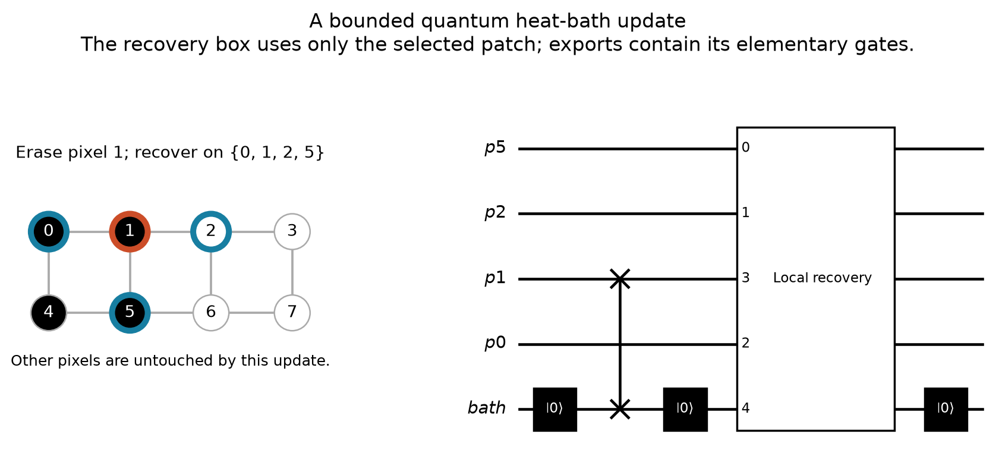
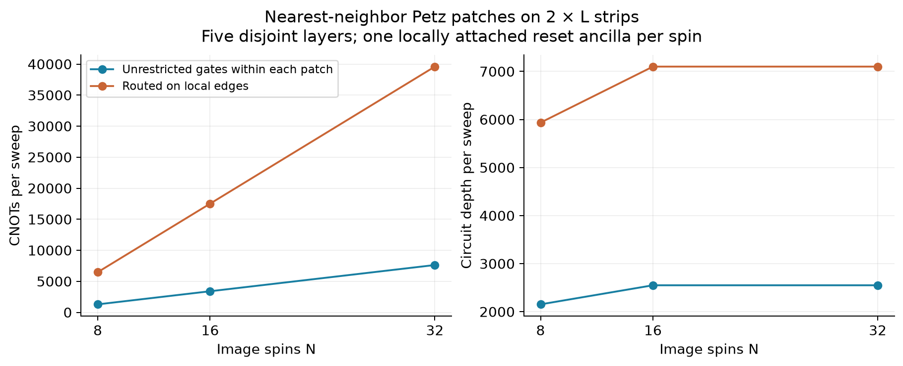
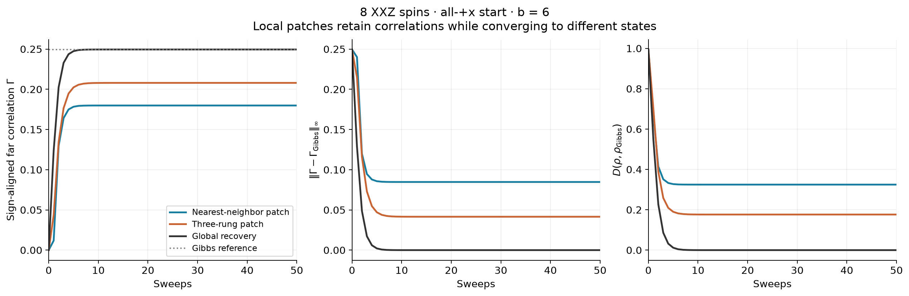
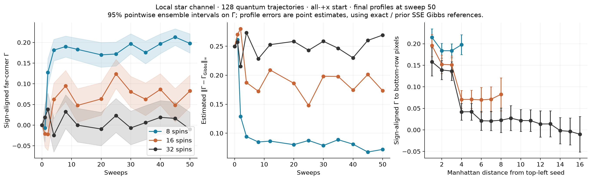
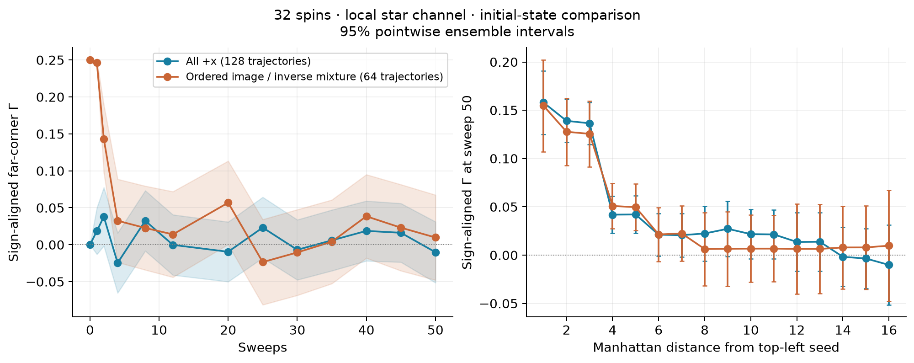

# Local Petz circuits for image-dependent XXZ heat baths

The global recovery has been replaced by **bounded-neighborhood recovery**.
The default patch is a spin and all its nearest neighbors: at most five
spins on a square image, or four on a two-row strip. This gives linear gate
count per sweep and bounded parallel depth for fixed patch size. It retains
the full XXZ interactions inside each patch, including XX and YY.

The channel is completely positive and trace preserving. It deliberately
does **not** preserve the full image's quantum Gibbs state. Its stationary
state and correlation bias are experimental quantities, not assumptions.

## What is localized

Let R_i contain pixel i and its nearest neighbors, let B_i = R_i minus i,
and let C_i be the exterior. Construct the small Hamiltonian

\[
H_{R_i}=-\frac14\sum_{\{j,k\}\subset R_i}
 (X_jX_k+Y_jY_k+\Delta_{jk}Z_jZ_k),\qquad
\tau_{R_i}=e^{-bH_{R_i}}/\operatorname{Tr}e^{-bH_{R_i}}.
\]

The sum includes the original image edges wholly inside the patch. We use
the original image's couplings and contrast standard deviation; there is
no per-patch renormalization. Here b = beta_paper / N.

Write tau_B = Tr_i(tau_R). In the i,B tensor order the four Kraus matrices are

\[
K_{as}^{(i)}=\sqrt{\tau_{R_i}}
  (|a\rangle\langle s|_i\otimes\tau_{B_i}^{-1/2}),
\qquad a,s\in\{0,1\}.
\]

Apply them to the entire state with identity on the exterior:

\[
\widetilde\Phi_i(\rho)=\sum_{a,s}
(K_{as}^{(i)}\otimes I_{C_i})\rho
(K_{as}^{(i)}\otimes I_{C_i})^\dagger.
\]

This is a Petz erasure/recovery map defined by a **patch Gibbs state**, not
by a marginal of the global Gibbs state. Computing global marginals would
reintroduce the difficult global preprocessing problem. The construction
adapts the conditional-expectation framework of
[Kastoryano and Brandão](https://arxiv.org/abs/1409.3435); it is not a theorem
that truncating their recovery preserves accuracy for noncommuting XXZ.

The exterior marginal is unchanged by each update, even on entangled
inputs. Correlations with the exterior are retained and transformed by
the channel; the implementation never replaces the state with a product
of a patch marginal and an exterior marginal.

Each update fixes tau_R, but overlapping patches generally have incompatible
local targets. The full image Gibbs state therefore need not be fixed.
For a diagonal classical nearest-neighbor model, a star contains all the
selected spin's neighbors and conditional resampling reduces to the usual
classical heat-bath rule. Noncommuting interactions obstruct that simple
global Gibbs-preservation argument.

## Actual circuit and parallel schedule



Each update resets a local ancilla, swaps out the center spin, resets the
ancilla again, applies the small recovery isometry, and resets the ancilla
after recovery. The target temperature is encoded in the recovery gates;
the ancilla itself is reset to a pure state. No postselection is used.
The SVD/polar construction from `quantum_glauber.py` avoids explicitly
inverting small eigenvalues. It rejects numerically unresolved directions.

Color a pixel at row r, column c by `(r + 2*c) mod 5`. Stars of the same
color have disjoint supports, so all updates in a color can run in parallel.
A sweep visits each color once in a fixed order. The compiled scalable
circuit uses **N system spins and N locally attached reset ancillas**.
With fewer ancillas, one can serialize updates, but moving a single shared
ancilla between distant patches has an additional physical routing cost.

The supplied routed circuits use only image nearest-neighbor edges and
an edge from each ancilla to its center spin. A conservative router moves
each CNOT control along a patch path and reverses the swaps afterward.
Thus the logical output layout is restored after every routed CNOT.
Both CNOT directions are assumed available; no specific hardware device,
gate duration, error model, or reset latency has been assumed.

The generic gate synthesis is still exponential in patch size k, but k is
bounded independently of N. Local matrix construction, total stored patch
data, and gates per sweep scale as O(N) for fixed k. Five parallel layers
give depth independent of N, with the above ancilla layout. This says
nothing yet about how the **number of sweeps needed** scales with image size.

## Executed circuit resource counts

These include all center erasures, recovery gates, and resets in one
complete sweep; initial preparation and final measurement are excluded.
Barriers separate the parallel layers and contribute no physical gate.

| Image | Largest patch | System + ancillas | Unrouted CNOTs | Locally routed CNOTs | Routed depth |
| --- | ---: | ---: | ---: | ---: | ---: |
| 2 x 4 | 4 | 8 + 8 | 1,288 | 6,472 | 5,935 |
| 2 x 8 | 4 | 16 + 16 | 3,400 | 17,512 | 7,100 |
| 2 x 16 | 4 | 32 + 32 | 7,624 | 39,592 | 7,100 |
| 8 x 8 | 5 | 64 + 64 | 46,528 | 268,000 | 33,020 |

The square image uses alternating black/white 2 x 2 blocks. The strip
images have identical rows `[0,0,255,255,...]`. The construction never
diagonalizes a global 32- or 64-spin Hamiltonian. The 64-spin experiment
is circuit construction and local validation, not a simulation of its
full dynamics.



For comparison, the previous eight-spin global recovery required 577,536
unrouted CNOTs per sweep. The local star circuit uses about 448 times fewer
before routing. Even the locally routed star circuit has about 89 times
fewer CNOTs than that unrouted global reference, though these are different
channels with different accuracy. Thousands of gates remain substantial
for noisy devices; linear scaling alone is not a hardware-feasibility claim.

## Correlation accuracy and the patch-size tradeoff

Exact eight-spin density-matrix experiments use b=6, kappa=2, and the
existing sample standard deviation over unique image-edge contrasts.
The far correlation is Gamma = `<Z_0 Z_7>/4`, multiplied by the expected
image sign. Its raw value is negative for the differently colored corners.

| Recovery | Maximum patch size | Far Gamma at sweep 80 | Fraction of full-Gibbs value | Profile ell-infinity error | Trace distance to full Gibbs |
| --- | ---: | ---: | ---: | ---: | ---: |
| Global reference | 8 | 0.249501 | 100% | <1e-13 | <1e-13 |
| Local star | 4 | 0.179839 | 72.1% | 0.084752 | 0.324807 |
| Three-rung patch | 6 | 0.207985 | 83.4% | 0.041516 | 0.176445 |

The three-rung control includes both rows in the center column and its
neighboring columns. It has at most six spins and six disjoint update
layers. Its eight-spin circuit costs 19,176 unrouted or 101,748 routed
CNOTs per sweep, at routed depth 82,994. Increasing patch size improves
these correlations but raises the constant cost sharply. This mode is
implemented for two-row images only; the star construction works on
arbitrary grayscale or RGB image grids.



All-+x, maximally mixed, and ordered image/inverse mixtures reach the same
observed eight-spin endpoint for each local model. One-further-sweep
residual trace distances are below 1e-14. This is numerical evidence of
stationarity for these runs, not a general uniqueness or mixing theorem.

Sustained independent X errors after every sweep give:

| Channel | Error probability per spin | Far Gamma | Trace distance to full Gibbs |
| --- | ---: | ---: | ---: |
| Star | 1% | 0.163853 | 0.380240 |
| Star | 5% | 0.111839 | 0.578759 |
| Three-rung | 1% | 0.186918 | 0.263022 |
| Three-rung | 5% | 0.122947 | 0.540937 |

Schedule also matters once global Gibbs preservation is sacrificed.
Replacing the five-color sweep by row-major updates changes the star's
far correlation from 0.179839 to 0.165846, and the two resulting states
have trace distance 0.295231. The corresponding three-rung values are
0.207985 versus 0.203380, with state distance 0.161851. The parallel schedule
is part of the algorithm specification, not just a hardware optimization.

## Validation and larger-system simulation

All 107 tests passed after adding the local implementation. Tests cover
compatibility with the original Hamiltonian conventions, complete positivity
and trace preservation, patch Gibbs preservation, explicit global Gibbs
bias, unchanged exterior marginals on entangled inputs, the five-layer
schedule on 256 pixels, routed circuit execution including resets, QASM/QPY
exports, and tensor-order conventions.

Every distinct patch in the circuit benchmarks was checked by simulating
all initialized recovery-isometry input columns. Routing was checked on the
full unitary of every segment between resets, and independently by density
matrix execution. Exported QASM and QPY were reloaded and compared gate by
gate. Resource counts come from the exported circuits, not from counting a
recovery box as one gate.

For longer strips, `local_petz_trajectories.py` samples the four physical
Kraus outcomes with their Born probabilities and evolves each pure state
as an MPS. Averaging all outcomes recovers the channel. There is no
postselection. Each trajectory remains a positive state; truncation and
finite-ensemble uncertainty are recorded separately. Eight-spin results
are compared to the exact density-matrix evolution, and paired larger
trajectories are repeated with doubled bond dimension.

A direct compressed density-MPS implementation is also supplied for small
validation. It must not be trusted just because its trace is normalized:
an initial 32-spin trial at bond 32 had substantial trace loss and negative
local marginal eigenvalues. Those trial values are not used as physical
results. The trajectory method avoids that positivity problem.

### Longer-strip results

The strip experiments have been extended to 50 sweeps using the same
Hamiltonians, five-color update order, initial states, ensemble sizes, and
random seeds. Checkpoints through sweep 25 are retained, with new measurements
at 30, 35, 40, 45, and 50. Original data and the original strip figure are
preserved under `results/local-petz/sweeps25/`. Because the earlier files
stored observables rather than final MPS states, the extension replays each
trajectory from its original seed and verifies agreement with the archive.
Differences between sweeps 25 and 50 use paired trajectory errors. Averages
over the five later checkpoints are formed within each trajectory before
computing ensemble errors; checkpoints are not treated as independent samples.

From all-+x, with 128 independent trajectories, b=6, and maximum MPS bond
dimension 32, the sign-aligned far-corner correlations are:

| Image | Sweep 25 | Sweep 50 | Approximate pointwise 95% interval at sweep 50 |
| --- | ---: | ---: | ---: |
| 2 x 4 | 0.172050 | 0.197648 | [0.174383, 0.220913] |
| 2 x 8 | 0.123915 | 0.082670 | [0.044483, 0.120857] |
| 2 x 16 | 0.023234 | -0.010120 | [-0.051376, 0.031136] |

The approximate paired 95% intervals for the change from sweep 25 to 50
are [-0.009318, 0.060513], [-0.091839, 0.009348], and
[-0.088775, 0.022068], respectively. None resolves a change from zero at
this precision. On 32 spins, averaging the measured checkpoints at sweeps
30, 35, 40, 45, and 50 gives 0.004778, with interval
[-0.014732, 0.024287]. This estimates a finite-time window average, not an
assumed stationary expectation.

For the 32-spin ordered image/inverse mixture control, 64 trajectories
give 0.009806 +/- 0.057595 at sweep 50, also consistent with zero. Its
sweep-25 estimate was -0.023497 +/- 0.057732. Starting from an ordered
state does not produce resolved far-corner retention at these later times.





The profile-distance panel uses the exact Gibbs profile for eight spins
and the previously equilibrated SSE reference profiles for 16 and 32 spins.
It checks b, sigma, and seed compatibility before comparison. Those distances
are point estimates; the maximum over noisy profile entries can have upward
bias. The SSE reference also has Monte Carlo error and depends on adequate
mixing, as described in `ladder-robustness.md`.

| Image | Profile ell-infinity distance to Gibbs at sweep 25 | At sweep 50 |
| --- | ---: | ---: |
| 2 x 4 | 0.087463 | 0.072035 |
| 2 x 8 | 0.147788 | 0.173517 |
| 2 x 16 | 0.243082 | 0.269235 |

These runs demonstrate scalable circuit construction, but **do not show
strong correlation retention at the largest tested separation** for the
smallest patches. The 32-spin estimate is consistent with zero at this
precision even after extending to 50 sweeps. Fifty sweeps and finite ensembles do not prove stationarity,
zero asymptotic correlation, or absence of other parameter regimes.

The true ensemble has zero Z means by global spin-flip symmetry, so these
Gamma values also equal its connected correlations. Individual trajectories
can have nonzero means: we average their raw Gamma, not their separately
connected correlations. Uncertainty comes from sampling Kraus outcomes;
observables within each trajectory are evaluated as MPS expectation values,
without additional finite-shot measurement noise.

For the first 16 paired random seeds, doubling the MPS bond dimension from
32 to 64 changed the ensemble mean Gamma by at most 3.2e-8 on 16 spins
and 8.7e-7 on 32 spins, over all checked pixels and checkpoints through
sweep 50. This is
an empirical truncation check on that subset, not a universal error bound.
The four trajectories with the largest accumulated discarded weight at
each size were also rerun at bond 64. Their maximum individual Gamma
changes were below 1.2e-6. The sampling intervals are much larger than
these observed truncation differences.

All six replayed runs exactly reproduce every archived Gamma checkpoint
through sweep 25. Three complete eight-spin trajectories were independently
replayed with dense state vectors for 50 sweeps: all Kraus choices agreed,
and the largest state-vector difference over all updates was 2.6e-14.
The maximum recorded Kraus probability-sum error in the three main runs
was 1.2e-14. The focused instrument-average test also passed.

The eight-spin exact far-corner value at sweep 50 is 0.179839, inside the
main ensemble's interval. Across *all* measured profile entries and
checkpoints, however, the largest discrepancy reaches 3.94 ensemble
standard errors; the displayed intervals are approximate and pointwise,
not a simultaneous validation guarantee. An additional 512 independent
eight-spin trajectories with seed base 92000 give 0.193045 +/- 0.012280
at sweep 50, about 2.11 standard errors above the exact value. Their
late-window average is 0.184819 +/- 0.005737, consistent with the exact
late-time value. These checks support treating individual plotted points
as noisy estimates, rather than precise stationary correlations. The
extra ensemble is saved separately in `validation-independent/` and does
not replace the original 128-trajectory comparison.

## Reproduce and use

From the repository root:

```sh
.venv/bin/python -m pip install -r algorithm1/requirements-tensor.txt
.venv/bin/python -m pytest -q -c algorithm1/pytest.ini
.venv/bin/python algorithm1/python/run_local_petz.py dense --sweeps 80
.venv/bin/python algorithm1/python/run_local_petz.py resources
.venv/bin/python algorithm1/python/run_local_petz.py trajectories \
  --widths 4 8 16 --replicas 128 --sweeps 50 --bond 32
.venv/bin/python algorithm1/python/run_local_petz.py trajectories \
  --widths 8 16 --replicas 16 --sweeps 50 --bond 64
.venv/bin/python algorithm1/python/run_local_petz.py trajectories \
  --widths 16 --initial ordered --replicas 64 --sweeps 50 --bond 32
.venv/bin/python algorithm1/python/analyze_local_petz_extension.py --refine-worst 4
.venv/bin/python algorithm1/python/plot_local_petz.py
```

The comparison script writes `sweeps50-comparison.json`, checks agreement
with archived 25-sweep data when present, compares the eight-spin results
with exact evolution, and reports paired changes and bond refinements.
For a fresh reproduction, an archive is optional: sweep 25 is also recorded
inside the 50-sweep runs.

To reproduce the additional independent eight-spin ensemble:

```sh
.venv/bin/python algorithm1/python/run_local_petz.py trajectories \
  --widths 4 --replicas 512 --sweeps 50 --bond 32 --seed 92000 \
  --output algorithm1/results/local-petz/validation-independent
```

`--output` selects a separate results directory. The default is
`algorithm1/results/local-petz/`, which is Git-ignored. It contains exact
density results and MAT fixtures in `dense/`, complete routed elementary
circuits in `circuits/`, and raw trajectory samples plus summaries in
`trajectories/`. The compressed QASM and QPY files contain all gates and
resets. No quantum hardware execution was performed.

To build a circuit for another image without constructing its global H:

```python
from local_petz import image_graph, build_local_petz, image_circuit

graph = image_graph(image, kappa=2.0)  # original contrast normalization
model = build_local_petz(graph, b=6.0, mode="star")
circuit = image_circuit(model, routed=True, parallel=True)
```

The circuit assumes zeroed ancillas and acts on whatever state is supplied
to the system spins. Pixel p is Qiskit system qubit N-1-p; its attached
ancilla is qubit 2N-1-p. The four-spin patch does not imply a four-pixel
limit on the image.

MATLAB exchange preserves row-major tensor order and zero-based exported
pixel indices. After generating the fixture:

```matlab
addpath('algorithm1/matlab');
r = verify_local_petz_fixture( ...
    'algorithm1/results/local-petz/dense/star-fixture.mat');
```

The MATLAB helper replays the small density-matrix channel. MATLAB itself
was not available here, so native MATLAB execution remains unverified.
