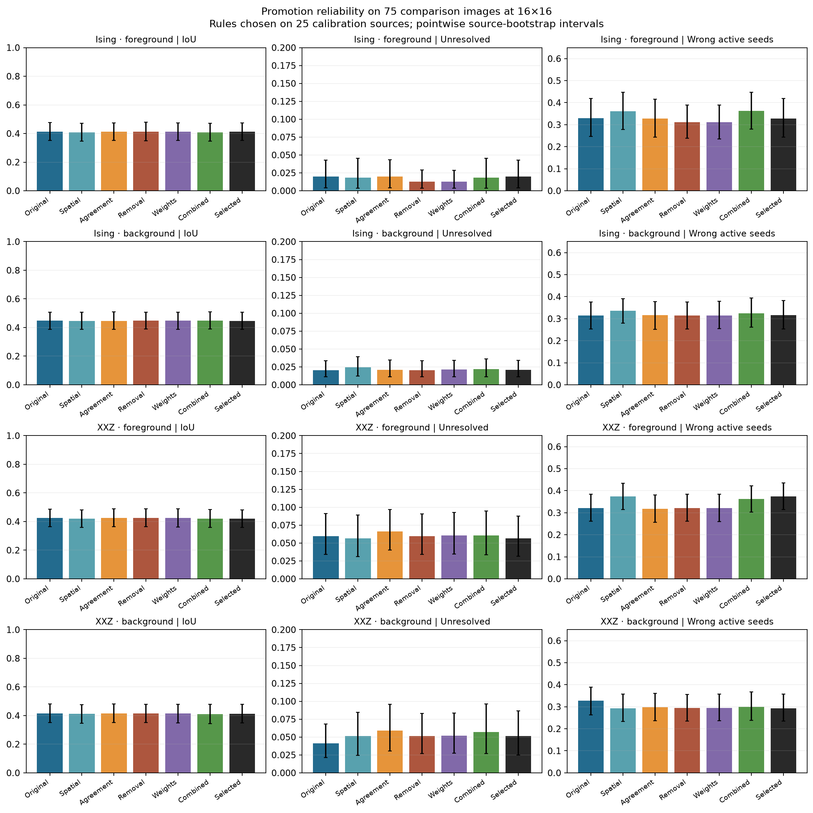
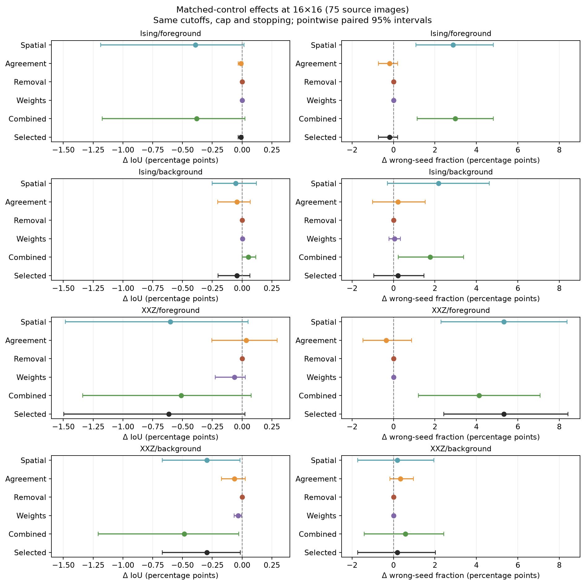
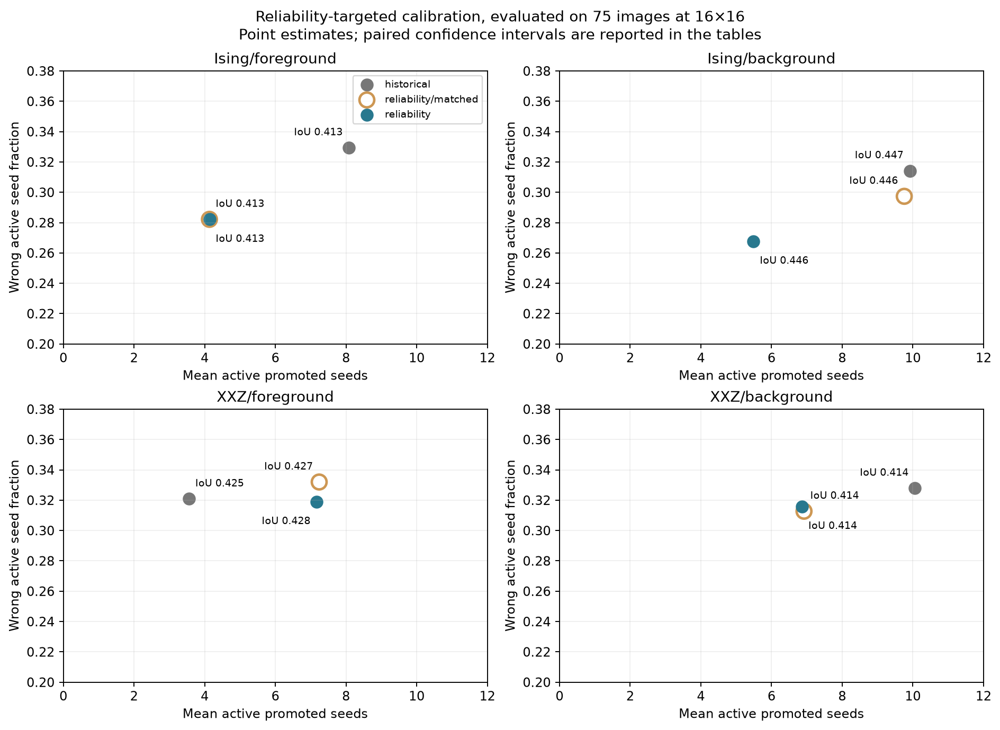
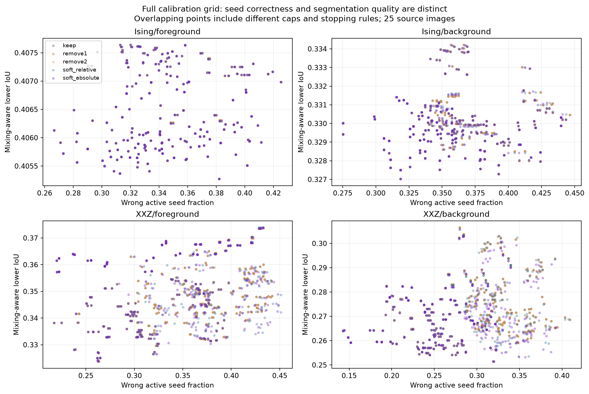

# Promotion reliability: spatial separation, agreement, and seed maintenance

Completed numerical Gibbs-state experiment on the Weizmann Segmentation Evaluation Database. This study changes promotion and readout while keeping the previously selected image Hamiltonians fixed.

**The tested safeguards did not produce a consistent segmentation improvement against matched controls.** Spatial separation increased wrong-promotion rates for foreground-start runs by 2.87 percentage points in Ising and 5.33 points in XXZ at 16×16; the pointwise paired intervals exclude zero. Agreement and weights mostly produced small or negligible mask changes.

No real seed was retired in either calibration or the selected comparison runs. The leave-one-out check detects deliberately planted contradictions in the numerical tests, but stable model correlations can support incorrect image labels. The result concerns the tested settings and confidence criteria, not every possible consistency rule.

A supplementary selection that explicitly minimizes seed error improves the Ising wrong-seed fraction from 32.94% to 28.22% with a foreground start and from 31.42% to 26.78% with a background start at 16×16. It promotes fewer seeds and does not materially improve IoU. For the foreground-start case the matched control is identical: the benefit comes from the stricter cutoff and stopping settings, not agreement or weight maintenance.

In XXZ, unanimous agreement gives a modest foreground-start seed-error reduction against its matched control (1.29 percentage points, pointwise 95% CI 0.01–2.60), but increases unresolved pixels by 0.91 points and gives no clear IoU gain. This narrow, unadjusted interval is exploratory evidence; the effect does not generalize across the four model/start settings.

Validation passed: 33 tests, 151,520 trajectory records, and 22 full-bank replays with zero metric discrepancy.

## Scope and interpretation

- 25 calibration source images and 75 comparison source images, each resized to 8×8 and 16×16. The split has been used in earlier development: this is an exploratory comparison, not an independent final benchmark.
- Four primary settings: Ising and XXZ, each with a known foreground seed or known background anti-seed. Four secondary settings test transfer without retuning.
- 2,250 policies per primary setting; 9,000 setting-policy combinations and **1,350,000 calibration endpoints**, including three random-promotion replicates. Comparison uses ten replicates, averaged within each source image.
- 750 comparison image/Hamiltonian banks and 117 longer confirmation banks. Ordinary banks contain ten independently initialized rounds. Longer confirmations for the secondary g/D=0.5 setting stop at the maximum requested cap of three; its unused future rounds do not affect any trajectory or control. The original ten-round seed spawning schedule and interval correction are unchanged.
- Ising samples are exact independent Gibbs draws from conditional-frontier sampling. XXZ uses the existing validated stochastic-series-expansion sampler. Each ordinary round has four chains × 2,048 retained configurations; confirmation uses four × 8,192.
- Primary policy selection maximizes calibration mean mixing-aware lower IoU. Secondary selections maximize raw IoU. Error rates below evaluate promotion reliability; policies were not selected by minimizing semantic seed error.
- BPM r=1 uses the inherited Zhang skeleton and Euclidean-distance convention. It measures skeleton proximity, not ordinary outline IoU; one pixel represents a different image scale at the two resolutions.
- IoU uses the full tentative binary mask, including unresolved pixels. Statistical unresolved excludes only the originally provided seed. Mixing-aware unresolved counts every unknown pixel unresolved when convergence checks fail.
- Promotion error is total wrong active promoted seeds divided by total active promoted seeds, pooled over sources and random runs. Cases with no promotion contribute no seeds, not a fictitious 100% precision.
- Paired 95% intervals bootstrap the 75 source images, averaging promotion randomness within image. They are pointwise, exploratory intervals without adjustment for multiple policy families. Neither Gibbs rounds nor promotion replicates count as extra independent images.

## Comparison results

The original row replays the previous rule with the same new random uniforms used by the variants. Minor differences from the prior report can arise from these random choices and the broader confirmation trigger. Each mechanism row was selected separately on calibration images.

### 16×16 images

| Model / initial seed | Rule | IoU | Statistical U | Mixing U | BPM r=1 | Active seed error | Active promoted / image |
|---|---|---:|---:|---:|---:|---:|---:|
| Ising / foreground | Original | 0.4127 | 1.99% | 1.99% | 0.3376 | 32.94% | 8.08 |
| Ising / foreground | Retuned baseline | 0.4126 | 1.26% | 1.26% | 0.3345 | 31.06% | 3.62 |
| Ising / foreground | Spatial only | 0.4087 | 1.82% | 1.82% | 0.3298 | 36.10% | 4.72 |
| Ising / foreground | Agreement only | 0.4126 | 1.98% | 1.98% | 0.3372 | 32.74% | 8.05 |
| Ising / foreground | Removal only | 0.4126 | 1.26% | 1.26% | 0.3345 | 31.06% | 3.62 |
| Ising / foreground | Downweight only | 0.4126 | 1.26% | 1.26% | 0.3345 | 31.06% | 3.62 |
| Ising / foreground | All three | 0.4088 | 1.82% | 1.82% | 0.3299 | 36.21% | 4.71 |
| Ising / foreground | Selected modification | 0.4126 | 1.98% | 1.98% | 0.3372 | 32.74% | 8.05 |
| Ising / background | Original | 0.4474 | 2.05% | 2.05% | 0.3970 | 31.42% | 9.91 |
| Ising / background | Retuned baseline | 0.4474 | 2.05% | 2.05% | 0.3970 | 31.42% | 9.91 |
| Ising / background | Spatial only | 0.4468 | 2.45% | 2.45% | 0.3961 | 33.58% | 7.95 |
| Ising / background | Agreement only | 0.4469 | 2.08% | 2.08% | 0.3975 | 31.64% | 8.93 |
| Ising / background | Removal only | 0.4474 | 2.05% | 2.05% | 0.3970 | 31.42% | 9.91 |
| Ising / background | Downweight only | 0.4474 | 2.13% | 2.13% | 0.3970 | 31.47% | 9.90 |
| Ising / background | All three | 0.4478 | 2.21% | 2.21% | 0.3974 | 32.53% | 5.60 |
| Ising / background | Selected modification | 0.4469 | 2.08% | 2.08% | 0.3975 | 31.64% | 8.93 |
| XXZ / foreground | Original | 0.4251 | 5.97% | 8.51% | 0.3455 | 32.08% | 3.56 |
| XXZ / foreground | Retuned baseline | 0.4251 | 5.97% | 8.51% | 0.3455 | 32.08% | 3.56 |
| XXZ / foreground | Spatial only | 0.4191 | 5.66% | 8.20% | 0.3438 | 37.41% | 3.21 |
| XXZ / foreground | Agreement only | 0.4255 | 6.62% | 9.16% | 0.3452 | 31.73% | 3.55 |
| XXZ / foreground | Removal only | 0.4251 | 5.97% | 8.51% | 0.3455 | 32.08% | 3.56 |
| XXZ / foreground | Downweight only | 0.4245 | 6.06% | 8.60% | 0.3447 | 32.08% | 3.56 |
| XXZ / foreground | All three | 0.4200 | 6.06% | 8.60% | 0.3426 | 36.21% | 3.17 |
| XXZ / foreground | Selected modification | 0.4190 | 5.65% | 8.19% | 0.3434 | 37.41% | 3.21 |
| XXZ / background | Original | 0.4143 | 4.12% | 7.46% | 0.3630 | 32.79% | 10.06 |
| XXZ / background | Retuned baseline | 0.4150 | 5.16% | 7.72% | 0.3628 | 29.45% | 3.47 |
| XXZ / background | Spatial only | 0.4125 | 5.12% | 7.68% | 0.3620 | 29.28% | 3.40 |
| XXZ / background | Agreement only | 0.4144 | 5.92% | 8.47% | 0.3619 | 29.78% | 3.47 |
| XXZ / background | Removal only | 0.4150 | 5.16% | 7.72% | 0.3628 | 29.45% | 3.47 |
| XXZ / background | Downweight only | 0.4147 | 5.19% | 7.75% | 0.3630 | 29.45% | 3.47 |
| XXZ / background | All three | 0.4102 | 5.70% | 8.25% | 0.3591 | 30.03% | 3.33 |
| XXZ / background | Selected modification | 0.4125 | 5.12% | 7.68% | 0.3620 | 29.28% | 3.40 |

### 8×8 images

| Model / initial seed | Rule | IoU | Statistical U | Mixing U | BPM r=1 | Active seed error | Active promoted / image |
|---|---|---:|---:|---:|---:|---:|---:|
| Ising / foreground | Original | 0.3902 | 1.83% | 1.83% | 0.4692 | 35.82% | 2.70 |
| Ising / foreground | Retuned baseline | 0.3903 | 2.16% | 2.16% | 0.4631 | 32.13% | 1.26 |
| Ising / foreground | Spatial only | 0.3899 | 1.72% | 1.72% | 0.4643 | 38.30% | 1.61 |
| Ising / foreground | Agreement only | 0.3902 | 1.83% | 1.83% | 0.4694 | 35.76% | 2.70 |
| Ising / foreground | Removal only | 0.3903 | 2.16% | 2.16% | 0.4631 | 32.13% | 1.26 |
| Ising / foreground | Downweight only | 0.3903 | 2.16% | 2.16% | 0.4631 | 32.13% | 1.26 |
| Ising / foreground | All three | 0.3899 | 1.71% | 1.71% | 0.4643 | 38.34% | 1.61 |
| Ising / foreground | Selected modification | 0.3902 | 1.83% | 1.83% | 0.4694 | 35.76% | 2.70 |
| Ising / background | Original | 0.4007 | 0.59% | 0.59% | 0.4389 | 32.13% | 3.65 |
| Ising / background | Retuned baseline | 0.4007 | 0.59% | 0.59% | 0.4389 | 32.13% | 3.65 |
| Ising / background | Spatial only | 0.4002 | 0.51% | 0.51% | 0.4380 | 32.45% | 2.51 |
| Ising / background | Agreement only | 0.4006 | 0.73% | 0.73% | 0.4389 | 30.73% | 3.45 |
| Ising / background | Removal only | 0.4007 | 0.59% | 0.59% | 0.4389 | 32.13% | 3.65 |
| Ising / background | Downweight only | 0.4007 | 0.51% | 0.51% | 0.4391 | 32.20% | 3.65 |
| Ising / background | All three | 0.4010 | 0.78% | 0.78% | 0.4403 | 32.07% | 2.25 |
| Ising / background | Selected modification | 0.4006 | 0.73% | 0.73% | 0.4389 | 30.73% | 3.45 |
| XXZ / foreground | Original | 0.4021 | 5.24% | 5.24% | 0.4578 | 30.59% | 2.36 |
| XXZ / foreground | Retuned baseline | 0.4021 | 5.24% | 5.24% | 0.4578 | 30.59% | 2.36 |
| XXZ / foreground | Spatial only | 0.3953 | 5.76% | 5.76% | 0.4408 | 38.61% | 1.98 |
| XXZ / foreground | Agreement only | 0.4019 | 5.61% | 5.61% | 0.4547 | 30.27% | 2.30 |
| XXZ / foreground | Removal only | 0.4021 | 5.24% | 5.24% | 0.4578 | 30.59% | 2.36 |
| XXZ / foreground | Downweight only | 0.4023 | 5.25% | 5.25% | 0.4591 | 30.59% | 2.36 |
| XXZ / foreground | All three | 0.3943 | 6.17% | 6.17% | 0.4364 | 37.64% | 1.89 |
| XXZ / foreground | Selected modification | 0.3958 | 5.92% | 5.92% | 0.4410 | 38.61% | 1.98 |
| XXZ / background | Original | 0.3305 | 5.44% | 5.44% | 0.4037 | 26.31% | 5.42 |
| XXZ / background | Retuned baseline | 0.3299 | 5.45% | 5.45% | 0.4050 | 26.56% | 2.35 |
| XXZ / background | Spatial only | 0.3305 | 5.27% | 5.27% | 0.4076 | 30.11% | 2.12 |
| XXZ / background | Agreement only | 0.3286 | 5.53% | 5.53% | 0.4044 | 26.42% | 2.33 |
| XXZ / background | Removal only | 0.3299 | 5.45% | 5.45% | 0.4050 | 26.56% | 2.35 |
| XXZ / background | Downweight only | 0.3298 | 5.34% | 5.34% | 0.4045 | 26.56% | 2.35 |
| XXZ / background | All three | 0.3291 | 4.91% | 4.91% | 0.4051 | 29.89% | 2.09 |
| XXZ / background | Selected modification | 0.3305 | 5.27% | 5.27% | 0.4076 | 30.11% | 2.12 |

## Is the selected modification better than matched controls?

The matched baseline has the same cutoff, stopping rule, round cap, and random uniforms, but disables separation, agreement, and maintenance. This comparison isolates the selected mechanisms more cleanly than comparison with the original policy. Equal-budget one-seed controls pool exactly the samples consumed by each adaptive trajectory.

| Setting | Size | ΔIoU vs matched [95% CI] | ΔU vs matched, pp [95% CI] | ΔIoU vs pooled one seed [95% CI] |
|---|---:|---|---|---|
| Ising/foreground | 8 | -0.000 [-0.000, +0.000] | -0.006 [-0.017, +0.000] | +0.002 [-0.001, +0.007] |
| Ising/foreground | 16 | -0.000 [-0.000, +0.000] | -0.004 [-0.018, +0.006] | +0.002 [-0.002, +0.010] |
| Ising/background | 8 | -0.000 [-0.002, +0.002] | +0.142 [-0.017, +0.303] | -0.000 [-0.003, +0.003] |
| Ising/background | 16 | -0.000 [-0.002, +0.001] | +0.026 [-0.109, +0.179] | +0.002 [-0.000, +0.004] |
| XXZ/foreground | 8 | -0.006 [-0.019, +0.003] | +0.679 [-0.440, +2.385] | -0.004 [-0.012, +0.003] |
| XXZ/foreground | 16 | -0.006 [-0.015, +0.000] | -0.322 [-1.867, +1.093] | -0.006 [-0.014, +0.000] |
| XXZ/background | 8 | +0.001 [-0.002, +0.003] | -0.284 [-0.779, +0.193] | +0.012 [+0.001, +0.028] |
| XXZ/background | 16 | -0.003 [-0.007, -0.000] | +0.155 [-0.919, +1.706] | +0.004 [-0.004, +0.017] |

In this plot, positive ΔIoU and negative Δwrong-seed fraction are favorable. Removal is exactly zero against matched controls because no seeds were retired; differences between its aggregate row and the original rule come from the chosen stopping settings.

## What happened to inconsistent seeds?

| Setting at 16×16 | Rule | Retired / image | Wrong among retired | Fraction of all wrong promotions retired | Weighted seed error | No-promotion runs |
|---|---|---:|---:|---:|---:|---:|
| Ising/foreground | remove | 0.0000 | — | 0.00% | 31.06% | 37.33% |
| Ising/foreground | weight | 0.0000 | — | 0.00% | 31.06% | 37.33% |
| Ising/foreground | combined | 0.0000 | — | 0.00% | 36.21% | 38.67% |
| Ising/foreground | any | 0.0000 | — | 0.00% | 32.74% | 37.33% |
| Ising/background | remove | 0.0000 | — | 0.00% | 31.42% | 37.33% |
| Ising/background | weight | 0.0000 | — | 0.00% | 31.49% | 37.33% |
| Ising/background | combined | 0.0000 | — | 0.00% | 32.55% | 37.33% |
| Ising/background | any | 0.0000 | — | 0.00% | 31.64% | 38.67% |
| XXZ/foreground | remove | 0.0000 | — | 0.00% | 32.08% | 8.00% |
| XXZ/foreground | weight | 0.0000 | — | 0.00% | 32.17% | 8.00% |
| XXZ/foreground | combined | 0.0000 | — | 0.00% | 36.48% | 16.00% |
| XXZ/foreground | any | 0.0000 | — | 0.00% | 37.72% | 16.00% |
| XXZ/background | remove | 0.0000 | — | 0.00% | 29.45% | 10.67% |
| XXZ/background | weight | 0.0000 | — | 0.00% | 29.04% | 10.67% |
| XXZ/background | combined | 0.0000 | — | 0.00% | 30.03% | 12.00% |
| XXZ/background | any | 0.0000 | — | 0.00% | 29.28% | 9.33% |

An absent retirement precision means no seed was removed. Removing no seeds does not establish that they were correct. A high-confidence seed can agree with the Hamiltonian while disagreeing with the ground-truth object.

For example, a new foreground seed j is admitted when its signed correlation contrast is positive. Immediately after admission, its leave-one-out contrast is exactly the contrast that admitted it, before sampling noise or other seed changes. A fresh round can detect unstable evidence, but a systematic, stationary model error remains consistent. Independent agreement therefore does not supply independent semantic supervision.

## Selected policies and Hamiltonians

Distances are fractions of the shorter image side: 0.125 is one pixel at 8×8 and two pixels at 16×16; 0.25 is two and four pixels respectively. `same` separates seeds of the same role; `all` separates both roles.

### Ising/foreground/mixing_lower

- Hamiltonian rule: `{"K": 1.2, "sensitivity": "inverse_spread", "strength": 0.0, "temperature": "longitudinal", "threshold": "q90", "transverse": "relative"}`
- Original nomination rule: `{"cut_bg": 0.5, "cut_fg": 0.75, "gate": "confidence", "start": "foreground"}`
- spatial: `{"agreement": "none", "cap": 6, "cut": "base", "maintenance": "keep", "space": "same_125", "stopping": "none"}`
- agreement: `{"agreement": "consensus100", "cap": 10, "cut": "base", "maintenance": "keep", "space": "none", "stopping": "none"}`
- remove: `{"agreement": "none", "cap": 6, "cut": "base", "maintenance": "remove1", "space": "none", "stopping": "same_count"}`
- weight: `{"agreement": "none", "cap": 6, "cut": "base", "maintenance": "soft_absolute", "space": "none", "stopping": "same_count"}`
- combined: `{"agreement": "consensus100", "cap": 6, "cut": "base", "maintenance": "remove1", "space": "same_125", "stopping": "none"}`
- any: `{"agreement": "consensus100", "cap": 10, "cut": "base", "maintenance": "keep", "space": "none", "stopping": "none"}`

### Ising/background/mixing_lower

- Hamiltonian rule: `{"K": 1.2, "sensitivity": "fixed01", "strength": 0.0, "temperature": "longitudinal", "threshold": "edge_otsu", "transverse": "relative"}`
- Original nomination rule: `{"cut_bg": 0.25, "cut_fg": 0.75, "gate": "confidence", "start": "background"}`
- spatial: `{"agreement": "none", "cap": 10, "cut": "base", "maintenance": "keep", "space": "same_250", "stopping": "none"}`
- agreement: `{"agreement": "temporal2", "cap": 10, "cut": "base", "maintenance": "keep", "space": "none", "stopping": "none"}`
- remove: `{"agreement": "none", "cap": 10, "cut": "base", "maintenance": "remove2", "space": "none", "stopping": "none"}`
- weight: `{"agreement": "none", "cap": 10, "cut": "base", "maintenance": "soft_absolute", "space": "none", "stopping": "none"}`
- combined: `{"agreement": "consensus100", "cap": 6, "cut": "base", "maintenance": "soft_relative", "space": "same_125", "stopping": "none"}`
- any: `{"agreement": "temporal2", "cap": 10, "cut": "base", "maintenance": "remove1", "space": "none", "stopping": "none"}`

### XXZ/foreground/mixing_lower

- Hamiltonian rule: `{"K": 0.8, "sensitivity": "fixed01", "strength": 0.1, "temperature": "longitudinal", "threshold": "q90", "transverse": "relative"}`
- Original nomination rule: `{"cut_bg": 0.25, "cut_fg": 0.25, "gate": "point_resolved", "start": "foreground"}`
- spatial: `{"agreement": "none", "cap": 3, "cut": "base", "maintenance": "keep", "space": "all_250", "stopping": "none"}`
- agreement: `{"agreement": "consensus75", "cap": 3, "cut": "base", "maintenance": "keep", "space": "none", "stopping": "same_count"}`
- remove: `{"agreement": "none", "cap": 3, "cut": "base", "maintenance": "remove1", "space": "none", "stopping": "same_count"}`
- weight: `{"agreement": "none", "cap": 3, "cut": "base", "maintenance": "soft_absolute", "space": "none", "stopping": "none"}`
- combined: `{"agreement": "consensus75", "cap": 3, "cut": "base", "maintenance": "soft_relative", "space": "all_250", "stopping": "none"}`
- any: `{"agreement": "none", "cap": 3, "cut": "base", "maintenance": "soft_relative", "space": "all_250", "stopping": "none"}`

### XXZ/background/mixing_lower

- Hamiltonian rule: `{"K": 0.8, "sensitivity": "fixed01", "strength": 0.1, "temperature": "longitudinal", "threshold": "q90", "transverse": "relative"}`
- Original nomination rule: `{"cut_bg": 0.5, "cut_fg": 0.25, "gate": "point_resolved", "start": "background"}`
- spatial: `{"agreement": "none", "cap": 3, "cut": "base", "maintenance": "keep", "space": "all_250", "stopping": "audit3"}`
- agreement: `{"agreement": "consensus75", "cap": 3, "cut": "base", "maintenance": "keep", "space": "none", "stopping": "same_count"}`
- remove: `{"agreement": "none", "cap": 3, "cut": "base", "maintenance": "remove1", "space": "none", "stopping": "same_count"}`
- weight: `{"agreement": "none", "cap": 3, "cut": "base", "maintenance": "soft_absolute", "space": "none", "stopping": "none"}`
- combined: `{"agreement": "consensus75", "cap": 3, "cut": "base", "maintenance": "remove1", "space": "all_250", "stopping": "none"}`
- any: `{"agreement": "none", "cap": 3, "cut": "base", "maintenance": "remove2", "space": "all_250", "stopping": "audit3"}`

## Rules tested

The full product comprises five spatial settings, five agreement settings, five maintenance settings, two cutoff choices, three round caps (3, 6, 10), and three stopping rules.

1. **Spatial separation:** no constraint; same-role exclusion at 1/8 or 1/4 side length; all-role exclusion at those distances. Distance must be strictly larger than the exclusion radius. Opposite-role candidates proposed in the same round also obey all-role separation. Selection is uniform among eligible candidates; role selection order is randomized.
2. **Agreement:** no additional check; at least 75% or 100% of active seed votes confidently share the proposed sign; eligibility in two consecutive independent rounds; or 75% consensus plus two-round persistence. Uncertain votes count against consensus, rather than disappearing from the denominator.
3. **Maintenance:** keep all; remove after one or two consecutive confident leave-one-out contradictions; or damp confidence weights using relative or absolute normalization. The initial trusted seed cannot be removed or downweighted. Removed seeds cannot return.
4. **Cutoffs and stopping:** inherit the prior asymmetric cutoffs or use 0.75 for both roles. Stop at all-resolved, no good candidates, a convergence failure, or the cap; optional two-transition unresolved-count stability. The minimum-three-round audit waits for fresh evidence and pending maintenance, subject to cap and sampling failure. No seeds are added on a fully resolved round.

The readout is S_i = sum_F(w_s C_si)/D_F − sum_B(w_a C_ai)/D_B, where C_si=⟨Z_s Z_i⟩. Relative normalization uses D=sum(weights); absolute normalization uses D=number of active seeds. Either empty term is zero. Relative normalization cannot attenuate a class containing a single seed, because its weight cancels. Absolute normalization can.
For a promoted seed j, remove its own contribution, recompute both class denominators, and test its signed leave-one-out score. A confident negative value counts as a contradiction. Soft maintenance sets a confidence target clip((signed score − interval radius)/0.5, 0.1, 1); the next weight is halfway between the current weight and target, when the change is at least 0.05. Updates affect only the next fresh round.

Main score intervals use the original nominal Bonferroni-t construction over pixels and ten rounds. Pairwise consensus uses the more conservative N²-pair correction. All checks require split-Rhat <1.05 and the scalar sampler guard. These are approximate MCMC uncertainty diagnostics, not rigorous simultaneous guarantees over the parameter search.

## Transfer and secondary selections

| Secondary setting, 16×16 | IoU | U | Active seed error | ΔIoU vs matched [95% CI] |
|---|---:|---:|---:|---|
| Ising/foreground/iou | 0.4218 | 2.77% | 27.70% | -0.001 [-0.008, +0.005] |
| Ising/background/iou | 0.4114 | 4.19% | 19.48% | +0.000 [-0.000, +0.000] |
| XXZ/foreground/iou | 0.4211 | 6.87% | 26.48% | +0.000 [-0.002, +0.002] |
| XXZ/background/iou | 0.4012 | 12.82% | 20.08% | -0.000 [-0.001, +0.001] |

The complete JSON also contains raw-IoU-selected policies, all matched controls, both sizes, stopping frequencies, per-round trajectories, and pairing against historical baselines. Transfer changes the Hamiltonian and/or nomination cutoff to the earlier secondary anchor without retuning the selected modifier.

## Reproducibility and limitations

- Validation: 1017 banks checked; 1011 reused prefixes verified byte-for-byte; 133520 stored trajectories audited; 16 full deterministic bank replays. Maximum replayed metric discrepancy: 0.0.
- Source and protocol SHA-256 hashes are frozen. Old experiment files are unchanged. Any missing independent sampling rounds were added under a new result directory with the identical original round seed schedule.
- Confirmation replaces the entire case/Hamiltonian bank, including controls, whenever any evaluated trajectory has a convergence failure or score ESS below 100; five predetermined source IDs at 16 are also confirmed. Cases still failing are retained and marked, not discarded.
- The results are for 8×8 and 16×16 numerical Gibbs sampling, not native-resolution segmentation, quantum-circuit execution, or an external validation set. Hyperparameters are fixed to the earlier selected anchors; this is not a fresh exhaustive Hamiltonian search.
- Aggregate error ratios can change because different numbers or classes of pixels are promoted. Read them with promotion counts, no-promotion fractions, and IoU. Stopped trajectories are carried forward only for trajectory plots; no later samples change their masks.

Files: [protocol](promotion-reliability-protocol.json), [execution amendment](promotion-reliability-execution-amendment.json), [selection](promotion-reliability-selection.json), [summary](promotion-reliability-summary.json), [validation](promotion-reliability-validation.json), [core](python/promotion_reliability.py), [runner](python/run_promotion_reliability.py), [analysis](python/analyze_promotion_reliability.py), [tests](tests/test_promotion_reliability.py).

To reproduce using the project virtual environment, run `run_promotion_reliability.py` stages `init`, `calibrate`, `select`, `test`, and `confirm`; use `promotion_reliability_confirmation.py confirm` for the documented execution amendment, then run `analyze_promotion_reliability.py`, `audit_promotion_reliability.py`, and this report generator. Results resume only when signatures match.

## Supplement: select directly for promotion reliability

This additional selection was frozen after the main calibration sweep and before inspecting the comparison outcomes. It directly minimizes the pooled wrong-active-seed fraction. On calibration data it must retain at least half the original promotion count, lose no more than 0.01 mean IoU, and increase mixing-aware unresolved by no more than 0.02. These are calibration constraints, not guarantees on the comparison images.

The selected policy, its matched control, and the original rule are rerun together on the same Gibbs bank. Main confirmations are reused, and any newly failing supplementary trajectory triggers a longer bank. All comparisons below are paired within this supplementary experiment.

| Setting at 16×16 | Rule | IoU | Statistical U | Mixing U | Wrong active seeds | Active promotions/image | Mean rounds |
|---|---|---:|---:|---:|---:|---:|---:|
| Ising/foreground | historical | 0.4127 | 1.99% | 1.99% | 32.94% | 8.08 | 5.16 |
| Ising/foreground | reliability/matched | 0.4130 | 3.04% | 3.04% | 28.22% | 4.13 | 3.20 |
| Ising/foreground | reliability | 0.4130 | 3.04% | 3.04% | 28.22% | 4.13 | 3.20 |
| Ising/background | historical | 0.4474 | 2.05% | 2.05% | 31.42% | 9.91 | 6.10 |
| Ising/background | reliability/matched | 0.4464 | 2.14% | 2.14% | 29.73% | 9.76 | 6.03 |
| Ising/background | reliability | 0.4462 | 2.17% | 2.17% | 26.78% | 5.49 | 4.47 |
| XXZ/foreground | historical | 0.4251 | 5.97% | 8.51% | 32.08% | 3.56 | 2.81 |
| XXZ/foreground | reliability/matched | 0.4272 | 4.66% | 8.25% | 33.20% | 7.24 | 4.67 |
| XXZ/foreground | reliability | 0.4276 | 5.57% | 8.76% | 31.91% | 7.17 | 4.69 |
| XXZ/background | historical | 0.4143 | 4.12% | 7.46% | 32.79% | 10.06 | 6.03 |
| XXZ/background | reliability/matched | 0.4144 | 4.40% | 7.73% | 31.27% | 6.92 | 4.46 |
| XXZ/background | reliability | 0.4144 | 5.36% | 8.70% | 31.59% | 6.87 | 4.45 |

| Setting | Size | ΔIoU vs original [95% CI] | Δwrong-seed fraction vs original, pp [95% CI] | ΔIoU vs matched [95% CI] |
|---|---:|---|---|---|
| Ising/foreground | 8 | -0.001 [-0.004, +0.002] | -4.489 [-11.641, +2.889] | +0.000 [+0.000, +0.000] |
| Ising/foreground | 16 | +0.000 [-0.000, +0.001] | -4.721 [-9.270, -0.448] | +0.000 [+0.000, +0.000] |
| Ising/background | 8 | +0.000 [-0.001, +0.002] | -6.674 [-9.994, -3.209] | -0.000 [-0.001, +0.001] |
| Ising/background | 16 | -0.001 [-0.004, +0.001] | -4.641 [-7.808, -1.691] | -0.000 [-0.001, +0.001] |
| XXZ/foreground | 8 | -0.002 [-0.006, +0.000] | -0.229 [-3.093, +2.655] | -0.001 [-0.004, +0.001] |
| XXZ/foreground | 16 | +0.002 [-0.007, +0.014] | -0.176 [-2.456, +2.113] | +0.000 [-0.004, +0.005] |
| XXZ/background | 8 | -0.004 [-0.008, -0.001] | +0.585 [-2.007, +3.032] | -0.003 [-0.007, -0.001] |
| XXZ/background | 16 | +0.000 [-0.001, +0.001] | -1.197 [-3.028, +0.927] | +0.000 [-0.001, +0.001] |

The XXZ background-start supplementary variant improves raw IoU over the equal-budget pooled one-seed control by +0.007 [+0.000, +0.019]. Against the matched adaptive control, however, the difference is +0.000 [-0.001, +0.001]. This comparison does not establish that the new safeguards caused the gain.

Selected rules:

- Ising/foreground: `{"agreement": "consensus75", "cap": 10, "cut": "strict75", "maintenance": "soft_relative", "space": "none", "stopping": "same_count"}`
- Ising/background: `{"agreement": "consensus75", "cap": 10, "cut": "strict75", "maintenance": "remove2", "space": "all_250", "stopping": "none"}`
- XXZ/foreground: `{"agreement": "consensus100", "cap": 6, "cut": "base", "maintenance": "keep", "space": "none", "stopping": "same_count"}`
- XXZ/background: `{"agreement": "consensus100", "cap": 6, "cut": "base", "maintenance": "soft_absolute", "space": "none", "stopping": "same_count"}`

Supplement validation: 450 image/Hamiltonian banks; 51 use longer sampling; 18000 seed-transition and mask-metric audits passed. Complete results: [targeted summary](promotion-reliability-targeted-summary.json) and [frozen targeted selection](promotion-reliability-targeted-selection.json).

## Calibration reliability landscape

None of the 3,600 calibration policies that enabled removal retired a seed in the evaluated trajectories. Soft weights did change in some settings, especially XXZ. This is evidence about these settings and cutoffs, not a theorem that the removal procedure can never activate. A planted-inconsistent-seed test verifies that it activates when a confident contradiction is present.

Seed error and segmentation IoU are distinct objectives. More spatial coverage can introduce seeds from different semantic regions; consistency checks can preserve a confidently wrong but stable model pattern. Any proposed improvement should therefore be judged jointly by IoU, unresolved pixels, wrong-seed fraction, number promoted, and measurement cost.
