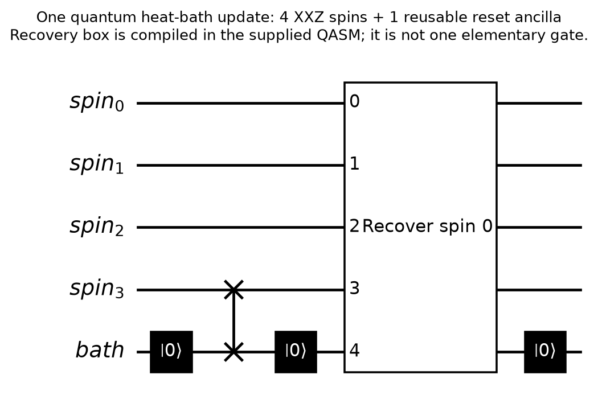
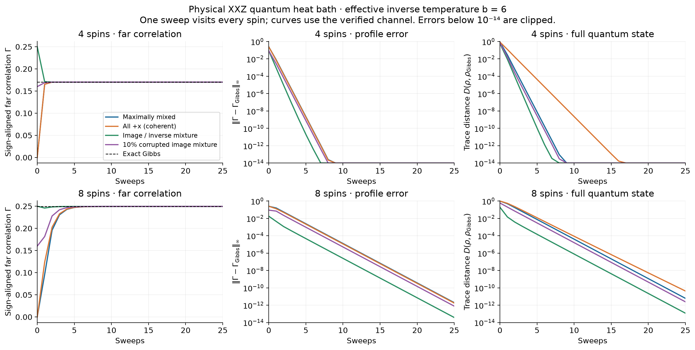
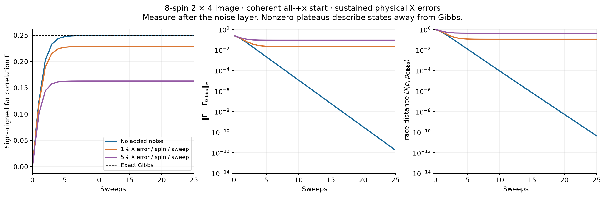

# A quantum heat-bath circuit on the XXZ spins

This implements the requested **physical quantum-state channel** for the
unchanged image-dependent XXZ Hamiltonian. The system register contains the
spins themselves. Each update uses one resettable ancilla, with no
postselection. Both coherent states and mixed states are valid inputs.

The construction is a small-system reference: it requires the full Gibbs
operator in classical preprocessing and generally acts on all spins. It is
not yet an efficient or local thermalization algorithm. It is also different
from the classical SSE path sampler in `xxz_glauber.py` and from the earlier
edge-local Davies bath. Their sweeps have different meanings and costs.

## The quantum update

Write the target state as

\[
\sigma=\frac{e^{-bH}}{\operatorname{Tr}e^{-bH}},\qquad b=\beta_{\rm paper}/N.
\]

For a selected spin \(A\), let \(B\) contain all other spins and let
\(\sigma_B=\operatorname{Tr}_A\sigma\). The update is

\[
\Phi_A(\rho)=\sqrt\sigma\left[I_A\otimes
\sigma_B^{-1/2}(\operatorname{Tr}_A\rho)\sigma_B^{-1/2}\right]\sqrt\sigma.
\]

This is erasure of spin A followed by Petz recovery. It is the Schrödinger
adjoint of the minimal conditional expectation in Eq. (13) of
[Kastoryano and Brandão, *Quantum Gibbs Samplers: the commuting case*](https://arxiv.org/abs/1409.3435).
That paper also discusses extension of this construction to faithful
noncommuting states and the resulting loss of locality. We do not transfer
its commuting-model locality or mixing results to our XXZ Hamiltonian.
Nor do we claim to implement the Ising path generator from
[arXiv:1105.5970](https://arxiv.org/abs/1105.5970).

For full-rank sigma this channel is completely positive, trace preserving,
and satisfies \(\Phi_A(\sigma)=\sigma\). In the classical diagonal limit,
on diagonal inputs it replaces the selected spin by its exact conditional
distribution, just as a classical heat-bath update does. For the
noncommuting XXZ model the recovery changes correlations throughout the
system: selecting one spin for erasure does **not** make the recovery local.

One sweep applies these channels sequentially in row-major pixel order.
There is no separately interleaved Hamiltonian-evolution stage. The full
Hamiltonian enters the recovery gates. This is a discrete sweep, not a
continuous-time Glauber clock.

## Circuit and stable construction

Each single-spin update performs:

1. Reset the bath ancilla to zero.
2. SWAP spin A with the ancilla; spin A is now zero.
3. Reset the ancilla, discarding the old spin and its correlations with B.
4. Apply the recovery isometry on B, the zeroed spin A, and the zeroed ancilla.
5. Reset the ancilla again, averaging over the recovery environment.



The recovery box is expanded into elementary `u3` and `cx` gates in the
exports; it must not be counted as one gate. Every reset retains the
ensemble of all outcomes. No favorable measurement outcome is selected.
One reusable ancilla suffices because the erasure environment is reset
before the recovery environment is needed. The reset bath is pure; the
temperature is encoded in the recovery gates. This is an engineered
dissipative channel, not a passive reservoir at temperature 1/b.

In the A,B basis let \(S=\sqrt\sigma\), with two column blocks
\(S_0,S_1\). Stack \(T=[S_0;S_1]\). Then
\(T^\dagger T=\sigma_B\), and

\[
V=T\sigma_B^{-1/2},\qquad V^\dagger V=I_B
\]

is a recovery isometry from N-1 input qubits to N+1 output qubits.
The implementation computes V as the polar factor of T using a thin SVD.
This avoids explicitly inverting a poorly conditioned Gibbs marginal.
It rejects unresolved singular directions rather than truncating or
regularizing the channel silently. Dense references are restricted to
at most eight spins. Extremely low temperatures can trigger this guard.

Pixel p maps to Qiskit qubit N-1-p, consistent with the existing code.
The recovery's internal register has B on its low bits, erased A next,
and the environment on the highest bit. These two highest input bits
must be initialized to zero.

## Executed results

Experiments use the original full XXZ interactions, kappa=2, unique-edge
contrast sample standard deviation (`ddof=1`), open boundaries and b=6.
The four-spin image is `[[0,0],[255,255]]`; the eight-spin image is the
2-by-4 strip with rows `[0,0,255,255]`. Thus the paper's beta is 24 and 48,
respectively. Gamma remains `<Z_seed Z_pixel>/4`.

The following are **complete sweep costs** in the generated circuits.
They exclude initial preparation, final measurement, optional noise, and
device routing; connectivity is unrestricted.

| System | Total qubits | Single-qubit u3 gates | CNOTs | Resets | Depth |
| --- | ---: | ---: | ---: | ---: | ---: |
| 4 spins | 5 | 1,192 | 1,056 | 12 | 2,038 |
| 8 spins | 9 | 586,224 | 577,536 | 24 | 1,152,094 |

From the coherent all-+x state, the direct channel reaches trace distance
below 1e-6 from the Gibbs state after 7 sweeps (four spins) and 15 sweeps
(eight spins). Maximally mixed, ordered image/inverse mixtures, and
10%-corrupted image/inverse mixtures also converge in these tests.
All noiseless cases are within 7e-14 after 80 sweeps in the direct
channel calculation. Such numerical floors are not hardware precision.



To test correlations away from Gibbs, independent X errors are applied
to each system spin with probability p **after every sweep**. These
errors also have a reset-ancilla circuit (`bit_flip_layer`). Observables
are measured after the errors, at the same point in each cycle.
For the eight-spin all-+x initialization, at sweep 80:

| Error probability per spin | Sign-aligned far Gamma | Fraction of Gibbs far correlation | Profile ell-infinity error | Trace distance to Gibbs |
| --- | ---: | ---: | ---: | ---: |
| 0 | 0.249501 | 100% | <1e-13 | <1e-13 |
| 0.01 | 0.228639 | 91.6% | 0.021087 | 0.107948 |
| 0.05 | 0.162679 | 65.2% | 0.087684 | 0.428511 |

The profile error is the maximum over both seeds (pixels 0 and 1) and
all target pixels, including self-correlations. The reported far pair
is pixel 0 and the opposite corner; its raw Gamma is negative because
the image colors differ. The table multiplies by the image's expected
sign. Z means vanish by symmetry, so raw and connected correlations
coincide up to numerical error in these runs.



The noisy states have one-more-sweep residual trace distance below 1e-14:
they are numerical stationary states of the **noisy cycle**, rather than
transient states on their way to Gibbs. Off-site Gamma values are immediately
attenuated by `(1-2*p)^2` in each noise layer; the channel then rebuilds
correlations during the next sweep. The exact attenuation identity is tested.

This supports correlation retention under this particular noise family on
eight spins. It does not establish universality, thermodynamic long-range
order, robustness under arbitrary noise, or a quantum advantage. The
nonlocal recovery has the target Gibbs correlations built into its gates,
so this is less demanding than recovery by a scalable local bath.

## What was verified

All **94 repository tests passed** after adding this implementation.
Coverage includes channel completeness and Gibbs preservation, the
classical conditional-update limit, an independent direct Petz formula,
complex input states, bit ordering, preparations, resets, and X noise.

For every recovery block, all initialized input columns of the compiled
elementary circuit were simulated, not just its action on the zero state.
The largest isometry Frobenius error, allowing an irrelevant global phase,
was 9.2e-13 for four spins and 5.4e-9 for eight spins. Comparing the
compiled-channel sweep with the direct channel on Gibbs, maximally mixed
and all-+x inputs gives trace-distance discrepancies below 2.8e-13 and
1.6e-10, respectively.

For four spins an independent Qiskit density-matrix execution of the
**entire** compiled sweep, including resets, agreed within 2.7e-13.
Actual ideal circuit execution with 1,024 BasicSimulator shots from all-+x
gave maximum seed-profile error 0.00408, inside the simultaneous 95%
Hoeffding radius 0.02489. This was not sampling from a precomputed density
matrix. No quantum hardware was used. Eight-spin verification uses all
compiled isometry columns and channel composition; its million-gate sweep
was not run shot-by-shot in Qiskit.

## Reproduce and inspect

From the repository root:

```sh
.venv/bin/python -m pip install -r algorithm1/requirements-tensor.txt
.venv/bin/python -m pytest -q -c algorithm1/pytest.ini
.venv/bin/python algorithm1/python/run_quantum_glauber.py --spins 4 8
.venv/bin/python algorithm1/python/plot_quantum_glauber.py
```

Use `--output` to preserve earlier runs. The eight-spin run took about
five minutes on this workspace, mainly synthesis and exhaustive circuit
verification; this is a classical simulation timing, not hardware latency.

Implementation files:

- `python/quantum_glauber.py`: channels, physical preparation/noise circuits,
  reset-ancilla updates, compilation, and elementary-gate verification.
- `python/run_quantum_glauber.py`: experiments, validations, and exports.
- `python/plot_quantum_glauber.py`: sweep figures and summary.
- `tests/test_quantum_glauber.py`: regression tests.
- `matlab/verify_quantum_heat_bath_fixture.m`: MATLAB density-matrix replay
  and optional reconstruction of four-spin recovery gates using QCLAB.

Each `results/quantum-glauber/n4` or `n8` directory contains:

- `report.json`: parameters, complete trajectories, numerical checks,
  gate counts, versions, and four-spin shot results.
- `one-sweep.qasm.gz`: elementary OpenQASM 2 circuit, including resets.
- `one-sweep.qpy` and `one-sweep-compiled.qpy`: boxed and expanded circuits.
  The boxed QPY uses generic instructions with full elementary definitions
  to avoid a Qiskit 2.5.2 serialization issue with the Isometry class.
- `one-update.png`, `.svg`, `.txt`: a single-site circuit diagram.
- `quantum-heat-bath.mat`: H, Gibbs state, initial/final states, four Kraus
  operators per update, and recovery isometries. Four-spin files additionally
  contain elementary recovery gate lists.
- `final-states.npz`: final density matrices for every tested case.

The four-spin directory also has `plus-x-one-sweep.qasm`, the complete
preparation/update/measurement circuit used for the shot check. Results
are Git-ignored, following existing repository practice.

MATLAB usage after generating the fixture:

```matlab
addpath('algorithm1/matlab');
r = verify_quantum_heat_bath_fixture( ...
    'algorithm1/results/quantum-glauber/n8/quantum-heat-bath.mat');
% With QCLAB on the MATLAB path, replay the four-spin elementary gates:
r4 = verify_quantum_heat_bath_fixture( ...
    'algorithm1/results/quantum-glauber/n4/quantum-heat-bath.mat', true);
```

QCLAB supplies the recovery unitary blocks; the helper evaluates erasure
and resets as averaged channels. MATLAB/QCLAB execution remains unverified
because MATLAB is not installed here. This is a compatible replay helper,
not a claim of a tested native MATLAB dynamic-circuit backend.

## Scaling implication

The ancilla count is economical, but the present gate count is not.
The dense Gibbs operator has 4^N entries, and the generic recovery
isometry has exponentially many entries and synthesized gates. Moving
from four to eight spins increased the measured CNOT count per sweep by
about 547 times. Neither the short observed mixing time nor N+1 qubits
removes this cost. These circuits are unsuitable as near-term scalable
implementations in their current form.

The useful next step is to approximate recovery on bounded neighborhoods
and measure the resulting correlation bias against this reference. That
would allow gate cost per update to be controlled, but global Gibbs
preservation and long-distance correlation recovery would need to be
tested again rather than assumed.
