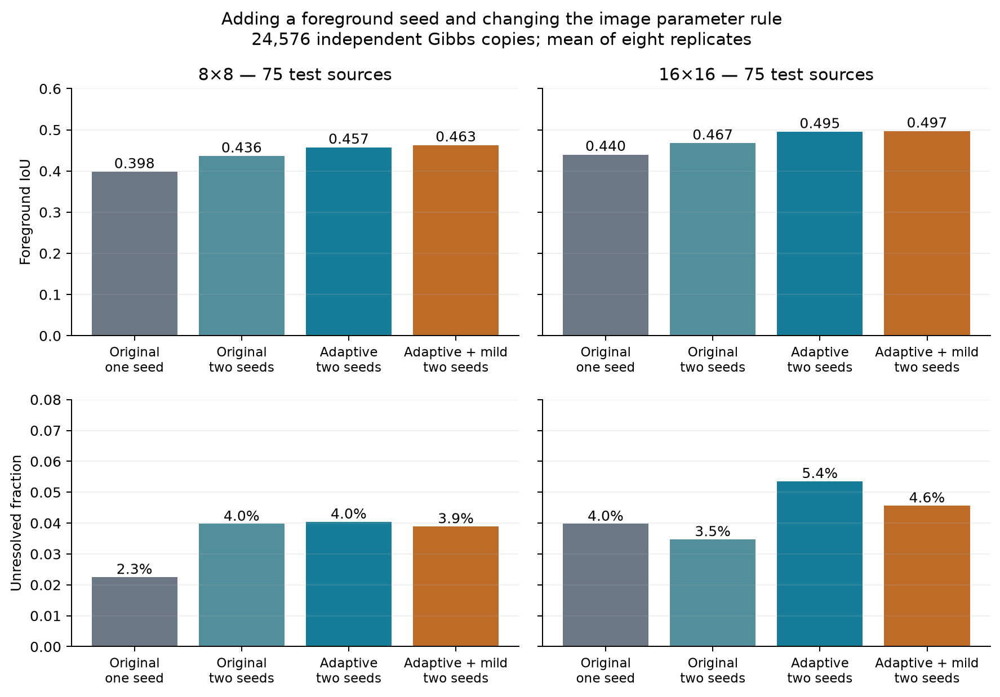
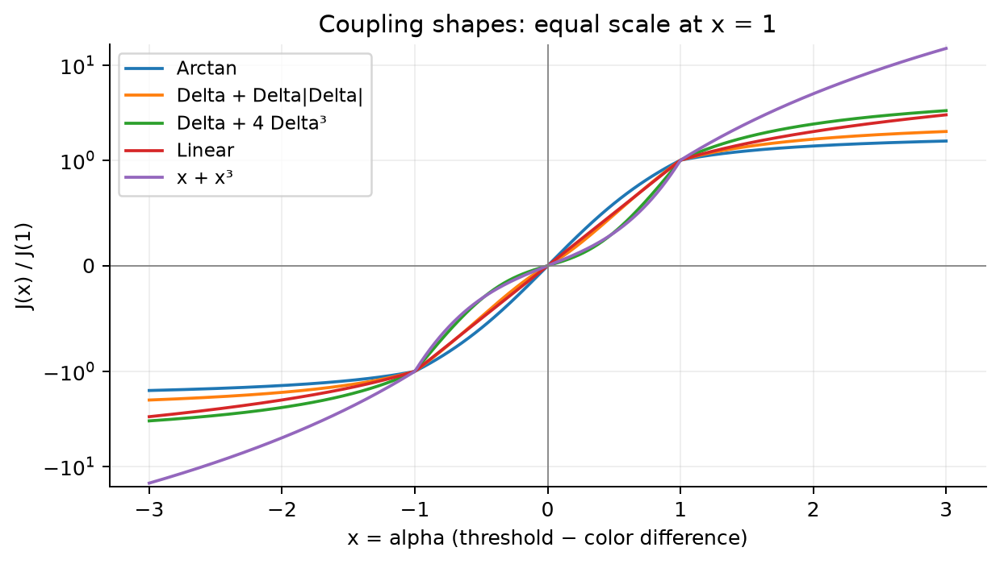
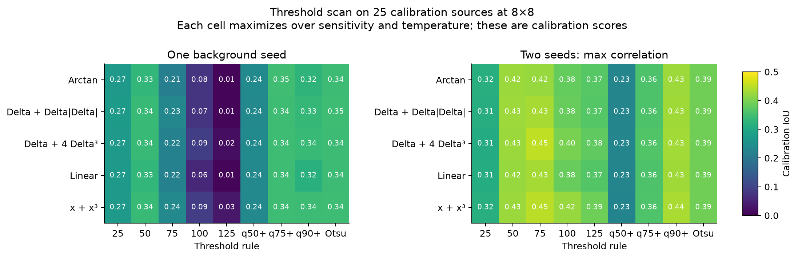
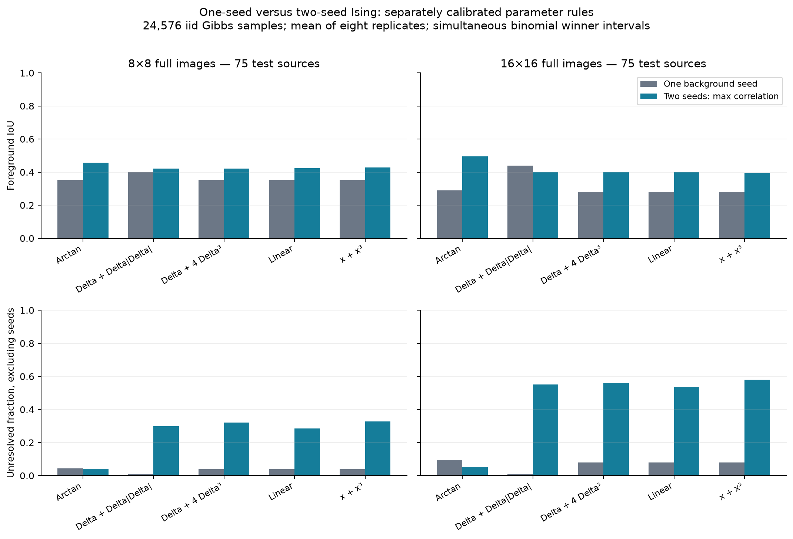
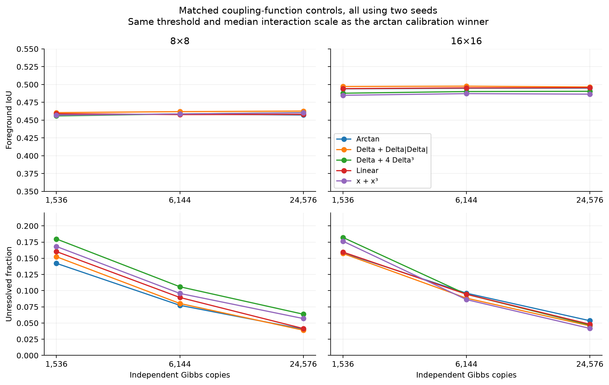
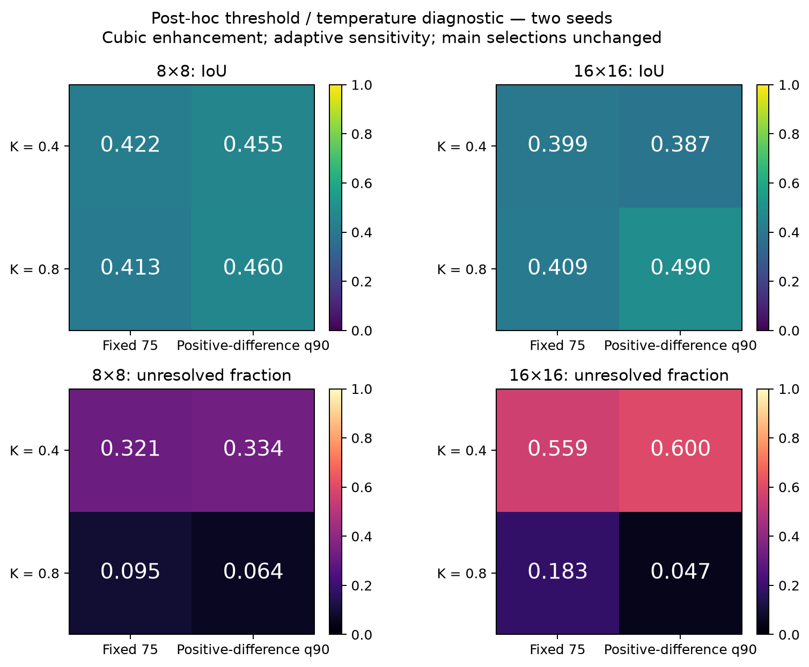
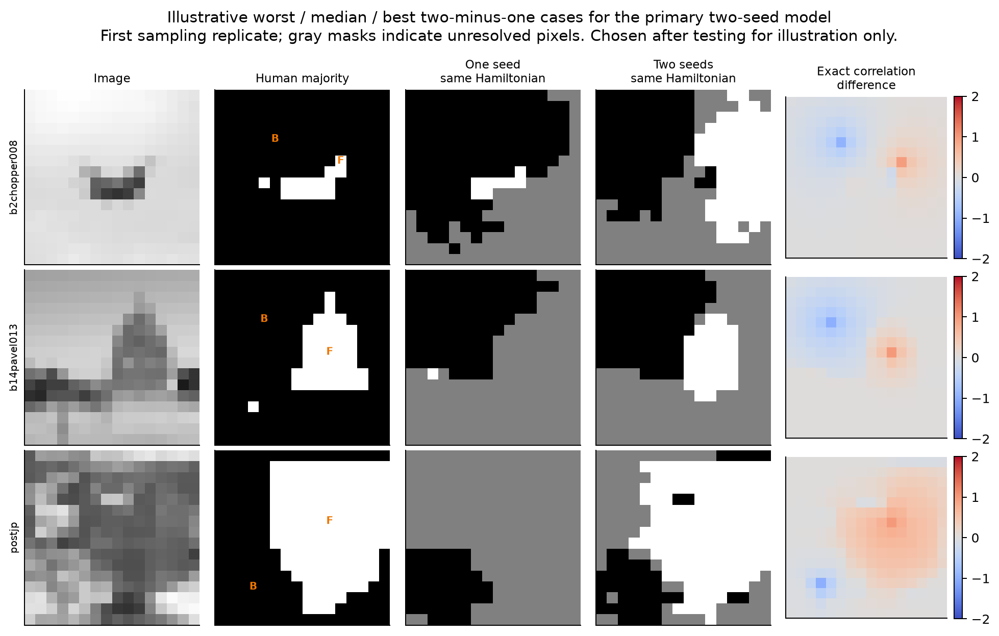

# One-seed and max-correlation two-seed Ising segmentation

Experiment date: 2026-10-08. This study extends the two-seed test to full-frame Weizmann images at 8×8 and 16×16 and investigates coupling functions that strengthen bonds farther from the image threshold.

**Adding a foreground seed improves mean segmentation IoU, but it does not guarantee fewer unresolved pixels.** Keeping the previous Hamiltonian unchanged at 16×16, max-correlation two-seed segmentation increases IoU from **0.4399 to 0.4674**. Unresolved pixels change from **3.98% to 3.48%**; the uncertainty interval for this change includes zero.

The arctangent family's calibration-selected adaptive rule reaches **0.4949 IoU and 5.36% unresolved** at 16×16. A matched mild nonlinear enhancement reaches **0.4966 and 4.57%**, but its small advantage over arctangent is not conclusive. Faster growth alone is not supported as a consistent improvement.

There is also a negative result: the **overall accuracy winner on calibration** was a cubic enhancement with fixed threshold 75 and K=0.4. It transferred poorly to 16×16, reaching only **0.3995 IoU with 55.93% unresolved**. It remains the recorded overall calibration winner; the successful adaptive arctangent result is reported as a separately preselected family result, not a retroactively selected primary model.

A post-hoc factorial diagnostic shows that **threshold and temperature interact**. For the same cubic function, q90 with K=0.8 works well; q90 alone at K=0.4 does not fix the sampling ambiguity. These are exploratory findings on reduced-resolution images with oracle seeds, not an established parameter rule for arbitrary images.



## Segmentation rule and Gibbs sampling

The Hamiltonian is

\[
H=-\frac14\sum_{\langle ij\rangle}J_{ij}Z_iZ_j,\qquad
\rho=\frac{e^{-bH}}{Z},\qquad b=\beta_{\rm paper}/N.
\]

Only nearest neighbors interact. There is no transverse field or XX/YY term. Because this Hamiltonian is diagonal, its computational-basis Gibbs distribution is a classical signed Ising distribution, including frustrated bonds. Drawing that distribution exactly supplies the quantum ZZ correlations requested here. No thermal-bath or circuit preparation is simulated.

Let B and F be known background and foreground seed locations, and let C_(s,i)=<Z_s Z_i>. The requested maximum rule is

\[
\hat\ell_i=\underset{s\in\{B,F\}}{\arg\max}\;C_{s,i}.
\]

Thus a pixel is foreground when C_(F,i)>C_(B,i). This uses the largest **signed correlation**, not the largest absolute correlation. It is algebraically the same as the two-seed contrast rule in the preceding XYZ experiment. The present work changes the image sizes and coupling functions, not that algebraic decision.

The primary one-seed comparison uses the original background sign: foreground iff C_(B,i)<0. A foreground-only sign rule, C_(F,i)>0, is also reported as a seed-choice diagnostic. Ties predict background. Spins are never clamped in the sampled state, and known labels are not imposed on output pixels.

A new logarithmic frontier sampler computes each spin's conditional probability given the previously drawn spins, then draws complete, independent Gibbs configurations. The state of the frontier has at most 2^w entries, where w is the shorter image dimension. Complexity is O(N 2^w) in preprocessing and storage, followed by O(N M) for M configurations. Logarithmic messages avoid exponential-weight overflow with the stronger couplings. This is exact up to floating-point arithmetic; it has no burn-in, autocorrelation, or mixing error.

Independent exact seed-correlation references use global spin-flip symmetry, C_(s,i)=E[Z_i | Z_s=+1], evaluated by deterministic transfer messages. This conditioning is an internal reference calculation, not a change to the state being sampled. Checks against full state enumeration and the earlier row-transfer implementation verify signs, normalization, transposition, arbitrary signed bonds, and strong-coupling behavior.

## Coupling functions and threshold choices

For neighboring intensity difference d in grayscale units [0,255], define

\[
x=\alpha(\tau-d),\qquad \Delta=\arctan(x),\qquad\alpha>0.
\]

The five tested families are:

| Family | Coupling J | Purpose |
|---|---|---|
| Arctangent | Delta | Existing saturating reference |
| Quadratic enhancement | Delta + Delta·abs(Delta) | Strengthen larger absolute couplings while retaining a linear term near zero |
| Cubic enhancement | Delta + 4 Delta³ | Stronger enhancement away from the threshold |
| Linear | x | Remove arctangent saturation without superlinear growth |
| Linear plus cubic | x + x³ | Unbounded cubic growth at large distance from threshold |

All functions are odd and preserve the sign and location of the image threshold. A positive J favors parallel spins under the minus sign in H. Enhancements applied to arctan remain bounded as d grows; only the x-based alternatives are unbounded in x. These are deliberately distinct tests of what “grows faster away from the threshold” can mean.



The threshold choices are fixed tau=25,50,75,100,125; the 50th, 75th, or 90th percentile of **positive** neighbor differences; and an Otsu split of neighbor differences. No truth labels enter these rules. Quantiles have a floor of 1, and a lack of positive differences uses the existing fallback 125. Otsu uses its established midpoint convention and fallback. Using positive differences avoids the all-zero quantile failure observed in the preceding XYZ diagnostic, though it does not guarantee distinct or universally useful thresholds.

Sensitivity choices are alpha=0.001, 0.01, and 1/S, where S=max(q90(d)-q10(d),1). Temperature is normalized by typical interaction magnitude:

\[
b=\frac{4K}{\operatorname{median}_e|J_e|},\qquad K\in\{0.4,0.8,1.6\}.
\]

A near-zero median uses max(mean|J|,0.001), recorded explicitly. This normalization prevents a new coupling function from improving a comparison solely by multiplying every interaction by a common constant. The pure linear function has only one sensitivity entry because the normalization cancels its positive alpha factor. Overall, the grid contains **351 distinct parameter rules**.

## Data and calibration

The verified Weizmann single-object archive supplies 100 images with three human masks each. Entire grayscale images are BOX-resized to 8×8 and 16×16. Each human mask is resized with nearest-neighbor sampling, then a majority mask is formed. Both classes remain present in all 200 resized cases; there are no exclusions.

The same original 25-calibration/75-test source split is reused. All parameter selection uses only the 25 calibration images at 8×8. Their 16×16 versions are prepared but never used for tuning. The 75 other sources provide 150 test cases across the two sizes. These sources have appeared in earlier research iterations: this is an internal exploratory comparison, not fresh external validation.

Seed locations are supplied from the human mask by choosing an interior background pixel and an interior foreground pixel. The two-seed method has more supervision than the background-only method. Paired comparisons evaluate the methods on identical images, and matched-Hamiltonian comparisons use identical sampled spin configurations. Both seed positions are excluded from resolution rates and from the additional unseeded-only IoU metric. Main IoU covers the full predicted mask.

Each parameter rule has three independent calibration replicates at 24,576 Gibbs copies. For each coupling family and each primary segmentation rule, the accuracy-focused choice maximizes mean sampled foreground IoU, breaking ties by the pessimistic unresolved-label IoU, exact IoU, and fixed identifiers. Two additional confidence-focused choices maximize pessimistic IoU across all families. A fixed legacy edge-Otsu, alpha=0.01, K=0.8 arctangent model checks continuity with the previous Ising/XXZ study.

Before test results were evaluated, a [matched-control extension](weizmann-ising-seeds-controls-protocol.json) added all five functions at the arctangent two-seed winner's threshold, sensitivity, and K. Only the function changes; b is adjusted to retain the same median dimensionless strength. The pure linear entry uses its equivalent canonical sensitivity. The final test contains 17 distinct Hamiltonian parameter rules. Duplicate labels reuse the same state and samples.

Test budgets are 1,536, 6,144, and **24,576** independent configurations, using nested prefixes within each of eight independent replicates. The same configurations supply both seed correlations and every pixel correlation, so two seeds do not receive double the number of Gibbs copies. All model choices are fixed before the test stage; there is no 16×16 retuning.

## What “unresolved” means in this study

A winner is unresolved when a simultaneous confidence interval includes the decision boundary. For one background seed, the relevant Bernoulli probability is P(Z_i != Z_B), with foreground when it exceeds 1/2.

For two seeds, configurations with Z_F=Z_B contribute exactly zero to the difference of correlations. Consequently

\[
C_{F,i}-C_{B,i}
=2\,P(Z_F\ne Z_B)\,E[Z_F Z_i\mid Z_F\ne Z_B].
\]

The sign is determined by P(Z_i=Z_F | Z_F != Z_B)>1/2. We count only these informative configurations for the winner test while charging **every drawn configuration** to the sampling budget. If none have opposing seed spins, the two-seed winner remains unresolved. Conditional on the number of informative draws, the count is binomial, so an exact Clopper–Pearson interval applies.

Both one- and two-seed tests use Clopper–Pearson intervals with a Bonferroni correction across three readouts, all pixels, and all three budgets. Coverage is at least 95% jointly within a Hamiltonian and sampling replicate; this is not a simultaneous claim across every model and image. Correlations within an image and between budget prefixes do not invalidate the union bound.

This replaces the earlier generic Hoeffding bounds with a sharper winner-specific test. Unresolved percentages from different studies should therefore not be compared directly. A sensitivity table below also applies the same generic Hoeffding method to both classifiers in this run.

Main IoU uses the sampled prediction even at unresolved pixels, so it can look good despite weak evidence for many labels. We also report correctly resolved and wrongly resolved fractions, and lower/upper IoU bounds obtained by allowing every assignment to unresolved pixels. Exact-correlation IoU uses a 1e-10 numerical tie tolerance. Statistical confidence is confidence in the model's correlation decision, not a guarantee that the decision matches the human segmentation.

## Selected parameter rules

Here q75+ and q90+ mean quantiles over positive neighbor differences. “Adaptive” means alpha=1/S. Selection used only the 25 calibration sources at 8×8.

| Coupling family | Readout | Threshold | Sensitivity alpha | K | Calibration IoU |
|---|---|---|---|---:|---:|
| Arctangent | One background seed | q75+ | 1/S | 0.8 | 0.3461 |
| Arctangent | Two seeds | q90+ | 1/S | 0.8 | 0.4276 |
| Δ + Δ·abs(Δ) | One background seed | Edge Otsu | 1/S | 1.6 | 0.3455 |
| Δ + Δ·abs(Δ) | Two seeds | 75 | 0.01 | 0.4 | 0.4349 |
| Δ + 4Δ³ | One background seed | q75+ | 0.001 | 0.8 | 0.3447 |
| Δ + 4Δ³ | Two seeds | 75 | 1/S | 0.4 | 0.4516 |
| x | One background seed | q75+ | 1/S | 0.8 | 0.3443 |
| x | Two seeds | 75 | 1/S | 0.4 | 0.4319 |
| x + x³ | One background seed | q75+ | 0.001 | 0.8 | 0.3445 |
| x + x³ | Two seeds | 75 | 1/S | 0.4 | 0.4485 |

The confidence-focused one-seed choice is arctangent/Otsu/1/S/K=1.6; the corresponding two-seed choice is cubic/q90+/1/S/K=1.6. The legacy model retains arctangent/Otsu/alpha=0.01/K=0.8. All matched-function controls use q90+/1/S/K=0.8.



## Test results: 24,576 independent Gibbs copies

All entries average eight sampling replicates per image, then 75 original source images. IoU is foreground intersection-over-union. U is the unresolved fraction among non-seed pixels. Both sizes use the same 75 test sources and must not be treated as 150 independent source images.

### Direct comparison with the previous model

| Model/readout | 8×8 IoU | 8×8 U | 16×16 IoU | 16×16 U |
|---|---:|---:|---:|---:|
| Previous model, one seed | 0.3978 | 2.26% | 0.4399 | 3.98% |
| Previous model, two seeds | 0.4361 | 3.98% | 0.4674 | 3.48% |
| Adaptive arctangent, two seeds | 0.4572 | 4.05% | 0.4949 | 5.36% |
| Same adaptive rule + mild enhancement, two seeds | 0.4627 | 3.90% | 0.4966 | 4.57% |

For the unchanged previous Hamiltonian at 16×16, the paired two-minus-one IoU difference is **+0.0275 [+0.0125, +0.0435]**, where brackets are a 95% source-bootstrap interval. Excluding both seeds from IoU still gives **+0.0205 [+0.0058, +0.0365]**. Thus the gain is not just the two known pixels. The unresolved change is −0.50 percentage points, with interval [−2.33, +1.31] points; a reduction is not established.

The intervals use 5,000 paired bootstrap resamples of original source images, averaging the eight sampling replicates first. They are exploratory intervals without adjustment for the many model comparisons. At 8×8 the direct previous-model IoU gain is +0.0383, with interval [−0.0077, +0.0867], so that smaller-size result is inconclusive.

### Separately calibrated rules for every coupling family

These comparisons change both the readout and its selected parameter rule. They should not be interpreted as a pure effect of adding a seed.

| Family | Readout | 8×8 IoU | 8×8 U | 16×16 IoU | 16×16 U |
|---|---|---:|---:|---:|---:|
| Arctangent | One seed | 0.3527 | 4.40% | 0.2895 | 9.48% |
| Arctangent | Two seeds | 0.4572 | 4.05% | 0.4949 | 5.36% |
| Δ + Δ·abs(Δ) | One seed | 0.3997 | 0.83% | 0.4400 | 0.71% |
| Δ + Δ·abs(Δ) | Two seeds | 0.4226 | 29.91% | 0.3995 | 55.03% |
| Δ + 4Δ³ | One seed | 0.3519 | 3.97% | 0.2808 | 8.00% |
| Δ + 4Δ³ | Two seeds | 0.4225 | 32.10% | 0.3995 | 55.93% |
| x | One seed | 0.3524 | 3.94% | 0.2810 | 8.00% |
| x | Two seeds | 0.4241 | 28.54% | 0.3988 | 53.85% |
| x + x³ | One seed | 0.3524 | 3.84% | 0.2812 | 8.00% |
| x + x³ | Two seeds | 0.4273 | 32.70% | 0.3949 | 58.01% |
| Confidence-focused selection | One seed | 0.3960 | 0.37% | 0.4313 | 0.54% |
| Confidence-focused selection | Two seeds | 0.4494 | 11.07% | 0.4749 | 11.33% |

The new one-seed accuracy calibration winner underperforms the previous one-seed rule on the test sources. Reporting only the new weak one-seed winner would overstate the practical two-seed improvement; the previous-model comparison above is therefore essential. The overall two-seed calibration winner also generalizes poorly, with exact-correlation IoU 0.4301 at 16×16 versus sampled IoU 0.3995. Its poor performance contains both model error and a finite-sample decision problem.



### Same Hamiltonian and same samples: isolate the readout

Using the adaptive arctangent two-seed selection (q90+, alpha=1/S, K=0.8):

| Readout | 8×8 IoU | 8×8 U | 16×16 IoU | 16×16 U |
|---|---:|---:|---:|---:|
| One background seed | 0.3144 | 1.87% | 0.4039 | 1.76% |
| One foreground seed | 0.3970 | 2.61% | 0.4087 | 3.20% |
| Max of two seeds | 0.4572 | 4.05% | 0.4949 | 5.36% |

At 16×16, adding the second seed increases IoU by **+0.0911 [+0.0548, +0.1289]** compared with the same-state background-only readout. However, unresolved pixels increase from 1.76% to 5.36%. A second seed can give a more useful semantic comparison while also creating small differences between two nonzero correlations. Better IoU and fewer ambiguous decisions are separate goals.

Fixed classical contextual controls give Otsu IoU 0.4408/0.4355 and random-walker IoU 0.4217/0.4102 at 8×8/16×16. These are existing default configurations, not equally extensive calibration studies. This experiment does not establish a general advantage over classical segmentation.

## Nonlinear growth at matched parameters

Only J changes below. Every model uses two seeds, q90+, alpha=1/S, and K=0.8; normalizing b keeps the median dimensionless bond magnitude fixed.

| Coupling | 8×8 IoU | 8×8 U | 16×16 IoU | 16×16 U |
|---|---:|---:|---:|---:|
| Arctangent | 0.4572 | 4.05% | 0.4949 | 5.36% |
| Δ + Δ·abs(Δ) | 0.4627 | 3.90% | 0.4966 | 4.57% |
| Δ + 4Δ³ | 0.4605 | 6.36% | 0.4905 | 4.69% |
| x | 0.4580 | 4.15% | 0.4955 | 4.81% |
| x + x³ | 0.4603 | 5.69% | 0.4865 | 4.17% |

At 16×16 the mild enhancement changes IoU by **+0.0016 [-0.0048, +0.0092]** relative to arctangent. Its unresolved change is −0.79 percentage points, with interval [−2.25, +0.42] points. Neither improvement is conclusive. At 8×8 the small IoU gain is +0.0055 [0.0002, 0.0114], but this is one of many exploratory comparisons.

Cubic and unbounded growth do not improve 16×16 mean IoU in these controls. The x+x³ rule has a smaller unresolved fraction but a lower IoU: strengthening confidence in a model decision can also strengthen a wrong segmentation.

The adaptive arctangent rule has stable 16×16 sampled IoU as the budget increases: 0.4939, 0.4948, 0.4949 at 1,536, 6,144, and 24,576 copies. Unresolved pixels fall from 15.84% to 9.61% to 5.36%. Its exact-correlation reference is 0.4943. More samples mainly improve decision certification here rather than average segmentation accuracy.



## Follow-up diagnostic: separate threshold and temperature

The failed overall calibration winner differs from the successful cubic matched control in both tau and K. After examining the main outcomes, a separately recorded diagnostic filled the two missing corners of that 2×2 comparison. This is **post-hoc mechanism exploration**, not fresh validation or a replacement for the original selected models. Function J=Δ+4Δ³ and alpha=1/S stay fixed.

| Threshold | K | 8×8 IoU | 8×8 U | 16×16 IoU | 16×16 U |
|---|---:|---:|---:|---:|---:|
| 75 | 0.4 | 0.4225 | 32.10% | 0.3995 | 55.93% |
| q90+ | 0.4 | 0.4548 | 33.39% | 0.3867 | 60.04% |
| 75 | 0.8 | 0.4126 | 9.51% | 0.4092 | 18.31% |
| q90+ | 0.8 | 0.4605 | 6.36% | 0.4905 | 4.69% |

At K=0.4, changing 75 to q90 does not help the 16×16 sampled result. At K=0.8, the same threshold change raises IoU by +0.0812 [0.0210, 0.1429] and reduces unresolved pixels by 13.63 points. Raising K at q90 increases IoU by +0.1038 [0.0663, 0.1441] and reduces unresolved pixels by 55.35 points. Raising K means increasing inverse temperature and strengthening correlations relative to thermal fluctuations.

The q90/K=0.4 state has exact IoU 0.4475 but sampled IoU 0.3867: a low inverse-temperature scale can leave useful correlation signs too weak to estimate at this budget. The q90/K=0.8 exact IoU is 0.4912 versus sampled 0.4905. Both the Gibbs correlations and their statistical accessibility matter. This does not imply that still larger K always helps; the separately selected K=1.6 two-seed model has 11.33% unresolved at 16×16.



## Sensitivity to the definition of unresolved

For the adaptive arctangent Hamiltonian, the same sample counts give the following unresolved rates:

| Size | Readout | Exact binomial winner interval | Generic Hoeffding interval |
|---|---|---:|---:|
| 8×8 | One background seed | 1.87% | 2.11% |
| 8×8 | Two seeds | 4.05% | 12.12% |
| 16×16 | One background seed | 1.76% | 1.97% |
| 16×16 | Two seeds | 5.36% | 13.27% |

The smaller binomial percentages partly reflect a sharper analysis, not a changed physical state or a new sampler advantage. Every comparison within the main tables applies the same winner-interval construction and familywise confidence target to both classifiers.

## Illustrative successes and failures

The following images use the overall calibration-selected cubic/fixed75/K=0.4 model, including its failure cases. They show the worst, median, and best source by the test-set two-minus-one IoU difference on that same Hamiltonian. They were selected after the experiment for illustration only; gray output pixels are unresolved, while IoU tables still use their tentative labels.



## Practical interpretation and next parameter rule

A reasonable **provisional** two-seed rule to carry forward is

\[
\tau=q_{0.9}(\{d_e:d_e>0\}),\qquad
\alpha=\frac{1}{\max(q_{0.9}(d)-q_{0.1}(d),1)},\qquad
J_e=\arctan[\alpha(\tau-d_e)],\qquad
b=\frac{3.2}{\operatorname{median}|J_e|},\quad
\beta_{\rm paper}=Nb.
\]

Use the documented threshold and denominator fallbacks for degenerate images. Predict foreground iff C_(F,i)>C_(B,i), and retain a separate confidence flag. The mild J=Δ+Δ·abs(Δ) variant is worth carrying alongside it as a comparison; the present data do not establish that it is better.

The results support testing two seeds further, not the stronger claim that a second seed or superlinear coupling generally eliminates unresolved pixels. In particular, the higher-q threshold must be paired with a suitable temperature scale. A universal rule cannot be inferred from only 25 small calibration images. Optimizing IoU alone can select weak-correlation models with many statistically ambiguous labels.

The next independent study should calibrate across multiple resolutions and use new sources, several seed placements per source, and an objective that penalizes unresolved pixels or reports the accuracy–coverage tradeoff. This is a recommendation, not a claim that those experiments were run here.

## Limits of the result

- These are full images reduced to 8×8 and 16×16, not full-resolution Weizmann benchmarks. Resizing changes edge differences and thin structures.
- Human masks determine ideal interior seeds. The extra foreground seed is real additional supervision; all comparisons must retain that qualification.
- The source split has been used in previous development. Neither the family comparisons nor the follow-up diagnostic constitute a pristine external test.
- Exact Gibbs sampling removes mixing error but costs exponentially in image width. This implementation is a reference engine for width at most 16, not an efficient sampler for arbitrary large images.
- The diagonal quantum Ising Gibbs state is sampled classically. No quantum circuit, coherent advantage, or scalable quantum Gibbs preparation is demonstrated by this experiment.
- Statistical resolution concerns the correlation decision, not agreement with human ground truth. A confidently wrong label remains an error.

## Verification

The [main audit](weizmann-ising-seeds-validation.json) passed **37 unit/regression tests** and recomputed **183,600 sampling decisions** across 2,550 model–image combinations. Stored metrics reproduce exactly. It checked frozen code/data/selection signatures, disjoint source sets, count bounds, confidence-bound consistency, self-correlations, pair reciprocity, and a conservative global sample-to-exact correlation check.

All **150 legacy-model exact IoUs reproduce the earlier Ising/XXZ study**, image by image. The largest self-correlation error is 1.75e−13 and the largest reciprocity error is 5.49e−14. The log-space engine stayed finite for tested dimensionless bond magnitudes as large as 1,709.8.

The [separate diagnostic audit](weizmann-ising-seeds-threshold-diagnostic-summary.json) passed signature and count checks and recomputed another 7,200 sampling decisions for its 300 additional model–image results, with zero metric discrepancy. This supplementary audit is distinct from the frozen main validation.

All figures were rendered and visually inspected. The implementation and results have been saved locally; this run does not commit or push them.

## Reproduction and files

- [Sampler and segmentation logic](python/ising_seed_sampling.py)
- [Frozen experiment runner](python/run_weizmann_ising_seeds.py)
- [Matched-control selection extension](python/add_ising_seed_controls.py)
- [Analysis and figures](python/analyze_weizmann_ising_seeds.py)
- [Artifact validation](python/validate_weizmann_ising_seeds.py)
- [Follow-up diagnostic runner](python/run_ising_seed_threshold_diagnostic.py) and [analysis/audit](python/analyze_ising_seed_threshold_diagnostic.py)
- [Tests](tests/test_ising_seed_sampling.py)
- [Manifest](weizmann-ising-seeds-manifest.json), [protocol](weizmann-ising-seeds-protocol.json), [selected rules](weizmann-ising-seeds-selection.json), and [summary](weizmann-ising-seeds-summary.json)

From the repository root:

```sh
.venv/bin/python algorithm1/python/run_weizmann_ising_seeds.py prepare
.venv/bin/python algorithm1/python/run_weizmann_ising_seeds.py init
.venv/bin/python algorithm1/python/run_weizmann_ising_seeds.py calibrate --workers 4
.venv/bin/python algorithm1/python/run_weizmann_ising_seeds.py select
.venv/bin/python algorithm1/python/add_ising_seed_controls.py
.venv/bin/python algorithm1/python/run_weizmann_ising_seeds.py test --workers 4
.venv/bin/python algorithm1/python/analyze_weizmann_ising_seeds.py
.venv/bin/python -m pytest -c algorithm1/pytest.ini algorithm1/tests/test_ising_seed_sampling.py algorithm1/tests/test_ising_grid_transfer.py algorithm1/tests/test_ising_thresholds.py -q --junitxml=algorithm1/results/weizmann-ising-seeds/tests.xml
.venv/bin/python algorithm1/python/validate_weizmann_ising_seeds.py
.venv/bin/python algorithm1/python/run_ising_seed_threshold_diagnostic.py
.venv/bin/python algorithm1/python/analyze_ising_seed_threshold_diagnostic.py
```

The input archive must be present at the existing verified dataset path. Frozen hashes guard against mixing changed code, data, or selected rules with cached results. Raw arrays contain the exact correlations and sufficient sample counts for every budget and replicate; all reported metrics can be recomputed from them. Generated arrays and figures live under the Git-ignored `results/weizmann-ising-seeds/`; source code, compact protocols, summaries, and this report are outside it. The implementation is additive and retains the earlier experiments.
