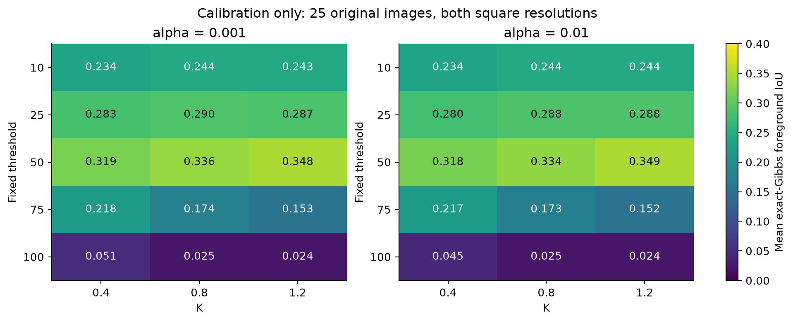
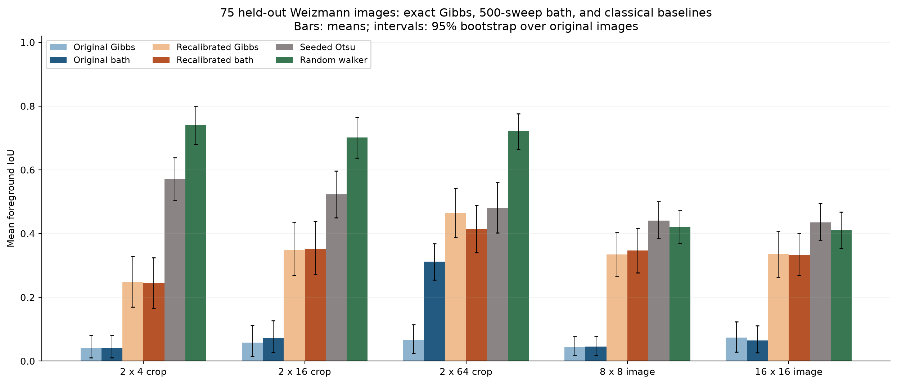
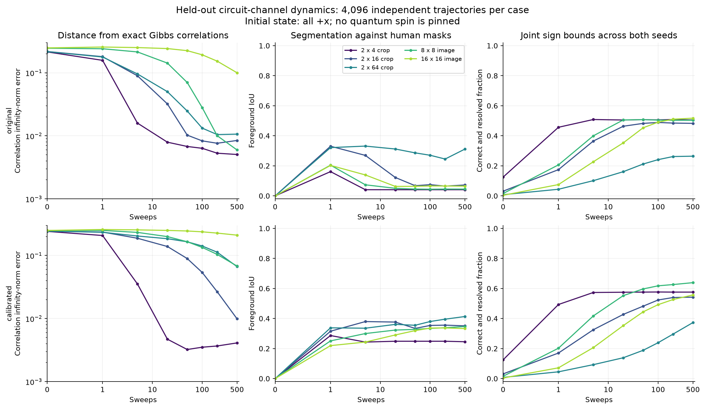
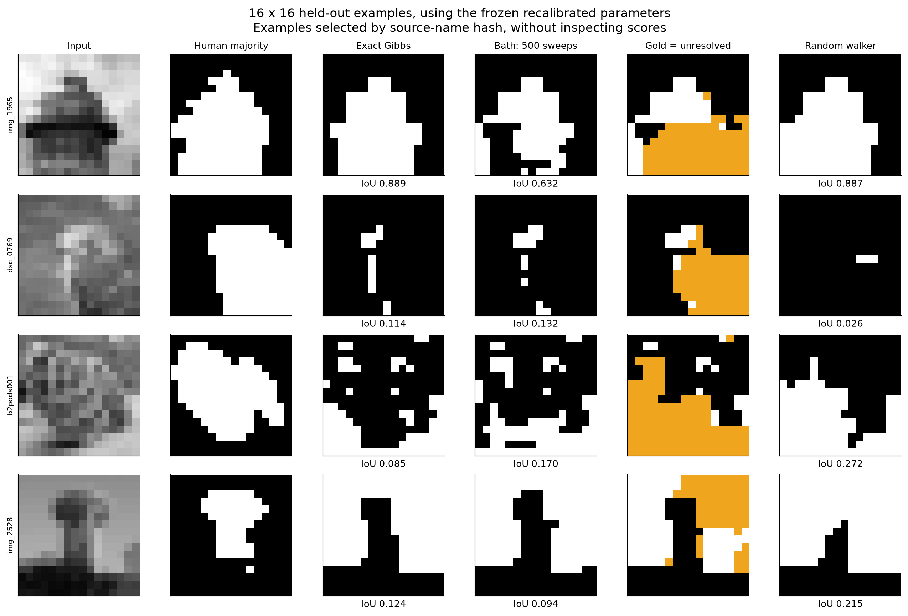
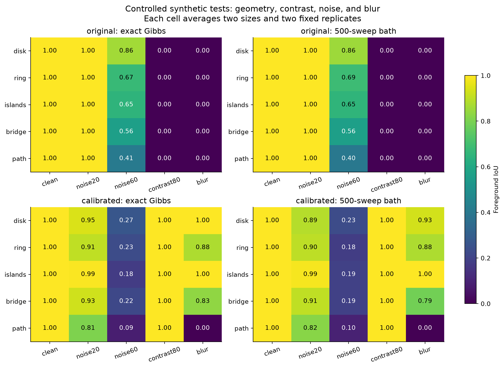
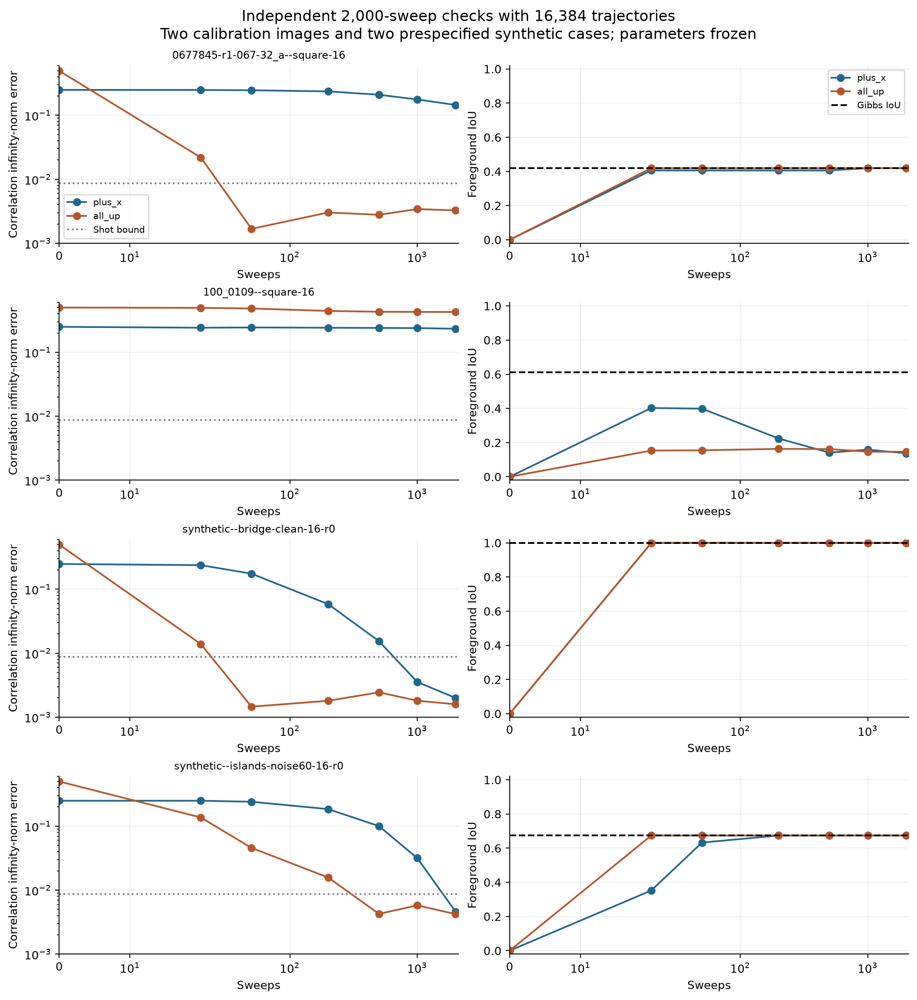

# Local Ising Petz circuit: natural images and controlled robustness tests

Completed 7 October 2026. The study contains 1,799 primary evolution runs,
1,500 exact-Gibbs calibration evaluations, and eight independent longer runs.
All numerical inputs and outputs are saved locally. Nothing was pushed to GitHub.

The circuit implements the intended local channel, but the current image
Hamiltonian does not reliably reproduce human object masks. A global
recalibration substantially improves segmentation, while remaining below the
mean scores of the two classical baselines. The experiments also give a clear
example of correct segmentation well before agreement with Gibbs correlations.
These are separate findings: correlation-sign robustness can hold even when
correlation magnitudes have not equilibrated, and equilibration can still give
the wrong object segmentation.

**Data and experimental design.** The input is the 100-image single-object
subset of the [Weizmann segmentation database](https://www.wisdom.weizmann.ac.il/~vision/Seg_Evaluation_DB/),
with three human annotations per image. The source requests citation of
Sharon Alpert, Meirav Galun, Ronen Basri and Achi Brandt, *Image Segmentation
by Probabilistic Bottom-Up Aggregation and Cue Integration*, CVPR 2007.
The [official download](https://www.wisdom.weizmann.ac.il/~vision/Seg_Evaluation_DB/dl.html)
is provided for research use; source images remain in the ignored local
results directory.

The downloaded archive has SHA256
`c3aa39699a644e9fc58b86b059ac446cba2f66d57fb92e806e61aeb7d7973de1`.
ZIP integrity, image counts, and individual input hashes were checked.
The annotation PNGs are red overlays on grayscale images. Foreground is
decoded using `R - max(G,B) > 128`, and the reference mask is a majority vote
of the three annotations. This color test decodes the annotation; it does not
threshold the experimental input image. Changing the red-dominance cutoff
from 64 to 192 changes at most 1.175% of an original annotation's pixels.
Individual human-mask Gibbs IoUs are also retained in the raw run records;
annotation uncertainty is not included in the bootstrap intervals below.

The [protocol](weizmann-petz-protocol.json) was specified before numerical
comparisons. Twenty-five original images are reserved for calibration and
75 for testing, using a deterministic hash split. All crops and resizes of
one source remain in its split. The [manifest](weizmann-petz-manifest.json)
records the source hashes, assignments, crop coordinates, and seeds.

| Cases | Construction | Count |
|---|---|---:|
| Natural strips | Native-resolution 2-by-4, 2-by-16, and 2-by-64 windows; one foreground, background, and boundary window per available category | 899 |
| Natural squares | Each original image resized to 8-by-8 and 16-by-16 | 200 |
| Synthetic images | Five geometries, five conditions, two sizes, two replicates | 100 |

Boundary windows contain 25–75% foreground and are sampled uniformly from
eligible windows using a fixed seed. One calibration image, `hpim1242`, has
no eligible foreground-only 2-by-64 window. No image is omitted on the basis
of segmentation performance. Full-frame square images use BOX averaging;
each human mask is resized by nearest-neighbor sampling before majority
voting. This anisotropic resize changes aspect ratios and fine structure.
These are small-image and native-strip tests, not full-resolution Weizmann
benchmark scores.

The synthetic geometries are a disk, ring, two islands, a narrow bridge
between islands, and a thin digitized diagonal path. The latter has diagonal
contacts, so it is not necessarily connected on the four-neighbor graph.
The bridge is two pixels thick at these even resolutions. Conditions are:
clean contrast 200, Gaussian noise with standard deviation 20 or 60, contrast
80, and Gaussian blur with standard deviation 0.8 pixels. Intensities are
clipped to [0,255]. Non-noisy replicates invert intensities; noisy replicates
use independent fixed random seeds. The 100 synthetic cases were not used
for calibration and are treated as a designed suite, not 100 independent
draws from a natural-image population.

**Model, seeds, and calibration.** The conventions remain

\[
H=-\frac14\sum_{\{i,j\}}\Delta_{ij} Z_iZ_j,\qquad
\Delta_{ij}=\arctan[\alpha(\tau-|I_i-I_j|)],\qquad
\Gamma_{sp}=\frac14\langle Z_sZ_p\rangle.
\]

Only open-boundary, immediate horizontal/vertical neighbors interact.
With \(b=\beta_{\rm paper}/N\), the image-dependent temperature is chosen by
\(K=b\,\operatorname{median}|\Delta|/4\). Thus a fixed K is not a fixed
paper beta across images. Every run records both b and the paper beta.

| Parameters | Threshold τ | Positive sensitivity α | K |
|---|---:|---:|---:|
| Original option 1 | 100 | 0.001 | 0.8 |
| Frozen recalibration | 50 | 0.01 | 1.2 |

Calibration evaluated τ in {10,25,50,75,100}, α in {0.001,0.01}, and K in
{0.4,0.8,1.2}: 30 candidates on both resolutions of the 25 calibration
images. The objective is exact-Gibbs foreground IoU, equally weighting
original images and resolutions. The chosen parameters obtain calibration
IoU 0.3485 versus 0.0245 for the original parameters. They were frozen before
held-out evaluation. The existing circuit defaults remain unchanged.
The selected K is at the upper edge of the tested grid, and the two alpha
choices give very similar best scores. This is a tested global setting,
not a universal parameter-selection rule or an established optimum.

Each available mask class supplies one seed at a maximum interior-distance
pixel. This is a **seeded benchmark**: human masks supply seed locations as
well as evaluation labels. The Hamiltonian uses only the image. No spin is
pinned during bath evolution. Primary IoU uses the background seed, with
foreground predicted by negative correlation. A second foreground seed is
used to report secondary IoU and seed consistency. The baselines receive
the same available seeds: Otsu uses a foreground seed to orient its two
classes, while the graph random walker clamps both labels.

For raw benchmark labels, a correlation of magnitude at most 1e-12 receives
the background label. This explicit numerical convention replaces the
paper's hard tie rule at zero. Statistical sign ambiguity is separately
reported and is not silently counted as a confident prediction.



**Simulation and uncertainty.** Primary bath runs start in all +x, with
4,096 independent trajectories and checkpoints 0, 1, 5, 20, 50, 100, 200,
and 500 sweeps. Interior-only strips use the original parameters, 2,048
trajectories, and at most 50 sweeps. One sweep updates every spin once using
the existing disjoint-star layer ordering. Initial correlations at sweep
zero are evaluated analytically.

The diagonal Ising channel's Z populations obey exactly the conditional
heat-bath process implemented by the quantum circuit. Consequently the
large runs use classical population trajectories of the gate-validated
channel; they do not store a 256-qubit statevector or density matrix. This
reduction is valid for these observables even from the coherent all-+x
initial state. An all-+x product state and I/d have the same Z-population
evolution here. The implementation is an engineered rotation/reset bath,
not an autonomous energy-conserving contact with a physical thermal ancilla.

Every Gibbs target is computed by the new exact row-transfer contraction.
The inter-row transfer is a product of 2-by-2 matrices, applied without
forming a dense transfer matrix. For dimensions H by W, with W the shorter
side, the cost is O(H W 2^W) per seed and storage O(H 2^W). This supplies
exact finite-system references through 16-by-16 and long width-two strips,
up to floating-point roundoff. Its exponential width cost prevents using
it as a general large-2D solver.

For M trajectories and S requested seeds, the simultaneous 95% Hoeffding
radius is

\[
\epsilon_M=\sqrt{\frac{\log(2NS/0.05)}{8M}}.
\]

A sign is resolved when \(|\widehat\Gamma|>\epsilon_M\). The bound covers
all requested seed/pixel pairs **at one fixed checkpoint of one case**,
not all times or all images simultaneously. It bounds sampling error
around the finite-sweep channel, not its distance from Gibbs and not
hardware noise. At 16-by-16 with two seeds and 4,096 shots, ε is 0.01741.
The report retains resolved fraction, correct-and-resolved fraction,
confidently wrong fraction, and disagreement between the two seeds.

Mean-score intervals use 3,000 bootstrap resamples of original image IDs.
Paired comparisons use the same source in both methods. These are pointwise
intervals, without multiple-comparison correction. Synthetic averages are
descriptive and have no sampling-population confidence interval.

**Held-out natural-image results.** Foreground IoU ranges from 0 to 1;
higher is better. Every row contains 75 original test images. Bath columns
use the fixed 500-sweep endpoint. Interior-only controls are excluded.

| Image/crop | Original Gibbs | Original bath | Recalibrated Gibbs | Recalibrated bath | Seeded Otsu | Random walker |
|---|---:|---:|---:|---:|---:|---:|
| 2-by-4 boundary | 0.041 | 0.041 | 0.249 | 0.245 | 0.571 | 0.741 |
| 2-by-16 boundary | 0.058 | 0.072 | 0.348 | 0.351 | 0.523 | 0.702 |
| 2-by-64 boundary | 0.066 | 0.312 | 0.464 | 0.413 | 0.481 | 0.722 |
| 8-by-8 image | 0.045 | 0.045 | 0.334 | 0.347 | 0.441 | 0.422 |
| 16-by-16 image | 0.073 | 0.065 | 0.335 | 0.333 | 0.435 | 0.410 |



For recalibrated bath IoU, 95% intervals are [0.277,0.417] at 8-by-8 and
[0.269,0.401] at 16-by-16. Paired improvements over the original bath are
0.302 [0.231,0.375] and 0.268 [0.201,0.337], respectively. The mean gap
against seeded Otsu is −0.094 [−0.160,−0.028] and −0.103 [−0.171,−0.033].
The recalibrated bath also has lower mean IoU than random walker; the
16-by-16 paired interval for that gap narrowly includes zero. All intervals
and paired comparisons are in the [summary](weizmann-petz-summary.json).

The Otsu baseline thresholds image intensities, not edge differences. The
random-walker conductances are exp[−(difference/scale)^2]+1e-6, where scale
is 10% of the image's 5th-to-95th percentile intensity range, floored at 1.
Both are simple fixed baselines, not optimized state-of-the-art methods.

The high raw IoU of the original 2-by-64 bath relative to its Gibbs target
requires caution: only 38.5% of its seed/pixel signs are statistically
resolved, averaged over both seeds. Many long-distance Gibbs correlations
are very small. Hard labels from unresolved sampled signs can change IoU
substantially even when absolute correlation error is small. This result
does not establish an improvement in reliable segmentation.

**Hamiltonian error and bath error can be separated.**

| Test group | Mean correlation infinity error at 500 | Resolved signs | Mean seed agreement |
|---|---:|---:|---:|
| Original 8-by-8 | 0.00596 | 97.6% | 6.2% |
| Original 16-by-16 | 0.10002 | 97.0% | 8.8% |
| Recalibrated 8-by-8 | 0.06800 | 96.5% | 51.6% |
| Recalibrated 16-by-16 | 0.21019 | 84.0% | 43.3% |
| Recalibrated 2-by-64 | 0.06658 | 53.9% | 35.2% |

With original 8-by-8 parameters the measured correlations are close to the
exact target, yet mean IoU is only 0.045. Thirty-four of 75 Hamiltonians
have strictly ferromagnetic bonds throughout. Their positive correlations
cannot separate a foreground object from a background seed. Averaged per
image, only 8.5% of annotated object-boundary edges are antiferromagnetic.
This failure persists even with exact Gibbs preparation.

Recalibration increases the 16-by-16 fraction of annotated boundary edges
that are antiferromagnetic from 9.9% to 38.9%, but also raises the mean
fraction of frustrated plaquettes from 2.6% to 8.9%. Fifty-two of the 75
recalibrated exact-Gibbs 16-by-16 segmentations still have IoU below 0.5.
Local intensity differences do not consistently encode object identity.

At the same time, the recalibrated 16-by-16 dynamics remain substantially
away from their targets: all 75 measured correlation errors exceed their
per-case sampling radius. Similar mean Gibbs and bath IoUs therefore do
not imply equilibration. Opposite seeds often produce inconsistent masks;
high sign confidence alone does not guarantee a correct semantic label.



The figures show group means over cases. The left column is the maximum
absolute Γ error per case, then averaged; it is not a quantum-state distance.
The right column averages correctness and statistical resolution across
both seeds. The following display uses four held-out source IDs selected
by a hash independently of their scores. Gold indicates an unresolved
primary-seed bath sign.



Foreground-only and background-only strip controls are reported separately.
At 50 sweeps, foreground/background mean pixel accuracies are 1.000/1.000
for 2-by-4, 0.968/1.000 for 2-by-16, and 0.648/0.683 for 2-by-64.
Only about 20–22% of signs in the longest controls are resolved. These
controls expose finite-distance and sampling limitations; they are not
evidence of successful two-class segmentation.

**Controlled synthetic results.** Each condition averages 20 cases.

| Condition | Original Gibbs | Original bath | Recalibrated Gibbs | Recalibrated bath |
|---|---:|---:|---:|---:|
| Clean, contrast 200 | 1.000 | 1.000 | 1.000 | 1.000 |
| Noise σ=20 | 1.000 | 1.000 | 0.916 | 0.901 |
| Noise σ=60 | 0.632 | 0.631 | 0.196 | 0.180 |
| Contrast 80 | 0.000 | 0.000 | 1.000 | 1.000 |
| Blur σ=0.8 pixels | 0.000 | 0.000 | 0.742 | 0.719 |

The lower threshold helps low-contrast and blurred boundaries but converts
more noisy within-object edges into antiferromagnetic bonds. The natural-image
recalibration therefore transfers poorly to strong synthetic noise. A single
global parameter choice is not robust across this range of corruptions.



An exploratory diagnostic counts cases with final IoU at least 0.9,
correct-and-resolved fraction at least 0.9 across both seeds, and measured
Gibbs correlation error exceeding the shot radius by more than 0.02.
Forty-one of 100 recalibrated synthetic cases meet all three conditions.
The criterion is a descriptive diagnostic chosen during analysis, not a
preregistered test or a simultaneous statistical claim over the suite.

**Longer independent confirmation.** Four cases were selected without
using held-out scores: the first two calibration IDs in sorted order,
the clean 16-by-16 bridge, and the noisy 16-by-16 islands. Each was run
from both all +x and all +Z, with 16,384 independent trajectories, frozen
parameters, and checkpoints through 2,000 sweeps. The per-checkpoint
correlation radius is 0.00870.

| Case and settings | Initial state | IoU at 2,000 | Exact Gibbs IoU | Correlation infinity error |
|---|---|---:|---:|---:|
| `0677845-r1-067-32_a`, recalibrated | +x | 0.419 | 0.419 | 0.14511 |
| Same | +Z | 0.419 | 0.419 | 0.00326 |
| `100_0109`, recalibrated | +x | 0.137 | 0.613 | 0.23353 |
| Same | +Z | 0.146 | 0.613 | 0.42643 |
| Clean bridge, original | +x | 1.000 | 1.000 | 0.00199 |
| Same | +Z | 1.000 | 1.000 | 0.00159 |
| Noisy islands, original | +x | 0.674 | 0.674 | 0.00459 |
| Same | +Z | 0.674 | 0.674 | 0.00422 |

For the clean bridge from +x, already at **50 sweeps** IoU is 1, every
seed/pixel sign is correct and resolved, but the correlation error is
**0.17501**. At 2,000 sweeps it is 0.00199 with the same segmentation.
This is direct evidence that successful labels can precede accurate Gibbs
correlation magnitudes. The noisy islands show the complementary limit:
both starts reach correlations close to Gibbs but only IoU 0.674.
The natural-image example `100_0109` remains far from Gibbs from either
start, so slow relaxation is also a real obstacle. No claim of full-state
mixing follows from checking these two-point observables.



There is a simple mechanism worth separating from a universality claim.
For an ideal two-tone image, let η_i=+1 on one class and −1 on the other.
If every bond has sign η_iη_j, substituting t_i=η_i z_i transforms the model
to a ferromagnet. Positive transformed two-point correlations then give
the desired segmentation signs. This explains why many clean geometries
work; the same sign condition can also hold away from equilibrium.
Noise, blur, and object texture can violate the bond pattern and introduce
competing signs. The current tests support robustness for some structured
images and finite-time states, but do not establish universality over
natural images or arbitrary nonequilibrium states.

**Native quantum-circuit checks and resource cost.** The new general-image
MATLAB entry point is [algorithm1_ising_image_qclab.m](matlab/algorithm1_ising_image_qclab.m).
It uses the existing native QCLAB erasure/recovery gate blocks and explicit
ancilla reset. MATLAB R2026b and QCLAB v1.2.0 were executed successfully.
The [validation record](weizmann-petz-matlab-validation.json) reports:

| Independent check | Maximum discrepancy |
|---|---:|
| Natural 8-spin full density matrix, 20 sweeps | 7.60e-15 (Frobenius norm) |
| Natural 8-spin correlation history | 4.22e-15 |
| Frustrated 9-spin full density matrix, two sweeps | 2.34e-16 (Frobenius norm) |
| Native 9-spin enumeration versus Python row transfer | 2.78e-16 |
| Native gate-derived local Kraus operators versus Python | 1.47e-15 |
| QCLAB statevector execution versus local gate matrices | 0 |
| Independent 64-spin MATLAB/Python sampled correlations, 20 sweeps | 0.00880, within the sampling check |

The native fixtures use the original parameters and include kernels from
8-, 64-, and 256-spin images. The calibrated runs use the same conditional
rotation formula through the population engine. A focused Python suite
also passed **51 tests**, including exact enumeration, independent ladder
transfer, grid transposition, mixed-sign interactions, arbitrary coherent
local inputs, annotation decoding, and baseline polarity.

At maximum degree four, each local circuit contains at most five system
spins and one reset ancilla. Five disjoint-star layers cover a square-grid
sweep. Gate counts refer to elementary Ry/CNOT operations; they include
erasure and recovery, but exclude input preparation and final measurement.

| Grid | System + parallel bath qubits | CNOT/sweep | Ry/sweep | Resets/sweep | Logical depth/sweep |
|---|---:|---:|---:|---:|---:|
| 2-by-4 | 8 + 8 | 80 | 32 | 24 | 76 |
| 8-by-8 | 64 + 64 | 1,040 | 456 | 192 | 155 |
| 16-by-16 | 256 + 256 | 4,624 | 2,056 | 768 | 155 |

These are ideal logical counts with a local ancilla at each site, compatible
nearest-neighbor control connections, and resets counted as one depth step.
Physical reset latency, routing, gate noise, and error correction are not
included. Per-sweep work scales linearly with image size, but the required
sweep count is not shown to remain bounded. At 16-by-16, 500 sweeps require
2,312,000 CNOTs per shot and depth 77,500; collecting 4,096 endpoint shots
would use about 9.47 billion CNOTs before hardware overhead. Measuring
multiple checkpoints requires separate circuit prefixes on hardware.
The diagonal process is also classically simulable, so these results do
not demonstrate a quantum computational advantage.

**Reproduction and saved artifacts.** Run from the repository root:

```sh
.venv/bin/python -m pip install -r algorithm1/requirements-petz-benchmark.txt
.venv/bin/python algorithm1/python/weizmann_petz_data.py
.venv/bin/python algorithm1/python/run_weizmann_petz.py calibrate --workers 4
.venv/bin/python algorithm1/python/run_weizmann_petz.py study --workers 4
.venv/bin/python algorithm1/python/extend_weizmann_petz.py
.venv/bin/python algorithm1/python/validate_weizmann_petz.py
```

Then, in MATLAB, with the repository as the current directory:

```matlab
addpath('algorithm1/matlab');
validation = verify_weizmann_petz_qclab();

f = load('algorithm1/results/weizmann-petz/matlab-fixture.mat');
r = algorithm1_ising_image_qclab(f.image_small, ...
    'Seeds', f.seeds_small, 'B', f.b_small, 'Sweeps', 20, ...
    'Simulation', 'density', 'GibbsReference', f.reference_small);
```

MATLAB seeds are **one-based row-major pixel indices**, preserving the
repository convention rather than MATLAB column-major linear indexing.
`Simulation='trajectories'` supports larger images; `density` is restricted
to nine system spins and `population` to 20. A general large 2D Gibbs
reference can be supplied from Python. The driver computes its own reference
for two-row strips or at most 16 spins. Omitting a large reference does not
silently treat a sampled state as Gibbs.

After MATLAB validation:

```sh
.venv/bin/python algorithm1/python/analyze_weizmann_petz.py
.venv/bin/python -m pytest -c algorithm1/pytest.ini \
  algorithm1/tests/test_ising_petz.py \
  algorithm1/tests/test_ising_grid_transfer.py \
  algorithm1/tests/test_weizmann_petz.py \
  algorithm1/tests/test_ising_algorithm1.py \
  algorithm1/tests/test_ising_monte_carlo.py \
  algorithm1/tests/test_ising_thresholds.py -q
```

Raw image cases, per-run correlations, and PNG/PDF figures are in
`algorithm1/results/weizmann-petz/`. One-sweep QASM exports are in its
`circuits/` subfolder. Cached runs reject changed source/input signatures;
the analyzer checks all expected case/parameter pairs, complete checkpoints,
source-split isolation, input hashes, and the six recorded numerical source
hashes before aggregating. Preparing the same cases again recreates NPZ
containers; retain the original case files when reusing byte-hashed cached
runs, or use a fresh results directory for a full rerun.

Portable numerical records are the [calibration](weizmann-petz-calibration.json),
[aggregate summary](weizmann-petz-summary.json), and
[per-case scores](weizmann-petz-case-results.json). Original source images,
generated figures and large arrays are kept in the ignored results folder.

The next experiment should optimize a finite-sweep, confidence-aware
segmentation objective on calibration images, and compare that with changing
the image-to-bond rule. Seed fields or more informative local image features
are candidates for the latter. The current held-out set should then be
treated as development evidence; a fresh test set is needed for an unbiased
assessment after further design decisions informed by these results.
