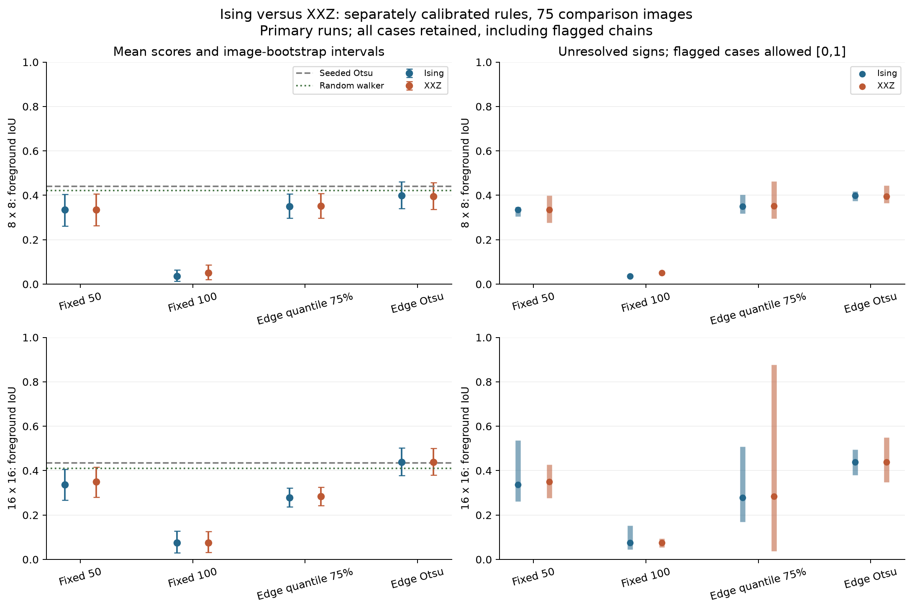
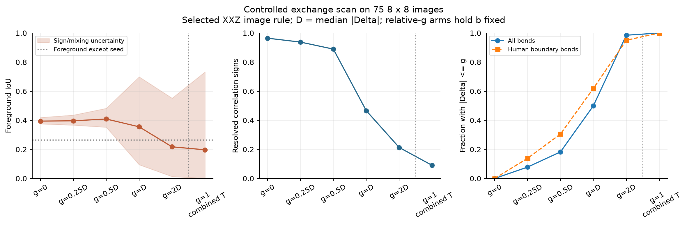
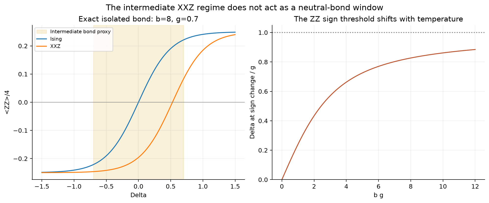
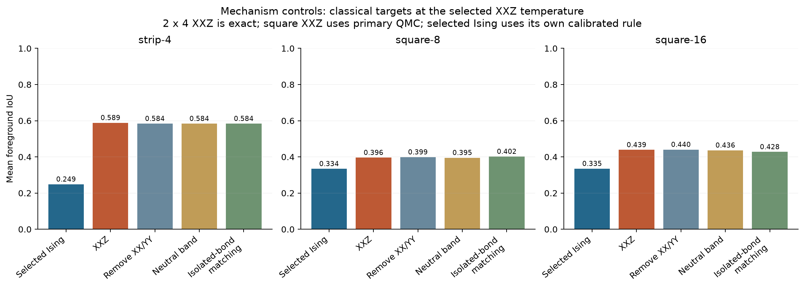
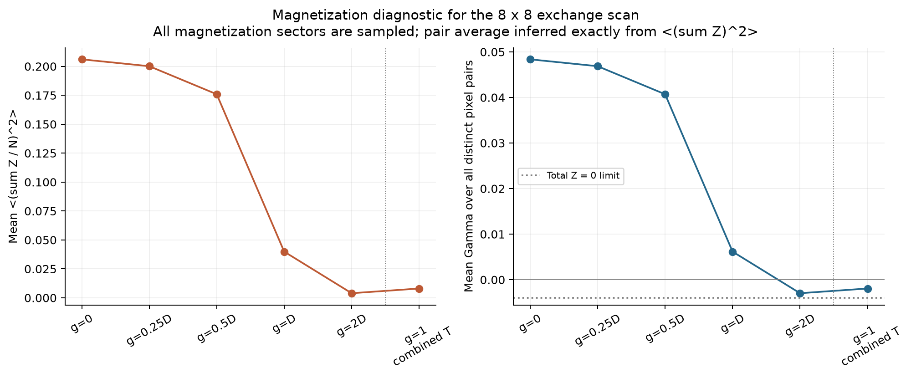
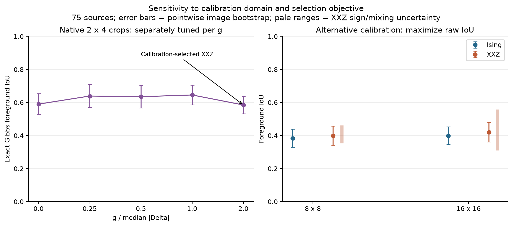
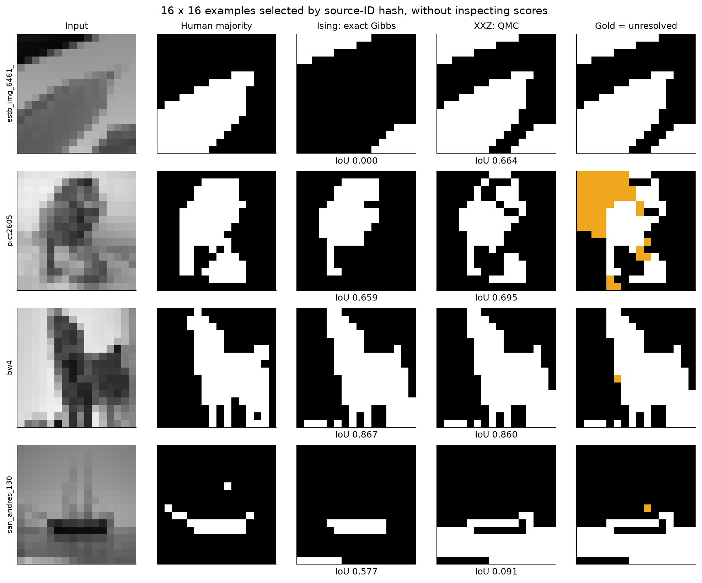

# Ising versus XXZ Algorithm 1 on Weizmann images

Completed 8 October 2026. The final experiment is version 2; the unversioned
XXZ benchmark records preserve an earlier sampling pilot.

The present results **do not establish that the XXZ intermediate regime
improves Algorithm 1 segmentation on natural images**. Weak exchange gives
almost the same result as Ising when the image threshold, sensitivity and
temperature are matched. Image-adaptive thresholds explain most of the gain
over the conservatively selected fixed-threshold Ising rule. Moderate exchange
has a promising small-crop result, but stronger exchange on larger images
produces weak, statistically unresolved ZZ signs rather than a reliably useful
neutral region.

## Model and segmentation convention

For nearest-neighbor pixels, with grayscale intensities in [0,255],

\[
H=-\frac14\sum_{\langle ij\rangle}
\left[g(X_iX_j+Y_iY_j)+\Delta_{ij}Z_iZ_j\right],\qquad
\Delta_{ij}=\arctan[\alpha(\tau-|I_i-I_j|)],\quad\alpha>0.
\]

The Ising comparison has g=0, with no transverse field. XX and YY have the
same strength g, preserving XXZ symmetry. The Gibbs state is exp(-bH)/Z,
where b=beta_paper/N in the paper's size-normalized convention.
All magnetization sectors are included; no seed spin is clamped.

Algorithm 1 uses Gamma(s,i)=<Z_s Z_i>/4 from a known background seed s:
negative correlation means foreground; positive or numerically zero
(absolute value at most 1e-12) means background. A foreground seed supplies
a secondary agreement diagnostic. There is no spatial postprocessing or
change to the sign decision in this study.

## Data and experimental design

We used the 100 single-object images and three human annotations per image
from the [official Weizmann Segmentation Evaluation Database](https://www.wisdom.weizmann.ac.il/~vision/Seg_Evaluation_DB/).
The source archive is available on its [download page](https://www.wisdom.weizmann.ac.il/~vision/Seg_Evaluation_DB/dl.html).
Its recorded SHA256 is
`c3aa39699a644e9fc58b86b059ac446cba2f66d57fb92e806e61aeb7d7973de1`.

We retained the earlier source-level split: 25 calibration images and 75
comparison images. Every crop/resolution of an image stays in that source's
split. These sources appeared in previous Ising development: this is an
internal held-out comparison for the present protocol, **not fresh external
validation**. No comparison scores were used to choose the reported primary
parameter rules.

Full-frame images were converted to grayscale and BOX-resized to 8×8 and
16×16 (64 and 256 spins). Human masks were resized by nearest neighbor and
combined by majority vote. This can distort aspect ratios and omit fine
boundaries. Native 2×4 boundary crops provide a separate exact benchmark.
Seeds are chosen from the human majority mask, far inside background and
foreground: this is a **seeded segmentation** experiment. Primary scores are
foreground intersection-over-union (IoU), averaged equally across sources.

The 360 candidate rules combine:

| Parameter | Rules tested |
|---|---|
| Threshold tau | Fixed 50; fixed 100; 75th percentile of positive neighbor differences; Otsu split of neighbor differences |
| Sensitivity alpha | 0.001; 0.01; 1/max(q90(d)-q10(d),1) |
| Dimensionless temperature K | 0.4, 0.8, 1.2 |
| Exchange | g/D = 0, 0.25, 0.5, 1, 2; also absolute g=1 |
| Inverse temperature b | 4K/D, or 4K/(D+g) for nonzero exchange |

D is median absolute Delta. When it is below 1e-8, the explicit fallback is
max(mean absolute Delta,0.001). Absolute g=1 uses combined normalization;
it is not a fixed-b point on the relative-exchange scan.

All 360 rules were screened on all 25 calibration 8×8 images. Within each
model/threshold family, the best two by uncertainty-lower IoU and the best
by raw IoU were retained, giving 23 unique rules. Longer independent runs
refined these rules. The primary choice maximizes mean lower IoU, assigning
zero to cases failing chain-agreement checks; raw IoU breaks ties. This
objective rewards reliable signs as well as segmentation quality. A secondary
analysis instead selects by raw calibration IoU from the same refined set.
This two-stage search is not an exhaustive high-precision optimization of
all 360 rules.

Completed numerical runs: 9,000 screening; 575 refinement; 1,200 main
comparison; 200 native-crop validation; 450 controlled exchange scan;
59 longer confirmations; 300 secondary raw-selection comparisons.
An additional 9,000 exact calibration-crop evaluations selected rules for
375 exact test-crop evaluations. Three exact classical controls were evaluated
on each of 225 test cases.

## Numerical Gibbs method and checks

Ising uses signed-cluster and local heat-bath Monte Carlo, with **exact row
transfer references for every 8×8 and 16×16 result**. XXZ uses sign-free
stochastic series expansion (SSE), diagonal heat-bath updates and directed
loops, based on [Syljuasen and Sandvik's directed-loop method](https://arxiv.org/abs/cond-mat/0202316).
For general g>0, H=g H_SSE(Delta/g), so the existing XXZ engine runs at b*g.
The fixed expansion cutoff has a stable analytic relative-tail bound below
exp(-50). There is no imaginary-time discretization/Trotter error.

The pilot directed-loop-only sampler mixed poorly at weak exchange. Version
2 adds an exact conditional worldline-cluster move and reruns the entire
calibration/comparison. Exchange vertices force their two complete worldlines
into the same component; diagonal vertices freeze relative orientations
with probability 1-W_opposite/W when W>W_opposite. Components flip independently.
This preserves the fixed-string conditional distribution; directed loops and
diagonal updates also change the operator string. This revision was motivated
by pilot mixing diagnostics and is part of the exploratory development.

Main comparisons use four diverse initial states, 2,000 burn-in sweeps and
4,096 retained samples per chain, separated by two sweeps. Each quantum sweep
uses eight complete directed loops and one whole-worldline cluster update.
Confirmations use 8,000 burn-in and 16,384 samples per chain. They cover flagged
overall-winner cases and five preselected source IDs at 16×16, without
retuning any parameters.

The 51 focused tests pass, including Pauli Hamiltonian reconstruction, SSE
rescaling, exact two/eight-spin Gibbs checks, conditional cluster weights,
magnetization-sector sampling, sparse estimators, exact transfer results,
cutoff bounds, mask processing and contrast invariance. Across all 100 native
crops, mean/max correlation infinity errors against exact Gibbs are
0.00126/0.00577 for Ising and 0.00320/0.00662 for XXZ. All 100 cases per model
pass the Rhat checks. Approximate intervals miss 0.125% of Ising correlation
entries and no XXZ entries in this crop check; this does not prove coverage
at larger sizes.

After confirmation, the primary XXZ rule passes the unranked split-Rhat<1.05
checks on correlations and scalar observables on all 75 images at each size;
all have estimated minimum variable-correlation ESS at least 200. The
fixed50 Ising sampler still fails Rhat on 12/75 images at 16×16, so exact
Ising targets are used for the substantive model comparison. Some secondary
families mix poorly: the primary XXZ/q75 arm passes only 15/75 at 16×16.
All cases remain in the records and figures.

Two uncertainties are kept separate. Image-bootstrap intervals (3,000 source
resamples) describe variability across the 75 sources conditional on estimated
labels. Approximate simultaneous Bonferroni-t correlation intervals use the
larger of block-mean and between-chain standard errors; their unresolved
signs induce lower/upper IoU ranges. Failed-Rhat cases are assigned [0,1] in
the mixing-aware ranges. Neither Rhat nor these approximate MCMC intervals
is a rigorous finite-time guarantee. Intervals are pointwise, not corrected
for all parameter comparisons.

## Matched model comparison

The Ising/edge-Otsu and XXZ/edge-Otsu family winners happen to select the same
tau rule, alpha=0.01, K=0.8 and b=3.2/D. The only difference is g=0 versus
g=0.25D. This is the cleanest test of the effect of adding exchange.

| Same image rule and temperature | 8×8 mean IoU | 16×16 mean IoU |
|---|---:|---:|
| Ising, exact Gibbs | 0.3988 | 0.4404 |
| XXZ, primary QMC | 0.3959 | 0.4388 |
| XXZ, with longer confirmations substituted | 0.3959 | 0.4369 |
| Seeded intensity Otsu baseline | 0.4408 | 0.4355 |
| Seeded random-walker baseline | 0.4217 | 0.4102 |

The confirmed paired XXZ-minus-Ising differences are -0.0029
(95% image-bootstrap interval [-0.0087,0.0013]) and -0.0035
([-0.0173,0.0063]), respectively. There is **no demonstrated improvement** in
this matched comparison. XXZ sign-uncertainty mean-IoU ranges remain
[0.3650,0.4442] and [0.3571,0.5201], wider than the differences between models.

The primary confidence-aware selection instead chooses fixed tau=50,
alpha=0.001, K=1.2 for Ising. Its exact IoUs are only 0.3341 and 0.3350.
XXZ looks substantially better against that rule, but comparing with
edge-adaptive Ising shows why this is not evidence for an XXZ mechanism.

| Threshold family, separately calibrated | Ising exact, 8×8 | XXZ QMC, 8×8 | Ising exact, 16×16 | XXZ QMC, 16×16 |
|---|---:|---:|---:|---:|
| Fixed 50 | 0.3341 | 0.3353 | 0.3350 | 0.3491 |
| Fixed 100 | 0.0329 | 0.0516 | 0.0749 | 0.0745 |
| Positive-edge quantile 75% | 0.3518 | 0.3511 | 0.2823 | 0.2838 |
| Edge Otsu | 0.3988 | 0.3959 | 0.4404 | 0.4388 |

These are primary-run scores. In particular, the 16×16 XXZ/q75 score is
unreliable as an equilibrated Gibbs estimate because most chains fail checks.



The raw-IoU selection check chooses edge Otsu/inverse-spread alpha/K=0.4
for Ising, and edge Otsu/alpha=0.01/K=0.8/g=0.25D with combined temperature
for XXZ. Exact Ising versus sampled XXZ scores are 0.3824 versus 0.3991 at
8×8, and 0.3993 versus 0.4205 at 16×16. Paired gains are +0.0167
([-0.0035,0.0388]) and +0.0212 ([-0.0016,0.0473]); both image intervals
include zero, with additional MCMC sign uncertainty. The primary conclusion
does not depend solely on using the conservative selection objective.

## Does a wider intermediate regime help?

For the controlled scan, tau=edge Otsu, alpha=0.01, K=0.8 and b=3.2/D are
held fixed while g varies. The following are independent primary QMC runs
on all 75 8×8 images. Resolved signs are averaged over both seeds.

| g/D | Mean IoU | Bonds with absolute Delta <= g | Resolved signs | Sign-uncertainty IoU range |
|---|---:|---:|---:|---:|
| 0 | 0.3944 | 0.0% | 96.5% | [0.3754,0.4193] |
| 0.25 | 0.3965 | 7.8% | 93.8% | [0.3668,0.4361] |
| 0.5 | 0.4089 | 18.3% | 88.9% | [0.3525,0.4825] |
| 1 | 0.3551 | 50.0% | 46.6% | [0.0945,0.6989] |
| 2 | 0.2175 | 98.5% | 21.3% | [0.0131,0.5521] |

At g=0.5D, the paired gain over exact matched Ising is +0.0101, with image
interval [-0.0018,0.0248]. This is a candidate for further testing, not a
resolved advantage. At stronger exchange the observed scores fall and the
statistical cost of determining signs increases greatly. These finite-sample
scores **do not establish the exact large-system Gibbs segmentation quality**
in those regimes. All scan chains pass Rhat, illustrating that apparent
equilibration does not mean small enough error to determine a weak sign.

Absolute g=1, with combined temperature b=3.2/(D+1), puts all bonds in the
intermediate proxy here. It gives IoU 0.1972 and only 9.0% resolved signs;
the sign-uncertainty range is [0.0006,0.7328]. It is a separate temperature
comparison, not another fixed-b scan point.



The conditions Delta>g, absolute Delta<=g and Delta<-g are **bond-level
proxies**, motivated by homogeneous-chain regimes. They do not identify
phases of these finite, inhomogeneous two-dimensional images. In particular,
the easy-plane regime is not synonymous with a featureless disordered state.
Temperature and separation can affect longitudinal signs even in the uniform
2D model, as studied by [Fehske et al.](https://arxiv.org/abs/cond-mat/0006272).

For 0<g<pi/2, the proxy intermediate distance interval is

\[
\tau-\frac{\tan g}{\alpha}\le d\le
\tau+\frac{\tan g}{\alpha}.
\]

But Algorithm 1 still makes a binary decision from Gamma. For an isolated
bond, direct diagonalization gives the exact result

\[
\Gamma_{12}=\frac14\tanh\!\left[\frac{b\Delta}{4}
-\frac12\log\cosh\!\left(\frac{bg}{2}\right)\right].
\]

Its zero occurs at Delta=2 log(cosh(bg/2))/b, tending toward g at low
temperature. Thus exchange shifts the longitudinal sign threshold; it does
not create an interval of zero longitudinal correlation. This calculation
explains why two phase boundaries alone do not guarantee a more forgiving
segmentation rule.



We also evaluated three classical controls at the selected XXZ b: set g=0
with Delta unchanged; set Delta=0 on intermediate-proxy bonds; or set
Delta_eff=Delta-2 log(cosh(bg/2))/b, which matches each isolated bond's ZZ
correlation but not the many-body Gibbs state. Their exact mean IoUs are:

| Control at selected XXZ temperature | Native 2×4 | 8×8 | 16×16 |
|---|---:|---:|---:|
| Remove XX/YY | 0.5837 | 0.3988 | 0.4404 |
| Neutralize intermediate bonds | 0.5837 | 0.3954 | 0.4364 |
| Match isolated-bond ZZ | 0.5837 | 0.4019 | 0.4276 |
| Actual XXZ, exact on crop / primary QMC on squares | 0.5886 | 0.3959 | 0.4388 |

The different native-crop scores behind the rounded 0.5837 values are
preserved in the JSON. These controls use the selected weak-exchange rule;
they do not cover every possible neutral-band width.



Strong exchange also suppresses total-Z fluctuations. With
m2=<(sum Z/N)^2>, the exact identity for the average over distinct pairs is
(N*m2-1)/(4*(N-1)). At g=2D on 8×8 images, mean m2 is 0.00396 and this pair
average is negative. A small negative background can assign many pixels to
foreground without encoding the object boundary. This is a mechanism
diagnostic, not proof that every seed correlation is negative. The trivial
mask “foreground everywhere except the known background seed” scores 0.2641
on these 8×8 images and 0.5810 on the native crops, so nonzero IoU alone is
not evidence of useful segmentation.



## Exact native-crop result

We separately calibrated all 360 rules on the 25 native 2×4 calibration
crops using full 256-dimensional Gibbs diagonalization. This avoids Monte
Carlo sign uncertainty and accounts for the different image domain. The
chosen Ising rule is edge Otsu, inverse-spread alpha, K=1.2. The chosen XXZ
rule is fixed50, alpha=0.001, K=0.8, g=2D, longitudinal temperature.

On the 75 comparison crops they score **0.5901 Ising versus 0.5850 XXZ**.
The paired difference is -0.0051 with interval [-0.0943,0.0830]. The strong
XXZ winner is also close to the 0.5810 foreground-except-seed baseline.

Separately selecting the best calibration rule at each relative exchange
gives test IoUs 0.5901, 0.6391, 0.6350, 0.6455 and 0.5850 for g/D=0,
0.25,0.5,1,2. The g=D rule (q75, alpha=0.001, K=0.4, combined temperature)
has a paired gain +0.0554 over the selected Ising rule, with pointwise
interval [0.0073,0.1058]. This is the strongest positive signal in the study.
It is a secondary comparison among several strengths, uses a different
threshold rule, and was not the calibration-selected overall XXZ winner.
It therefore merits an independent native-patch test, but does not isolate
the intermediate regime or establish a general advantage.



## Practical parameter guidance

For these resized natural images, a useful starting rule for **both** models
is tau=edge Otsu on nearest-neighbor differences, alpha=0.01 and b=3.2/D.
Use g=0 as the reference and g=0.25D as the first XXZ comparison. This is a
benchmark-supported starting point, not a universal prescription or a
prospectively validated rule for arbitrary images. The edge-Otsu family
winners were chosen on calibration data; preferring that family over all
families after seeing these comparisons needs fresh validation.

The lessons about choosing parameters are:

1. **Choose the threshold from the image domain.** Fixed100, successful in
   earlier binary-digit tests, performs poorly on these natural images.
   For the selected rule, image-derived tau spans about 12.5–72.4 at 8×8
   and 18.4–60.7 at 16×16. Native boundary crops favor different rules.
2. **Separate contrast scaling from nonlinear sensitivity.** A quantile/Otsu
   threshold together with alpha=1/(q90-q10) is invariant under affine
   intensity scaling, away from floors and clipping. It is a principled
   normalization option but did not consistently give the best scores.
   In the small-alpha linear regime, scaling b by D and g by D largely
   cancels alpha; its remaining effect mainly comes from arctan saturation.
3. **Scale exchange and temperature together deliberately.** Relative g/D
   is more comparable across images than a fixed absolute g. Longitudinal
   normalization holds the longitudinal energy scale fixed as g changes;
   combined normalization raises temperature as exchange is added. They
   answer different questions and should not be mixed in one controlled scan.
4. **Do not maximize intermediate-bond fraction.** The better resolved
   large-image XXZ rule places only about 7–8% of bonds in that proxy regime.
   Making nearly every bond intermediate produces little evidence of a
   useful longitudinal segmentation signal at the available precision.
5. **Calibrate at the intended resolution and validate on new sources.**
   Report exact/estimated signs, uncertainty, and a simple classical baseline
   together. A future magnitude-based abstention rule or a classifier using
   transverse as well as longitudinal correlations would be a change to
   Algorithm 1 and requires separate calibration; it was not tested here.

## Files and reproduction

The primary sources are `python/run_weizmann_xxz_v2.py`,
`python/xxz_image_gibbs_v2.py`, `python/xxz_sse_cluster.py`,
`python/xxz_sse_fast.py`, and `python/xxz_image_gibbs.py`.
Classical controls and secondary experiments are in
`python/weizmann_xxz_controls_v2.py` and `python/weizmann_xxz_supplements.py`.
`python/analyze_weizmann_xxz_v2.py` checks completion, input/source hashes,
source splits and rule IDs, and generates the JSON summary and eight PNG/PDF
figures. The numerical core is frozen in protocol hashes.

From the repository root, using the existing environment and prepared
Weizmann inputs:

```bash
.venv/bin/python algorithm1/python/run_weizmann_xxz_v2.py init
.venv/bin/python algorithm1/python/run_weizmann_xxz_v2.py screen --workers 4
.venv/bin/python algorithm1/python/run_weizmann_xxz_v2.py shortlist
.venv/bin/python algorithm1/python/run_weizmann_xxz_v2.py refine --workers 4
.venv/bin/python algorithm1/python/run_weizmann_xxz_v2.py select
.venv/bin/python algorithm1/python/run_weizmann_xxz_v2.py test --workers 4
.venv/bin/python algorithm1/python/run_weizmann_xxz_v2.py small --workers 2
.venv/bin/python algorithm1/python/run_weizmann_xxz_v2.py scan --workers 2
.venv/bin/python algorithm1/python/run_weizmann_xxz_v2.py confirm --workers 2
.venv/bin/python algorithm1/python/weizmann_xxz_controls_v2.py
.venv/bin/python algorithm1/python/weizmann_xxz_supplements.py raw --workers 2
.venv/bin/python algorithm1/python/weizmann_xxz_supplements.py exact-crops --workers 2
.venv/bin/python algorithm1/python/analyze_weizmann_xxz_v2.py
```

Dependencies reuse `requirements-glauber.txt` and
`requirements-petz-benchmark.txt`. See [the earlier data report](weizmann-petz.md)
for source archive preparation. No new circuit or MATLAB implementation was
required for this study. Cached numerical runs are reused only when their
input, settings and code signatures agree.

The shareable experiment records are [the protocol](weizmann-xxz-v2-protocol.json),
[selection](weizmann-xxz-v2-selection.json),
[summary](weizmann-xxz-v2-summary.json), and
[per-case results](weizmann-xxz-v2-case-results.json).
The much larger sampled arrays, raw stage records and plot files remain in
the Git-ignored `results/weizmann-xxz-v2/` directory. They are local artifacts,
not uploaded files. No changes were committed or pushed in this task.



Examples use primary runs and the overall selected rules. Source IDs were
chosen by a hash without inspecting scores; gold marks unresolved XXZ signs.
The apparent large gains in some examples can include changing the image
threshold, which is why the matched comparison above is essential.
