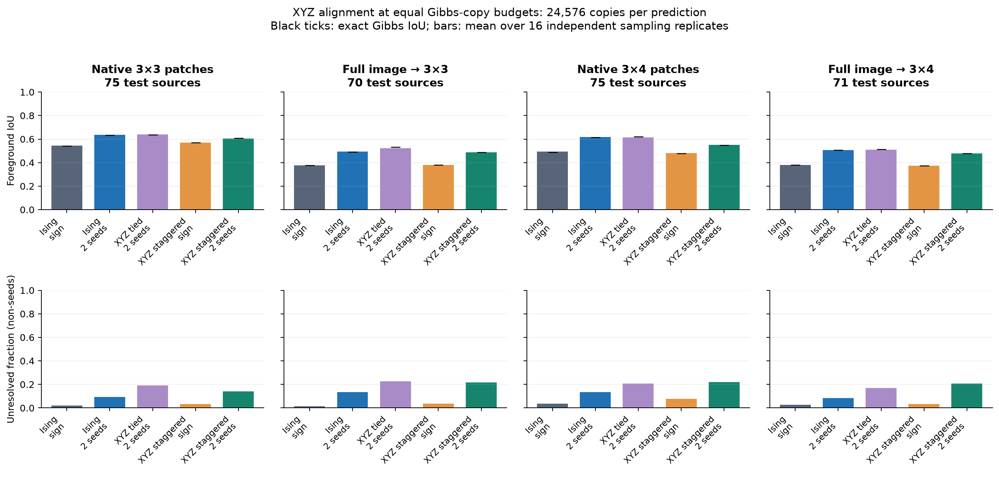
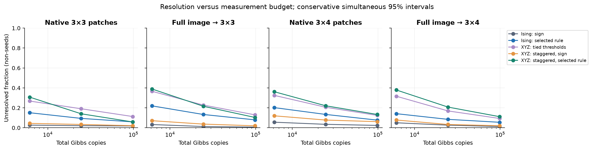
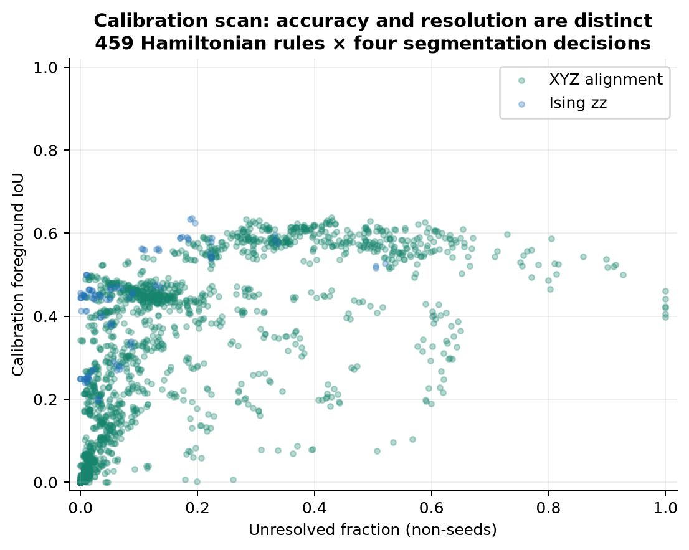
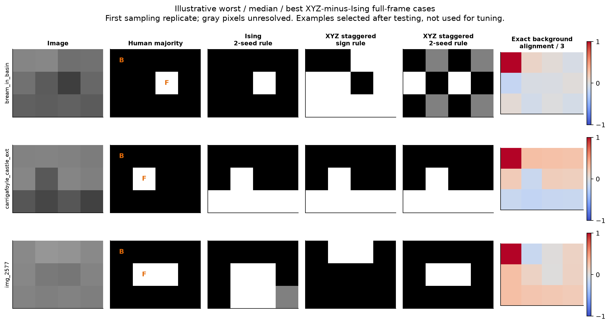
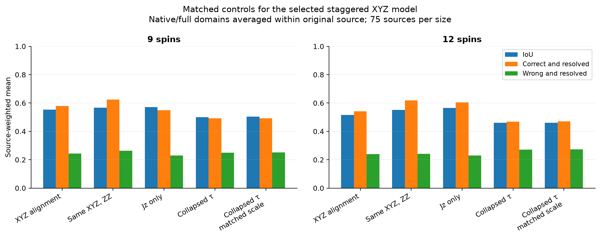
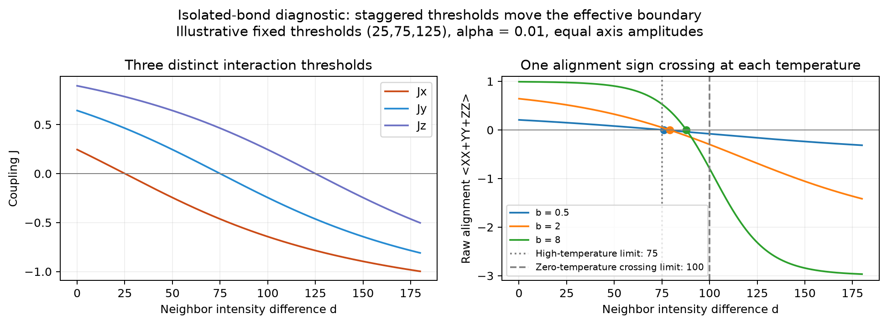

# Algorithm 1 with staggered XYZ couplings and spin alignment

Experiment date: 2026-10-08. This is a numerical Gibbs-state study; it does not implement a circuit or a thermal bath. The original Ising/XXZ implementations and their results are preserved.

The tested staggered XYZ/alignment model **does not improve the joint goal of segmentation accuracy and fewer unresolved pixels** relative to calibrated Ising. At twelve spins, pooling the two image representations with equal source weighting, the two-seed XYZ rule gives IoU **0.5159** and **21.8% unresolved**, compared with **0.5676** and **10.7% unresolved** for the two-seed Ising rule. The paired IoU difference is -0.0517, with exploratory 95% bootstrap interval [-0.0855,-0.0185]. Exact-correlation IoUs show the same ordering, so this is not merely a Gibbs-sampling failure.

There is a more limited positive result: preserving the three thresholds improves the selected XYZ model relative to collapsing its thresholds to their mean, even after matching total interaction scale. At twelve spins that matched control has IoU 0.4599 and 25.6% unresolved. Threshold spacing can therefore matter without establishing an overall advantage over a separately calibrated Ising or tied-threshold XYZ model.

Two-seed segmentation is the most consistently useful change, and it also helps Ising. Accuracy-only parameter selection finds a secondary XYZ result with somewhat higher nine-spin exact IoU, but many more unresolved pixels. Neither observation establishes a general benefit from the proposed multiple-threshold mechanism. These conclusions concern small, seeded, grayscale cases and the stated measurement protocol.

## Hamiltonian and observable

For grayscale intensities in [0,255], let d_ij=|c_i-c_j| on nearest-neighbor edges. The implemented Hamiltonian is

\[
H=-\frac14\sum_{\langle ij\rangle}\left[J^x_{ij}X_iX_j+J^y_{ij}Y_iY_j+J^z_{ij}Z_iZ_j\right],\qquad
J^a_{ij}=w_a\arctan\!\left[\alpha(\tau_a-d_{ij})\right].
\]

All sensitivities and amplitudes are positive. The minus sign in H makes a positive coupling favor the corresponding parallel Pauli correlation. The Gibbs state is rho=exp(-b H)/Z; in the paper's rho_(beta/N) convention, beta=N b. No magnetization sector is discarded. In particular, unequal XX and YY interactions do not conserve total Z magnetization, although they preserve parity.

The requested raw alignment is A_ij=<X_iX_j+Y_iY_j+Z_iZ_j>. The code stores a_ij=A_ij/3. This rescaling leaves sign and two-seed decisions unchanged. For distinct spins A has eigenvalues +1 (triplet) and -3 (singlet), so a lies in [-1,1/3]; self-correlation is a_ii=1. It is not a classical dot product of the mean spin vectors, and its positive and negative ranges are not symmetric.

The interactions are nearest-neighbor, while segmentation uses correlations from a seed to every pixel, including non-neighboring pairs.

## Parameter rules

The scan contains 459 Hamiltonian rules: 27 Ising controls and 432 XYZ rules. Each is tested with four segmentation rules. All rules are listed in [the frozen protocol](weizmann-xyz-protocol.json).

For S=max(q90(d)-q10(d),1), the threshold families are:

- A central threshold tau chosen as 50, edge-Otsu, or the 75th percentile of positive edge differences. The axis thresholds are (tau-w S, tau, tau+w S), with w=0, 0.25, or 0.5. They are not clipped.
- Independent edge-difference quantiles (q25,q50,q75) or (q50,q75,q90), including zero differences.
- Fixed thresholds (25,75,125).

Sensitivity is alpha=0.001, 0.01, or 1/S. The XY amplitudes are w_x=w_y=0.25 or 1, with w_z=1. Thus the study varies both the thresholds and the strength of transverse interactions. It does not independently optimize every possible axis amplitude or threshold permutation. Quantile thresholds can coincide on images with repeated intensities; actual per-image thresholds are recorded.

Two temperature rules control scale:

\[
b=\frac{4K}{\operatorname{median}_e\sum_a|J^a_e|}
\quad\text{or}\quad
b=\frac{4K}{\operatorname{median}_e\max_a|J^a_e|},
\qquad K\in\{0.4,0.8,1.6\}.
\]

A nearly zero median uses max(mean,0.001), recorded in the result metadata. Normalizing by the sum prevents adding interactions from automatically making the model colder; the max rule deliberately permits stronger total interaction energy. Inverse-spread sensitivity is approximately contrast-adaptive, subject to the explicit scale floors.

## Segmentation and unresolved pixels

Let b0 and f0 denote background and foreground seeds. Four decisions are evaluated for both alignment and ZZ readouts:

1. Original background sign: foreground if a_(b0,i)<0.
2. More permissive background cutoff: foreground if a_(b0,i)<0.1.
3. More restrictive background cutoff: foreground if a_(b0,i)<-0.1.
4. Two-seed contrast: foreground if a_(f0,i)-a_(b0,i)>0.

The nonzero cutoffs correspond to raw A cutoffs +0.3 and -0.3. Numerical ties within 1e-12 predict background. The two-seed rule uses additional supervision compared with the original background-only rule, so both are also tested on Ising. No spins are pinned, and seed labels are not clamped onto predicted masks.

Sampling budgets are 6,144, 24,576, and 98,304 independent Gibbs copies, with 24,576 the primary budget. Each XYZ alignment estimate uses one third of the copies in each global X, Y, and Z measurement basis. ZZ uses all copies in Z. Each global outcome estimates both seed correlations to all pixels. The comparisons therefore use equal total copies; alignment is not given three times the sampling resource. These are ideal projective samples, without hardware or bath-preparation noise. This is one measurement protocol, not a claim that it is the optimal possible quantum measurement of alignment.

A pixel is unresolved if its confidence interval crosses the decision threshold. Conservative Hoeffding intervals cover both observables, both score types, all pixels and all three budgets jointly at 95% for each model and sampling replicate. The background-score radius is sqrt(2 log(24N/0.05)/B), and the contrast radius is twice that. Shifted background cuts use the same underlying interval. This guarantee does not cover all models and images simultaneously.

Resolution rates exclude both known seeds. The report separately records the fraction of all non-seed pixels that are correctly resolved and the fraction that are wrongly resolved. Reported mean IoU uses the sampled decision for every pixel, including unresolved ones; a second IoU range allows every possible assignment of unresolved labels. Reducing unresolved pixels alone is not evidence of better segmentation. Exact-correlation IoU separates finite sampling effects from Hamiltonian and decision-rule errors.

## Dataset, calibration, and numerical method

The existing Weizmann single-object archive and original 25-calibration/75-test source split are reused. All versions of a source stay in the same split. These sources have already been used in earlier development, so this is an internal exploratory comparison, not fresh external validation.

Two image representations are prepared at 3×3 and 3×4:

- Native-resolution crops that contain 25–75% foreground under the majority of the three human annotations. One eligible window is selected deterministically, before evaluating any Hamiltonian. This tests local boundaries and is not an unbiased sample of all image patches.
- Entire grayscale images resized using BOX averaging, with human masks resized using nearest-neighbor sampling before taking their majority. These tiny full images have severe loss of detail and mask/image discretization artifacts.

The background and foreground seeds are selected from the ground-truth mask as the most interior available pixels. These are oracle seed locations; there is no automatic object-seed detection. One-class resized masks cannot support this protocol and are excluded before outcomes. The manifest lists every exclusion: seven at 3×3 and four at 3×4, across calibration and test combined.

Calibration uses 48 nine-spin cases from all 25 calibration sources: 25 native and 23 full-frame. The twelve-spin calibration images are prepared but not used to retune parameters. Native/full metrics are averaged within each original source, then sources are weighted equally. Each rule has three independent calibration sampling replicates. For each primary model family, selection maximizes the mean lower endpoint of the unresolved-label IoU range, breaking ties by exact IoU, sampled IoU, and fixed identifiers. This explicitly rewards useful, resolved predictions. Separate exact-IoU-selected winners show the consequence of choosing accuracy without a resolution penalty.

Testing uses 291 cases from the 75 test sources:

| Representation | 9 spins | 12 spins |
|---|---:|---:|
| Native boundary crops | 75 | 75 |
| Coarse full frames | 70 | 71 |

There are 16 independent measurement replicates at each budget. All primary choices are locked before the test stage. Bootstrap intervals resample original sources, not pixels or sampling replicates. They are exploratory 95% intervals with no multiplicity adjustment. The 9- and 12-spin native crops are independently selected windows, so their comparison is a size stress test, not a controlled finite-size scaling measurement.

Unequal, signed XX and YY couplings produce computational-basis off-diagonal entries -(Jx+Jy)/4 and -(Jx-Jy)/4. These need not all be nonpositive. The earlier positive-weight XXZ sampler is therefore not reused blindly; a positive entry does not by itself prove that no sign-removing basis change exists. Instead, this study diagonalizes both parity blocks exactly and forms exact Gibbs probabilities in all three Pauli bases. Independent multinomial outcomes are then drawn from those probabilities. There is no MCMC mixing error, Trotter error, tensor truncation, or sign reweighting. There is floating-point eigensolver error, which is checked and reported.

This method has exponential classical cost and is deliberately limited to twelve spins. These results cannot be substituted for the previous 8×8 or 16×16 whole-image benchmarks, and they do not establish quantum computational advantage.

## Rules selected using calibration only

All primary flexible winners use the two-seed contrast rather than a shifted one-seed cutoff. The following are the main comparison rules; the JSON selection also contains the tied-threshold sign, staggered-XYZ ZZ-readout, and exact-IoU-selected alternatives.

| Model | Thresholds | Alpha | XY amplitude | K | Scale |
|---|---|---:|---:|---:|---|
| Ising, sign | edge-Otsu, tied | 0.01 | 0 | 0.8 | sum |
| Ising, two seeds | positive-edge q75, tied | 0.01 | 0 | 0.8 | sum |
| XYZ tied thresholds, two seeds | positive-edge q75, tied | 0.001 | 1 | 1.6 | max |
| XYZ staggered thresholds, sign | (q25,q50,q75) | 1/S | 0.25 | 1.6 | max |
| XYZ staggered thresholds, two seeds | (q25,q50,q75) | 0.01 | 1 | 1.6 | max |

For the selected staggered alignment model with two seeds, the concrete rule is

\[
(\tau_x,\tau_y,\tau_z)=(q_{25}(d),q_{50}(d),q_{75}(d)),\quad\alpha=0.01,\quad w_x=w_y=w_z=1,\quad b=\frac{6.4}{\operatorname{median}_e\max_a|J^a_e|}.
\]

This is the best rule in its predefined family under the resolution-aware calibration objective, not a universal rule for arbitrary images. The amplitude-0.25 variant with alpha=1/S was selected when retaining the original sign decision.

## Held-out results

Each IoU is the mean across source images after averaging the 16 measurement replicates. Unresolved percentages exclude the two seeds. The budget is 24,576 total Gibbs copies for every method.

### 9 spins

| Model | Native-crop IoU | Native unresolved | Full-frame IoU | Full unresolved |
|---|---:|---:|---:|---:|
| Ising, sign | 0.5434 | 2.1% | 0.3768 | 1.3% |
| Ising, two seeds | 0.6363 | 9.4% | 0.4953 | 13.3% |
| XYZ tied thresholds, two seeds | 0.6388 | 19.1% | 0.5237 | 22.8% |
| XYZ staggered thresholds, sign | 0.5686 | 3.4% | 0.3787 | 3.7% |
| XYZ staggered thresholds, two seeds | 0.6055 | 14.0% | 0.4879 | 21.6% |

### 12 spins

| Model | Native-crop IoU | Native unresolved | Full-frame IoU | Full unresolved |
|---|---:|---:|---:|---:|
| Ising, sign | 0.4934 | 3.5% | 0.3806 | 2.6% |
| Ising, two seeds | 0.6164 | 13.4% | 0.5058 | 8.5% |
| XYZ tied thresholds, two seeds | 0.6139 | 20.6% | 0.5092 | 16.9% |
| XYZ staggered thresholds, sign | 0.4807 | 7.8% | 0.3743 | 3.3% |
| XYZ staggered thresholds, two seeds | 0.5506 | 22.1% | 0.4796 | 20.8% |



Pooled comparisons average available native/full results within each source first, giving 75 equally weighted sources at each size. They are summaries of two different tasks; the domain-specific tables above should be read first.

| Contrast: staggered XYZ minus Ising, both with two seeds | IoU difference | Paired 95% bootstrap interval | Resolved-fraction difference | Paired 95% bootstrap interval |
|---|---:|---|---:|---|
| 9 spins | -0.0201 | [-0.0484, +0.0074] | -0.0620 | [-0.1091, -0.0137] |
| 12 spins | -0.0517 | [-0.0855, -0.0185] | -0.1106 | [-0.1525, -0.0702] |

The unresolved fraction falls with more measurements. This does not by itself improve the exact Gibbs segmentation: confidently wrong signs remain wrong.



Classical context uses the same cases and seeds. The random walker uses both seeds; Otsu uses the foreground seed to orient its binary output. These baselines are fixed, not retuned on the test data.

| Representation | Otsu IoU | Random-walker IoU | All foreground except background seed |
|---|---:|---:|---:|
| native 9 | 0.5756 | 0.6366 | 0.5683 |
| full 9 | 0.4123 | 0.4459 | 0.3214 |
| native 12 | 0.5322 | 0.6439 | 0.5297 |
| full 12 | 0.4279 | 0.4395 | 0.3124 |

### Accuracy-only selection gives a different tradeoff

The secondary selection maximizes exact calibration IoU and does not penalize unresolved pixels. These winners were selected before testing and were evaluated only at nine spins.

| Exact-IoU-selected model | Test exact IoU, pooled | Sampled IoU | Unresolved |
|---|---:|---:|---:|
| Ising_exact_best | 0.6055 | 0.6035 | 18.7% |
| XYZ_exact_best | 0.6188 | 0.6089 | 51.0% |

The sampled XYZ-minus-Ising difference for these winners is +0.0053, with paired 95% interval [-0.0126, +0.0244]. The XYZ choice uses fixed center 50 with width 0.5 S, alpha=0.001, XY amplitude 0.25, K=0.4 and max normalization. It can improve raw accuracy on native patches, but its weak correlations leave substantially more pixels unresolved. The experiment therefore does not support a blanket claim that every XYZ rule is less accurate; the accuracy–resolution tradeoff matters.





The examples are the worst, median, and best coarse twelve-spin full-frame cases by sampled XYZ-minus-Ising two-seed IoU. They are selected after testing for illustration only. Gray pixels are unresolved in the first sampling replicate; B/F mark the supplied seeds.

## Matched mechanism controls

These controls use the selected staggered XYZ two-seed rule. They are not independently recalibrated. They test what happens when one feature of that particular model is removed. The separate tied-threshold family is independently calibrated, so it answers a different comparison.

| Model/readout | 9-spin IoU | 9-spin unresolved | 12-spin IoU | 12-spin unresolved |
|---|---:|---:|---:|---:|
| Staggered XYZ, alignment | 0.5534 | 17.8% | 0.5159 | 21.8% |
| Same XYZ state, ZZ readout | 0.5666 | 11.2% | 0.5514 | 13.9% |
| Jz only, same b | 0.5711 | 22.0% | 0.5653 | 16.6% |
| Thresholds collapsed to their mean, same b | 0.5006 | 25.8% | 0.4613 | 26.0% |
| Thresholds collapsed, matched total scale | 0.5032 | 25.7% | 0.4599 | 25.6% |

For the scale-matched collapse, b is multiplied by the ratio of original to collapsed median sum of absolute couplings. The Jz-only control retains the original b rather than recalibrating temperature. Metadata explicitly mark these transformations.



| Staggered XYZ minus collapsed thresholds, matched scale | IoU difference | Paired 95% interval | Resolved-fraction difference | Paired 95% interval |
|---|---:|---|---:|---|
| 9 spins | +0.0502 | [+0.0209, +0.0824] | +0.0791 | [+0.0357, +0.1231] |
| 12 spins | +0.0560 | [+0.0331, +0.0822] | +0.0384 | [+0.0044, +0.0721] |

A further diagnostic checks cancellation in the axis-specific two-seed contrasts. In the selected XYZ model, the X/Y/Z contrasts have conflicting nonzero signs for 60.5% of non-seed pixels at 9 spins, 63.8% of non-seed pixels at 12 spins. This is descriptive evidence that summing the axes can reduce a useful signal; it is not a causal explanation for every segmentation error.

## Why three thresholds do not guarantee three useful alignment regimes

An isolated bond provides an exact diagnostic. Its three triplet states all have raw alignment +1, despite differing individual XX, YY, and ZZ correlations. The singlet has alignment -3. Therefore

\[
A(d)=1-4p_s(d),\qquad
p_s(d)=\left[1+e^{b(J_x+J_y)/2}+e^{b(J_x+J_z)/2}+e^{b(J_y+J_z)/2}\right]^{-1}.
\]

With thresholds, sensitivity, positive amplitudes, and positive inverse temperature held fixed, every J_a(d) is strictly decreasing. Every pair sum decreases, so p_s increases and A decreases. Consequently an isolated bond still has only one alignment sign crossing as d varies over the real line. Multiple thresholds change the location and shape of that crossover; they do not create three independent alignment sign boundaries.

At high temperature,

\[
A_{ij}=\frac{b}{4}(J^x_{ij}+J^y_{ij}+J^z_{ij})+O(b^2)
\]

for a neighboring pair, so the effective boundary is approximately the zero of the summed couplings. For the illustrative equal-amplitude thresholds (25,75,125) with alpha=0.01, the isolated-bond crossing moves from 76.03 at b=0.5 to 79.04 at b=2 and 87.81 at b=8. Its high-temperature limit is 75 and its zero-temperature limit is 100. Those numbers describe a two-spin diagnostic, not a fitted Weizmann parameter rule.



The full image includes interacting bonds, frustration, and correlations over multiple edges, so this proof does not establish monotonicity or segmentation performance for a seed-to-pixel correlation in the full lattice. Nor does it establish monotonicity across images when thresholds and temperature are recalculated adaptively. It does explain why the proposed change should be tested against an adjusted single threshold and a tied-threshold XYZ model, rather than assuming multiple local thresholds must produce better global labels.

## Interpretation and next experiments

The evidence supports three narrower conclusions:

1. Separate interaction thresholds are meaningful model parameters. The matched collapse controls lose accuracy and resolution, but independently calibrating a single threshold recovers or exceeds the benefit. The isolated-bond calculation shows how threshold spacing can shift an effective decision boundary.
2. The alignment readout does not reliably rescue weak or conflicting signals. On the same twelve-spin XYZ Gibbs states and with the same two-seed rule, ZZ readout gives pooled IoU 0.5514 and 13.9% unresolved, versus 0.5159 and 21.8% for alignment. This comparison holds the Hamiltonian fixed. Its measurement-efficiency conclusion is specific to equal-copy global Pauli measurements and the conservative confidence bounds used here.
3. Adding foreground-seed information is valuable, but it changes the supervision supplied to Algorithm 1. It must be compared against an Ising implementation with the same two-seed information, not credited entirely to the new Hamiltonian.

I would retain the two-seed Ising rule as the working baseline. Before a larger XYZ study, the useful next tests are a safeguarded threshold rule for flat/binary images, and segmentation from local alignment affinities rather than relying only on correlations to distant seeds. Both need matched classical/Ising controls and fresh calibration/test sources. A larger-system tensor-network Gibbs approximation should first reproduce these exact nine- and twelve-spin references and demonstrate convergence; the present dense engine cannot supply the earlier full-image sizes.

### Portability check: a quantile rule is not a universal default

After the Weizmann selection was fixed, a single clean 2×4 image with two black columns and two white columns was tested as a diagnostic. Eight of its ten neighbor differences are zero. Consequently the selected XYZ (q25,q50,q75) thresholds all become zero, removing every interior coupling. Its exact-correlation IoU is 0.25 and 83.3% of non-seed pixels are unresolved at the primary budget. Random decisions from finite-shot fluctuations raise its forced-label mean IoU to 0.5271; that is not evidence of useful correlation information.

Keeping the other selected XYZ parameters but using fixed thresholds (25,75,125) gives IoU 1 and no unresolved pixels on this example. The selected two-seed Ising rule also gives IoU 1 with no unresolved pixels. This post-selection counterexample was not used to retune any Weizmann result. It shows why a fallback or positive threshold-spacing rule must be tested before adopting the quantile recipe generally. See [the diagnostic script](python/run_xyz_portability.py) and [its results](weizmann-xyz-portability.json).


## Validation

22 tests pass. The artifact audit verified all 48 calibration cases, 291 test cases, 3,199 model-case results, and 153,552 stored sampling replicates. Recomputed metrics differ from their records by at most 0.00e+00; the largest checked eigenpair residual is 1.28e-14. Isotropic XYZ axis correlations agree to 1.27e-13. See [the validation record](weizmann-xyz-validation.json).

The observed average simultaneous interval coverage across model-case-budget groups is 99.998%. This checks the sampling pipeline, not the correctness of the segmentation model.

## Files and reproduction

The implementation is additive:

- [XYZ Gibbs and measurement engine](python/xyz_alignment.py)
- [Frozen experiment runner](python/run_weizmann_xyz.py)
- [Analysis and figures](python/analyze_weizmann_xyz.py)
- [Analytic isolated-bond diagnostic](python/xyz_bond_diagnostic.py) and [flat-image portability check](python/run_xyz_portability.py)
- [Artifact validation](python/validate_weizmann_xyz.py)
- [Independent tests](tests/test_xyz_alignment.py)
- [Input manifest](weizmann-xyz-manifest.json), [protocol](weizmann-xyz-protocol.json), [selected rules](weizmann-xyz-selection.json), and [summary](weizmann-xyz-summary.json)

Run from the repository root with the existing Python environment:

```sh
.venv/bin/python algorithm1/python/run_weizmann_xyz.py prepare
.venv/bin/python algorithm1/python/run_weizmann_xyz.py init
.venv/bin/python algorithm1/python/run_weizmann_xyz.py calibrate --workers 4
.venv/bin/python algorithm1/python/run_weizmann_xyz.py select
.venv/bin/python algorithm1/python/run_weizmann_xyz.py test --workers 4
.venv/bin/python algorithm1/python/run_weizmann_xyz.py extend --workers 4
MPLCONFIGDIR=/private/tmp/xyz-matplotlib .venv/bin/python algorithm1/python/analyze_weizmann_xyz.py
.venv/bin/python algorithm1/python/xyz_bond_diagnostic.py
.venv/bin/python algorithm1/python/run_xyz_portability.py
.venv/bin/python -m pytest -c algorithm1/pytest.ini algorithm1/tests/test_xyz_alignment.py algorithm1/tests/test_ising_algorithm1.py algorithm1/tests/test_ising_thresholds.py -q --junitxml=algorithm1/results/weizmann-xyz/tests.xml
.venv/bin/python algorithm1/python/validate_weizmann_xyz.py
```

The data archive must already be available at the path recorded in the manifest. Frozen core/runner hashes and input hashes prevent silently mixing changed code or data with cached results. Per-case results, ideal correlations, individual sampling replicates, figures, and test logs are under `results/weizmann-xyz/`. This generated results directory is ignored by Git; compact manifests, protocols, reports, and source files live outside it. No changes have been pushed as part of this experiment.
