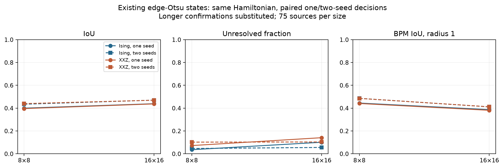
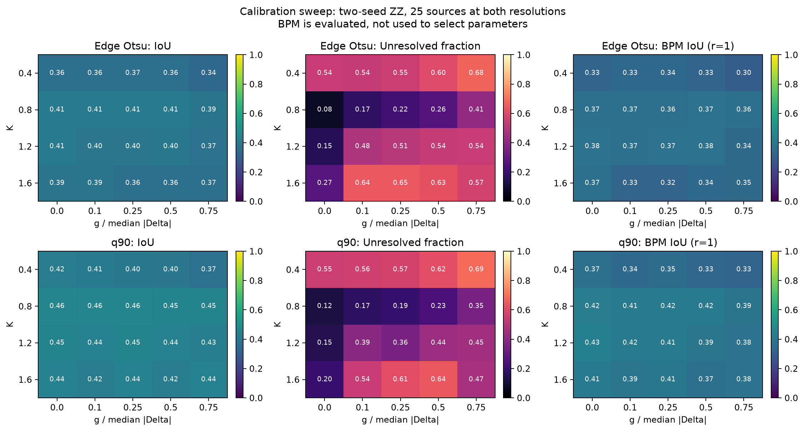
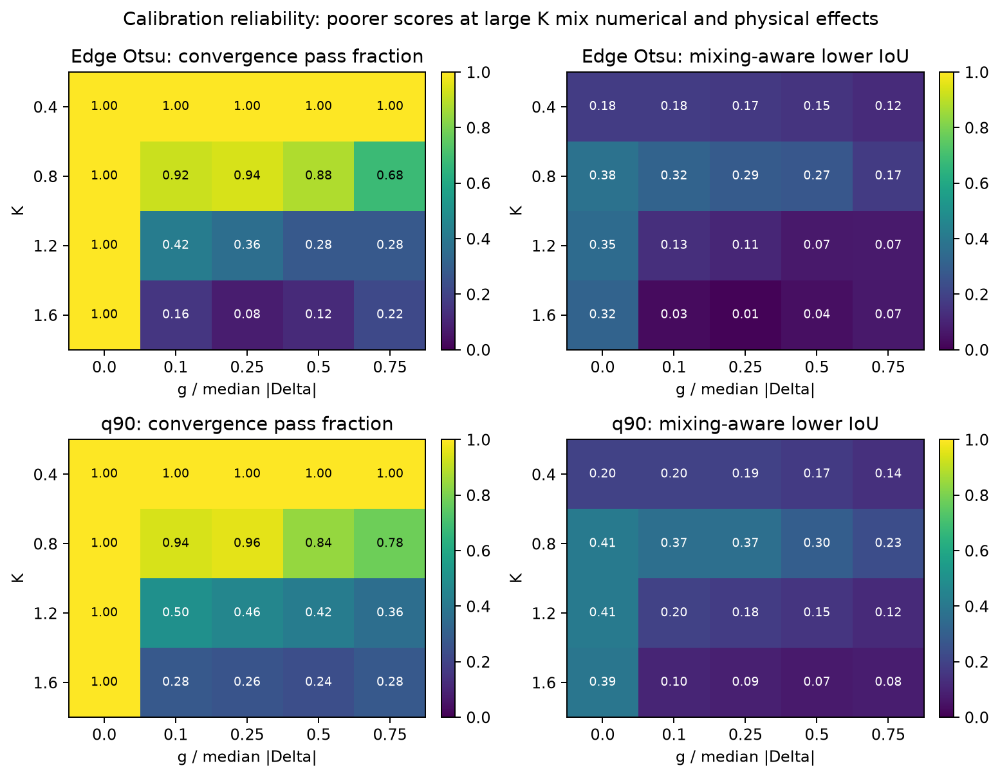
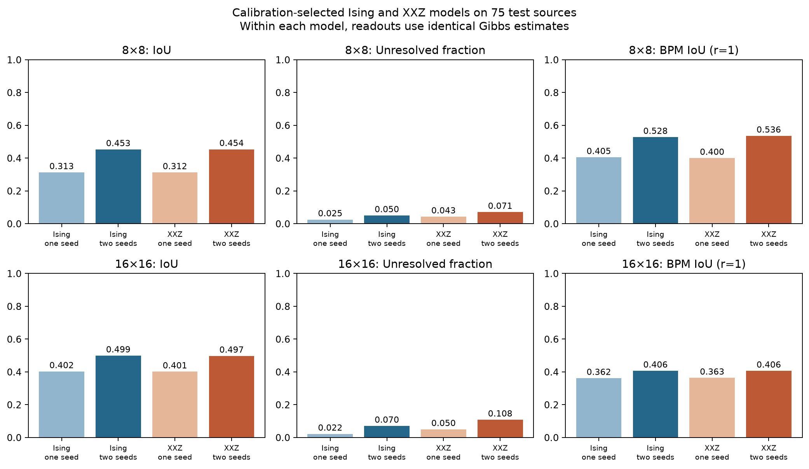
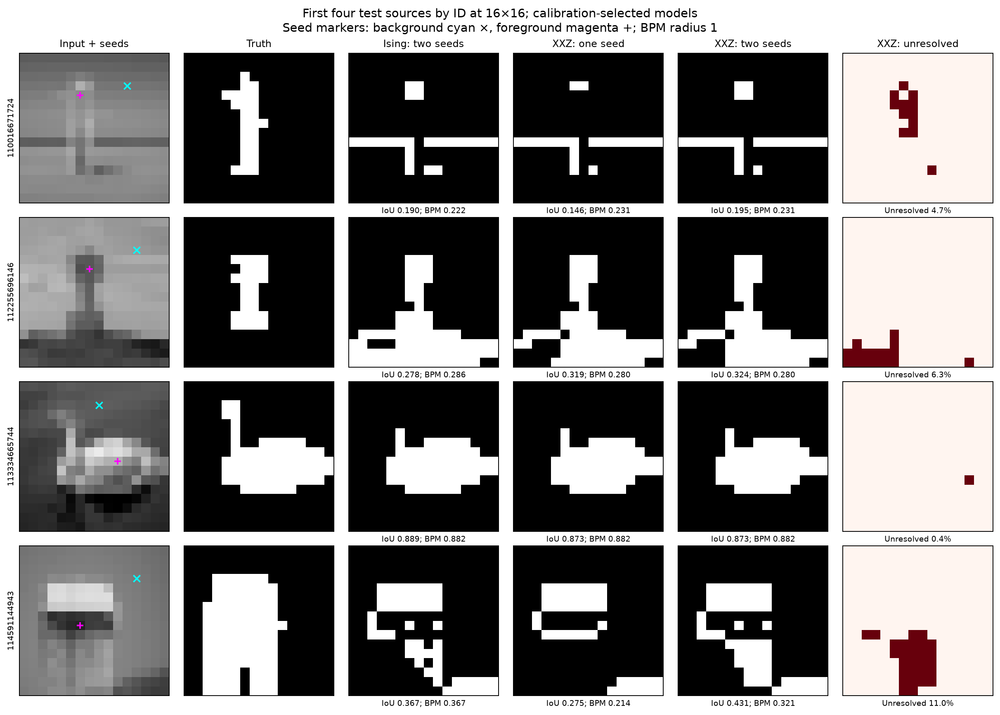
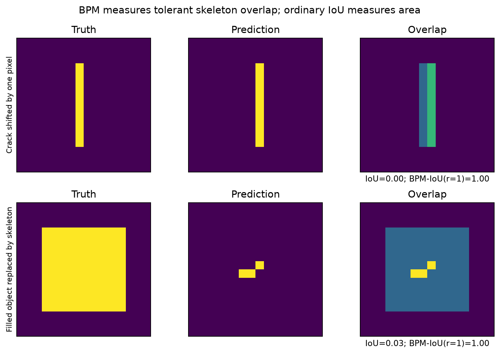
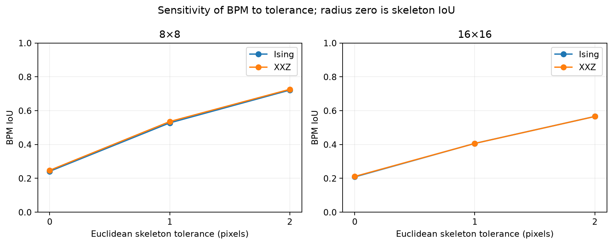

# XXZ Algorithm 1: two-seed ZZ decisions, exchange/temperature sweep, and BPM

Experiment date: 2026-10-08. This is an additive study; earlier frozen XXZ and Ising experiments are retained.

**Two seeds improve XXZ segmentation, but the tested exchange sweep does not establish an XXZ advantage over two-seed Ising.** Reusing the old edge-Otsu XXZ states raises 16×16 IoU from 0.4369 to 0.4693. In the newly calibrated q90 model, two seeds raise XXZ IoU from 0.4013 to 0.4973, while matched two-seed Ising reaches 0.4988. The secondary XXZ candidate reaches 0.5010, but its paired advantage includes zero.

The study completed 1,909 cached-state reanalyses, 2,000 calibration evaluations, 900 comparison evaluations and 62 longer confirmations. BPM is now included at three tolerances. The cited crack dataset was not obtained, so the completed comparisons use Weizmann and are not a direct replication of that paper.

## What was compared

The Hamiltonian and convention remain

\[
H=-\frac14\sum_{\langle ij\rangle}
\left[g(X_iX_j+Y_iY_j)+\Delta_{ij}Z_iZ_j\right],\qquad
\Delta_{ij}=\arctan[\alpha(\tau-d_{ij})],\quad
\rho=e^{-bH}/Z,\quad \beta_{\rm paper}=Nb.
\]

The transverse exchange g is uniform and nonnegative. The lattice is a full nearest-neighbor image grid with open boundaries. All magnetization sectors are included, and no seed spin is clamped.

The code retains Gamma(s,i)=<Z_s Z_i>/4. With a known background seed B and foreground seed F, the three decisions are:

- Original background-only: foreground if -Gamma(B,i)>0.
- **Two-seed maximum correlation:** foreground if Gamma(F,i)-Gamma(B,i)>0.
- Foreground-only diagnostic: foreground if Gamma(F,i)>0.

All comparisons use signed correlations. Numerical ties within 1e-12 predict background, and predicted seed labels are not overwritten. Both seeds are excluded from unresolved fractions and from the separately reported unseeded-only IoU; primary IoU and BPM evaluate the full predicted mask. The additional foreground seed is additional supervision, not a property of the XXZ Hamiltonian.

## Existing-state reanalysis

The previous study saved both seed correlation profiles, paired batch averages and chain means, although its primary segmentation used only the background seed. We recomputed all three decisions for 1,909 saved model/image runs: 1,200 main comparisons, 450 exchange scans, 200 small reference crops and 59 longer confirmations. The 59 confirmations replace matching main comparison records, without choosing between runs by accuracy.

For each batch and each chain we first take the two-seed difference, then estimate its uncertainty. This retains covariance: subtracting two independently assigned error bars would discard that information. All original result/input hashes are retained and checked. No new Gibbs samples are needed for this first part.

The old arrays contain only 16 batch means per chain, not every original correlation sample. The reanalysis records the original full-series convergence result and an additional guard based on the maximum split-Rhat of the short batch series. That extra guard is conservative and is **not a calibrated convergence test**; failure is not proof of non-equilibration. The fresh sweep checks the paired difference using the complete sampled series. Raw reanalysis IoU/BPM remains provisional where numerical precision is inadequate, regardless of the original sampler's reported convergence.

The established edge-Otsu parameter choice (alpha=0.01, K=0.8; g/D=0.25 for XXZ and 0 for Ising) gives the following paired comparison. Unresolved is the approximate statistical fraction, not the extra short-batch convergence guard.

| Size | Model | One-seed IoU | Two-seed IoU | One-seed unresolved | Two-seed unresolved | One-seed BPM | Two-seed BPM |
|---|---|---:|---:|---:|---:|---:|---:|
| 8×8 | Ising | 0.3997 | 0.4343 | 3.55% | 4.62% | 0.4443 | 0.4856 |
| 8×8 | XXZ | 0.3959 | 0.4393 | 7.18% | 10.19% | 0.4406 | 0.4851 |
| 16×16 | Ising | 0.4387 | 0.4698 | 10.09% | 5.54% | 0.3867 | 0.4109 |
| 16×16 | XXZ | 0.4369 | 0.4693 | 14.08% | 10.34% | 0.3809 | 0.4115 |

BPM in this table uses radius 1. At 16×16, the XXZ two-minus-one IoU difference is **+0.0324** (95% paired source-bootstrap interval **[0.0161, 0.0507]**). The unseeded-only IoU difference is +0.0252 [0.0096, 0.0436], so the improvement is not just the supplied foreground seed. BPM increases by +0.0306 [0.0108, 0.0519]. The unresolved change is −3.74 percentage points [−8.55, +1.02], which does not establish a reduction across source images.

The same two-seed XXZ rule differs from the matched **exact Ising** result by only +0.0017 IoU [−0.0037, +0.0078] at 16×16. These saved states support the benefit of a second seed, but do not demonstrate an XXZ advantage.

In the older 8×8 exchange scan at K=0.8, two-seed IoU is 0.4356, 0.4416, 0.4257, 0.3630 and 0.0906 at g/D=0, 0.25, 0.5, 1 and 2 respectively. The two-seed decision does not rescue strong exchange. The new scan concentrates on moderate exchange and explicitly tests temperature.



## New exchange and temperature sweep

The verified Weizmann single-object archive, source split, image processing and mask conventions are unchanged. There are 25 calibration sources and 75 comparison sources. Every source supplies an 8×8 and 16×16 full-frame version, using BOX grayscale image resizing and nearest-neighbor resizing of the three human masks followed by majority voting. Interior seeds come from those masks. The 75 comparison sources have appeared in earlier development; this is an exploratory internal comparison, not new external validation.

The new calibration includes **both resolutions**, equally weighted within each original source. It tests 40 combinations:

| Parameter | Values |
|---|---|
| Image rule | Edge Otsu with alpha=0.01; positive-difference q90 with alpha=1/max(q90(d)-q10(d),1) |
| Relative exchange g/D | 0, 0.1, 0.25, 0.5, 0.75 |
| Normalized inverse temperature K | 0.4, 0.8, 1.2, 1.6 |
| D | Median absolute Delta, with the established explicit near-zero fallback |
| Physical inverse temperature | b=4K/D; beta_paper=N b |

Threshold q90 excludes zero differences and has a floor of 1 and empty-positive-set fallback 125. All parameter choices depend on the image only. For edge Otsu, the earlier midpoint and fallback conventions are reused exactly. Increasing K increases inverse temperature. At fixed image rule and K, changing g leaves the longitudinal energy scale and b unchanged; no combined-temperature normalization is mixed into this new scan.

All 40 rules run on all 50 calibration cases: **2,000 model/image evaluations**. Each XXZ case uses four diverse starts, 1,500 burn-in sweeps and 2,048 retained samples per chain separated by two sweeps. Each sweep uses eight directed loops and one conditional whole-worldline cluster move. The sign-free stochastic-series-expansion engine and expansion-tail control are unchanged from the earlier validated implementation.

Ising controls use exact log-frontier conditional Gibbs sampling, so their retained configurations are independent and have no burn-in. Exact Ising seed correlations are also recorded. Both models use the same retained sample count, but effective samples and computation costs differ. This is a numerical Gibbs comparison, not an equal-hardware-resource quantum experiment. No circuits or bath preparation are simulated.

### Selection and final evaluation

Primary selection maximizes calibration **mixing-aware lower IoU**, averaged over the two sizes and then the sources. This pessimistically assigns unresolved labels and scores failed convergence cases zero. Ties use sampled IoU and then rule ID. BPM is reported but never used to select a model.

Selections include one two-seed winner per model/threshold family, an overall one-seed winner per model, and secondary two-seed winners chosen by raw calibration IoU. Every selected two-seed XXZ rule also gets an Ising control with exactly the same threshold, sensitivity and K. Duplicate Hamiltonians reuse the same results.

Final runs use all 75 comparison sources at both resolutions, four chains, 2,000 burn-in sweeps and 4,096 retained samples per chain with spacing two. Each case failing max Rhat<1.05 or paired-score ESS>=200 receives a separate longer run: 8,000 burn-in and 16,384 samples per chain. The first five test source IDs at 16×16 are also confirmed independently of outcomes. Longer results replace their primary runs without parameter retuning; failed cases remain in the tables.

All final scores, correlations and Hamiltonian parameters are saved. The analysis reports matched-state one/two-seed differences, matched-Hamiltonian Ising/XXZ differences, and comparisons between separately selected models. These answer different questions.

The selections were frozen before reading the new comparison results. They collapse to **six distinct Hamiltonian rules**, giving 900 comparison model/image runs.

| Calibration selection | Image rule | g/D | K | Calibration IoU | Mixing-aware lower IoU | Converged / 50 |
|---|---|---:|---:|---:|---:|---:|
| Ising, two seeds, edge Otsu | edge_otsu | 0 | 0.8 | 0.4133 | 0.3783 | 50 |
| Ising, two seeds, q90 | q90 | 0 | 0.8 | 0.4612 | 0.4126 | 50 |
| XXZ, two seeds, edge Otsu | edge_otsu | 0.1 | 0.8 | 0.4113 | 0.3201 | 46 |
| XXZ, two seeds, q90 | q90 | 0.1 | 0.8 | 0.4575 | 0.3668 | 47 |
| Ising, one seed | edge_otsu | 0 | 1.2 | 0.3363 | 0.3305 | 50 |
| XXZ, one seed | q90 | 0.25 | 0.8 | 0.3365 | 0.2866 | 48 |
| XXZ, two seeds, raw-IoU selection | q90 | 0.25 | 0.8 | 0.4618 | 0.3662 | 48 |

The overall primary two-seed selections are **q90, K=0.8**, with g/D=0 for Ising and g/D=0.1 for XXZ. The secondary raw-IoU XXZ selection has g/D=0.25; it is also the selected one-seed XXZ Hamiltonian. Ising’s raw-IoU and confidence-aware two-seed selections coincide. Matched Ising controls already occur among the six rules.

At K=0.4 the approximate unresolved fraction is high even though all calibration chains pass the convergence checks: correlations are too small to determine many labels at this sample budget. At K=1.2 and 1.6, many XXZ chains fail the checks, so the poorer certainty cannot be attributed solely to the Gibbs state or to segmentation physics. At q90 and K=0.8, increasing g/D from 0 through 0.1, 0.25, 0.5 and 0.75 gives calibration IoU 0.4612, 0.4575, 0.4618, 0.4529 and 0.4469. There is no clear monotone benefit from widening the intermediate bond regime.





### Final comparison scores

Every row below averages 75 sources. Both primary models use the q90 rule and K=0.8. XXZ primary has g/D=0.1; the secondary candidate has g/D=0.25. The one-seed rows apply a different readout to the same states selected for two-seed segmentation.

| Size | Model/readout | IoU | Unresolved | BPM IoU (r=1) | Rhat passes |
|---|---|---:|---:|---:|---:|
| 8×8 | Ising, one seed | 0.3126 | 2.52% | 0.4047 | 75/75 |
| 8×8 | Ising, two seeds | 0.4528 | 5.01% | 0.5276 | 75/75 |
| 8×8 | XXZ primary, one seed | 0.3124 | 4.28% | 0.3999 | 75/75 |
| 8×8 | XXZ primary, two seeds | 0.4537 | 7.08% | 0.5356 | 75/75 |
| 8×8 | XXZ secondary, two seeds | 0.4525 | 7.20% | 0.5358 | 75/75 |
| 16×16 | Ising, one seed | 0.4025 | 2.17% | 0.3616 | 75/75 |
| 16×16 | Ising, two seeds | 0.4988 | 7.02% | 0.4063 | 75/75 |
| 16×16 | XXZ primary, one seed | 0.4013 | 4.98% | 0.3635 | 75/75 |
| 16×16 | XXZ primary, two seeds | 0.4973 | 10.80% | 0.4061 | 75/75 |
| 16×16 | XXZ secondary, two seeds | 0.5010 | 9.93% | 0.4088 | 74/75 |

At 16×16 the primary XXZ two-minus-one IoU change is **+0.0960 [0.0601, 0.1363]**. The unseeded-only change is +0.0893 [0.0537, 0.1299]. However, unresolved pixels increase from 4.98% to 10.80%, a paired change of +5.82 percentage points [1.20, 11.10]. This supports a benefit in segmentation accuracy, but not a general claim that two seeds reduce unresolved pixels. A pixel can correlate strongly with both seeds and still have a small difference between those correlations.

Optimizing one-seed models separately selects edge Otsu/K=1.2 for Ising (IoU 0.4002 at 8×8 and 0.4468 at 16×16), and q90/g/D=0.25/K=0.8 for XXZ (0.3162 and 0.3995). Those are distinct model-selection comparisons; they should not replace the same-state readout comparison above.



### Does exchange itself help?

The next table subtracts the **matched sampled Ising** result from the XXZ two-seed result. Brackets are 95% paired source-bootstrap intervals, not bounds on finite-time Gibbs error.

| Size | XXZ g/D | IoU difference | BPM difference (r=1) |
|---|---:|---|---|
| 8×8 | 0.1 | +0.0008 [-0.0050, +0.0067] | +0.0080 [-0.0026, +0.0196] |
| 8×8 | 0.25 | -0.0003 [-0.0058, +0.0044] | +0.0082 [-0.0029, +0.0197] |
| 16×16 | 0.1 | -0.0016 [-0.0079, +0.0042] | -0.0002 [-0.0078, +0.0072] |
| 16×16 | 0.25 | +0.0021 [-0.0048, +0.0100] | +0.0024 [-0.0082, +0.0132] |

At 16×16, primary XXZ has **3.78 percentage points more unresolved pixels** than matched Ising [2.01, 5.94]. The secondary XXZ statistical unresolved fraction is 9.93%, or 11.26% when its failed case is marked completely unresolved. Ising is at 7.02%. Equal retained sample counts do not imply equal effective sample sizes: the median of the per-image minimum score ESS is approximately 3,599 for Ising, 638 for primary XXZ, and 375 for secondary XXZ at this size. Some XXZ cases received extra samples under the confirmation rule.

The exact Ising two-seed IoU is 0.4593 at 8×8 and 0.4943 at 16×16. At 16×16, XXZ minus exact Ising is +0.0030 [−0.0006, 0.0069] for g/D=0.1 and +0.0067 [−0.0012, 0.0168] for g/D=0.25. At 8×8, the primary difference is −0.0056 [−0.0138, −0.0001]. These checks show why differences of a few thousandths in sampled IoU should not be read as evidence of an exchange benefit.

At 16×16, selecting the q90 recipe instead of edge Otsu raises two-seed IoU from 0.4688 to 0.4988 for Ising and from 0.4681 to 0.4973 for XXZ. The paired recipe differences are +0.0301 [−0.0024, 0.0635] and +0.0291 [−0.0033, 0.0610]. These intervals also include zero. The recipe changes both threshold and sensitivity, so this comparison does not isolate the threshold alone.

The mean fraction of bonds satisfying |Delta|≤g rises from about **2.41%** at g/D=0.1 to **5.89%** at g/D=0.25 on the 16×16 q90 images. This is a local bond diagnostic, not a measured thermodynamic disordered phase in an inhomogeneous finite image. Widening this interval has not produced a reliable segmentation advantage in these data. Stronger exchange remains a hypothesis to test with improved sampling or different coupling rules, rather than a benefit established by this sweep.

A useful working baseline for subsequent images is the **two-seed q90 Ising rule with K=0.8**. It is an empirically selected rule on this reused development split, not a universal parameter prescription. The q90 XXZ rule at g/D=0.1 is a useful matched quantum control; g/D=0.25 is worth retaining as a secondary candidate.

### Numerical reliability and examples

All 900 final model/image records are retained. After the 62 prescribed confirmations, 899 pass max Rhat<1.05; four have minimum score ESS below 200. All primary two-seed Ising and XXZ records pass Rhat, although two primary XXZ images still have low ESS. The remaining Rhat failure is `bbmf_lancaster_july_06--square-16` at q90/g/D=0.25/K=0.8 (Rhat=1.107, minimum ESS=33.5). Its uncertainty is retained, and its mixing-aware unresolved fraction is 100%.

Substituting confirmations changes the primary XXZ 16×16 mean two-seed IoU by +0.00186 and the secondary by +0.00111. The direction of the overall conclusion is stable under these longer runs, but the unresolved pixels and the failed case prevent a claim of exact Gibbs-state evaluation.

The examples below are the first four comparison sources by ID, fixed independently of accuracy. Red marks statistically unresolved pixels; foreground predictions are still shown for them in the IoU panels.



## Uncertainty and unresolved pixels

For the original one-seed score and the paired two-seed score, the standard error is the larger of the batch-mean standard error and the between-chain standard error. Bonferroni-t intervals cover the three readouts and all image pixels approximately at 95% within each model/image run. New runs use 32 blocks per chain. Split-Rhat and effective sample size are evaluated on the complete score series as well as on the correlations and scalar observables.

These are approximate MCMC intervals, not rigorous finite-time coverage. In particular, the exact binomial winner intervals from the preceding iid Ising experiment cannot be applied to correlated XXZ samples. Unresolved percentages from those studies are therefore not directly comparable.

The main unresolved fraction counts non-seed pixels whose score interval includes zero. A separate mixing-aware unresolved fraction marks every non-seed pixel unresolved when convergence checks fail. IoU and BPM still evaluate the tentative labels, so a good score can coexist with many uncertified pixels. Correctly resolved and wrongly resolved fractions and pessimistic/optimistic IoU ranges are retained.

Source uncertainty uses 5,000 paired bootstrap resamples of the 75 original image IDs. Two resolutions are not two independent sources. These exploratory intervals are not corrected for the many parameter comparisons, and are distinct from uncertainty in the Gibbs estimates.

## Boundary proximity metric: exact convention used here

The cited [crack-segmentation paper](https://arxiv.org/pdf/2410.10713v1), Sections 3.1–3.2, calls this **BPM**. It skeletonizes prediction and truth before applying a disk tolerance. Its equations print negative FP/FN indicator differences followed by an l1 norm and an unsigned sum; they do not specify the radius or the skeletonization algorithm. We implement the nonnegative unmatched-count interpretation of the l1 norm and document it explicitly. This has not been verified against author code.

Let P and G be the prediction and truth skeletons and B_r a Euclidean disk. We use

\[
TP_r=|P\cap(G\oplus B_r)|,\qquad
FP_r=|P\setminus(G\oplus B_r)|,\qquad
FN_r=|G\setminus(P\oplus B_r)|,
\]
\[
\operatorname{BPM\!\text{-}\!IoU}_r=\frac{TP_r}{TP_r+FP_r+FN_r},\qquad
\operatorname{BPM\!\text{-}\!F1}_r=\frac{2TP_r}{2TP_r+FP_r+FN_r}.
\]

Skeletonization is Zhang's method in scikit-image 0.25.2. Distances use pixel-center Euclidean distance, with no foreground outside the image. **Radius 1 pixel is our stated primary choice**, with radii 0 and 2 as sensitivity checks; it is not a radius recovered from the paper. Empty prediction and truth score 1; exactly one empty mask scores 0.

This TP-based construction is asymmetric at nonzero radius when skeleton lengths differ. We additionally save a separately named symmetric proximity F1 using matched predicted-skeleton precision and matched truth-skeleton recall. It is not substituted silently for the paper-inspired BPM F1. TN is not used, because these tolerant skeleton counts are not a conventional partition of the image pixels.

**BPM is a centerline metric here, not an outline metric.** At radius zero it is skeleton IoU, not ordinary mask IoU. A very thin prediction can match a filled object's skeleton while missing much of its area. For Weizmann's filled objects, ordinary IoU must remain beside BPM. A one-pixel tolerance also represents a larger fraction of an 8×8 image than of a 16×16 or 32×32 image; raw scores across those sizes are not a scale-invariant comparison.

A simple diagnostic illustrates why ordinary IoU is retained. Shifting a one-pixel crack by one pixel gives ordinary IoU 0 but BPM-IoU at radius 1 equal to 1. Replacing a filled rectangle by its skeleton gives ordinary IoU 0.03 but BPM-IoU equal to 1. These are expected metric behaviors, not segmentation improvements.



The metric is quite sensitive to tolerance. For the final two-seed models:

| Size | Model | BPM r=0 | BPM r=1 | BPM r=2 |
|---|---|---:|---:|---:|
| 8×8 | Ising | 0.2415 | 0.5276 | 0.7215 |
| 8×8 | XXZ g/D=0.1 | 0.2474 | 0.5356 | 0.7261 |
| 8×8 | XXZ g/D=0.25 | 0.2399 | 0.5358 | 0.7278 |
| 16×16 | Ising | 0.2083 | 0.4063 | 0.5655 |
| 16×16 | XXZ g/D=0.1 | 0.2110 | 0.4061 | 0.5656 |
| 16×16 | XXZ g/D=0.25 | 0.2099 | 0.4088 | 0.5703 |

XXZ and Ising remain close across these radii. The increasing scores largely reflect the increasing allowed spatial discrepancy; they do not demonstrate improved predictions. BPM-F1 and the symmetric precision/recall F1 are also included in the machine-readable summary.



## Can we compare directly with the crack paper?

The paper describes 456 annotated 32×32 concrete-crack patches for U-Net training/validation and 30 additional test patches. I could not locate a public distribution of the original image/mask pairs from the arXiv paper, author/institutional publication pages, or targeted searches. The publisher HTML could not be retrieved. This does not establish that the authors will not provide the data.

The PDF contains rendered illustration panels, not the original 32×32 image/mask files. Reconstructing examples from those panels would not reproduce the test dataset. Consequently **no direct numerical comparison with the paper's published table has been performed**.

A direct comparison needs the original 30 test pairs without resizing, training/validation and parent-image IDs, the BPM radius and morphology code, and the preprocessing and averaging conventions. Our two oracle seeds also provide supervision that must be disclosed relative to the paper's methods. Published scores are retained as provenance in [the dataset-status record](crack-benchmark-data-status.json), not plotted as competitors on Weizmann.

## Validation

- **50 tests passed**, including small-system exact Gibbs comparisons, paired-score covariance, parameter compatibility, ties/empty masks, and BPM geometry.
- All **2,962 new model/image runs** were audited against frozen source and input hashes. All 8,886 new readout records were recomputed from saved arrays with zero metric discrepancy.
- All **1,909 old-state reanalyses** were checked; the old one-seed IoU is reproduced exactly.
- **108 independent morphology checks** matched Euclidean-distance and explicit disk-dilation counts.
- All **62 required confirmations** are present. Self-correlations equal 1/4 and sampled correlations stay in the allowed range.
- Scientific figures were rendered and visually inspected. Earlier frozen sampling code is unchanged. Numerical audit success does not remove the convergence/ESS limitations reported above.

## Reproduction and files

- [Experiment protocol](xxz-two-seed-protocol.json)
- [Existing-state reanalysis](xxz-two-seed-reanalysis-summary.json)
- [Selected rules and calibration scores](xxz-two-seed-selection.json)
- [Final summary](xxz-two-seed-summary.json) and [validation](xxz-two-seed-validation.json)
- [Paired-score and Gibbs engine](python/xxz_two_seed.py)
- [Reusable BPM implementation](python/segmentation_bpm.py)
- [Runner](python/run_xxz_two_seed_study.py), [analysis](python/analyze_xxz_two_seed_study.py), and [audit](python/validate_xxz_two_seed_study.py)
- [Tests](tests/test_xxz_two_seed.py) and [dependency additions](requirements-bpm.txt)

From the repository root, with the verified existing Weizmann and XXZ artifacts:

```sh
.venv/bin/python -m pip install -r algorithm1/requirements-bpm.txt
.venv/bin/python algorithm1/python/run_xxz_two_seed_study.py init
.venv/bin/python algorithm1/python/run_xxz_two_seed_study.py reanalyse --workers 4
.venv/bin/python algorithm1/python/analyze_xxz_two_seed_study.py reanalysis
.venv/bin/python algorithm1/python/run_xxz_two_seed_study.py calibrate --workers 4
.venv/bin/python algorithm1/python/run_xxz_two_seed_study.py select
.venv/bin/python algorithm1/python/run_xxz_two_seed_study.py test --workers 4
.venv/bin/python algorithm1/python/run_xxz_two_seed_study.py confirm --workers 4
.venv/bin/python algorithm1/python/analyze_xxz_two_seed_study.py final
.venv/bin/python -m pytest -c algorithm1/pytest.ini algorithm1/tests/test_xxz_two_seed.py algorithm1/tests/test_xxz_image_gibbs.py algorithm1/tests/test_xxz_sse_cluster.py algorithm1/tests/test_xxz_classical_controls.py algorithm1/tests/test_ising_seed_sampling.py -q --junitxml=algorithm1/results/xxz-two-seed/tests.xml
.venv/bin/python algorithm1/python/validate_xxz_two_seed_study.py
```

Raw arrays, full per-case metrics and figures live under the Git-ignored `algorithm1/results/xxz-two-seed/`. Compact protocols, summaries, code and this report are outside it. Existing source files covered by earlier experiment hashes are unchanged. Re-running verifies signatures before using cached results. New studies should import `bpm_metrics` alongside ordinary mask metrics and always record the radius and skeletonization convention.
